# Window placement scenarios

This catalog shows how your app can reopen windows at their saved positions and sizes,
adapt to display changes, and arrange windows before showing them. Each scenario gives
app code and observable results that can become acceptance tests.

Your app creates the windows and restores their content. WinUI applies their saved
positions, sizes, and states. Some scenarios also show how your app can manage its own
layout or supply a snapshot to test placement independently of storage.

Start with [Automatic placement](#automatic-placement) to review what WinUI does after
your app opts in. [Placement customization](#placement-customization) covers the options
and adjustments your app can choose. API-contract checks, shared test setup, and deferred
work follow those two groups.

This catalog accompanies the proposed [window placement API spec](Window-placement-spec.md),
which defines the APIs and their general rules. The scenarios do not imply that tests
are implemented or that the APIs are available in a released SDK.

## Scope for this revision

This revision focuses on automatic placement persistence for apps with package identity.
`PlacementId` enables automatic saving, loading, and ID-based cascading together. The
current proposal supports this property only in apps with package identity.

The capture and apply APIs remain available as building blocks. Supplying a snapshot in
a geometry test does not demonstrate a complete custom-storage solution. In particular,
this catalog does not recommend saving placement only during `Window.Closed`.

| Deferred extension | Tracking issue |
| --- | --- |
| [Unpackaged automatic persistence](#wp-unpackaged) | [#12388](https://github.com/microsoft/microsoft-ui-xaml/issues/12388) |
| App-defined fallback display selection | [#12389](https://github.com/microsoft/microsoft-ui-xaml/issues/12389) |
| [Custom save and load](#wp-custom-save-load), including destruction and session-ending save hooks | [#12390](https://github.com/microsoft/microsoft-ui-xaml/issues/12390) |

The [test-suite task (#12392)](https://github.com/microsoft/microsoft-ui-xaml/issues/12392)
tracks implementing coverage for the behavior specified here. It does not make deferred
features part of this revision.

## How to use this catalog

Use the grouped index to find a scenario. Read its **Setup** before running the **App code**,
then check the **Assertions**. Each assertion has a label such as `A3`; a test can reference it
as `WP-APP-TERMINAL.A3`. **Variants** describe related cases, and **Boundary** notes state
what the scenario does not cover.

| Status | Meaning |
| --- | --- |
| **Specified** | The API proposal describes the expected behavior. This does not mean an implementation has passed a test. |
| **Needs decision** | The expected outcome, numerical tolerance, or a reproducible fixture needs agreement before a test can judge the implementation. |
| **Baseline pending** | The implementation will follow PlacementEx, but reference fixtures and their expected results have not yet been recorded. |
| **Deferred** | The requested behavior is outside the current proposal. |

An **Open variant** or **Open assertion** identifies a case that is not yet a pass criterion.
A scenario can contain both specified and open or deferred assertions; its status identifies
those exceptions. Neither open questions nor deferred scenarios add guarantees to the API
proposal.

Diagrams illustrate outcomes, not exact pixel coordinates. Dashed outlines indicate
remembered bounds, hidden geometry, or disconnected displays, as described in each image.
They do not represent additional open windows.

The automatic examples set `PlacementId` and call `Activate()`. Customization examples
can call `ApplyInitialPlacement` to prepare a window while it is hidden. Once that call
completes without error, `Activate()` uses the prepared first-presentation behavior
without applying placement again.

## Scenario index

**[Automatic placement](#automatic-placement)**

| Stable ID | Scenario | Status |
| --- | --- | --- |
| [WP-RESTORE-NORMAL](#wp-restore-normal) | Reopen a normal window where it was left | Specified |
| [WP-APP-MULTIWINDOW](#wp-app-multiwindow) | Recreate independent document windows | Specified |
| [WP-CASCADE](#wp-cascade) | Cascade additional windows | Specified for packaged apps; A3 deferred |
| [WP-PLACEMENT-SOURCES](#wp-placement-sources) | Select placement sources and handle a missing record | Specified |
| [WP-RESTORE-MAXIMIZED](#wp-restore-maximized) | Restore maximization and normal restore bounds | Specified |
| [WP-RESTORE-SNAPPED](#wp-restore-snapped) | Restore snapped placement after a work-area change | Baseline pending: follow PlacementEx |
| [WP-EXIT-FULLSCREEN](#wp-exit-fullscreen) | Exit in full-screen and reopen with windowed placement | Specified with windowed history |
| [WP-DISPLAY-OFFSCREEN](#wp-display-offscreen) | Bring saved off-screen bounds back into view | Specified |
| [WP-DISPLAY-DPI](#wp-display-dpi) | Preserve logical size after a DPI change | Specified for unchanged target DPI; scaled-size tolerance remains proposed |
| [WP-DISPLAY-WORKAREA](#wp-display-workarea) | Avoid a changed taskbar or reserved area | Specified |
| [WP-DISPLAY-REARRANGED](#wp-display-rearranged) | Follow a matched display after rearrangement | Specified |
| [WP-DISPLAY-IDENTITY](#wp-display-identity) | Assess display-name matching across docking and adapter changes | Specified logical-name matching; no physical-identity guarantee |
| [WP-DISPLAY-REMOVED](#wp-display-removed) | Select an available display after removal | Specified |

**[Placement customization](#placement-customization)**

| Stable ID | Scenario | Status |
| --- | --- | --- |
| [WP-LAUNCH-DISPLAY](#wp-launch-display) | Use the display associated with process launch | Specified |
| [WP-LAUNCH-STATE](#wp-launch-state) | Honor a request to start minimized or maximized | Specified for conflict-free cases |
| [WP-RESTART-DESKTOP](#wp-restart-desktop) | Return to a saved virtual desktop | Specified, with a best-effort desktop move |
| [WP-RESTART-MINIMIZED](#wp-restart-minimized) | Keep restarted windows minimized | Specified |
| [WP-RESTART-ACTIVATION](#wp-restart-activation) | Recreate windows without requesting activation | Specified |
| [WP-RESTORE-WINDOWED](#wp-restore-windowed) | Reopen using the last windowed placement | Specified with windowed history; A4 needs a fixture decision |
| [WP-APP-FULLSCREEN-RETURN](#wp-app-fullscreen-return) | Open full-screen and return to maximized placement | Specified |
| [WP-APP-CENTER-WORKAREA](#wp-app-center-workarea) | Center a window in its last-used display's work area using AppWindow APIs | Specified |
| [WP-APP-TOOLBAR](#wp-app-toolbar) | Position a toolbar beside the restored main window | Specified |
| [WP-APP-TERMINAL](#wp-app-terminal) | Fit a terminal window to whole text cells | Specified |
| [WP-APP-ZORDER](#wp-app-zorder) | Restore app window stacking order after a system reboot | Specified as app-managed ordering |

**[API contract checks](#api-contract-checks)**

| Stable ID | Scenario | Status |
| --- | --- | --- |
| [WP-ACTIVATE-LEGACY](#wp-activate-legacy) | Preserve activation behavior without placement and after first presentation | Specified |
| [WP-DISPLAY-FRAME](#wp-display-frame) | Keep outer bounds and visible-frame bounds distinct | Specified away from edges; border-only overlap needs a decision |
| [WP-APPLY-REPEAT](#wp-apply-repeat) | Repeat preparation without changing input snapshots | Specified; input non-mutation confirmed in review |
| [WP-PLACEMENT-ERRORS](#wp-placement-errors) | Distinguish invalid calls from ordinary fallback | Specified for validation errors; native failure reporting remains open |
| [WP-CAPTURE-LIFECYCLE](#wp-capture-lifecycle) | Capture while hidden, deactivated, or closing | Specified; capture during Closed confirmed in review |

**[Deferred behavior](#deferred-behavior)**

| Stable ID | Scenario | Status |
| --- | --- | --- |
| [WP-OFFSCREEN-INTENTIONAL](#wp-offscreen-intentional) | Automatically preserve an intentional off-screen offset | Deferred |
| [WP-CUSTOM-SAVE-LOAD](#wp-custom-save-load) | Save and load placement in the app's own storage | Deferred: complete workflow not supported in this revision |
| [WP-UNPACKAGED](#wp-unpackaged) | Remember placement automatically without package identity | Deferred: automatic persistence and ID-based cascading not supported in this revision |

## Automatic placement

Your app opts in by setting `PlacementId` and calling `Activate()`. WinUI saves and loads
placement, selects an available display, and adjusts bounds for the current display
configuration. Your app still creates its windows and restores their content.

Each example is independent. Unless a snippet creates its own windows, `window` is a new,
unshown `Window`. See [Shared sample setup](#shared-sample-setup) for namespaces,
app-defined window classes, and terminology.

Run with package identity. For cases that use saved placement, establish a usable
automatic record: placement that WinUI has saved for the packaged app and can load under
the ID in the example. In an earlier run, use the scenario's saved display configuration
and required window bounds and state. Then recreate the window in its target display
configuration.
Unless the scenario tests cascading, ensure no other open, visible window uses that ID.
These setup conditions do not define when WinUI saves data.

The app code below shows the automatic path, without an explicit preparation call.
Tests also inspect a hidden window or capture placement to check some assertions.
Use the [geometry-only test variant](#geometry-only-test-variant) for hidden preparation
checks. Test observations do not add steps to the automatic app code. Customization
variants and assertions are labeled within their scenarios.

<a id="wp-restore-normal"></a>
### WP-RESTORE-NORMAL: Reopen a normal window where it was left

**Status:** Specified. See [automatic persistence](Window-placement-spec.md#21-let-winui-remember-and-restore-your-windows-placement).

The user wants a window to reopen at its previous position and size. Your app recreates
the window with the same `PlacementId`; WinUI applies its saved bounds. This scenario
keeps the display configuration unchanged.

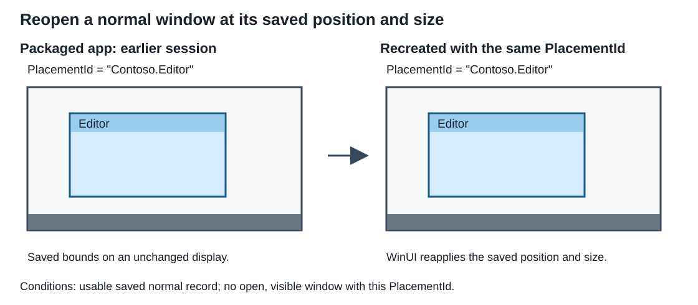

**Setup:** The packaged app has a valid saved normal placement for `Contoso.Editor`.
The bounds fit the current work area. There is no open, visible window with the same ID.
The app has not set conflicting fallback dimensions or selected another presenter.

**App code:**

```csharp
Window window = new MainWindow
{
    PlacementId = "Contoso.Editor",
};
window.Activate();
```

**Assertions:**

- **A1:** The recreated window has the saved normal outer bounds.
- **A2:** The window is normal and uses the overlapped presenter.
- **A3:** This path requires no explicit load or `ApplyInitialPlacement` call in app code.
- **A4:** The app does not need to set the experimental `AppWindow.PersistedStateId`
  property to use WinUI's `Window.PlacementId`.

**Geometry test variant:** Repeat by calling `ApplyInitialPlacement` with the same snapshot as
`CustomPlacement` and `AllowCascading = false`. Use the automatic path to cover storage
integration and the snapshot path to isolate placement application.

**Open interoperability variant:** The author describes `Window.PlacementId` and
`AppWindow.PersistedStateId` as parallel APIs. If an experimental SDK exposes the latter,
test enabling both with different saved placements only after agreeing on how the two
placement engines interact. The current scenario does not promise shared IDs, shared
storage, or precedence between them.

<a id="wp-app-multiwindow"></a>
### WP-APP-MULTIWINDOW: Recreate independent document windows

**Status:** Specified.

Your app recreates two browser or document windows and restores their content. WinUI
applies each window's saved placement when your app reuses its `PlacementId`.

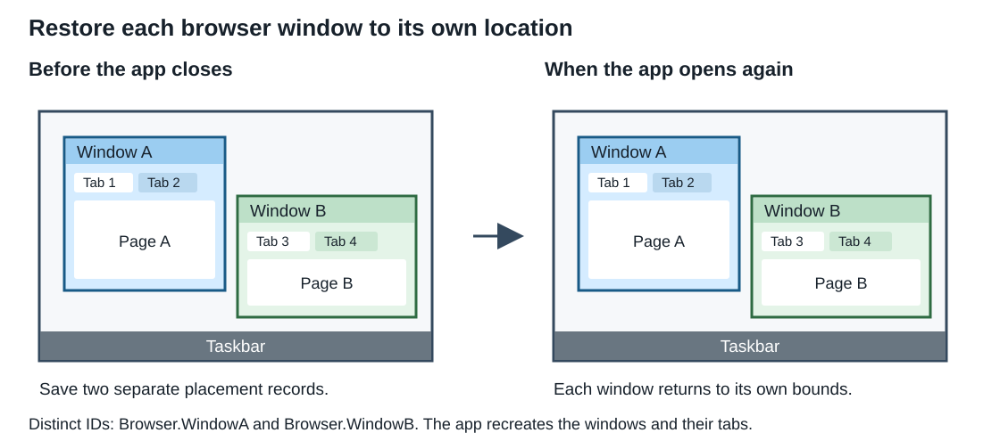

**Setup:** The packaged app's inventory contains two different IDs, each associated with a
different valid saved placement. Reuse each ID whenever the app recreates that window so
WinUI can find its saved record. Both placements fit the current display configuration.

**App code:**

```csharp
var windowA = new BrowserWindow
{
    PlacementId = "Contoso.Browser.WindowA",
};
windowA.Activate();

var windowB = new BrowserWindow
{
    PlacementId = "Contoso.Browser.WindowB",
};
windowB.Activate();
```

**Assertions:**

- **A1:** A receives A's saved placement and B receives B's.
- **A2:** Neither window cascades from the other merely because they belong to the same app.
- **A3:** The app, not WinUI placement persistence, creates the windows and restores their content.

**Customization variant:** For a restart, prepare each window with `ApplicationRestart`, then call
`Activate()` for its first presentation. Persist the identifiers with the app's inventory;
do not assign new IDs each time the session is recreated.

<a id="wp-cascade"></a>
### WP-CASCADE: Cascade additional windows

**Status:** Specified for apps with package identity. A3 is deferred. See
[placement selection](Window-placement-spec.md#42-windowapplyinitialplacement).

The user opens another window. Your app assigns it the same `PlacementId` as an existing
window. WinUI uses the existing window's current bounds and offsets the new window.

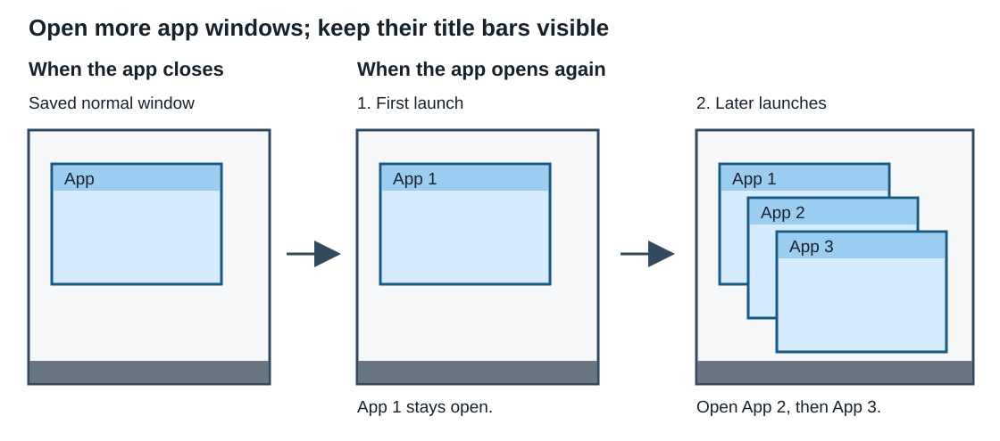

**Setup:** Run in an app with package identity. Start with no other open, visible window
using the shared ID. After showing `first`, move it before creating `second` so the result
shows whether WinUI used its current bounds. Keep `first` normal, using the overlapped
presenter, and leave enough work area
for an offset. Keep `CustomPlacement` null so a supplied snapshot does not override
cascading. The shared ID also enables automatic saving and loading. Keep the first
window's current bounds different from any saved record so A1 can distinguish cascading
from automatic loading.

**App code:**

```csharp
var first = new MainWindow
{
    PlacementId = "Contoso.Editor",
};
first.Activate();

// The user or scenario host moves the first window before creating the second.
var second = new MainWindow
{
    PlacementId = first.PlacementId,
};
second.Activate();
```

**Customization assertions:** A4 and A5 use explicit preparation with the options described
below. Those calls are not required for the automatic cascade in A1 and A2.

**Assertions:**

- **A1:** The second window uses the open, visible first window as the cascade source.
- **A2:** In this fixture, the second window's top-left position differs from the first's
  rather than placing their title bars directly on top of each other.
- **A4:** In separate variants, `AllowCascading = false`, a non-null `CustomPlacement`, or
  `Reason = ApplicationRestart` prevents this cascade path.
- **A5:** With only `AllowCascading = false` changed and a valid saved normal record
  available, the new window uses that record without a cascade offset. Keep the saved
  bounds distinct from the open window's bounds to prove which source won.

**Deferred assertion, not a current pass criterion:**

- **A3:** Cascading without package identity is outside this revision. Keep this label
  reserved for the unpackaged case; define its expected behavior when
  [unpackaged support (#12388)](https://github.com/microsoft/microsoft-ui-xaml/issues/12388)
  is designed.

**Boundary:** Do not assert an exact offset, source ordering among multiple candidates,
cross-process scope, or a universal non-overlap guarantee. This scenario does not add
eligibility rules beyond the current spec's open, visible windows.

**Open clarification:** A reviewer reported an unwanted offset that differed between UWP
launch paths. A4 and A5 cover disabling WinUI's same-ID cascading. If that report describes
a different offset, identify its triggering sequence before treating it as covered here.
`ApplicationLaunch` does not itself disable cascading.

<a id="wp-placement-sources"></a>
### WP-PLACEMENT-SOURCES: Select placement sources and handle a missing record

**Status:** Specified. See [placement selection](Window-placement-spec.md#42-windowapplyinitialplacement)
and [loading](Window-placement-spec.md#47-windowplacementinfotryloadforplacementid).

An app can request a fallback size without overriding a usable placement source. If no
record loads, it should still be able to open the window.

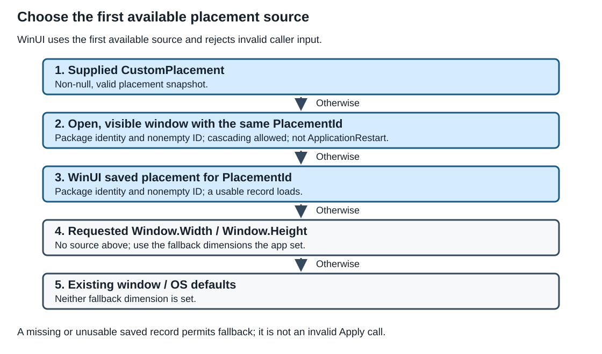

**Setup:** Run with package identity and an unchanged display configuration. Give custom,
live-cascade, and stored placements visibly different normal bounds that all fit the work
area. Use fallback dimensions that differ from all three. Run each assertion in a separate
fixture, removing higher-priority sources as described.

**App code:**

```csharp
var window = new MainWindow
{
    PlacementId = "Contoso.Editor",
    Width = 640,
    Height = 480,
};
window.Activate();
```

**Customization variants:** A1 and A7 use explicit preparation rather than only the
automatic code above. Supply `CustomPlacement` through `ApplyInitialPlacement` before
calling `Activate()`. For A1, leave cascading allowed and keep a distinguishable cascade
source available so the test proves that custom placement takes precedence.

**Test observation:** To check A4, the test calls `TryLoadForPlacementId` directly. The
automatic app code does not need to make that call.

**Assertions:**

- **A1:** In the supplied-snapshot variant, a valid non-null `CustomPlacement` wins over
  an available cascade source, stored placement, and fallback dimensions.
- **A2:** With null custom placement and cascading allowed, an open, visible same-ID
  window wins over a stored record and fallback dimensions.
- **A3:** With no cascade source, valid stored placement wins over `Width` and `Height`.
  Setting those properties before or after `PlacementId` does not change this precedence.
- **A4:** With no usable stored record, `TryLoadForPlacementId` returns null rather than an
  all-default placement object. Initial placement can continue to the requested-size path.
- **A5:** With custom, cascade, and stored sources absent, WinUI uses the requested fallback
  dimensions. Repeat with only width set and only height set, measuring the actual window
  according to those properties' sizing contract rather than just reading them back.
- **A6:** With no placement source and neither fallback dimension set, WinUI retains the
  window's existing or OS defaults.
- **A7:** Leaving `PlacementId` unset still permits explicit custom placement, but does not
  enable automatic saving or ID-based cascading. Giving the window an ID opts it into
  automatic persistence even if the app also supplies a custom snapshot.

**Variants:** For A4, cover missing records and, where the test host can arrange them,
unavailable storage, invalid stored data, and unsupported record versions. Null means no
usable placement loaded; it does not identify which of those conditions occurred.
Do not convert invalid caller-supplied placement into this fallback path:
[WP-PLACEMENT-ERRORS](#wp-placement-errors) covers that error.

**Boundary:** This scenario does not promise save timing, durability, or per-cause storage
diagnostics. It does not add an opt-out that combines a nonempty ID with custom-only storage.
Post-preparation and post-show app changes are covered separately below and in
[WP-ACTIVATE-LEGACY](#wp-activate-legacy).

<a id="wp-restore-maximized"></a>
### WP-RESTORE-MAXIMIZED: Restore maximization and normal restore bounds

**Status:** Specified.

The user closes a maximized window. Reopening should preserve its maximized state and the
normal bounds to use when the user restores it.

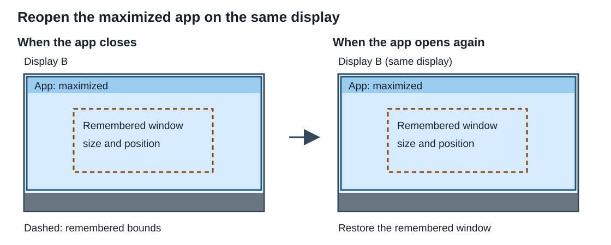

**Setup:** Establish a usable automatic record for a maximized window with valid normal
bounds. Keep the display, DPI, and work area unchanged, and do not supply launch-state
overrides.

**App code:**

```csharp
window.PlacementId = "Contoso.Editor";
window.Activate();

// Later, the user restores the maximized window.
((OverlappedPresenter)window.AppWindow.Presenter).Restore();
```

**Test observation:** To check A3, the test captures placement before and after the
restore action. The app does not need to capture placement.

**Assertions:**

- **A1:** Before the restore action, the visible window is maximized on the selected display.
- **A2:** After the restore action, the window uses the saved normal outer bounds.
- **A3:** When the app captures placement while the window is maximized, and again after
  the restore action, `NormalRect` holds the normal restore bounds, not the maximized
  visible rectangle.

<a id="wp-restore-snapped"></a>
### WP-RESTORE-SNAPPED: Restore snapped placement after a work-area change

**Status:** Baseline pending. The implementation will follow PlacementEx for snapped-bounds
adjustment and fallback; this is no longer a request to design a different snap policy.

The user closes a window snapped against the left edge. On reopening, the available work
area has changed.

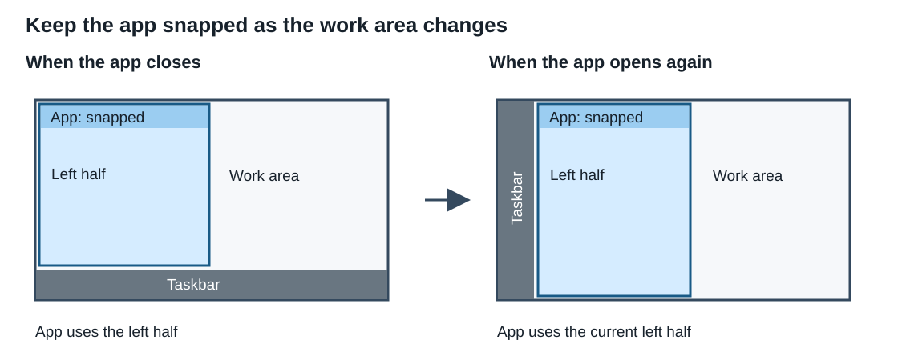

**Setup:** Establish a usable automatic record with `State = Snapped`, valid `NormalRect`,
and valid `SnapRect`. Use the same saved values in the geometry-only test variant.
Use the version of PlacementEx copied by the implementation as the reference. The diagram
illustrates the scenario, not a separate pixel-exact snap algorithm.

**App code:**

```csharp
window.PlacementId = "Contoso.Editor";
window.Activate();
```

**Customization assertion:** For A3, establish a usable automatic record with
`State = MinimizedFromSnapped` and valid `NormalRect` and `SnapRect`. Keep
`window.PlacementId` set to `"Contoso.Editor"`. Before `window.Activate()`, call
`window.ApplyInitialPlacement` with `Reason = ApplicationRestart` and leave the other
options at their defaults. WinUI loads the record by ID instead of using an app-supplied
snapshot. The automatic app code above does not need this explicit preparation call.

**Proposed assertions:**

- **A1:** The adjusted snapped bounds and resulting state match the recorded PlacementEx
  result for the same snapshot and target environment.
- **A2:** Restoring out of snap uses the adapted `NormalRect`, not `SnapRect`, as normal bounds.
- **A3:** A minimized-from-snapped variant preserves minimization when prepared for restart.

**Baseline fixtures needed:** Record expected results for unchanged and changed work areas,
DPI changes, display removal, and targets that cannot accept the saved snapping. Include
normal restore bounds and fallback state, not just a screenshot. Observe Windows' snap
state separately from matching rectangle coordinates. Do not invent a snap-to-normal rule
or a numerical tolerance independently of the PlacementEx baseline.
This scenario does not require recreating a snap group.

<a id="wp-exit-fullscreen"></a>
### WP-EXIT-FULLSCREEN: Exit in full-screen and reopen with windowed placement

**Status:** Specified with valid windowed history. See
[automatic persistence](Window-placement-spec.md#41-windowplacementid) and
[windowed placement](Window-placement-spec.md#22-how-winui-applies-window-placement-data-to-a-new-window).

The user exits the app while its window uses the full-screen presenter. On the next launch,
WinUI restores the last windowed position, size, and state. The app does not need to switch
back to the overlapped presenter before exiting.

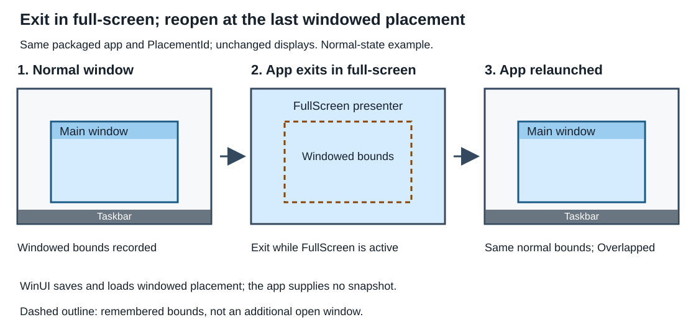

**Setup:** Run an app with package identity and one normal main window. Choose
`windowedBounds`, a `RectInt32` fully inside the current work area, smaller than the
full-screen rectangle, and different from the window's initial bounds. Record the actual
normal outer bounds after the move completes. Keep the displays and size constraints
unchanged. Let the window become visibly full-screen before invoking the app's Exit command.

Do not call `TryGetPlacement`, `CaptureRequired`, or `ApplyInitialPlacement` in the first
run, including in exit handlers. The scenario must exercise WinUI's automatic tracking and
saving, not depend on an explicit capture to establish windowed history.

**App code, first process:**

```csharp
window.PlacementId = "Contoso.FullScreenExit";
window.Activate();
window.AppWindow.MoveAndResize(windowedBounds);
window.AppWindow.SetPresenter(AppWindowPresenterKind.FullScreen);

// Later, the user invokes Exit while the full-screen presenter is still active.
Application.Current.Exit();
```

**App code, next launch:** In a new process, create a new `window` with the same
`PlacementId`. Do not select a presenter, supply `CustomPlacement`, or explicitly load
placement. Ensure no other open, visible window can supply a cascade.

```csharp
window.PlacementId = "Contoso.FullScreenExit";
window.Activate();
```

**Assertions:**

- **A1:** When the app requests exit, the window uses the full-screen presenter. App code
  has not switched it back to overlapped.
- **A2:** On the next launch, WinUI automatically restores the recorded last normal outer
  bounds, not the full-screen display rectangle or the first run's initial bounds.
- **A3:** The recreated window is normal and uses the overlapped presenter. WinUI has not
  persisted the full-screen presenter choice.
- **A4:** After the dispatcher becomes idle, the restored bounds still match A2. No app
  move or resize is needed to correct them.
- **A5:** In the maximized variant, the recreated window is maximized. Restoring it through
  `OverlappedPresenter.Restore()` returns it to the recorded normal bounds.

**Variants:** Before entering full-screen, maximize the window after establishing its
normal bounds, then check A5 instead of A3's normal-state requirement. Also repeat normal
exit by closing the last window with `Window.Close()` while it is full-screen, rather than
calling `Application.Current.Exit()`.

**Boundary:** Use the automatic record produced by the first run, not a supplied snapshot.
As in Shared sample setup, a usable automatic record is required; this scenario does not
define save timing, durability, or crash and session-ending recovery. The next launch
deliberately does not select full-screen based on an app preference. App-selected
full-screen startup is covered by [WP-APP-FULLSCREEN-RETURN](#wp-app-fullscreen-return).

<a id="wp-display-offscreen"></a>
### WP-DISPLAY-OFFSCREEN: Bring saved off-screen bounds back into view

**Status:** Specified. See [display adjustments](Window-placement-spec.md#22-how-winui-applies-window-placement-data-to-a-new-window).

The display layout changes so that the saved bounds no longer fit an available display.

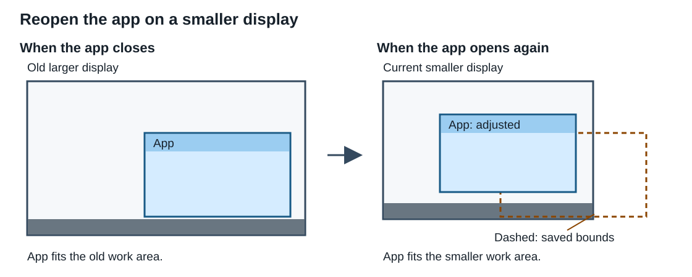

**Setup:** Establish a usable automatic record with normal bounds `(900, 500, 1000, 550)`
and a saved work area of `(0, 0, 1920, 1080)` at 96 DPI. Recreate the window when the only
display's work area is `(0, 0, 800, 600)` at 96 DPI.
The window's minimum outer size fits that work area.

**App code:**

```csharp
window.PlacementId = "Contoso.Editor";
window.Activate();
```

**Test observations:** On the automatic path, apply A2 and A3's numerical checks to the
shown window's outer bounds. Use the [geometry-only test variant](#geometry-only-test-variant)
to inspect the hidden prepared bounds and check A1 and A4.

**Assertions:**

- **A1:** After `ApplyInitialPlacement` returns, the window remains hidden and WinUI has not
  requested activation.
- **A2:** The prepared outer rectangle has positive dimensions, `X >= 0`, `Y >= 0`,
  `X + Width <= 800`, and `Y + Height <= 600`.
- **A3:** The prepared width is smaller than the saved width of 1000 physical pixels.
- **A4:** Showing the window preserves the prepared bounds.

**Boundary:** Constraint-conflict cases need separate expected results; this fixture does
not promise a complete fit when minimum size makes it impossible.

<a id="wp-display-dpi"></a>
### WP-DISPLAY-DPI: Preserve logical size after a DPI change

**Status:** Specified for the unchanged-target-DPI case. A1 needs agreement on numerical
test tolerance for a saved-to-target DPI change. The API specifies approximately preserving
DIP size; it does not specify a pixel-exact rounding rule for that change.

The window should retain approximately the same logical size, measured in DIPs, after
display scaling changes.

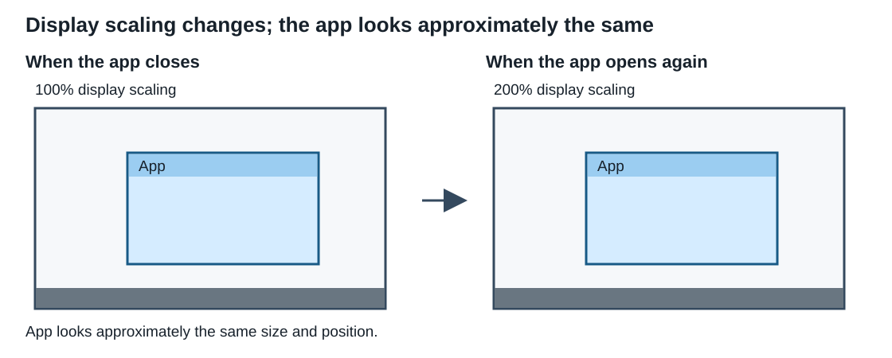

**Setup:** Establish a usable automatic record with an 800 by 600 physical-pixel normal
rectangle at 96 DPI. Recreate the window on a matched display at 192 DPI with a work area
large enough for the scaled window. No size constraint or work-area fitting should reduce
the target dimensions.

**App code:**

```csharp
window.PlacementId = "Contoso.Editor";
window.Activate();
```

**Test observations:** On the automatic path, check A1 and A2 against the shown bounds and
DPI. Check A4's shown size after the first `Activate()`, and A5 after the dispatcher becomes
idle. Use the [geometry-only test variant](#geometry-only-test-variant) for A3 and the
hidden-window part of A4.

**Assertions, with a proposed numerical tolerance for A1:**

- **A1:** In the saved-96-DPI fixture, the nominal target is 1600 by 1200 physical pixels.
  After converting the result back to DIPs, width differs from 800 DIPs by no more than
  1 DIP and height differs from 600 DIPs by no more than 1 DIP.
- **A2:** The result fits the selected display's work area in this unconstrained fixture.
- **A3:** Showing preserves the prepared target size. When the saved DPI differs from the
  target DPI, showing does not revert to the old physical size.
- **A4:** In the saved-192-DPI fixture, the prepared window is on B at 192 DPI with an
  800 by 600 physical-pixel normal outer size. Moving the fresh window from A to B does
  not add another scale change. First `Activate()` preserves that size.
- **A5:** The app needs no second `AppWindow.MoveAndResize` call or queued corrective
  resize. After the dispatcher becomes idle, the bounds still match A4 or the scaled
  target in A1, depending on the fixture.

**Mixed-DPI variant:** Keep primary display A at 96 DPI and secondary display B at 192 DPI.
Both saved records identify B and have an 800 by 600 physical-pixel normal rectangle. Give B
enough work area for either result, without fitting or size constraints.

| Fixture | Saved DPI | B's current DPI | Expected normal size on B |
| --- | --- | --- | --- |
| Intentional scaling | 96 | 192 | Nominally 1600 by 1200 physical pixels; A1's tolerance remains proposed. |
| Already saved at target DPI | 192 | 192 | 800 by 600 physical pixels; moving from A must not double it. |

Verify that the newly created window starts on A at 96 DPI. On the automatic path, measure
physical bounds and native window DPI after the first `Activate()` and after the dispatcher
becomes idle. Also run the [geometry-only test variant](#geometry-only-test-variant) to
observe the hidden result immediately after Apply and compare it with first presentation.
Advance the dispatcher to observe
pending work, not to perform a corrective move or resize. Do not infer success from the
saved snapshot's values or only a final screenshot.

The second fixture isolates the reviewer's unwanted scaling problem: the saved and target
DPIs already agree, even though the fresh window starts at a different DPI. A raw AppWindow
experiment can reproduce the platform behavior separately; its double-move workaround
must not become a requirement for using WinUI placement.

**Decision needed:** The 1 DIP threshold is a proposed test tolerance, not an existing API
guarantee. Agree on it before making A1 a pass criterion. Do not infer a position-scaling
formula or physical-pixel dimensions from the diagram.

<a id="wp-display-workarea"></a>
### WP-DISPLAY-WORKAREA: Avoid a changed taskbar or reserved area

**Status:** Specified.

The taskbar or another reserved area moves into space previously occupied by the window.

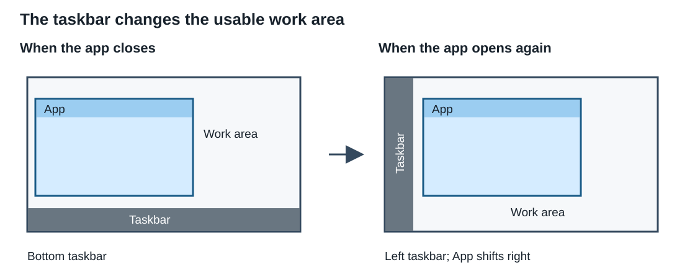

**Setup:** Keep the display and DPI unchanged. Establish a usable automatic record with
normal bounds against the old work area. Change the work area so the saved window would
overlap its new left edge, while leaving enough room for the window.

**App code:**

```csharp
window.PlacementId = "Contoso.Editor";
window.Activate();
```

**Test observations:** Check A1 and A2 on the automatic path. Check A3's hidden-window
behavior with the [geometry-only test variant](#geometry-only-test-variant).

**Assertions:**

- **A1:** The resulting normal outer bounds lie inside the current work area, not the saved one.
- **A2:** The window does not occupy the newly reserved strip in this fixture.
- **A3:** The window remains hidden while WinUI prepares the adjusted bounds.

**Variants:** Use a reserved-area fixture when the OS does not support moving the taskbar.
This tests changed work-area geometry, not a requirement that every OS expose the same
taskbar settings.

<a id="wp-display-rearranged"></a>
### WP-DISPLAY-REARRANGED: Follow a matched display after rearrangement

**Status:** Specified.

The user moves display B from the right of display A to its left, then reopens the app.
Your app recreates the window, and WinUI matches its saved display name to B.

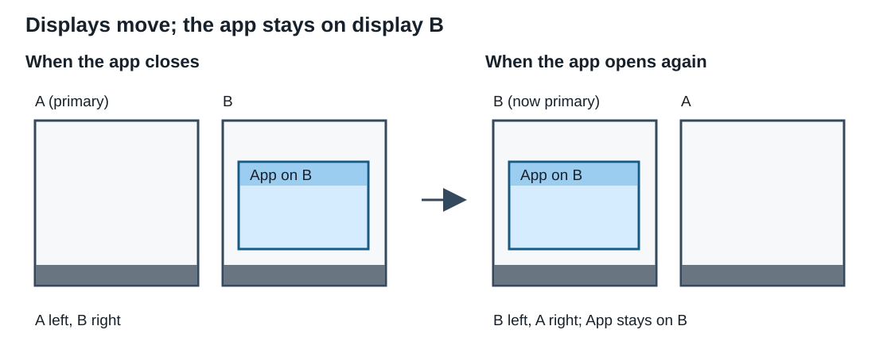

**Setup:** Establish a usable automatic record whose saved `DisplayDeviceName` still
matches B. Its work area can fit the window.
No launch hint or cascade source overrides saved placement.

**App code:**

```csharp
window.PlacementId = "Contoso.Editor";
window.Activate();
```

**Assertions:**

- **A1:** The resulting window is placed on matched display B, even if A is primary.
- **A2:** WinUI adapts the normal bounds to B's current work area rather than leaving them
  at B's old screen coordinates.
- **A3:** WinUI accepts negative screen coordinates on B; it does not treat the primary
  display's origin as the limit of valid screen coordinates.
- **A4:** When the user switches which display is primary and the saved GDI display name
  still matches the original display, the window follows that match. It does not remain
  in the old primary display's `(0, 0)` region merely because those coordinates are valid.
- **A5:** In the equal-size, equal-DPI work-area-offset fixture below, the resulting normal
  position is `(80, 100)`, not the old absolute screen position `(2000, 100)`.

**Variants:** For A4, save placement on primary display A, make B primary, and move A to
negative screen coordinates. Verify the saved name still matches A before judging the
result. This does not turn a GDI name into a permanent hardware ID.

For A5, save `NormalRect = (2000, 100, 600, 400)` relative to
`WorkArea = (1920, 0, 1920, 1080)`. Move the matched display's work area to
`(0, 0, 1920, 1080)` without changing DPI. The saved work area establishes the old
`(80, 100)` offset; reading only the new work area would lose that information.

**Boundary:** A GDI display name is not a permanent physical-device ID, so this scenario
does not guarantee that WinUI recognizes the hardware.
[WP-DISPLAY-REMOVED](#wp-display-removed) covers a stale or unmatched name.

<a id="wp-display-identity"></a>
### WP-DISPLAY-IDENTITY: Assess display-name matching across docking and adapter changes

**Status:** Specified for logical-name matching and coordinate fallback. The proposal does
not promise that a GDI display name identifies the same physical monitor across changes.

The app wants its window to return to a useful display after docking, changing an adapter,
or switching which display is primary. This scenario tests when saving a display name helps
and when that name stops identifying the hardware the user expects.

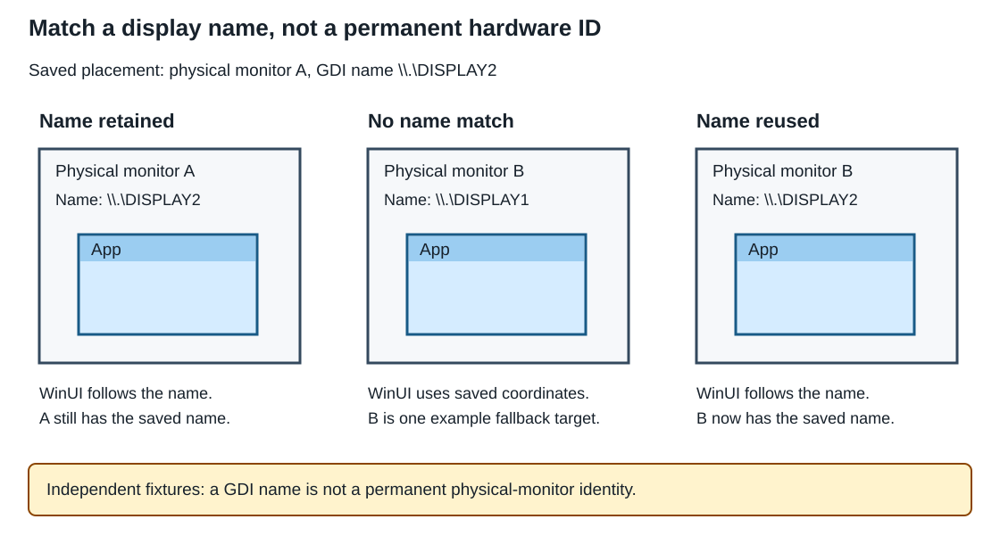

**Setup:** Independently record which physical display uses each GDI display name before
and after the change. Use real docking, adapter, and connection changes to establish the
fixtures; do not assume that a name always changes or always stays the same. Keep saved
bounds normal, unconstrained, and small enough to fit. Use extended displays with
non-overlapping bounds. Exclude launch hints and cascading.
Establish usable automatic records before changing the display configuration.

Run a retained-name fixture, an unmatched-name fixture, and, where the environment produces
one, a fixture where an old name now belongs to a different physical display. Record
unavailable fixtures as not exercised, not as passing.

**App code:**

```csharp
window.PlacementId = "Contoso.Editor";
window.Activate();
```

**Assertions:**

- **A1:** When the saved name still matches the original display, WinUI follows that match
  even if switching the primary display makes the old screen coordinates refer to another
  display. Use [WP-DISPLAY-REARRANGED.A4](#wp-display-rearranged) for that comparison.
- **A2:** With no current name match, or with an empty saved name, WinUI uses the specified
  coordinate-based fallback, not an assumed physical-monitor identity. Exercise both
  intersection and nearest-display cases from [WP-DISPLAY-REMOVED](#wp-display-removed).
- **A3:** If a saved GDI name now matches a different physical display, judge matching
  against the current GDI-name assignment. Do not claim that WinUI recognized the old
  hardware; record the resulting display as a limitation of name-based matching.
- **A4:** In the coordinate-fallback fixture, a saved normal rectangle fully inside an
  unchanged primary work area remains on the primary display. It does not move merely
  because another display or adapter changed.

**Evaluation:** Compare the name-based result with the coordinate-only fallback result
for the same layout. Record cases where following a name helps, such as primary-display
swaps, and cases where adapter changes or name reuse make it less useful. This evaluates
the reviewer's concern; it does not add a permanent hardware ID, per-layout history, or a
new matching policy. App-customized fallback remains
[#12389](https://github.com/microsoft/microsoft-ui-xaml/issues/12389).

<a id="wp-display-removed"></a>
### WP-DISPLAY-REMOVED: Select an available display after removal

**Status:** Specified.

The saved display is disconnected before the app recreates the window.

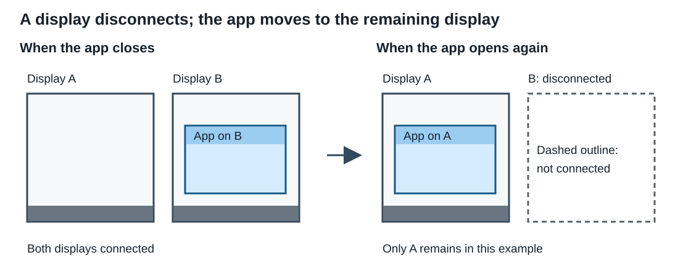

**Setup:** Establish a usable automatic record whose saved display name has no current
match. Run one fixture where exactly one connected
display has the largest positive intersection with `NormalRect`, and another where no
display intersects it and exactly one is nearest. Avoid ties in these fixtures.

**App code:**

```csharp
window.PlacementId = "Contoso.Editor";
window.Activate();
```

**Assertions:**

- **A1:** In the intersection fixture, WinUI selects the connected display with the largest
  intersection.
- **A2:** In the no-intersection fixture, WinUI selects the nearest connected display.
- **A3:** The resulting normal bounds fit the selected work area when size constraints allow.
- **A4:** The selected display need not be the primary display.

**Boundary:** These are initial-placement tests. They do not require WinUI to remember a
history for every monitor layout or move a running window when a display reconnects.
Choosing the cursor's display, always choosing the primary display, and other app-defined
fallback policies are deferred to [#12389](https://github.com/microsoft/microsoft-ui-xaml/issues/12389).

**Office/home variant:** Replace the saved display with a different display occupying the
same screen region, and verify that the saved GDI name has no current match. The default
intersection/nearest policy may select that region rather than the laptop's primary
display. Do not require a separate saved record for each monitor layout.

## Placement customization

Your app can choose launch or restart behavior, supply placement, or adjust a window
before showing it. These examples also show how to choose a presenter and arrange windows,
toolbars, and text cells. WinUI still applies and adapts placement; your app chooses the
additional behavior.

These choices are not automatic consequences of setting `PlacementId`. The examples use
the namespaces, app-defined window classes, and test helpers in
[Shared sample setup](#shared-sample-setup).

The launch and restart examples explicitly set a placement reason. `ApplicationLaunch`
honors Windows' startup show request, including minimization. `ApplicationRestart` keeps
minimized windows minimized and shows windows without requesting activation. WinUI retains
these decisions after `ApplyInitialPlacement` returns.

Once the window has been shown, later `Activate()` calls use the existing behavior:
restore the window if minimized and request activation. Showing it minimized counts as
its first presentation. Windows that have not enabled placement also keep existing
activation behavior. See [Window.Activate](Window-placement-spec.md#43-windowactivate).

For restart scenarios, the app detects the restart, loads its window inventory and content, and creates the
windows. Setting a placement reason does not register the app for restart or recreate its
documents. See the API spec's [restart example](Window-placement-spec.md#34-recreate-windows-after-an-app-or-system-restart).

The restart scenarios isolate applying an existing snapshot from registration and
automatic save timing. An end-to-end restart test also exercises the app's registration,
inventory, and recreation code. Tests that use supplied snapshots do not demonstrate
custom-storage save hooks. The packaged automatic path can load placement by
`PlacementId`; the app still records which windows and documents to recreate.

<a id="wp-launch-display"></a>
### WP-LAUNCH-DISPLAY: Use the display associated with process launch

**Status:** Specified. See [launch context](Window-placement-spec.md#49-windowplacementreason).

The user starts a new process from the taskbar on A, although the saved window was on B.

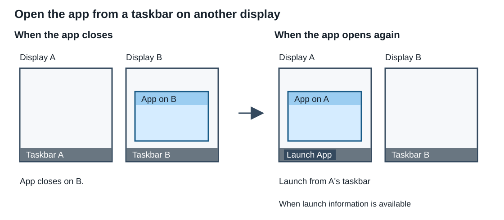

**Setup:** Start a new process with a valid OS launch-display hint for A. A saved record
exists on B. There is no cascade source or custom placement, and both displays can fit
the window.

**App code:**

```csharp
var window = new MainWindow
{
    PlacementId = "Contoso.Editor",
};
window.ApplyInitialPlacement(new WindowInitialPlacementOptions
{
    Reason = WindowPlacementReason.ApplicationLaunch,
    AllowCascading = false,
});
window.Activate();
```

**Assertions:**

- **A1:** WinUI uses Windows' launch-display hint to place the window on A rather than its
  saved display B.
- **A2:** WinUI does not show the window or request activation during `ApplyInitialPlacement`.
- **A3:** With no usable launch hint, the ordinary saved-display selection remains available.

**Boundary:** The hint describes the process's original launch. This test does not assume
that a later activation redirected to an existing process updates that hint. Precedence
between launch hints and explicit custom placement remains a separate review question.

<a id="wp-launch-state"></a>
### WP-LAUNCH-STATE: Honor a request to start minimized or maximized

**Status:** Specified for the conflict-free cases below.

Your app can honor a Windows request to start a window minimized or maximized instead of
using its saved normal state. Call `ApplyInitialPlacement` with
`Reason = ApplicationLaunch`, then call `Activate()`. WinUI honors the requested launch
state in the conflict-free cases below.

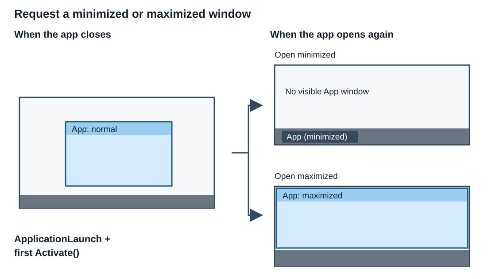

**Setup:** Run two tests, each in a new process with a valid Windows request: minimized in
one test, maximized in the other. The saved placement is normal, and no custom placement
or cascade source competes with it.

**App code:**

```csharp
var window = new MainWindow
{
    PlacementId = "Contoso.Editor",
};
window.ApplyInitialPlacement(new WindowInitialPlacementOptions
{
    Reason = WindowPlacementReason.ApplicationLaunch,
    AllowCascading = false,
});
window.Activate();
```

**Assertions:**

- **A1:** In the minimized-launch fixture, the window remains minimized after its first
  `Activate()`.
- **A2:** In the maximized-launch fixture, the window is maximized after its first `Activate()`.
- **A3:** Preparation itself does not show the window or request activation.
- **A4:** A second `Activate()` on the minimized window restores it and requests activation,
  rather than reusing the startup show request.

**Boundary:** Check A1 before calling `Activate()` a second time for A4. The launch show
request applies only to the first presentation. Conflicts with custom placement or other
requested states need an agreed precedence rule before adding assertions for them.

<a id="wp-restart-desktop"></a>
### WP-RESTART-DESKTOP: Return to a saved virtual desktop

**Status:** Specified, with a best-effort virtual-desktop move.

The app's window was on desktop 1, while the user is now working on desktop 2.

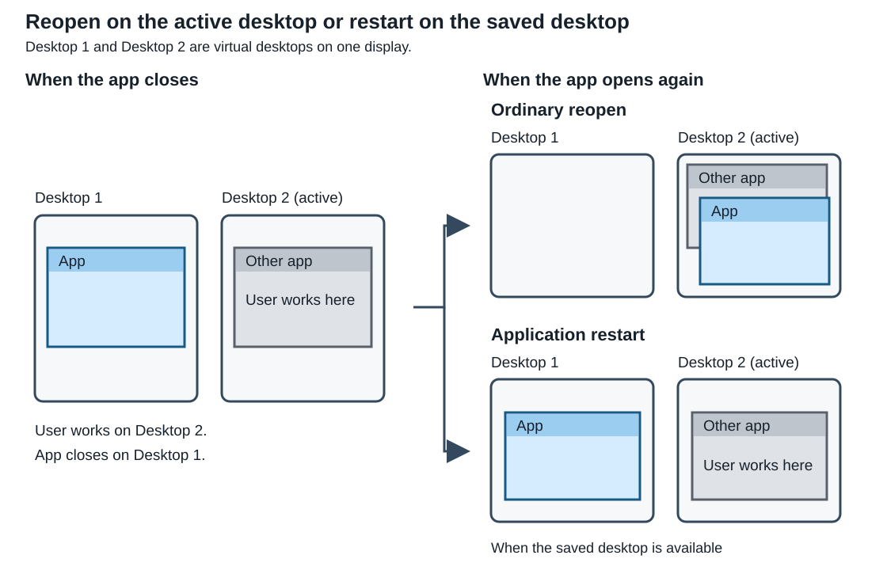

**Setup:** Supply a valid snapshot whose `VirtualDesktopId` identifies desktop 1. Desktop 2
is active. Run a successful-move fixture only where that destination exists and Windows
permits the move.

**App code:**

```csharp
window.ApplyInitialPlacement(new WindowInitialPlacementOptions
{
    CustomPlacement = savedPlacement,
    Reason = WindowPlacementReason.ApplicationRestart,
    AllowCascading = false,
});
window.Activate();
```

**Assertions:**

- **A1:** When the virtual-desktop move succeeds, the recreated window belongs to desktop 1.
- **A2:** The user's active desktop remains desktop 2 throughout preparation and showing.
- **A3:** The sequence does not request activation.
- **A4:** In `Default` and `ApplicationLaunch` variants, the saved virtual-desktop ID is not
  used to return the window to desktop 1.

**Open variant:** Fallback and error behavior for missing desktops, stale IDs, and denied
moves remain undecided. Agree on those outcomes before using them as pass/fail criteria.

<a id="wp-restart-minimized"></a>
### WP-RESTART-MINIMIZED: Keep restarted windows minimized

**Status:** Specified.

A window that was minimized stays minimized when the app recreates it after a restart.

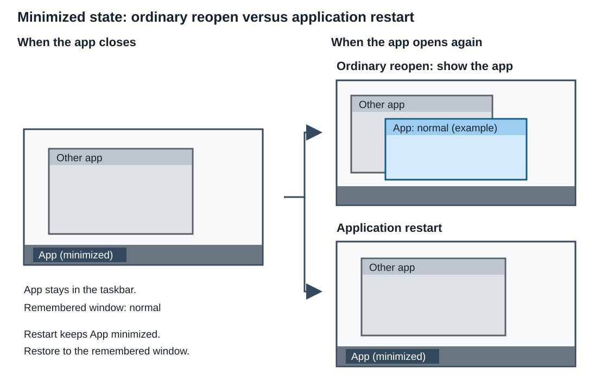

**Setup:** Run snapshots with `Minimized`, `MinimizedFromMaximized`, and
`MinimizedFromSnapped`. For the snapped variant, use a target where the saved snapping
can be applied; unsupported-snap fallback is tracked by `WP-RESTORE-SNAPPED`.

**App code:**

```csharp
window.ApplyInitialPlacement(new WindowInitialPlacementOptions
{
    CustomPlacement = savedPlacement,
    Reason = WindowPlacementReason.ApplicationRestart,
    AllowCascading = false,
});
window.Activate();
```

For comparison, run this snippet in a separate fixture with a new, unshown `window` and
the same snapshot. Omitting the reason uses `Default`; its first `Activate()` restores
the window from minimization:

```csharp
window.ApplyInitialPlacement(new WindowInitialPlacementOptions
{
    CustomPlacement = savedPlacement,
    AllowCascading = false,
});
window.Activate();
```

For A4, use a separate automatic-loading test with another open, visible window sharing
the ID. Set `Reason = ApplicationRestart`, leave `CustomPlacement` null, and leave
`AllowCascading` at its default of `true`. Supplying a custom snapshot or disabling
cascading would hide whether the restart reason prevents cascading.

**Assertions:**

- **A1:** After the app first calls `Activate()` in the restart sequence, the recreated
  window remains minimized.
- **A2:** Restoring it later returns to the recorded normal, maximized, or supported snapped state.
- **A3:** The comparison path using `Activate()` is not left minimized.
- **A4:** The restart path does not cascade, even if another open, visible window has the same ID.
- **A5:** Calling `window.Activate()` again in the restart fixture restores the window
  and requests activation. It does not reuse restart behavior or apply placement again.

**Boundary:** Check A1 before restoring the window. Test A2 and A5 in separate runs so A5
calls `Activate()` while the window is still minimized. The restart reason affects only
the first presentation, including when that presentation leaves the window minimized.

<a id="wp-restart-activation"></a>
### WP-RESTART-ACTIVATION: Recreate windows without requesting activation

**Status:** Specified.

The app restores its windows while the user continues working in another app.

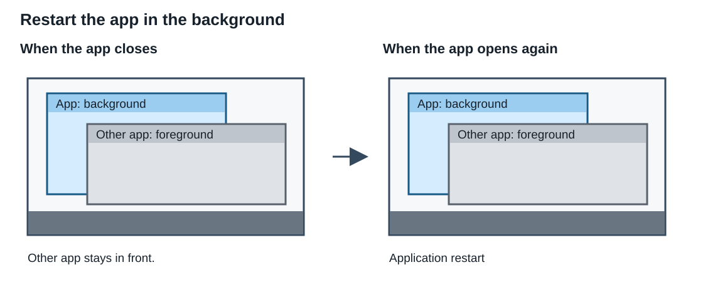

**Setup:** Another app has the foreground window. Provide new, unshown `windowA` and
`windowB` with distinct snapshots. Record foreground and activation observations
throughout recreation.

**App code:**

```csharp
windowA.ApplyInitialPlacement(new WindowInitialPlacementOptions
{
    CustomPlacement = placementA,
    Reason = WindowPlacementReason.ApplicationRestart,
    AllowCascading = false,
});
windowA.Activate();

windowB.ApplyInitialPlacement(new WindowInitialPlacementOptions
{
    CustomPlacement = placementB,
    Reason = WindowPlacementReason.ApplicationRestart,
    AllowCascading = false,
});
windowB.Activate();
```

**Assertions:**

- **A1:** Neither preparation call requests activation.
- **A2:** Neither window's first `Activate()` requests activation.
- **A3:** In the controlled fixture, the other app retains the foreground window and focus.
- **A4:** Both recreated windows remain alive until closed, even without an activation request.

**Boundary:** Monitor the whole sequence, not just the final foreground window.
`ApplicationRestart` does not suppress activation on later `Activate()` calls after the
window has first been shown.

<a id="wp-restore-windowed"></a>
### WP-RESTORE-WINDOWED: Reopen using the last windowed placement

**Status:** Specified when valid windowed history exists. A4 needs a reproducible fixture
and review of the nullable capture contract. See
[capture](Window-placement-spec.md#44-windowtrygetplacement).

Your app can reopen a window at its last windowed position, size, and state rather than
re-entering full-screen or compact-overlay mode. Your app controls those modes separately;
WinUI applies the saved windowed placement.

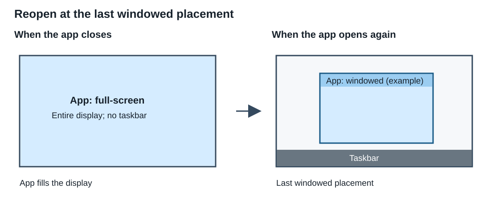

**Setup:** Begin with `existingWindow`, an open normal window with valid windowed placement
that `CaptureRequired` can capture. The code captures `before`, switches to full-screen,
captures `savedPlacement`, and closes `existingWindow` before applying the snapshot to
the new, hidden `window`.
Do not move or resize the window between captures, so the comparison isolates which bounds
and state WinUI captures.

**App code:**

```csharp
WindowPlacementInfo before = CaptureRequired(existingWindow);
existingWindow.AppWindow.SetPresenter(AppWindowPresenterKind.FullScreen);
WindowPlacementInfo savedPlacement = CaptureRequired(existingWindow);
existingWindow.Close();

window.ApplyInitialPlacement(new WindowInitialPlacementOptions
{
    CustomPlacement = savedPlacement,
    AllowCascading = false,
});
window.Activate();
```

**Assertions:**

- **A1:** Capturing in full-screen returns the last valid windowed bounds and state, not
  the full-screen display rectangle.
- **A2:** The recreated window uses the overlapped presenter unless app code selects another.
- **A3:** With unchanged display configuration, the recreated normal bounds match `before`.

**Open assertion, not a current pass criterion:**

- **A4:** The spec says capture returns null in full-screen or compact-overlay when no
  valid windowed snapshot exists. First establish that an app can reach this condition.
  Selecting full-screen immediately after creating a window is not a proven fixture:
  WinUI might capture the hidden overlapped placement before changing presenter.

**Fixture decision needed:** Either identify a supported sequence that reaches the A4
condition or revisit the nullable live-capture contract. Use `TryGetPlacement` directly
when checking a null result; `CaptureRequired` deliberately throws in that case.

**Variants:** Repeat the capture path with `CompactOverlay`. Initial preparation selects
the overlapped presenter if needed. To show another presenter, select it after
`ApplyInitialPlacement` and before the first `Activate()`.

For automatic saving and loading across an app exit in full-screen, see
[WP-EXIT-FULLSCREEN](#wp-exit-fullscreen). The capture path above does not test that integration.

<a id="wp-app-fullscreen-return"></a>
### WP-APP-FULLSCREEN-RETURN: Open full-screen and return to maximized placement

**Status:** Specified. See [full-screen startup](Window-placement-spec.md#35-start-a-new-window-in-full-screen-mode).

The last windowed state was maximized on B. Your app opens full-screen, then switches back
to `Overlapped` to return to maximized. A later `Restore()` call returns the window to its
saved normal bounds.

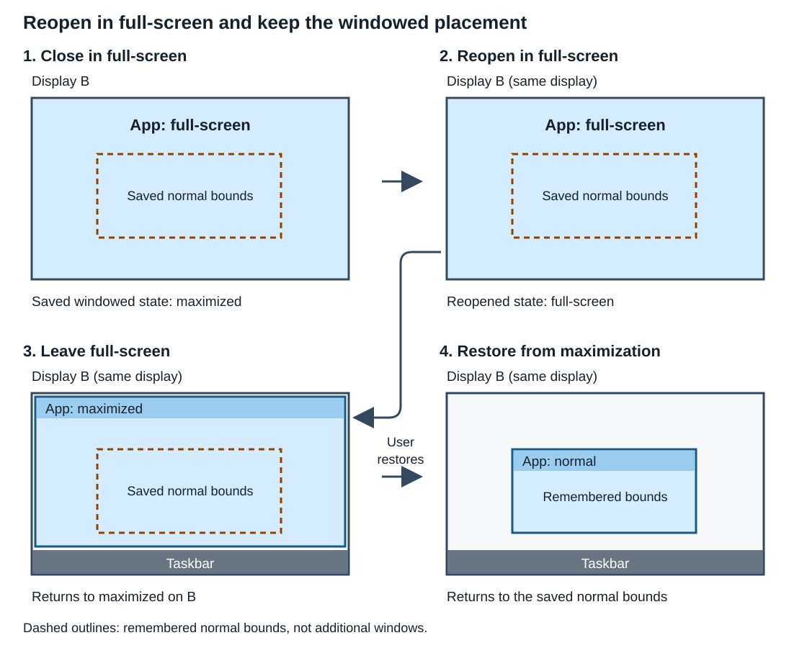

**Setup:** Supply a maximized windowed snapshot on matched display B, with valid normal
restore bounds. Keep the display configuration unchanged.

**App code:**

```csharp
window.ApplyInitialPlacement(new WindowInitialPlacementOptions
{
    CustomPlacement = savedPlacement,
    AllowCascading = false,
});
window.AppWindow.SetPresenter(AppWindowPresenterKind.FullScreen);
window.Activate();

// Later, the user leaves full-screen and then restores the maximized window.
window.AppWindow.SetPresenter(AppWindowPresenterKind.Overlapped);
((OverlappedPresenter)window.AppWindow.Presenter).Restore();
```

**Assertions:**

- **A1:** `ApplyInitialPlacement` prepares the maximized state and normal restore bounds
  while the window remains hidden.
- **A2:** The first shown presenter is full-screen on the prepared display B.
- **A3:** After switching back to overlapped, but before the restore action, the window is
  maximized on B.
- **A4:** After restoring from maximized, the window uses the remembered normal bounds.

**Boundary:** The app selects full-screen; placement persistence does not save that
presenter choice. The diagram omits transient rendering and is not a flash-free presenter
transition guarantee.

<a id="wp-app-center-workarea"></a>
### WP-APP-CENTER-WORKAREA: Center a window in its last-used display's work area using AppWindow APIs

**Status:** Specified. See the API spec's
[centering example](Window-placement-spec.md#33-center-a-window-in-the-work-area-of-its-last-used-display-using-appwindow-apis).

The app lets WinUI select the saved display and adapt the window's size, then centers a
normal window in that display's current work area before showing it.

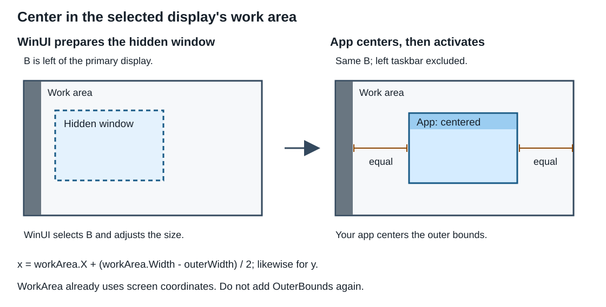

**Setup:** Supply a valid snapshot from display B, with `DisplayDeviceName` still matching
B. Run variants with B to the right of, left of, and above the primary display. Include
nonzero and negative screen origins and a reserved strip at the top or left of the work
area. B's work area can fit the prepared window, and no size constraint prevents centering.
The snapshot may start maximized or snapped; the app changes its state to normal.

For the assertions, obtain B's expected work-area rectangle independently through Win32
`GetMonitorInfo` in the same DPI-awareness context as the app window. Its `rcWork` uses
virtual-screen coordinates. Do not derive the expected origin from the same
`DisplayArea.WorkArea` expression used by the sample.

**App code:**

```csharp
savedPlacement.State = WindowPlacementState.Normal;
window.ApplyInitialPlacement(new WindowInitialPlacementOptions
{
    CustomPlacement = savedPlacement,
    AllowCascading = false,
});

AppWindow appWindow = window.AppWindow;
DisplayArea display = DisplayArea.GetFromWindowId(appWindow.Id, DisplayAreaFallback.Nearest)
    ?? throw new InvalidOperationException("Cannot find the prepared window's display.");
RectInt32 workArea = display.WorkArea;
SizeInt32 size = appWindow.Size;

appWindow.Move(new PointInt32(
    workArea.X + (workArea.Width - size.Width) / 2,
    workArea.Y + (workArea.Height - size.Height) / 2));

window.Activate();
```

**Assertions:**

- **A1:** Before `Activate()`, the prepared window is normal, remains hidden, and is on B.
  Neither preparation nor the app's move requests activation.
- **A2:** Its outer top-left is the expected screen work-area origin plus half the
  difference between work-area size and prepared outer size, using integer division on
  each axis.
- **A3:** Showing the window preserves the centered position and prepared size.
- **A4:** Nonzero and negative display-origin variants satisfy A2 without omitting the
  display offset or adding it twice.

**Boundary:** `DisplayArea.WorkArea` already includes its virtual-screen origin. Do not add
`DisplayArea.OuterBounds.X/Y` to it. Center the outer bounds, not just the client area.
Repeat with placement loaded through `TryLoadForPlacementId` in a packaged app to cover
the main spec's automatic-store example; supplying a snapshot here isolates the geometry.

<a id="wp-app-toolbar"></a>
### WP-APP-TOOLBAR: Position a toolbar beside the restored main window

**Status:** Specified as app-managed layout.

After restoring the main window, the app positions a separate toolbar beside the main
window's actual, adjusted bounds rather than restoring the toolbar to an unrelated saved
position.

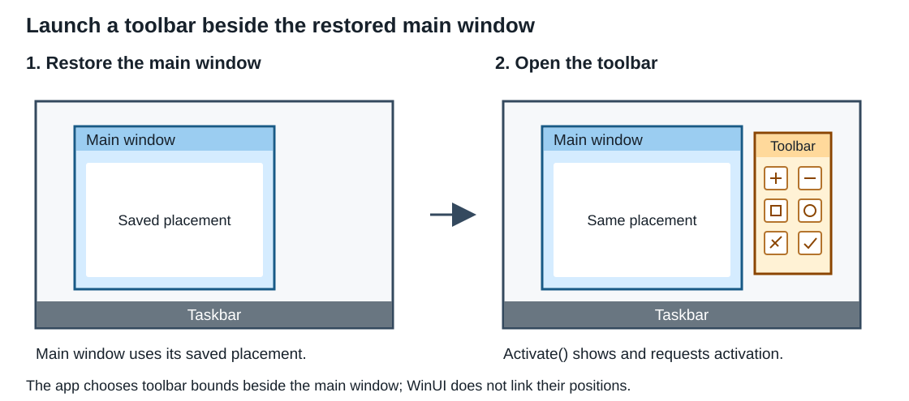

**Setup:** The restored main window is normal and fits one display. There is enough room
to its right for a 160 by 400 physical-pixel toolbar and an 8-physical-pixel gap, all within
that display's work area.

**App code:**

```csharp
var mainWindow = new MainWindow
{
    PlacementId = "Contoso.Editor",
};
mainWindow.Activate();
WindowPlacementInfo mainPlacement = CaptureRequired(mainWindow);

PointInt32 position = mainWindow.AppWindow.Position;
SizeInt32 size = mainWindow.AppWindow.Size;
var toolbarBounds = new RectInt32(position.X + size.Width + 8, position.Y, 160, 400);

var toolbar = new ToolbarWindow();
toolbar.ApplyInitialPlacement(new WindowInitialPlacementOptions
{
    CustomPlacement = new WindowPlacementInfo
    {
        NormalRect = toolbarBounds,
        WorkArea = mainPlacement.WorkArea,
        Dpi = mainPlacement.Dpi,
        State = WindowPlacementState.Normal,
        DisplayDeviceName = mainPlacement.DisplayDeviceName,
    },
    AllowCascading = false,
});
toolbar.Activate();
```

**Assertions:**

- **A1:** The app calculates the toolbar's bounds from the main window's current `AppWindow`
  bounds after WinUI applies the main window's placement.
- **A2:** The toolbar's top aligns with the main window's top, with an 8-physical-pixel
  horizontal gap in this fixture.
- **A3:** Showing the toolbar does not replace the supplied bounds with saved or cascaded bounds.
- **A4:** Preparing the toolbar does not request activation. `toolbar.Activate()` shows it
  and requests activation.

**App responsibility:** Choose another layout when there is not enough room, or when the
main window is maximized or snapped. This sequence does not establish ownership, link
window lifetimes, or keep the toolbar following the main window after launch. It does not
provide a non-activating toolbar show operation.

**Open variant:** A toolbar that must not request activation needs a separate first-show
sequence. `AppWindow.Show(false)` is a candidate, but this catalog does not yet establish
its WinUI first-show initialization and lifetime behavior. Do not use
`Reason = ApplicationRestart` merely as a generic activation switch; it also changes
cascading, minimization, launch hints, and virtual-desktop handling.

<a id="wp-app-terminal"></a>
### WP-APP-TERMINAL: Fit a terminal window to whole text cells

**Status:** Specified as app-managed sizing.

The app uses WinUI's placement result, then adjusts the client size to whole text cells
before first showing the window.

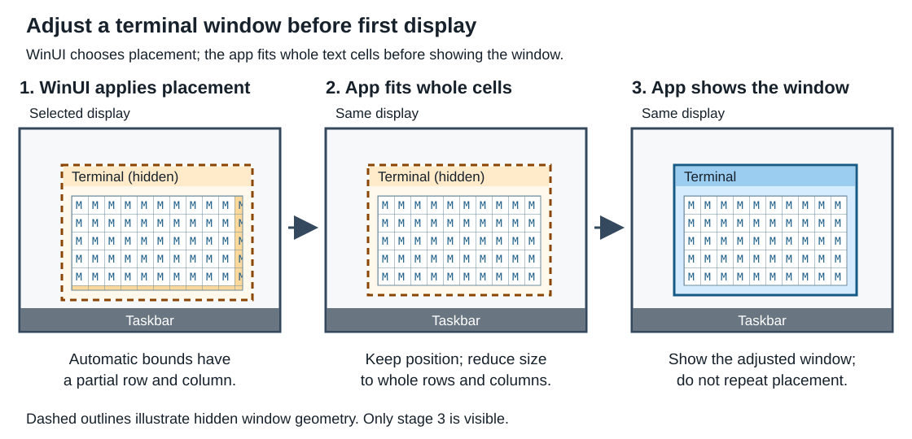

**Setup:** Initial placement produces a normal window using the overlapped presenter.
No minimum-size constraint prevents the small reduction. Implement
`MeasureTextCellInPixels(window)` in your app to return the current font's cell width and
height in physical pixels at the prepared window's actual DPI, not its saved DPI.
Make the helper return positive integer cell dimensions, and make sure the client area
fits at least one cell.

**App code:**

```csharp
var window = new TerminalWindow
{
    PlacementId = "Contoso.Terminal",
};
window.ApplyInitialPlacement(new WindowInitialPlacementOptions
{
    Reason = WindowPlacementReason.ApplicationLaunch,
    AllowCascading = false,
});

if (window.AppWindow.Presenter is OverlappedPresenter &&
    CaptureRequired(window).State == WindowPlacementState.Normal)
{
    SizeInt32 client = window.AppWindow.ClientSize;
    SizeInt32 cell = MeasureTextCellInPixels(window);
    if (cell.Width <= 0 || cell.Height <= 0 ||
        client.Width < cell.Width || client.Height < cell.Height)
    {
        throw new InvalidOperationException("The scenario requires at least one valid text cell.");
    }

    window.AppWindow.ResizeClient(new SizeInt32(
        client.Width / cell.Width * cell.Width,
        client.Height / cell.Height * cell.Height));
}

window.Activate();
```

**Assertions:**

- **A1:** Before `Activate()`, placement preparation and the app's resize leave the window hidden.
- **A2:** The resulting client width and height are positive integer multiples of the
  measured cell width and height.
- **A3:** The client width shrinks by less than one cell width, or not at all. The client
  height shrinks by less than one cell height, or not at all.
- **A4:** The app's resize preserves the prepared display and outer top-left position.
- **A5:** Showing the window preserves the adjusted client size rather than applying
  placement or fallback sizing again.

**Variants:** When placement produces maximized or snapped state, the app should not
force this normal-window resize. Test that the guard skips the resize and the window keeps
its prepared state. Check the placement's `State`. The presenter's `Restored` state covers
both normal and snapped windows, so it alone cannot tell them apart. The app owns font,
row, and column settings; placement does not persist them.

<a id="wp-app-zorder"></a>
### WP-APP-ZORDER: Restore app window stacking order after a system reboot

**Status:** Specified as app-managed ordering.

After Windows reboots and restarts the app, the app recreates two overlapping windows and
restores their relative stacking order, placing B below A. WinUI placement does not save
or restore that order automatically.

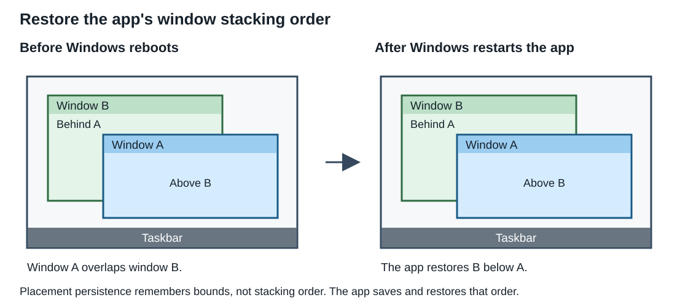

**Setup:** The scenario host supplies new, unshown `windowA` and `windowB` and their normal
placement snapshots. The app's inventory records which windows to recreate and that A was
above B. Another app retains the foreground window throughout the sequence. This fixture
does not show how to save the placement snapshots to custom storage.

**App code:**

```csharp
windowA.ApplyInitialPlacement(new WindowInitialPlacementOptions
{
    CustomPlacement = placementA,
    Reason = WindowPlacementReason.ApplicationRestart,
    AllowCascading = false,
});
windowA.Activate();

windowB.ApplyInitialPlacement(new WindowInitialPlacementOptions
{
    CustomPlacement = placementB,
    Reason = WindowPlacementReason.ApplicationRestart,
    AllowCascading = false,
});
windowB.Activate();

windowB.AppWindow.MoveInZOrderBelow(windowA.AppWindow.Id);
```

**Assertions:**

- **A1:** Each window receives its own placement before the app adjusts Z-order.
- **A2:** After `MoveInZOrderBelow`, B is below A in their relative Z-order.
- **A3:** The sequence does not request activation or restore a minimized window.
- **A4:** Capturing placement does not substitute for the app recording its own ordering.
- **A5:** In the reboot variant, the app reloads the saved relative order, maps its stable
  window identifiers to the newly created windows, and restores that order after creating
  the windows. It does not reuse pre-reboot `WindowId` values or native window handles.

**Reboot variant:** Before reboot, establish valid WinUI placement records in a packaged
app and an app-owned inventory containing the window identifiers and relative order.
After Windows relaunches the app, recreate each window with its saved `PlacementId`,
apply `Reason = ApplicationRestart` with null `CustomPlacement`, and call `Activate()`.
Then reorder the recreated windows using their new `AppWindow.Id` values. Unlike the
snapshot fixture above, this covers automatic placement loading across a real reboot
without requiring custom placement storage.

Keep the compared windows on the same virtual desktop. Repeat with a minimized window
to check that ordering does not restore it. The app must arrange restart registration,
inventory persistence, and restart detection; setting the placement reason does none of
those things.

**Boundary:** `MoveInZOrderBelow` takes a `WindowId`, not an `AppWindow`.
`WindowPlacementInfo` does not contain Z-order. This scenario does not restore other apps'
window ordering or the global pre-reboot order across apps.

## Shared sample setup

Each sample is independent. The **scenario host** is the test app that runs the scenarios.
Run window operations on the window's UI thread. The snippets use these namespaces:

```csharp
using System;
using Microsoft.UI.Windowing;
using Microsoft.UI.Xaml;
using Windows.Graphics;
```

Use `window.AppWindow` to read or change a window's position, size, presenter, and Z-order
through Windows App SDK APIs. A **presenter** controls how Windows presents the window,
such as full-screen or compact overlay. By default, WinUI uses an `OverlappedPresenter`
for normal, maximized, minimized, and snapped windows.

The scenarios use these terms:

| Term | Meaning |
| --- | --- |
| Placement snapshot | A `WindowPlacementInfo` value containing position, size, state, and display information. |
| Outer bounds | The window's full rectangle, including its title bar and borders. `AppWindow.Position` and `AppWindow.Size` describe these bounds. |
| Normal bounds | The outer bounds to use when the window uses the overlapped presenter and is not minimized, maximized, or snapped. |
| Client size | The size of the area inside the window frame, where the app's content appears. Read it with `AppWindow.ClientSize`. |
| Work area | A display's usable rectangle in physical-pixel virtual-screen coordinates, excluding the taskbar and other reserved areas. Its origin need not be `(0, 0)`. |
| Logical size | Size in device-independent pixels (DIPs), the units XAML uses for layout. DPI determines how DIPs relate to physical pixels. |
| Windowed placement | In this catalog, placement from the overlapped presenter, not from full-screen or compact-overlay mode. |

`MainWindow`, `BrowserWindow`, `ToolbarWindow`, and `TerminalWindow` are app-defined
`Window` subclasses. They do not perform additional placement or select a presenter in
their constructors. The scenario host supplies placement values such as `savedPlacement`,
`placementA`, and `placementB` according to each scenario's **Setup**. The example snapshot
below is not the input for every scenario.

Unless a snippet creates its own windows, assume `window` already refers to a new, unshown
`Window` with `PlacementId` unset. For multiwindow snippets that omit construction, the
scenario host provides separate new, unshown `windowA` and `windowB`.
Snapshot-based examples call `ApplyInitialPlacement` directly.

Use valid placement values:

- Rectangles use physical pixels and screen coordinates.
- `Dpi` is at least 96.
- The saved normal rectangle intersects its saved work area.
- Negative screen coordinates are valid on displays left of or above the primary display.

Unless a scenario says otherwise, use a normal, resizable window whose size constraints
allow the expected bounds. Keep the display configuration unchanged during each placement
operation.

### Placement fixtures and automatic storage

A **fixture** is the set of starting conditions for a test, such as a placement snapshot
and a display configuration.

You can supply saved placement in two ways:

| To test | Supply placement by |
| --- | --- |
| Position, size, and state independently of storage | Capturing or constructing a snapshot and passing it as `CustomPlacement`. |
| Automatic saving and loading together | Establishing that an automatic record exists, then recreating the window with the same `PlacementId`. |

When a scenario starts with saved placement, make sure that snapshot or record is
available. This setup condition does not define when WinUI saves a record. Save timing,
durability, retention, eviction, crash recovery, and which writer wins when windows share
an ID remain unspecified.

For automatic saving, loading, and ID-based cascading, run the app with package identity
and a non-empty `PlacementId`. To test automatic loading without competing placement
sources, leave `CustomPlacement` null and ensure no open, visible window with the same ID
can supply a cascade. Snapshot-based fixtures leave `PlacementId` unset to isolate placement from
automatic persistence and ID-based cascading. They do not test custom-storage lifecycle
support or promise unpackaged automatic placement.

Do not use these fixtures as a recipe for durable custom storage. WinUI does not expose
`WM_DESTROY` or `WM_ENDSESSION` as public `Window` events. A complete native save path
handles window destruction and session ending (`WM_ENDSESSION` with `wParam` set to
`TRUE`), because Windows can end a session without destroying each window.
See [the custom-storage follow-up](https://github.com/microsoft/microsoft-ui-xaml/issues/12390).

For example, this snapshot describes the display environment when the placement was saved,
not the environment where a later test applies it:

```csharp
WindowPlacementInfo savedPlacement = new WindowPlacementInfo
{
    NormalRect = new RectInt32(900, 500, 1000, 550),
    WorkArea = new RectInt32(0, 0, 1920, 1080),
    Dpi = 96,
    State = WindowPlacementState.Normal,
};
```

The app-defined `CaptureRequired` helper below is a test assertion, not a WinUI API.
It throws if `TryGetPlacement` returns null, so a scenario that requires a valid snapshot
cannot continue with missing placement:

```csharp
static WindowPlacementInfo CaptureRequired(Window window)
{
    return window.TryGetPlacement()
        ?? throw new InvalidOperationException("This scenario requires a windowed placement.");
}
```

### Geometry-only test variant

To test how WinUI adjusts bounds independently of storage, supply the scenario's placement
as a snapshot to a new, unshown window with `PlacementId` unset:

```csharp
window.ApplyInitialPlacement(new WindowInitialPlacementOptions
{
    CustomPlacement = savedPlacement,
    AllowCascading = false,
});
window.Activate();
```

Use the same saved bounds, state, display information, and target environment as the
automatic-loading test. Assertions about the hidden window after `ApplyInitialPlacement`
and before `Activate()` apply to this variant. Observe those points between the two calls;
perform any later restore action from the scenario after showing the window.
This variant does not replace testing automatic saving and loading.

Record actual bounds, state, presenter, display, visibility, and activation observations at
the relevant steps. A final screenshot alone cannot show whether a window was briefly
shown or activated during preparation.

Treat `CustomPlacement` as an input, not as a field that WinUI fills with its result.
Capture the actual window after applying placement when a test needs the adjusted bounds
or state. The app can edit its snapshot before supplying it.

## API contract checks

These scenarios check activation compatibility, rectangle definitions, call order,
snapshot independence, and capture lifetime. They support API review and later test
implementation; they are not extra steps required to use automatic placement.

<a id="wp-activate-legacy"></a>
### WP-ACTIVATE-LEGACY: Preserve activation behavior without placement and after first presentation

**Status:** Specified. See [Window.Activate](Window-placement-spec.md#43-windowactivate).

Existing apps keep the same activation behavior when they do not enable placement.
After any window has first been shown, `Activate()` also uses its existing behavior,
regardless of the reason used to prepare that window.

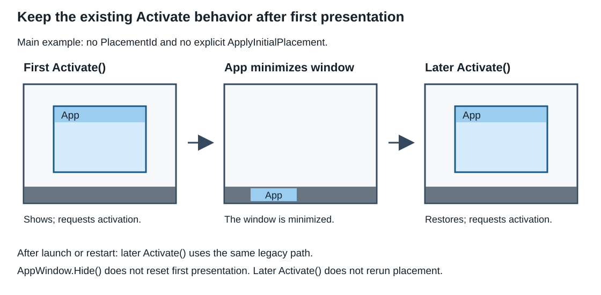

**Setup:** Create a window without `PlacementId` and without calling
`ApplyInitialPlacement`. Record visibility, window state, and activation requests.

**App code:**

```csharp
var window = new MainWindow();
window.Activate();

// Later, minimize the window and explicitly activate it again.
((OverlappedPresenter)window.AppWindow.Presenter).Minimize();
window.Activate();
```

**Assertions:**

- **A1:** With placement disabled, the first `Activate()` shows the window and requests
  activation through the existing activation path.
- **A2:** After minimization, `Activate()` restores the window and requests activation.
- **A3:** In a variant prepared with `ApplicationRestart`, the first `Activate()` does not
  request activation, but a later call does.
- **A4:** In a variant first shown minimized for launch or restart, a later `Activate()`
  restores the window and requests activation.
- **A5:** Hiding a previously shown window does not reset first-presentation behavior.
  The next `Activate()` uses the existing activation path, not the retained launch or
  restart behavior.
- **A6:** Calls after first presentation do not reload placement, cascade, or replace
  subsequent app or user changes to the window's bounds.

**Variants:** Use the fixtures in [WP-LAUNCH-STATE](#wp-launch-state),
[WP-RESTART-MINIMIZED](#wp-restart-minimized), and
[WP-RESTART-ACTIVATION](#wp-restart-activation) to check A3 and A4.
For A5, hide a shown window with `AppWindow.Hide()` before calling `Activate()` again.
For A6, change and record a placement-enabled normal window's bounds after its first
presentation, then call `Activate()` again.
Leaving `PlacementId` unset prevents automatic persistence and ID-based cascading.
Explicit preparation with `ApplyInitialPlacement` remains available without an ID.

<a id="wp-display-frame"></a>
### WP-DISPLAY-FRAME: Keep outer bounds and visible-frame bounds distinct

**Status:** Specified for the round-trip cases below. A4 needs a policy decision.

An invisible resize border must not be mistaken for visible content when recording or
comparing window bounds. Otherwise, reopening a window can shift it or change its size.

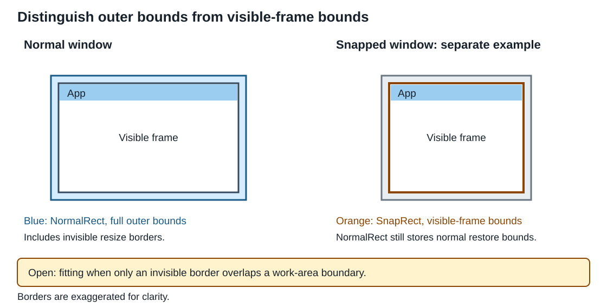

**Setup:** Use a normal, resizable window with nonzero invisible resize borders. Keep its
full outer bounds comfortably inside one work area, with unchanged display, DPI, and
size constraints. Record outer bounds independently with Win32 `GetWindowRect` and
visible-frame bounds with `DwmGetWindowAttribute(DWMWA_EXTENDED_FRAME_BOUNDS)` in the app's
per-monitor-aware DPI context.

**App code:**

```csharp
WindowPlacementInfo savedPlacement = CaptureRequired(existingWindow);
existingWindow.Close();

window.ApplyInitialPlacement(new WindowInitialPlacementOptions
{
    CustomPlacement = savedPlacement,
    AllowCascading = false,
});
window.Activate();
```

**Assertions:**

- **A1:** For the normal window, captured `NormalRect` matches its full outer bounds,
  including invisible resize borders, not just its visible frame.
- **A2:** Repeating capture and recreation in this unchanged fixture preserves outer size
  and position. It does not accumulate a border-sized shift or size change.
- **A3:** In a snapped variant, captured `SnapRect` uses visible-frame bounds, while
  `NormalRect` still describes the separate normal restore bounds.

**Open assertion, not a current pass criterion:**

- **A4:** Arrange a window whose visible frame fits its work area but whose invisible
  border crosses a display edge or reserved-area boundary. Decide whether fitting should
  move or resize this window, then record the expected result. Do not assume that any
  outer-rectangle overlap means visible content needs correction.

**Variants:** Repeat at 96 and 192 DPI and near adjacent displays. Keep A1-A3 away from
edge-fitting ambiguities; A4 isolates the reviewer's border-only overlap concern.

<a id="wp-apply-repeat"></a>
### WP-APPLY-REPEAT: Repeat preparation without changing input snapshots

**Status:** Specified, with snapshot non-mutation confirmed in the
[author's correction](https://github.com/microsoft/microsoft-ui-xaml/pull/12371#discussion_r4364818296).
The API reference should state that input contract explicitly.

The app can run placement immediately, inspect the resulting window, and run placement
again before showing it. WinUI changes the window, not the supplied snapshot.

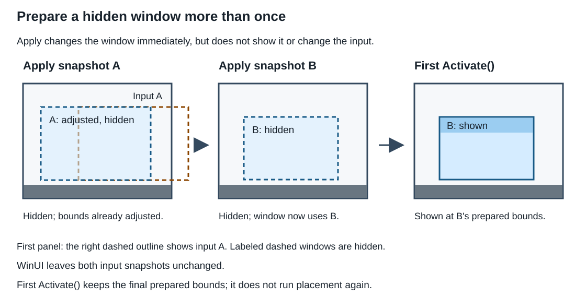

**Setup:** Supply two distinguishable valid snapshots. Make the first require a bounds
adjustment on the current display; make the second fit unchanged. Record every input
property before each call: `NormalRect`, `WorkArea`, `Dpi`, `State`, `SnapRect`,
`DisplayDeviceName`, and `VirtualDesktopId`.

**App code:**

```csharp
var window = new MainWindow();
var optionsA = new WindowInitialPlacementOptions
{
    CustomPlacement = placementA,
    AllowCascading = false,
};
window.ApplyInitialPlacement(optionsA);

var optionsB = new WindowInitialPlacementOptions
{
    CustomPlacement = placementB,
    AllowCascading = false,
};
window.ApplyInitialPlacement(optionsB);
window.Activate();
```

**Assertions:**

- **A1:** Each successful call immediately prepares the window's bounds and state while
  leaving it hidden and without requesting activation. Apply is not merely a setter for
  work deferred until `Activate()`.
- **A2:** The second call is accepted before first presentation and reruns placement.
  In a variant, change the window between calls to prove the second call does real work.
- **A3:** Every supplied snapshot property retains its input value, including when WinUI
  must adjust the window to fit a different work area.
- **A4:** `CustomPlacement` remains an input. WinUI does not replace it with adjusted output
  or populate a null `CustomPlacement` with a cascaded or automatically loaded result.
- **A5:** A subsequent `TryGetPlacement` returns an independent snapshot of the actual
  prepared window. Its adjusted bounds can differ from the input; editing the captured
  snapshot does not move the window or alter the input snapshot.
- **A6:** First `Activate()` does not rerun placement. In separate variants, change bounds
  after the final successful Apply through `AppWindow`, or change `Window.Width` and
  `Window.Height`; the first presentation preserves those app changes.

**Boundary:** Apply remains optional. These cases do not introduce a required initialization
call, a separate show method, or an output property on the options object.

<a id="wp-placement-errors"></a>
### WP-PLACEMENT-ERRORS: Distinguish invalid calls from ordinary fallback

**Status:** Specified for validation and call-order errors. A5 remains open for actual
placement failures. See [Apply errors](Window-placement-spec.md#42-windowapplyinitialplacement)
and [capture errors](Window-placement-spec.md#44-windowtrygetplacement).

An app needs to distinguish a missing saved placement from a failed call. A void WinRT
method can report an error; the app does not need a Boolean result or `GetLastError`.

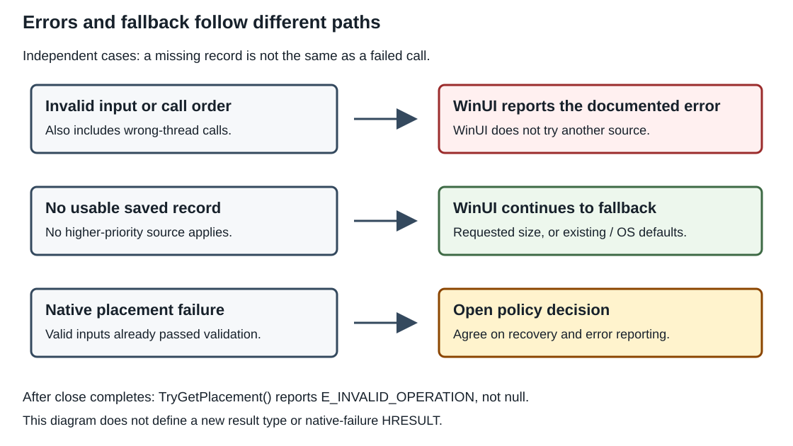

**Setup:** The scenario host expects projected WinRT errors from deliberately invalid
calls. For live-window validation cases, record bounds before the call and verify that
validation fails before changing placement. Use separate windows for closed-window cases.

**App code, used as negative-test input:**

```csharp
var window = new MainWindow();
window.ApplyInitialPlacement(new WindowInitialPlacementOptions());
window.Activate();

// The scenario host expects E_ILLEGAL_METHOD_CALL.
window.ApplyInitialPlacement(new WindowInitialPlacementOptions());
```

**Assertions:**

- **A1:** Null options, invalid snapshot values, and wrong-thread calls report the
  documented error before applying placement; they do not quietly choose another source.
- **A2:** Apply after first presentation, reentrant Apply, and `Activate()` during Apply
  report `E_ILLEGAL_METHOD_CALL`.
- **A3:** Calls on a closed window report their documented error. In particular,
  `TryGetPlacement` reports `E_INVALID_OPERATION`, not a no-history null result.
- **A4:** A missing or unusable saved record follows the allowed loading/fallback path in
  [WP-PLACEMENT-SOURCES](#wp-placement-sources). It is not automatically an Apply failure.

**Open assertion, not a current pass criterion:**

- **A5:** Inject a native placement failure after valid inputs pass validation. Agree on
  when WinUI can recover and when it must report failure, and record the projected error
  or diagnostic the app can observe. Do not count this concern as solved merely because
  invalid-argument tests pass.

**Boundary:** The current API does not define a native placement-failure HRESULT or a
per-cause storage diagnostic. This scenario records that review question without inventing
a Boolean return, a result enum, or a `GetLastError` contract.

<a id="wp-capture-lifecycle"></a>
### WP-CAPTURE-LIFECYCLE: Capture while hidden, deactivated, or closing

**Status:** Specified, with capture during the close event confirmed in
[review](https://github.com/microsoft/microsoft-ui-xaml/pull/12371#discussion_r4352505084).
The API reference should distinguish the callback from a window that has finished closing.

An app can capture a valid windowed placement without showing or activating the window.
Capturing during normal close does not provide a complete custom-storage lifecycle.

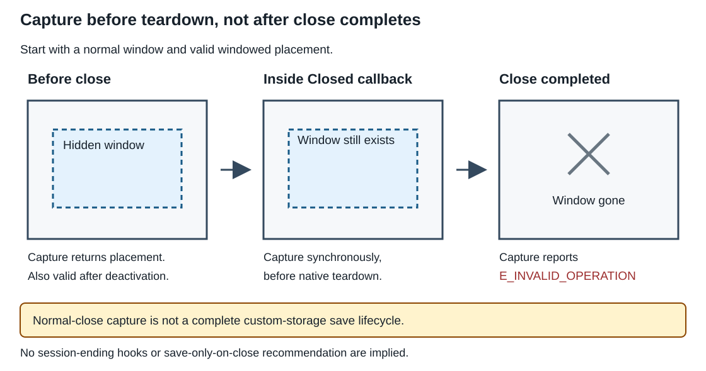

**Setup:** Start with a normal window and valid windowed placement. For the close fixture,
capture synchronously in `Window.Closed`, without awaiting or canceling close. For the
deactivation fixture, move focus to another app and capture synchronously in the
`Window.Activated` callback whose state is `WindowActivationState.Deactivated`.

**App code:**

```csharp
WindowPlacementInfo? closedSnapshot = null;
existingWindow.Closed += (sender, args) =>
{
    closedSnapshot = CaptureRequired(existingWindow);
};
existingWindow.Close();
```

**Assertions:**

- **A1:** Capture before first show and after `AppWindow.Hide()` returns valid windowed
  placement without showing the window or requesting activation.
- **A2:** Capture during deactivation returns valid placement without activating the window
  again. This does not make deactivation a recommended durable-save hook.
- **A3:** Synchronous capture in `Closed` returns the windowed placement before teardown.
  It does not fail merely because the callback is named `Closed`.
- **A4:** After close completes, capture reports `E_INVALID_OPERATION`. Do not defer work
  from the callback and assume the native window will still exist.
- **A5:** A snapshot captured before teardown remains usable after the source window
  closes. Recreating from it does not require keeping the old window alive.

**Boundary:** The full-screen no-history null case remains
[WP-RESTORE-WINDOWED.A4](#wp-restore-windowed). This scenario does not expose `WM_DESTROY`,
provide `WM_ENDSESSION` coverage, or recommend saving only on close. Complete custom
storage remains deferred to [#12390](https://github.com/microsoft/microsoft-ui-xaml/issues/12390).

## Deferred behavior

These scenarios record requested behavior outside this revision. They are not additional
supported automatic or customization features.

<a id="wp-offscreen-intentional"></a>
### WP-OFFSCREEN-INTENTIONAL: Automatically preserve an intentional off-screen offset

**Status:** Deferred for automatic preservation.

The user deliberately leaves part of the window beyond a display edge and wants automatic
persistence to preserve that offset when the display layout has not changed.

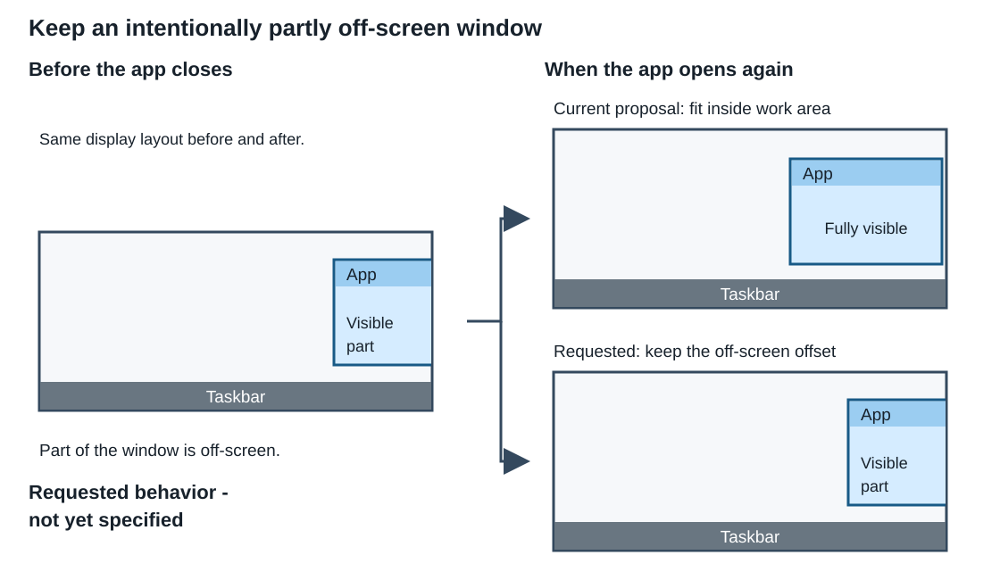

**Setup:** The window is partially off-screen but intersects its display's work area.
The current proposal has no automatic-persistence option that declares this offset intentional.

**Current app-managed alternative:**

```csharp
window.ApplyInitialPlacement(new WindowInitialPlacementOptions
{
    CustomPlacement = savedPlacement,
    AllowCascading = false,
});
RectInt32 workArea = savedPlacement.WorkArea;

// App-chosen bounds for this unchanged-display fixture, after WinUI's preparation.
window.AppWindow.Move(new PointInt32(
    workArea.X + workArea.Width - 100,
    workArea.Y + 100));
window.Activate();
```

**Proposed future assertions, not current pass criteria:**

- **A1:** With an explicit future opt-in and unchanged display configuration, reopening
  preserves the intentionally off-screen offset.
- **A2:** A changed or removed display still has a defined recovery rule that keeps
  essential window controls reachable.

**Current boundary:** The sample places the window manually after preparation; it is not
an opt-in to automatic offset preservation. The app owns that geometry and its recovery
policy. Negative coordinates on an available display are not themselves off-screen.

<a id="wp-custom-save-load"></a>
### WP-CUSTOM-SAVE-LOAD: Save and load placement in the app's own storage

**Status:** Deferred. This revision does not provide a complete supported custom save-and-load
workflow. Follow-up: [#12390](https://github.com/microsoft/microsoft-ui-xaml/issues/12390).

The app wants to save placement in its own storage and load it when recreating a window,
rather than rely on WinUI's placement store.

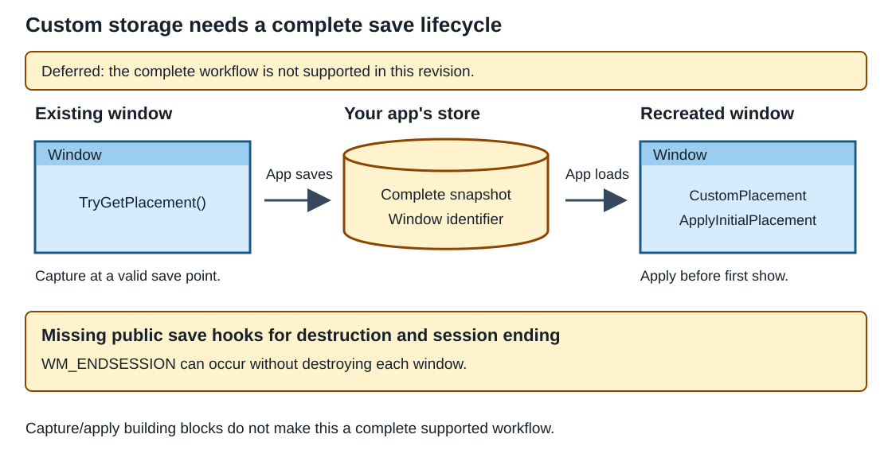

**Requested workflow:** Capture the complete placement, save it with the app's window
identifier, load it when recreating that window, and apply it before first showing the
window. The save path must account for normal destruction and session ending.

**Deferred coverage, not current pass criteria:**

- **A1:** A future complete custom-storage path can save a window's placement in the app's
  own store, load it, and apply it to a recreated window.
- **A2:** The save path covers session ending even when Windows does not destroy each
  window. Saving only during normal close does not satisfy this case.

**Current boundary:** `TryGetPlacement`, `CustomPlacement`, and `ApplyInitialPlacement`
already provide capture/apply building blocks. They do not supply public hooks for
`WM_DESTROY` and `WM_ENDSESSION`. [WP-CAPTURE-LIFECYCLE](#wp-capture-lifecycle) checks
synchronous capture during normal close, not a complete custom save-and-load solution.
Snapshot-based geometry fixtures are not a storage recipe. The future design must also
explain how app-owned storage composes with `PlacementId` and automatic persistence.

<a id="wp-unpackaged"></a>
### WP-UNPACKAGED: Remember placement automatically without package identity

**Status:** Deferred. This revision does not support automatic placement persistence or
ID-based cascading for unpackaged apps.
Follow-up: [#12388](https://github.com/microsoft/microsoft-ui-xaml/issues/12388).

The app runs without package identity and wants windows to reopen at their saved position,
size, and state without implementing placement storage itself.

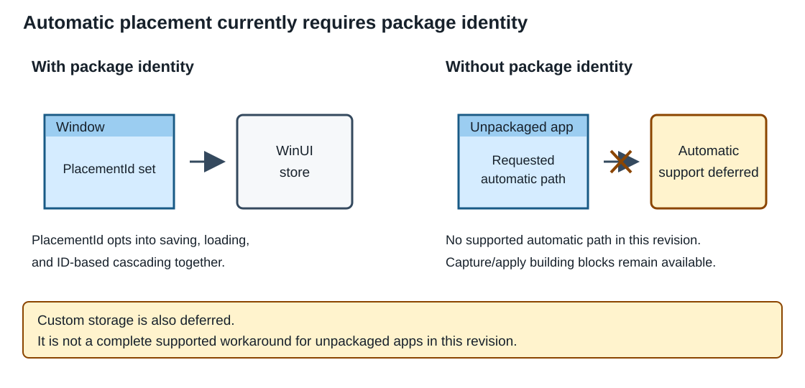

**Deferred coverage, not current pass criteria:**

- **A1:** A future unpackaged automatic-persistence path saves and reloads placement across
  app launches without requiring package identity.
- **A2:** Define ID-based cascading for unpackaged windows and exercise the case reserved
  as [WP-CASCADE.A3](#wp-cascade).

**Current boundary:** Unpackaged apps can still position windows and use the capture/apply
building blocks. The missing support is the automatic persistence and ID-based cascading
path. Do not infer a supported unpackaged `PlacementId` behavior from the packaged tests,
or assume that `ApplicationData.GetDefault().LocalSettings` supplies unpackaged storage.
[Custom save and load](#wp-custom-save-load) is also deferred; it is not a complete
supported workaround in this revision.

## Remaining gaps and decisions

The table separates scenarios without a complete supported path from test decisions.
It does not expand this revision's API scope.

| Case | Current path or limitation | What remains |
| --- | --- | --- |
| Automatic persistence or ID-based cascading without package identity | [WP-UNPACKAGED](#wp-unpackaged) explicitly records the unsupported workflow; `WP-CASCADE.A3` remains deferred. | Design [unpackaged support (#12388)](https://github.com/microsoft/microsoft-ui-xaml/issues/12388). |
| Complete custom persistence, including session ending | [WP-CUSTOM-SAVE-LOAD](#wp-custom-save-load) explicitly records the unsupported complete workflow. Capture/apply fixtures and normal-close capture do not solve its lifecycle gap. | Define save hooks and the custom-storage lifecycle in [#12390](https://github.com/microsoft/microsoft-ui-xaml/issues/12390). |
| App-selected fallback display | WinUI provides its default selection policy. Moving the window after preparation does not replace the policy that chose the fallback display. | Design [custom monitor fallback (#12389)](https://github.com/microsoft/microsoft-ui-xaml/issues/12389). |
| Snapped placement on a changed or unsupported target | The implementation will follow PlacementEx, rather than define a new snap policy. | Record version-matched reference fixtures, including snap state, normal restore bounds, and fallback behavior. |
| Capture with no windowed history | `WP-RESTORE-WINDOWED.A4` follows the spec's null rule, but no reachable fixture has been established. | Prove the condition can occur or revisit the nullable capture contract. |
| Launch hints competing with supplied placement | `WP-LAUNCH-DISPLAY` and `WP-LAUNCH-STATE` cover conflict-free cases only. | Define precedence for display and state conflicts before adding competing-source assertions. |
| Missing or inaccessible saved virtual desktop | `WP-RESTART-DESKTOP` tests a successful best-effort move. | Define fallback and error expectations for a missing desktop or a denied move. |
| A toolbar that must not request activation | `WP-APP-TOOLBAR` currently uses `Activate()` and therefore requests activation. | Verify a separate WinUI-compatible first-show path; do not assume that `AppWindow.Show(false)` completes WinUI initialization. |
| Intentional off-screen placement | `WP-OFFSCREEN-INTENTIONAL` has a manual post-preparation move, not automatic preservation. | A future automatic opt-in and its recovery policy remain deferred. |
| Numerical DPI test threshold | `WP-DISPLAY-DPI` has a proposed 1 DIP tolerance. The API already promises approximate DIP-size preservation. | Agree on a test tolerance; this does not require another API. |
| Invisible-border-only overlap | `WP-DISPLAY-FRAME.A4` separates invisible resize borders from visible content. | Decide when fitting should move or resize a window whose visible frame already fits. |
| Experimental AppWindow persistence enabled alongside WinUI placement | `WP-RESTORE-NORMAL` tests WinUI alone; the author describes the APIs as parallel. | Define coexistence before assigning pass criteria to conflicting settings in both engines. |

`WP-APPLY-REPEAT` now covers the confirmed input non-mutation contract. The main API
reference still needs to state it explicitly. `WP-PLACEMENT-ERRORS.A5` records the separate
open question about actual placement failures; validation-error coverage is not a substitute.

## PR review coverage

This map accounts for all 18 inline review threads in
[#12371](https://github.com/microsoft/microsoft-ui-xaml/pull/12371), including the resolved
work-area thread, and each behavioral concern in the conversation comments. The review
summaries add no separate requests. Build-status automation does not describe app behavior.
Coverage means a scenario, an explicit open case, or a recorded design disposition, not
that tests have been implemented or every request accepted.
The final two rows record the agreed scope cuts, rather than additional PR comments.

| Review concern | Scenario or disposition | Status |
| --- | --- | --- |
| [Home/office layouts and default display selection](https://github.com/microsoft/microsoft-ui-xaml/pull/12371#discussion_r4352278128) | [WP-DISPLAY-REMOVED](#wp-display-removed) includes replacement displays in the same screen region; [WP-DISPLAY-REARRANGED](#wp-display-rearranged) covers matched displays. Per-layout history is not promised. | Default specified; customization deferred to [#12389](https://github.com/microsoft/microsoft-ui-xaml/issues/12389). |
| [When Width and Height override placement](https://github.com/microsoft/microsoft-ui-xaml/pull/12371#discussion_r4352316143) | [WP-PLACEMENT-SOURCES](#wp-placement-sources) A3-A6 cover fallback timing and precedence; [WP-APPLY-REPEAT](#wp-apply-repeat) A6 and [WP-ACTIVATE-LEGACY](#wp-activate-legacy) cover later app changes. | Specified. |
| [A separate show method that may not show](https://github.com/microsoft/microsoft-ui-xaml/pull/12371#discussion_r4352401380) | The separate show API was removed. [WP-LAUNCH-STATE](#wp-launch-state), [WP-RESTART-MINIMIZED](#wp-restart-minimized), and [WP-RESTART-ACTIVATION](#wp-restart-activation) exercise first Activate. | Design resolved; current behavior covered. |
| [Showing behavior after initial activation](https://github.com/microsoft/microsoft-ui-xaml/pull/12371#discussion_r4352405817) | The removed API needs no new test. [WP-ACTIVATE-LEGACY](#wp-activate-legacy) covers later Activate, including after hiding and first showing minimized. | Design resolved; current behavior covered. |
| [Capture during close or deactivation](https://github.com/microsoft/microsoft-ui-xaml/pull/12371#discussion_r4352505084) | [WP-CAPTURE-LIFECYCLE](#wp-capture-lifecycle) distinguishes synchronous callbacks from capture after teardown. | Covered; full custom-storage lifecycle remains deferred. |
| [Why keep an automatic-storage opt-out](https://github.com/microsoft/microsoft-ui-xaml/pull/12371#discussion_r4352574109) | The opt-out was cut. [WP-PLACEMENT-SOURCES](#wp-placement-sources) A7 covers explicit placement without an ID and automatic persistence with an ID. | Deferred design, not an MVP requirement. |
| [Is Apply an operation, and can it repeat](https://github.com/microsoft/microsoft-ui-xaml/pull/12371#discussion_r4352622609) | [WP-APPLY-REPEAT](#wp-apply-repeat) covers immediate effects, repeated calls, and the author's corrected non-mutation statement. | Specified; non-mutation wording should be explicit in the reference. |
| [Redundant separate show and activate methods](https://github.com/microsoft/microsoft-ui-xaml/pull/12371#discussion_r4352641530) | The separate show method was removed; [WP-ACTIVATE-LEGACY](#wp-activate-legacy) covers the retained activation operation. | Design resolved. |
| [A non-error null from live capture](https://github.com/microsoft/microsoft-ui-xaml/pull/12371#discussion_r4354385689) | [WP-RESTORE-WINDOWED](#wp-restore-windowed) A4 needs a reachable no-history fixture. | Open; not claimed as solved. |
| [Naming CustomPlacement and the earlier auto-fill explanation](https://github.com/microsoft/microsoft-ui-xaml/pull/12371#discussion_r4354389219) | The proposal keeps the name and treats it as input; [WP-APPLY-REPEAT](#wp-apply-repeat) A4 tests that contract. | Naming feedback recorded; the older auto-fill reply still needs clarification. |
| [Null versus a default object, and detecting storage failure](https://github.com/microsoft/microsoft-ui-xaml/pull/12371#discussion_r4354406174) | [WP-PLACEMENT-SOURCES](#wp-placement-sources) A4 keeps null for no usable loaded placement, following the author's final reply. Null does not distinguish missing data from every storage failure. | Null decision retained; per-cause diagnostics not promised. |
| [Use the cursor's display when the saved display is unavailable](https://github.com/microsoft/microsoft-ui-xaml/pull/12371#discussion_r4356294489) | [WP-DISPLAY-REMOVED](#wp-display-removed) states the current default and explicitly defers app-selected fallback. | Deferred to [#12389](https://github.com/microsoft/microsoft-ui-xaml/issues/12389). |
| [Report unsuccessful placement for debugging](https://github.com/microsoft/microsoft-ui-xaml/pull/12371#discussion_r4359938224) | [WP-PLACEMENT-ERRORS](#wp-placement-errors) separates known validation errors, ordinary fallback, and an injected native placement failure. | Native failure reporting remains open. |
| [Relationship to AppWindow.PersistedStateId](https://github.com/microsoft/microsoft-ui-xaml/pull/12371#discussion_r4361402105) | [WP-RESTORE-NORMAL](#wp-restore-normal) A4 requires no experimental AppWindow opt-in; its open variant records enabling both engines. | Parallel APIs per author; coexistence remains open. |
| [Why save the old work area](https://github.com/microsoft/microsoft-ui-xaml/pull/12371#discussion_r4362295787) | [WP-DISPLAY-REARRANGED](#wp-display-rearranged) A5 uses the review's `(2000, 100)` and `(1920, 0)` example to preserve the old offset. | Resolved thread; concrete coverage retained. |
| [Centering example versus supplying centered bounds](https://github.com/microsoft/microsoft-ui-xaml/pull/12371#discussion_r4362580680) | [WP-APP-CENTER-WORKAREA](#wp-app-center-workarea) prepares the window, retrieves the selected display, and moves it through AppWindow. Easier display lookup is follow-up work. | Current composition covered; lookup support deferred to [#12389](https://github.com/microsoft/microsoft-ui-xaml/issues/12389). |
| [Do not persist visibility, activation, presenter, or Z-order](https://github.com/microsoft/microsoft-ui-xaml/pull/12371#discussion_r4366233515) | [WP-CAPTURE-LIFECYCLE](#wp-capture-lifecycle), [WP-RESTART-ACTIVATION](#wp-restart-activation), [WP-APP-FULLSCREEN-RETURN](#wp-app-fullscreen-return), and [WP-APP-ZORDER](#wp-app-zorder) cover the separate responsibilities. | Specified. |
| [Make the PlacementId association clear](https://github.com/microsoft/microsoft-ui-xaml/pull/12371#discussion_r4366234083) | [WP-RESTORE-NORMAL](#wp-restore-normal), [WP-APP-MULTIWINDOW](#wp-app-multiwindow), and [WP-CASCADE](#wp-cascade) distinguish reused IDs, different IDs, and shared IDs. | Editorial request backed by behavior coverage. |
| [Display-name reliability and coordinate-based fallback](https://github.com/microsoft/microsoft-ui-xaml/pull/12371#issuecomment-6372609455) | [WP-DISPLAY-IDENTITY](#wp-display-identity) covers docking, adapter changes, retained or reused GDI names, and comparison with coordinate-only fallback. [WP-DISPLAY-REARRANGED](#wp-display-rearranged) covers primary swaps. | Logical-name behavior covered; physical identity not guaranteed and customizable fallback deferred. |
| [Mixed-DPI MoveAndResize and delayed resizing](https://github.com/microsoft/microsoft-ui-xaml/pull/12371#issuecomment-6372609455) | [WP-DISPLAY-DPI](#wp-display-dpi) separately tests saved DPI matching or differing from the target DPI, observing after Apply, first Activate, and dispatcher idle without an app-side corrective resize. | Unwanted rescaling covered; tolerance remains proposed only for intentional scaling. |
| [Unwanted offset and different UWP launch paths](https://github.com/microsoft/microsoft-ui-xaml/pull/12371#issuecomment-6372609455) | [WP-CASCADE](#wp-cascade) A4-A5 cover disabling the cascade offset. Its open clarification retains the author's question about whether the report means another offset. | Cascade case covered; a different offset still needs a concrete sequence. |
| [Invisible resize borders when fitting bounds](https://github.com/microsoft/microsoft-ui-xaml/pull/12371#issuecomment-6372609455) | [WP-DISPLAY-FRAME](#wp-display-frame) checks independent outer/visible measurements and repeated round trips; A4 isolates border-only overlap. | Round trips covered; edge-fitting policy remains open. |
| Current scope: custom save and load | [WP-CUSTOM-SAVE-LOAD](#wp-custom-save-load) covers the requested complete workflow, including session ending. Capture/apply building blocks do not make it supported. | Deferred to [#12390](https://github.com/microsoft/microsoft-ui-xaml/issues/12390). |
| Current scope: unpackaged apps | [WP-UNPACKAGED](#wp-unpackaged) covers automatic persistence without package identity; [WP-CASCADE](#wp-cascade) A3 retains the related cascade case. | Deferred to [#12388](https://github.com/microsoft/microsoft-ui-xaml/issues/12388). |

## Turning the catalog into tests

- Keep each `WP-...` scenario ID and its assertion labels stable when changing titles or
  moving scenarios.
- Reference scenario and assertion IDs in test names or metadata. Add new IDs rather than
  renumbering existing scenarios.
- Exercise geometry with supplied snapshots, then cover automatic loading separately.
  A test of source selection must leave competing sources distinguishable: supplying
  `CustomPlacement` would mask a bug in cascading or automatic loading.
- Record observations before preparation, after preparation, after showing, and after
  relevant presenter or restore actions. Observe activation and visibility over time.
- Separate deterministic geometry cases from windowing integration and environment-dependent
  display, launch, and virtual-desktop cases. State environment prerequisites explicitly.
- Do not make **Needs decision** or **Deferred** assertions release pass criteria until the
  corresponding decision is recorded in the API spec.
- For **Baseline pending** cases, record reference results from the agreed PlacementEx
  version before judging the WinUI implementation. Record fallback and state as well as bounds.
- Keep mixed-status assertions separate: `WP-CASCADE.A3` is deferred and
  `WP-RESTORE-WINDOWED.A4` needs a fixture decision, even though their other assertions
  describe specified behavior.
- Include non-primary displays with nonzero and negative origins. For work-area centering,
  compare against independently obtained Win32 screen coordinates, not only a screenshot
  or a calculation that repeats the sample's assumptions.
- Link implemented tests from their scenarios when they exist. This document does not add
  a test harness, a storage schema, or new API guarantees.
