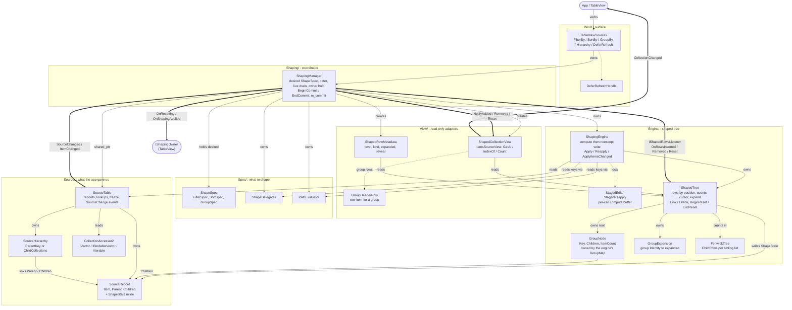

# Shaping architecture: layers

A one-page map of the `TableViewSource2` shaping pipeline (`controls/dev/TableViewSource2`), grouped
by folder. The full design and the decisions behind it are in
[Shaping-Architecture-Redesign.md](Shaping-Architecture-Redesign.md).

Legend: solid arrows are ownership or reads, thick arrows are events, dotted arrows are local or
helper relationships.

<b>Layer diagram</b>

## Layers

- **Source/** mirrors the app's data: records and their `Parent` / `Children` links. It knows
  nothing about shaping. `SourceRecord` carries `ShapeState` inline, but Source/ never writes it.
- **Spec/** describes the desired shape (`ShapeSpec`) and evaluates keys (`ShapeDelegates`,
  `PathEvaluator`).
- **Engine/** computes filter, sort and grouping. `ShapingEngine` computes into a local
  `StagedEdit` / `StagedReapply` buffer, then writes in a `noexcept` phase. `ShapedTree` is the
  only owner of the rows: it holds the group root, the visible-row counts (`FenwickTree` per
  sibling list), the cursor, the expansion verbs and `GroupExpansion` (pruned at each
  `EndReset`), and it writes the tree-owned `ShapeState` fields.
- **Shaping/** coordinates one commit. `ShapingManager` listens to `SourceTable` and to the tree
  (`IShapedRowsListener`) and turns tree events into view notifications and owner callbacks.
- **View/** holds read-only adapters over `ShapedTree`; no rows are stored there.
