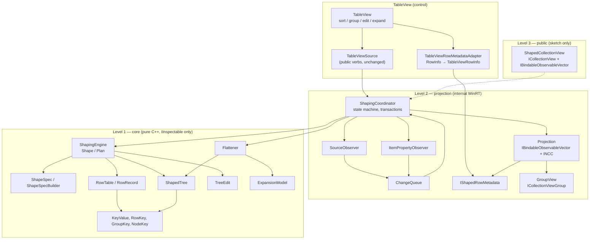
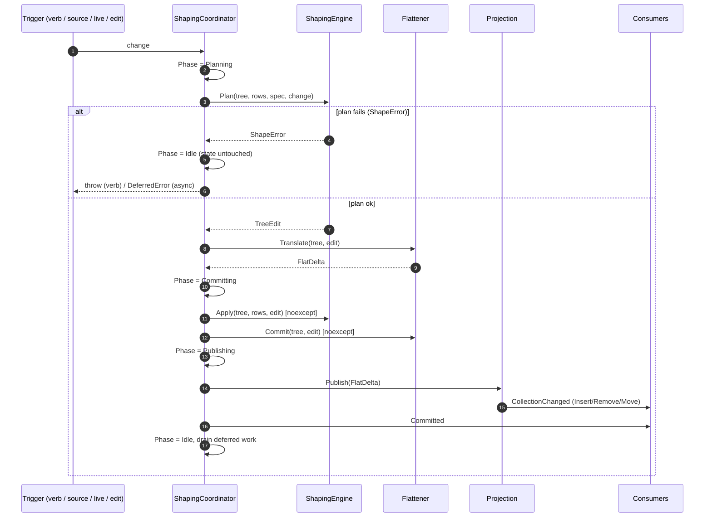
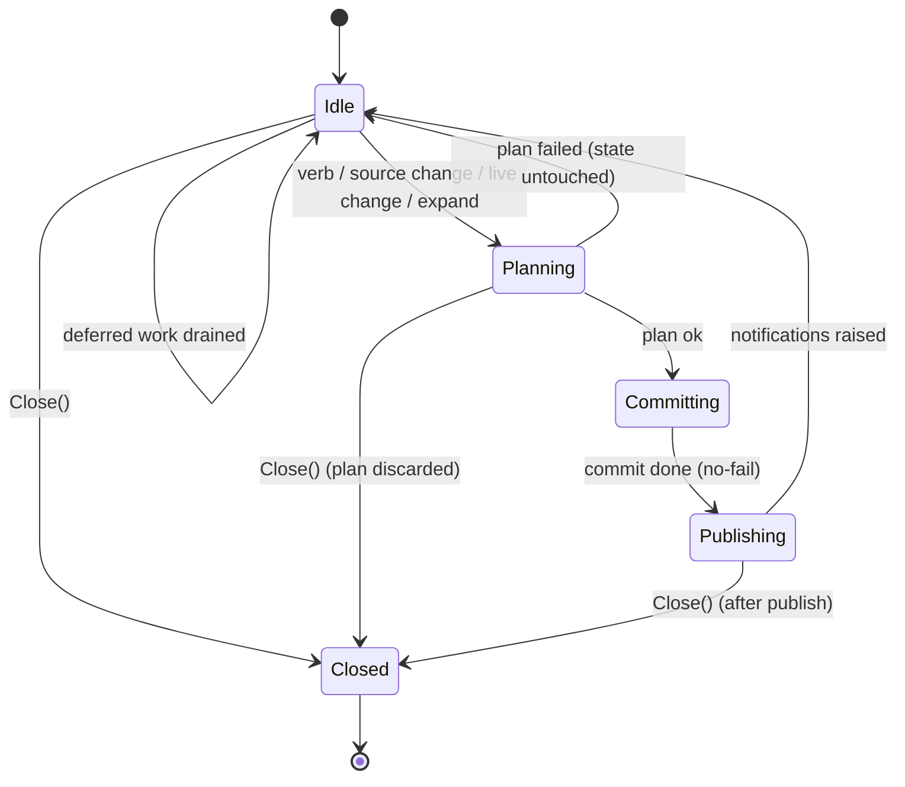
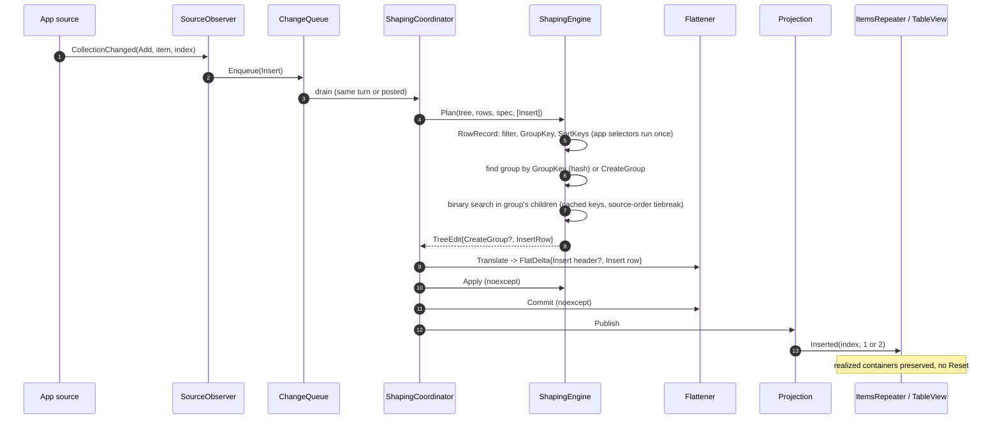
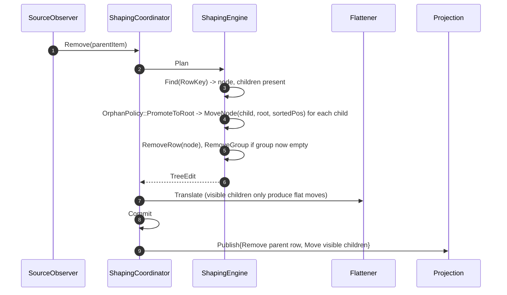
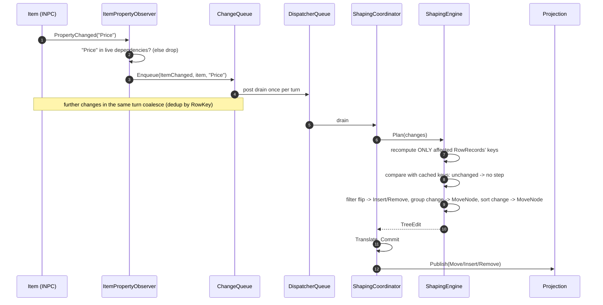
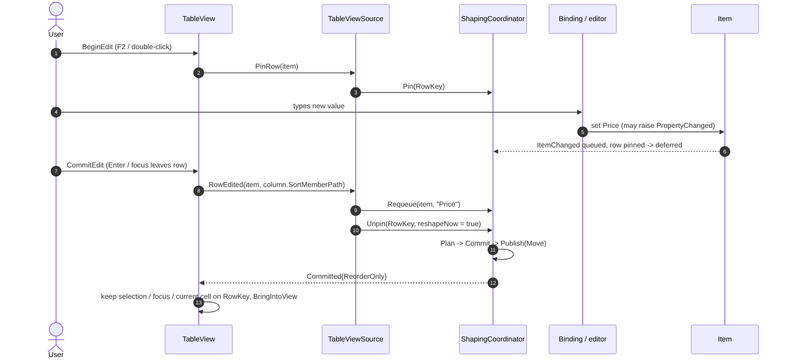
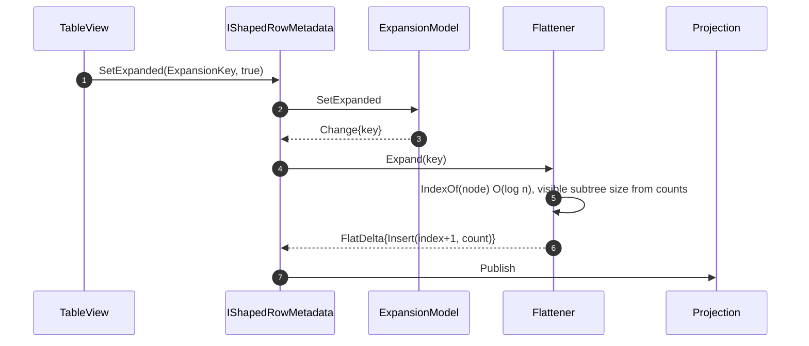
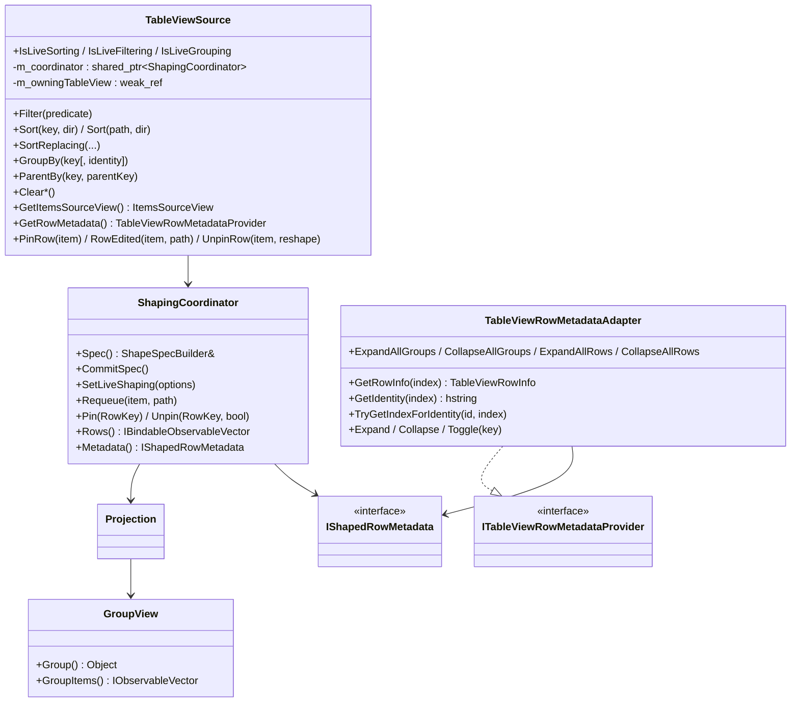
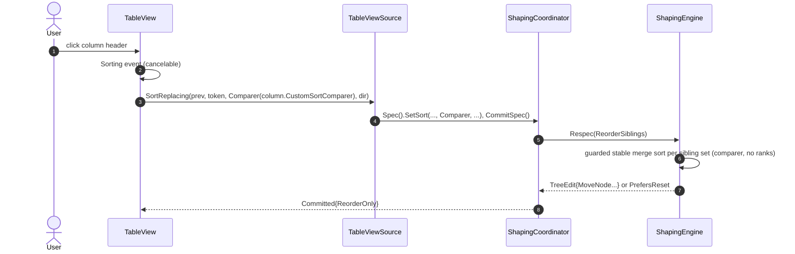

# Tabular Shaping — Architecture Redesign (Interface Draft)

Status: **Draft for review.** No code changes accompany this document.
Scope: internal core (level 1), internal projection (level 2), and TableView wiring. The public
reusable collection view (level 3) is sketched only.

---

## 1. Goals and non-goals

### Goals

1. **One shaping model.** A single immutable spec and a single engine produce every shape: flat,
   filtered, sorted, grouped (N levels), hierarchical, and grouped + hierarchical.
2. **Fast paths everywhere.** Source collection changes, item property changes (live shaping),
   expand/collapse, and most verb changes update the projection in place and raise
   Insert / Remove / Move notifications. A full rebuild (Reset) is the fallback, not the default.
3. **Live shaping, including UI edits.** A committed cell edit re-shapes exactly the edited row.
   `INotifyPropertyChanged` changes re-shape exactly the changed rows, filtered by declared
   dependencies.
4. **Transactional updates.** Every change is planned without touching live state, then committed
   with no-fail operations. A failure leaves the previous projection intact.
5. **One key type.** Sort comparison, group identity, row identity and node identity share one
   typed key whose ordering and equality agree by construction.
6. **Reusable.** The core has no XAML, no Dispatcher and no TableView vocabulary. The projection
   is consumable by any items control.
7. **Source compatible.** The public `TableViewSource` API (verbs, `IsLive*` properties) is
   unchanged.

### Non-goals

- Changing public TableView / TableViewSource API shape.
- Shipping the public `ShapedCollectionView` in this phase (level 3 is sketched in §13).
- Virtualized / paged data sources (`ISupportIncrementalLoading`) — unchanged behavior.

---

## 2. Problems this design removes

| # | Current problem | Resolved by |
|---|---|---|
| A | Two engines: `ShapingPipeline`+`Reshape` (flat only) vs. bespoke grouped / hierarchical rebuilds in `ShapedItemsSource` | §4.3 `ShapeSpec`, §4.6 `ShapingEngine` |
| B | Hierarchy is out-of-band (`m_hierarchyAxisDirty`), not in the spec or diff | `HierarchyStep` is part of `ShapeSpec` |
| C | Grouped + hierarchical kept coherent by two adapters, ABI-pointer side maps and re-slice callbacks | §4.5 `ShapedTree` + §4.7 `Flattener` |
| D | Identity contracts encoded as string prefixes (`s:`, `i32:`, `o:`, `value:`, `object:`, `node:`, `group:`, `identity:`) parsed across files | §4.1 `KeyValue`, §4.2 typed keys |
| E | Sort equality ≠ group identity (`Int32 5` vs `Int64 5`, `-0.0` vs `+0.0`, culture compare vs ordinal identity) | `KeyValue` ordering/equality/hash agree |
| F | `CustomSortRankAdapter` ranks a visible-row snapshot and renumbers ranks mid-pass | `SortStep` carries the comparer; engine merge-sorts directly |
| G | Incremental insert re-evaluates `IStringable` keys a full sort froze | Per-row cached keys in `RowRecord` |
| H | Partial mutation before a fallback rebuild can throw (sorted Replace, flat Replace/ItemChanged, hierarchy splice) | Plan → Commit (§6) |
| I | Flag web in `ShapedItemsSource` (~15 interacting booleans) | `ShapingCoordinator` state machine (§7) |
| J | Fast paths limited to flat lists; filter-only, grouped and hierarchical changes rebuild | §8 fast-path matrix |
| K | Live shaping re-shapes with a full `Refresh()` (Reset) per coalesced turn; subscriptions are blanket | `ItemPropertyObserver` + per-row plan (§9) |
| L | `RowMetadataProvider` includes concrete adapters / `GroupedEntry`; `get_self<TableViewSource>` from control code | `IShapedRowMetadata` (§5.4) |
| M | Helpers depend on XAML / Dispatcher; code compiled only into Tabular.dll | Core is XAML-free (§13) |
| N | Dead / duplicated paths (`ShapingDelta` flags, unreachable not-diffable branch, grouped `Reshape`, duplicate rebuild and subscription code) | Deleted by construction |

---

## 3. Layered architecture



Dependency rules:

- Level 1 depends only on the C++ standard library, `winrt::IInspectable`,
  `Windows.Foundation` (`IPropertyValue`, `IStringable`, `IReference`) and the Win32 string APIs
  `CompareStringEx` / `LCMapStringEx`.
- Level 2 depends on level 1 and on XAML interop collection types and `DispatcherQueue`.
- TableView depends on level 2 through `ShapingCoordinator`, `Projection` and `IShapedRowMetadata`
  only. It never names a level-1 tree node or a concrete level-2 implementation class.
- Nothing in levels 1–2 names TableView.

---

## 4. Level 1 — core interfaces

Namespace for all level-1 and level-2 types: `Shaping`.

### 4.1 `KeyValue` — the one key type

```cpp
namespace Shaping
{
    enum class KeyKind : uint8_t
    {
        Null,
        Number,        // all integer and floating PropertyTypes, normalized
        String,
        Boolean,
        Char16,
        Guid,
        DateTime,
        TimeSpan,
        Geometry,      // Point / Size / Rect, compared component-wise
        Stringable,    // IStringable reference: text captured once at creation
        Object,        // any other reference: COM identity
        Unavailable,   // key selector threw, or a QI failed
    };

    enum class StringComparison : uint8_t
    {
        Culture,            // CompareStringEx(LOCALE_NAME_USER_DEFAULT, 0)
        CultureIgnoreCase,  // NORM_IGNORECASE
        Ordinal,
        OrdinalIgnoreCase,
    };

    // Exact numeric representation. Normalizes Int32 5 == Int64 5 == UInt8 5 == Double 5.0, and
    // -0.0 == +0.0. NaN is a single value that orders after every number.
    class NumberKey
    {
    public:
        static NumberKey FromSigned(int64_t) noexcept;
        static NumberKey FromUnsigned(uint64_t) noexcept;
        static NumberKey FromDouble(double) noexcept;

        friend std::strong_ordering operator<=>(NumberKey const&, NumberKey const&) noexcept;
        friend bool operator==(NumberKey const&, NumberKey const&) noexcept;
        size_t Hash() const noexcept;   // equal numbers hash equal across source types

    private:
        enum class Class : uint8_t { NegInf, Finite, PosInf, NaN };
        Class m_class{ Class::Finite };
        bool m_negative{ false };
        uint64_t m_integerMagnitude{ 0 };   // |value| integer part when representable
        double m_fraction{ 0.0 };           // [0,1) fractional part, 0 for integers
        bool m_outOfIntegerRange{ false };  // |value| >= 2^64: compare on m_double
        double m_double{ 0.0 };
    };

    struct KeyPolicy
    {
        StringComparison Strings{ StringComparison::Culture };
    };

    class KeyValue
    {
    public:
        KeyValue() = default;   // Null

        // Never throws. A throwing selector or failed QI yields KeyKind::Unavailable.
        static KeyValue From(winrt::IInspectable const& value, KeyPolicy const& policy) noexcept;
        static KeyValue Unavailable() noexcept;

        KeyKind Kind() const noexcept;

        // Total order. Cross-kind order is by KeyKind rank. Within a kind:
        //   Number: NumberKey order; String: per policy; Object: stable by COM identity pointer.
        friend std::strong_ordering Compare(KeyValue const& a, KeyValue const& b) noexcept;

        // Equality and hash are consistent with Compare: Compare(a,b)==equal <=> a==b, and
        // a==b => Hash(a)==Hash(b). For culture strings the hash is computed over the
        // LCMapStringEx(LCMAP_SORTKEY) bytes, so culture-equal strings hash equal.
        friend bool operator==(KeyValue const& a, KeyValue const& b) noexcept;
        size_t Hash() const noexcept;

        // The original boxed value, for display (group header, UIA name). Never used for
        // comparison.
        winrt::IInspectable const& Original() const noexcept;

        // Diagnostic text only (error messages, ETW). Not an identity.
        std::wstring Describe() const;

    private:
        using Payload = std::variant<
            std::monostate,                 // Null / Unavailable
            NumberKey,
            std::wstring,                   // String / Stringable text
            bool,
            char16_t,
            winrt::guid,
            int64_t,                        // DateTime / TimeSpan ticks
            std::array<double, 4>,          // Geometry
            winrt::com_ptr<::IUnknown>>;    // Object: held strongly, so the address cannot be reused

        KeyKind m_kind{ KeyKind::Null };
        Payload m_payload{};
        std::vector<uint8_t> m_sortKey{};   // culture strings only
        winrt::IInspectable m_original{ nullptr };
        StringComparison m_strings{ StringComparison::Culture };
    };

    struct KeyValueHash { size_t operator()(KeyValue const& k) const noexcept { return k.Hash(); } };
}
```

Contract (tested exhaustively, see §12):

- `Compare` is a strict weak ordering over all kinds.
- `a == b` ⇔ `Compare(a, b) == equal`.
- `a == b` ⇒ `a.Hash() == b.Hash()`.
- `IStringable::ToString` is called once, inside `From`. Every later comparison uses the captured
  text, so a non-deterministic app `ToString` cannot break ordering.
- Object keys are held by strong reference, so equal pointers always mean the same object.

### 4.2 Typed identities

```cpp
namespace Shaping
{
    // Identity of a data row. Default policy: COM identity of the item (KeyKind::Object), which is
    // the current behavior. Under a HierarchyStep the node key is the row key.
    struct RowKey
    {
        KeyValue Value;
        friend bool operator==(RowKey const&, RowKey const&) = default;
    };

    // Identity of a group at any level: the key path from the outermost level down.
    struct GroupKey
    {
        std::vector<KeyValue> Path;
        friend bool operator==(GroupKey const&, GroupKey const&) = default;
    };

    // Identity of a hierarchy node.
    struct NodeKey
    {
        KeyValue Value;
        friend bool operator==(NodeKey const&, NodeKey const&) = default;
    };

    // What an expansion intent is stored against.
    using ExpansionKey = std::variant<GroupKey, NodeKey>;

    struct RowKeyHash;  struct GroupKeyHash;  struct NodeKeyHash;  struct ExpansionKeyHash;

    // Optional app-supplied identity (TableViewIdentitySelector). Produces the KeyValue used as
    // the group's identity; the group key's Original() is still used for display.
    using IdentitySelector = std::function<winrt::hstring(winrt::IInspectable const& key)>;
}
```

There is no string form of any identity. Consumers that need a string (UIA AutomationId,
persisted view state) call a single formatter owned by the projection (§5.4), and never parse it.

### 4.3 `ShapeSpec` — the one description

```cpp
namespace Shaping
{
    using KeySelector = std::function<winrt::IInspectable(winrt::IInspectable const& item)>;
    using Predicate   = std::function<bool(winrt::IInspectable const& item)>;
    using Comparer    = std::function<int32_t(winrt::IInspectable const& a, winrt::IInspectable const& b)>;

    enum class SortDirection : uint8_t { Ascending, Descending };

    // Which item properties a step reads. Drives live shaping (§5.2) and diffing.
    struct Dependencies
    {
        std::vector<std::wstring> PropertyPaths;   // e.g. L"Price", L"Owner.Name"
        bool AnyProperty{ true };                  // true when the step is an opaque delegate
    };

    // Identifies a declared step for replace / clear. Equal tokens address the same step.
    struct StepToken
    {
        std::wstring Value;   // empty = the untokenized shorthand step
        friend bool operator==(StepToken const&, StepToken const&) = default;
    };

    // Bumped by the builder whenever a step's delegate is replaced. (Token, Version) equal means
    // the step is unchanged; this is what the diff compares instead of minted description ids.
    using StepVersion = uint64_t;

    struct FilterStep
    {
        StepToken Token;
        StepVersion Version{};
        Predicate Test;
        Dependencies Reads;
    };

    struct SortStep
    {
        StepToken Token;
        StepVersion Version{};
        std::variant<KeySelector, Comparer> Order;   // key-based, or app pairwise comparer
        SortDirection Direction{ SortDirection::Ascending };
        KeyPolicy Keys{};
        std::wstring MemberPath;                     // descriptive; empty for computed keys
        Dependencies Reads;
    };

    struct GroupLevel
    {
        StepToken Token;
        StepVersion Version{};
        KeySelector Key;
        IdentitySelector Identity;                   // optional
        KeyPolicy Keys{};
        // Sorts that order the GROUPS at this level. A group is placed at the position of its
        // first member under these sorts (the current "sort declared before GroupBy" semantics).
        std::vector<SortStep> OrderGroupsBy;
        Dependencies Reads;
    };

    enum class OrphanPolicy : uint8_t
    {
        PromoteToRoot,   // current behavior: unknown parent key => root
    };

    struct HierarchyStep
    {
        StepVersion Version{};
        KeySelector NodeKey;
        KeySelector ParentKey;
        KeyPolicy Keys{};
        OrphanPolicy Orphans{ OrphanPolicy::PromoteToRoot };
        bool FilterRetainsAncestors{ true };         // current behavior
        Dependencies Reads;
    };

    // Immutable value. Evaluation order is fixed:
    //   Filters (conjunctive) -> Hierarchy (tree over survivors + retained ancestors)
    //   -> Groups (outermost to innermost, over hierarchy ROOTS when both are present)
    //   -> RowSorts (within every sibling set: group leaves, and every node's children).
    struct ShapeSpec
    {
        std::vector<FilterStep> Filters;
        std::optional<HierarchyStep> Hierarchy;
        std::vector<GroupLevel> Groups;
        std::vector<SortStep> RowSorts;

        bool IsFlat() const noexcept { return !Hierarchy && Groups.empty(); }
        Dependencies AllReads() const;
    };
}
```

### 4.4 `ShapeSpecBuilder` and `ShapePlan`

The builder replaces `ShapingPipeline`. It owns the mutable, fluent accumulation and translates
"sort declared before / after GroupBy" into `GroupLevel::OrderGroupsBy` vs `RowSorts`, so the spec
never carries a numeric verb order.

```cpp
namespace Shaping
{
    class ShapeSpecBuilder
    {
    public:
        void SetFilter(StepToken const&, Predicate, Dependencies);
        void ClearFilter(StepToken const&);
        void ClearFilters() noexcept;

        // Replace-in-place keeps the step's precedence slot (WPF DataGrid semantics).
        void SetSort(StepToken const& previous, StepToken const& token,
                     std::variant<KeySelector, Comparer> order,
                     winrt::Windows::Foundation::IUnknown const& delegateIdentity,
                     SortDirection, std::wstring memberPath, Dependencies);
        void ClearSort(StepToken const&);
        void ClearSorts() noexcept;
        void ClearSortsExcept(StepToken const&);

        void SetGroup(KeySelector, IdentitySelector, Dependencies);   // one level today
        void ClearGroup() noexcept;

        void SetHierarchy(KeySelector nodeKey, KeySelector parentKey, Dependencies);
        void ClearHierarchy() noexcept;

        ShapeSpec Build() const;

        struct SortInfo { StepToken Token; std::wstring MemberPath; SortDirection Direction; };
        std::vector<SortInfo> ActiveSorts() const;
    };

    // The minimum work to move from one spec to another.
    enum class ShapeWork : uint8_t
    {
        None,
        ReorderSiblings,   // only RowSorts changed
        ReorderGroups,     // only some GroupLevel::OrderGroupsBy changed
        Regroup,           // group levels changed; membership and hierarchy unchanged
        Rehierarchy,       // hierarchy step changed
        Refilter,          // filters changed: membership changes
        Full,              // first shape, or KeyPolicy changed
    };

    struct ShapePlan
    {
        ShapeWork Work{ ShapeWork::Full };
        bool InvalidatesSortKeys{ true };
        bool InvalidatesGroupKeys{ true };
        bool InvalidatesNodeKeys{ true };
        bool InvalidatesFilter{ true };
    };

    // Compares (Token, Version, Direction, KeyPolicy) per step. Pure.
    ShapePlan Diff(ShapeSpec const& from, ShapeSpec const& to) noexcept;
}
```

### 4.5 Row table and shaped tree

```cpp
namespace Shaping
{
    // Everything the engine derived for one source item, evaluated ONCE per spec version.
    struct RowRecord
    {
        winrt::IInspectable Item;
        RowKey Key;
        bool PassesFilter{ true };
        bool RetainedAsAncestor{ false };        // kept only because a descendant passed
        std::vector<KeyValue> SortKeys;          // one per key-based RowSorts step
        std::vector<std::vector<KeyValue>> GroupOrderKeys;   // per level, per OrderGroupsBy step
        GroupKey Group;                          // empty when not grouped
        std::optional<NodeKey> Node;
        std::optional<NodeKey> Parent;
        StepVersion SpecVersion{};               // detects stale cached keys
    };

    // Owns all RowRecords. O(1) lookup by RowKey and by item; O(log n) source position.
    class RowTable
    {
    public:
        RowRecord const* Find(RowKey const&) const noexcept;
        RowRecord const* FindByItem(winrt::IInspectable const&) const noexcept;
        uint32_t SourceIndexOf(RowRecord const&) const noexcept;       // Fenwick over source order
        uint32_t KeptBefore(uint32_t sourceIndex) const noexcept;      // filtered rows before index
        uint32_t Count() const noexcept;
    };

    using NodeId = uint32_t;
    enum class NodeKind : uint8_t { Root, Group, Row };
    enum class ShapeKind : uint8_t { Flat, Grouped, Hierarchical, GroupedHierarchical };

    // Ordered children with O(log n) positional access and per-subtree visible counts. Small
    // sibling sets use a flat vector; large ones a chunked sequence.
    class OrderedChildren;

    struct TreeNode
    {
        NodeKind Kind{ NodeKind::Row };
        NodeId Id{};
        NodeId Parent{};
        uint16_t Depth{};
        RowRecord const* Row{ nullptr };       // Kind == Row
        GroupKey Group;                        // Kind == Group
        KeyValue GroupDisplayKey;              // Kind == Group: first-level Original() for display
        OrderedChildren* Children{ nullptr };
    };

    class ShapedTree
    {
    public:
        TreeNode const& Root() const noexcept;
        TreeNode const& Node(NodeId) const;
        std::optional<NodeId> Find(RowKey const&) const noexcept;
        std::optional<NodeId> Find(GroupKey const&) const noexcept;
        uint32_t ChildCount(NodeId) const noexcept;
        NodeId ChildAt(NodeId parent, uint32_t index) const;
        uint32_t IndexInParent(NodeId) const noexcept;   // O(log n)
        ShapeKind Kind() const noexcept;
    };
}
```

Shapes in tree form:

| Spec | Tree |
|---|---|
| Flat | Root → Row\* |
| Grouped (N levels) | Root → Group → … → Group → Row\* |
| Hierarchical | Root → Row → Row … |
| Grouped + hierarchical | Root → Group(s) → root Row → Row … |

### 4.6 `ShapingEngine` — pure planning

```cpp
namespace Shaping
{
    struct SourceSnapshot
    {
        std::vector<winrt::IInspectable> Items;   // source order
    };

    // A normalized source or item change. Produced by level 2 (SourceObserver,
    // ItemPropertyObserver, Requeue) but defined here because the engine consumes it.
    struct SourceChange
    {
        enum class Kind : uint8_t { Insert, Remove, Replace, Move, Reset, ItemChanged };
        Kind Kind{ Kind::Reset };
        uint32_t OldIndex{};
        uint32_t NewIndex{};
        std::vector<winrt::IInspectable> OldItems;
        std::vector<winrt::IInspectable> NewItems;
        std::wstring PropertyPath;   // ItemChanged only; empty = unknown / all
    };

    struct ShapeError
    {
        enum class Code : uint8_t
        {
            NullRowKey, DuplicateRowKey,
            NullNodeKey, DuplicateNodeKey, SelfParent, Cycle,
            InvalidGroupIdentity, GroupIdentityCollision,
        };
        Code Code;
        std::wstring Message;   // built from KeyValue::Describe()
    };

    template <typename T> using Expected = std::variant<T, ShapeError>;

    // A sequence of tree operations computed against an existing (tree, rows) pair WITHOUT
    // mutating it. All allocations happen while building the edit; Apply is no-fail.
    class TreeEdit
    {
    public:
        enum class Op : uint8_t { InsertRow, RemoveRow, MoveNode, UpdateRow, CreateGroup, RemoveGroup };
        struct Step { Op Op; NodeId Node; NodeId NewParent; uint32_t NewIndex; };

        std::span<Step const> Steps() const noexcept;
        bool IsEmpty() const noexcept;
        bool PrefersReset() const noexcept;   // batch too large; a Reset is cheaper to consume
    };

    class ShapingEngine
    {
    public:
        // Full shape. Pure: produces new state, touches nothing existing.
        struct Shaped { std::unique_ptr<ShapedTree> Tree; std::unique_ptr<RowTable> Rows; };
        Expected<Shaped> Shape(SourceSnapshot const&, ShapeSpec const&) const;

        // Incremental: a source change or item change against current state.
        Expected<TreeEdit> Plan(ShapedTree const&, RowTable const&, ShapeSpec const&,
                                std::span<SourceChange const>) const;

        // Incremental: a spec change against current state (ReorderSiblings / ReorderGroups /
        // Regroup / Refilter). Returns std::nullopt in the variant's first alternative when the
        // plan's work is Full or Rehierarchy and a full Shape is required.
        Expected<std::optional<TreeEdit>> Respec(ShapedTree const&, RowTable const&,
                                                 ShapeSpec const& from, ShapeSpec const& to,
                                                 ShapePlan const&) const;

        // Commits a planned edit. No-fail.
        static void Apply(ShapedTree&, RowTable&, TreeEdit&&) noexcept;
    };
}
```

Sorting rules inside the engine:

- Key-based `SortStep`: keys come from `RowRecord::SortKeys`, evaluated once per spec version.
  `std::stable_sort` over `KeyValue` is safe because `Compare` is a strict weak ordering.
- Comparer `SortStep`: the engine never hands an app comparer to `std::` algorithms. Full sorts
  use a bounded stable merge sort; incremental placement uses binary search. Both call the
  comparer through a guard that maps throw → equal and detects re-entrancy (§7.3).
  There are no ranks, so nothing can go stale.
- Ties always break by source order (`RowTable::SourceIndexOf`), so incremental results equal a
  full shape.

### 4.7 `ExpansionModel` and `Flattener`

```cpp
namespace Shaping
{
    // Generalization of today's RowExpansionModel, keyed by typed ExpansionKey.
    class ExpansionModel
    {
    public:
        struct Change { std::vector<ExpansionKey> Keys; bool AffectsAll{ false }; bool IsExpanded{ true }; };

        bool IsExpanded(ExpansionKey const&) const;
        void SetExpanded(ExpansionKey const&, bool);
        void SetAllExpanded(bool groups, std::optional<bool> nodes);
        void RetainOnly(std::span<ExpansionKey const> live);
        void SetDefaults(bool groupsExpanded, bool nodesExpanded);   // groups open, nodes closed today
    };

    struct RowInfo
    {
        NodeKind Kind{ NodeKind::Row };
        uint16_t Depth{};
        bool IsExpandable{ false };
        bool IsExpanded{ false };
        uint32_t ChildCount{};            // immediate children
        std::optional<ExpansionKey> Expansion;
        std::optional<RowKey> ParentRow;  // hierarchical rows only
        uint32_t PositionInSet{};         // 1-based
        uint32_t SizeOfSet{};
    };

    struct FlatRow
    {
        NodeId Node{};
        winrt::IInspectable Item{ nullptr };   // data item, or the GroupView for a header
        RowInfo Info;
    };

    struct FlatChange
    {
        enum class Op : uint8_t { Insert, Remove, Move, Replace, Reset };
        Op Op{ Op::Reset };
        uint32_t Index{};
        uint32_t Count{};
        uint32_t NewIndex{};   // Move only
    };
    using FlatDelta = std::vector<FlatChange>;

    // Maps a ShapedTree + ExpansionModel to a flat row sequence. Visible-descendant counts are kept
    // per node, so index <-> node is O(log n) in both directions.
    class Flattener
    {
    public:
        void Attach(ShapedTree const&, ExpansionModel const&);

        uint32_t Count() const noexcept;
        FlatRow At(uint32_t index) const;
        std::optional<uint32_t> IndexOf(NodeId) const noexcept;
        std::optional<uint32_t> IndexOf(RowKey const&) const noexcept;

        // Computes flat changes for an edit BEFORE it is applied (needs pre-image indices), then
        // updates counts after Apply. Translate is pure; Commit is no-fail.
        FlatDelta Translate(ShapedTree const&, TreeEdit const&) const;
        void Commit(ShapedTree const&, TreeEdit const&) noexcept;

        FlatDelta Expand(ExpansionKey const&);
        FlatDelta Collapse(ExpansionKey const&);
        FlatDelta ApplyExpansionChange(ExpansionModel::Change const&);
    };
}
```

---

## 5. Level 2 — projection interfaces

### 5.1 `SourceObserver`

Single owner of collection-interface probing (replaces the four duplicated subscription ladders).

```cpp
namespace Shaping
{
    // Emits SourceChange (§4.6).
    class SourceObserver
    {
    public:
        using Sink = std::function<void(SourceChange&&)>;

        void Bind(winrt::IInspectable const& source, Sink sink);   // uses CollectionAccessor
        void Unbind() noexcept;                                     // SafeRevoke on all paths
        SourceSnapshot Snapshot() const;                            // materialize
        bool IsObservable() const noexcept;
    };
}
```

### 5.2 `ItemPropertyObserver` (replaces `LiveShapingTracker`)

```cpp
namespace Shaping
{
    class ItemPropertyObserver
    {
    public:
        using Sink = std::function<void(winrt::IInspectable const& item, std::wstring_view property)>;

        // Subscribes only when the spec has a live-enabled step. A property name is forwarded only
        // when it matches a declared dependency path head (or a step has AnyProperty) - so
        // PropertyChanged for "Notes" is dropped when only "Price" is sorted.
        void Configure(Dependencies const& liveReads, Sink sink);
        void Track(winrt::IInspectable const& item);      // idempotent
        void Untrack(winrt::IInspectable const& item);
        void RetainOnly(RowTable const&);
        void Clear() noexcept;
    };
}
```

Weak item references and recycled-address detection carry over from `LiveShapingTracker`.

### 5.3 `ChangeQueue`

```cpp
namespace Shaping
{
    // Coalesces changes within one dispatcher turn and decides batch vs. reset.
    class ChangeQueue
    {
    public:
        struct Policy
        {
            double ResetThresholdFraction{ 0.25 };   // batch larger than this => full Shape
            uint32_t ResetThresholdAbsolute{ 4096 };
        };

        void Enqueue(SourceChange&&);
        // ItemChanged entries are de-duplicated by RowKey; a Reset subsumes everything queued.
        std::vector<SourceChange> Drain();
        bool IsEmpty() const noexcept;
        bool ShouldReset(uint32_t rowCount) const noexcept;
    };
}
```

### 5.4 `Projection`, `IShapedRowMetadata`, `GroupView`

```cpp
namespace Shaping
{
    // The published flat row sequence. Implements
    //   IBindableObservableVector, IBindableVector, IBindableIterable,
    //   IObservableVector<IInspectable>, INotifyCollectionChanged
    // so an ItemsSourceView (and therefore ItemsRepeater / ItemsView / TableView) consumes it
    // directly. Read-only for consumers.
    class Projection;   // winrt::implements<...>, ReferenceTracker

    // Control-neutral row metadata. Replaces the parts of RowMetadataProvider that reach into
    // GroupedSourceAdapter / HierarchicalSourceAdapter / GroupedEntry.
    struct IShapedRowMetadata
    {
        virtual ~IShapedRowMetadata() = default;

        virtual uint32_t Count() const = 0;
        virtual RowInfo GetRowInfo(uint32_t index) const = 0;
        virtual RowKey GetRowKey(uint32_t index) const = 0;
        virtual std::optional<uint32_t> IndexOf(RowKey const&) const = 0;
        virtual std::optional<uint32_t> IndexOf(ExpansionKey const&) const = 0;
        virtual ShapeKind Kind() const = 0;

        virtual bool SetExpanded(ExpansionKey const&, bool) = 0;   // true when state changed
        virtual void SetAllGroupsExpanded(bool) = 0;
        virtual void SetAllNodesExpanded(bool) = 0;
        virtual void ExpandSubtree(NodeKey const&) = 0;

        // The ONLY string form of an identity. Opaque: consumers may store and compare it, never
        // parse it. Round-trips through TryParseIdentity for persisted state.
        virtual winrt::hstring FormatIdentity(RowKey const&) const = 0;
        virtual winrt::hstring FormatIdentity(ExpansionKey const&) const = 0;
        virtual std::optional<std::variant<RowKey, ExpansionKey>> TryParseIdentity(winrt::hstring const&) const = 0;
    };

    // DataContext of a group header row. Implements ICollectionViewGroup: Group() returns the
    // display key (KeyValue::Original()), GroupItems() a read-only live view of the node's
    // children. Stable per GroupKey across reshapes (cached by GroupKey, not by string).
    class GroupView;
}
```

### 5.5 `ShapingCoordinator`

The single owner of shaping state. Replaces `ShapedItemsSource`, `GroupedSourceAdapter`,
`HierarchicalSourceAdapter` and the shaping half of `TableViewSource`.

```cpp
namespace Shaping
{
    enum class LiveShapingMode : uint8_t
    {
        Off,           // only verbs and collection changes reshape; Requeue is ignored
        OnCommit,      // + explicit Requeue (UI edit commit); no INotifyPropertyChanged subscriptions
        Immediate,     // + INotifyPropertyChanged, coalesced per dispatcher turn (includes OnCommit)
    };

    // TableViewSource maps: all IsLive* false -> Mode Off; any IsLive* true -> Mode Immediate.
    // OnCommit is available to consumers that want edit-driven reshaping without per-item
    // subscriptions.
    struct LiveShapingOptions
    {
        bool Sorting{ false };     // TableViewSource.IsLiveSorting
        bool Grouping{ false };    // TableViewSource.IsLiveGrouping
        bool Filtering{ false };   // TableViewSource.IsLiveFiltering
        LiveShapingMode Mode{ LiveShapingMode::Off };
    };

    class ShapingCoordinator : public std::enable_shared_from_this<ShapingCoordinator>
    {
    public:
        explicit ShapingCoordinator(winrt::IInspectable const& source);

        // ---- spec ----
        ShapeSpecBuilder& Spec() noexcept;
        // Applies the builder's current spec. Synchronous: throws ShapeError as
        // hresult_invalid_argument when the new shape is invalid; the previous projection stays.
        void CommitSpec();

        // ---- live shaping ----
        void SetLiveShaping(LiveShapingOptions const&);
        LiveShapingOptions LiveShaping() const noexcept;

        // Re-evaluates one item now (or at end of the current turn when re-entered). Used by UI
        // edit commit; works for items that do not implement INotifyPropertyChanged.
        void Requeue(winrt::IInspectable const& item, std::wstring_view propertyPath = {});

        // A pinned row is not moved or removed by live shaping until unpinned. Collection changes
        // that remove the item still remove it.
        void Pin(RowKey const&);
        void Unpin(RowKey const&, bool reshapeNow);

        // ---- output ----
        winrt::Microsoft::UI::Xaml::Interop::IBindableObservableVector Rows() const;
        std::shared_ptr<IShapedRowMetadata> Metadata() const;
        ShapeKind Kind() const noexcept;

        // Raised after a commit, once per transaction, after Rows() raised its notifications.
        struct Committed { ShapeKind Kind; bool KindChanged; bool MembershipChanged; bool ReorderOnly; };
        void SetCommittedHandler(std::function<void(Committed const&)>);

        // Raised when an asynchronous change (source or live) could not be applied. The previous
        // projection stays; the next change retries.
        void SetDeferredErrorHandler(std::function<void(ShapeError const&)>);

        void Close() noexcept;

    private:
        enum class Phase : uint8_t { Idle, Planning, Committing, Publishing, Closed };
        // See §7.
    };
}
```

---

## 6. Transactions: plan → commit → publish

Every mutation, whatever its trigger, follows one path:

1. **Plan** (may throw, may call app code): compute `TreeEdit` or a full `Shaped` result from
   the current state plus the change. No live state is touched.
2. **Translate**: `Flattener::Translate` computes the `FlatDelta` against the pre-image.
3. **Commit** (no-fail): `ShapingEngine::Apply`, `Flattener::Commit`, swap in a new
   `RowTable`/`ShapedTree` for full shapes, update `ExpansionModel::RetainOnly`,
   `ItemPropertyObserver::RetainOnly`.
4. **Publish**: `Projection` raises the `FlatDelta` as collection notifications, then the
   coordinator raises `Committed`.

App code (selectors, predicates, comparers, `ToString`) runs only in step 1. Consumer code
(collection-changed handlers, `Committed` handlers) runs only in step 4. A failure in step 1
discards the plan; steps 2–3 cannot fail.



---

## 7. State machine and re-entrancy

### 7.1 States



Shape kind (flat / grouped / hierarchical / both) is a property of the committed tree, not a
flag. There is no `m_projectedAsGrouped`, `m_hierarchyAxisDirty`, `m_pendingHierarchyTeardown`,
`m_reslicingGroups`, `m_liveShapingDirty` or `m_pendingRefresh`.

### 7.2 Re-entrancy rules

| Re-entry while in | From | Behavior |
|---|---|---|
| Planning | app selector / predicate / comparer calls a verb | Verb is recorded on the builder; the in-flight plan is discarded and re-planned once with the latest spec |
| Planning | app comparer re-enters the engine | Comparer guard returns "equal"; chk build asserts |
| Publishing | consumer handler calls a verb, mutates the source, or expands | Enqueued; drained when `Idle` is reached, in arrival order |
| Any | `Close()` | Plan discarded; no publish after close |

### 7.3 Comparer guard

```cpp
namespace Shaping::detail
{
    // One per engine call. Calls the app comparer, normalizes to -1/0/1, maps a throw to 0, and
    // refuses nested entry (returns 0, chk-asserts).
    class ComparerGuard
    {
    public:
        explicit ComparerGuard(Comparer const&) noexcept;
        int32_t operator()(winrt::IInspectable const& a, winrt::IInspectable const& b) const noexcept;
    };
}
```

---

## 8. Fast paths

### 8.1 Matrix

`n` = rows, `k` = changed rows, `s` = sibling-set size, `d` = tree depth.

| Change | Flat | Filtered | Sorted | Grouped | Hierarchical | Notification |
|---|---|---|---|---|---|---|
| Source Insert | O(log n) | O(log n) (`KeptBefore`) | O(log s) | O(1) group lookup + O(log s) | O(1) parent lookup + O(log s) | Insert |
| Source Remove | O(log n) | O(log n) | O(log s) | + remove empty group | children re-homed by `OrphanPolicy` | Remove (+Move for orphans) |
| Source Replace (same RowKey) | O(log n) | O(log n) | O(log s) | O(log s) | O(log s) | Replace or Move |
| Source Move | O(log n) | O(log n) | no-op unless tie order changes | same | same | Move |
| Source Reset | full | full | full | full | full | Reset |
| Item property change | — | in/out of filter | reposition | move between groups | reparent subtree | Insert / Remove / Move |
| Expand / collapse | — | — | — | O(log n) + block | O(log n) + block | Insert / Remove range |
| Verb: sort only | — | — | O(n log n), Moves if ≤ threshold | per-group | per sibling set | Move or Reset |
| Verb: filter change | O(n) predicate, splice | same | same | same | ancestors recomputed | Insert / Remove ranges or Reset |
| Verb: group / hierarchy change | full | full | full | full | full | Reset |

Batches larger than `ChangeQueue::Policy` thresholds take the full path (still transactional).

### 8.2 Source insert into a grouped, sorted projection



### 8.3 Source remove in a hierarchy



---

## 9. Live shaping

### 9.1 `INotifyPropertyChanged` path



Differences from today's `LiveShapingTracker` + `RestoreLiveShaping`:

- Per-row reshape with Move notifications instead of a coalesced full `Refresh()` and Reset.
- Property names filtered by declared `Dependencies` when steps were declared by path
  (`Sort(sortMemberPath, …)`, column sort). Opaque delegates keep today's blanket behavior.
- Snapshots are the `RowRecord` cached keys themselves; there is no second snapshot map keyed by
  ABI pointer.

### 9.2 UI edit commit path



Rules:

- While pinned, live changes to that row are held, so the row does not jump while typing.
- `Requeue` works for items that do not implement `INotifyPropertyChanged`, so a committed edit
  always reshapes when any `IsLive*` flag is on.
- Cancel: `Unpin(reshapeNow = false)` unless the editor already wrote through.
- A row that no longer passes the filter after commit is removed (WPF `ListCollectionView`
  behavior). See open question Q1.

---

## 10. Expand / collapse



Expansion state is keyed by `ExpansionKey`, so it survives every reshape that keeps the key.

---

## 11. TableView wiring

### 11.1 Class diagram



`TableViewRowMetadataAdapter` keeps `ITableViewRowMetadataProvider` (and therefore all of
TableView's row, peer and expansion code) unchanged. It maps `RowInfo` → `TableViewRowInfo` and
`FormatIdentity` → `GetIdentity`.

### 11.2 Verb mapping

| `TableViewSource` | `ShapeSpecBuilder` |
|---|---|
| `Filter(p)` | `SetFilter({}, p, AnyProperty)` |
| `Sort(path, dir)` | `SetSort(prev, token(path), KeySelector(path), …, Reads{path})` |
| `Sort(key, dir)` | `SetSort({}, {}, key, delegateIdentity, …, AnyProperty)` |
| `SortReplacing(...)` | `SetSort(prev, token, …)` |
| `GroupBy(key[, id])` | `SetGroup(key, id, AnyProperty)`; sorts already declared move to `OrderGroupsBy` |
| `ParentBy(k, pk)` | `SetHierarchy(k, pk, AnyProperty)` |
| `Clear*` | matching `Clear*` |
| `IsLive*` | `SetLiveShaping` |

Each verb then calls `CommitSpec()`.

### 11.3 Column sort with `CustomSortComparer`



`CustomSortRankAdapter`, the row snapshot in `SyncTableViewSourceSort`, and the reused
selector whose comparer is swapped underneath it are removed.

---

## 12. Invariants (test contract)

1. **Incremental = full.** For any spec and any sequence of source changes, item changes and
   expand/collapse, the projection after incremental application equals `Shape` from scratch
   on the final source, row for row, including tie order. Property-based TAEF test with
   randomized sequences.
2. **Key consistency.** `KeyValue` ordering, equality and hash agree for every pair of kinds,
   including numeric cross-type, ±0, NaN, culture-equal strings, `IStringable`.
3. **Strong guarantee.** If a plan throws, `Rows()`, `Metadata()`, expansion state and
   subscriptions are unchanged.
4. **No app code in commit or publish.** Commit performs no calls into app code; publish calls
   only consumer notification handlers.
5. **Identity stability.** A row keeps its `RowKey`, and a group its `GroupKey` and `GroupView`
   object, across every reshape that keeps the key.
6. **Pinned rows do not move** due to live shaping until unpinned.
7. **Single thread.** All coordinator entry points are UI-thread affine; source notifications
   from other threads are marshaled by `SourceObserver`.

---

## 13. Reuse and packaging

- New folders: `controls\dev\Shaping\Core` (level 1) and `controls\dev\Shaping\Projection`
  (level 2), each a `.vcxitems`.
- Level 1 is compiled into any binary that needs it (TableView's Tabular.dll today; the main
  MUXC dll when a second control adopts it). It defines no WinRT runtime classes, so duplicate
  compilation is safe.
- Level 2 defines internal (non-activatable, non-projected) WinRT implementations only, so it is
  also safe to compile into more than one binary.
- A second consumer validates the boundary: a test page binding `ItemsView.ItemsSource` to
  `ShapingCoordinator::Rows()` with sort + filter + live shaping.
- TreeView may later replace its `ViewModel` flattening with `Flattener` + `ExpansionModel`.

### Level 3 sketch (not in this phase)

```idl
namespace Microsoft.UI.Xaml.Data
{
    [MUX_PREVIEW]
    runtimeclass ShapedCollectionView :
        Microsoft.UI.Xaml.Data.ICollectionView,
        Microsoft.UI.Xaml.Interop.IBindableObservableVector
    {
        ShapedCollectionView(Object source);

        ShapedCollectionView Filter(Predicate predicate);
        ShapedCollectionView Sort(String propertyPath, SortDirection direction);
        ShapedCollectionView Sort(KeySelector key, SortDirection direction);
        ShapedCollectionView GroupBy(KeySelector key);
        ShapedCollectionView ClearFilter();
        ShapedCollectionView ClearSort();
        ShapedCollectionView ClearGroupBy();

        Boolean IsLiveSorting;
        Boolean IsLiveFiltering;
        Boolean IsLiveGrouping;

        void Refresh(Object item);
    }
}
```

`ICollectionView.CollectionGroups` exposes `GroupView` objects, so ListView / GridView grouping
works without new consumer API. Hierarchy is not exposed at level 3 in v1.

---

## 14. Migration

| Phase | Work | Removes |
|---|---|---|
| P0 | Strong-guarantee fixes in today's code: plan-then-splice for sorted Replace, flat Replace / ItemChanged, hierarchy splice; rank the full source, not the visible snapshot | Findings H, F (partial) |
| P1 | `KeyValue` + typed keys behind today's string APIs; per-row cached keys; delete dead code | D, E, G, N |
| P2 | `ShapeSpec` / `ShapeSpecBuilder` / `ShapingEngine::Shape` / `ShapedTree`; `ShapedItemsSource` uses them for full shapes | A, B |
| P3 | `Flattener` + `ExpansionModel` + `Projection` + `GroupView`; retire both adapters; `TableViewRowMetadataAdapter` | C, L |
| P4 | `ShapingEngine::Plan` / `Respec` incremental paths; `ChangeQueue`; `ItemPropertyObserver`; edit pin/requeue | J, K |
| P5 | `ShapingCoordinator` state machine; delete `ShapedItemsSource`; move code to `controls\dev\Shaping` | I, M |

Gate before P2: TAEF coverage for every verb combination and invariant 1 (incremental = full)
against today's implementation, so behavior changes are detected rather than introduced.

---

## 15. Open questions

| # | Question | Proposed default |
|---|---|---|
| Q1 | Edited row that fails the filter after commit: remove now, or keep until next reapply? | Remove now (WPF behavior) |
| Q2 | Culture-equal strings ("Å" vs "A\u030A") group together? | Yes: grouping equality follows the sort's `StringComparison` |
| Q3 | Multiple group levels in public API? | Engine supports N; `TableViewSource` keeps one level until API review |
| Q4 | `ChangeQueue` reset thresholds | 25% of rows or 4096 changes, tuned by perf tests |
| Q5 | Should column sorts declare `Dependencies` from `SortMemberPath` automatically? | Yes; opaque `Sort(key)` stays `AnyProperty` |
| Q6 | Where does level 1/2 code live once a control in the main dll adopts it? | Shared `.vcxitems` compiled into both binaries (no runtime classes, so safe) |
