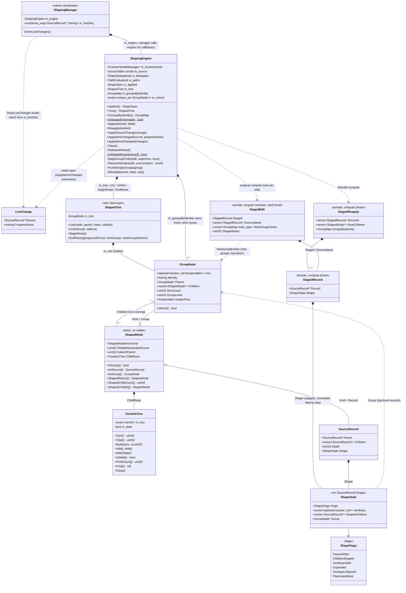
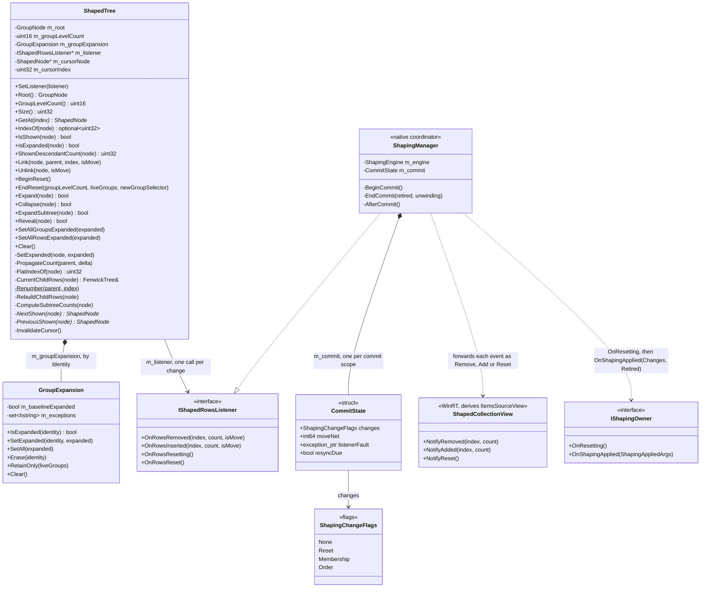
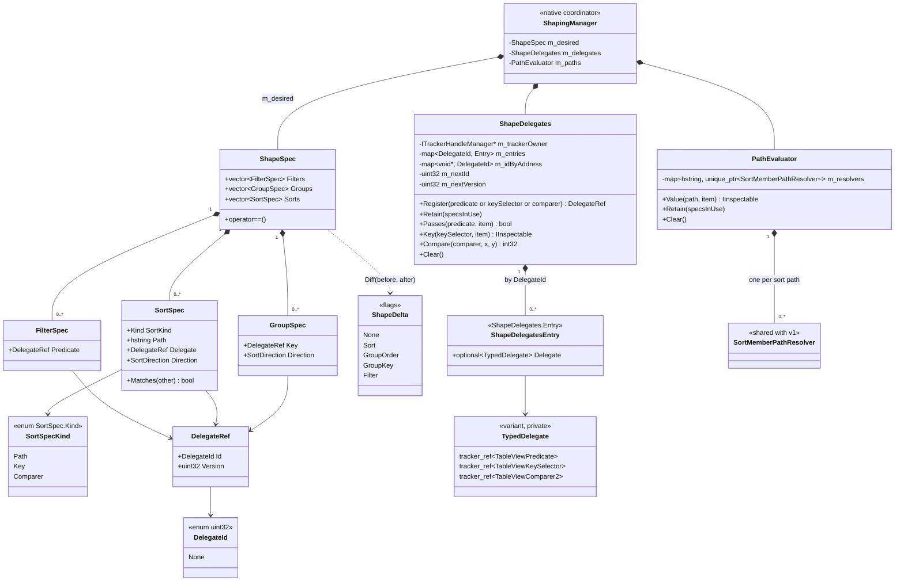

# TableView shaping redesign — TableViewSource2

**Status:** In progress. This doc grows section by section as each part of the design is agreed.
It covers only what exists in `controls/dev/TableViewSource2` today. Everything is declared; nothing
is implemented, and every verb still throws `hresult_not_implemented`.

**Related:**

- [TableView-Data-Pipeline-Current-Structure.md](TableView-Data-Pipeline-Current-Structure.md)
  describes the current (v1) pipeline this replaces.
- [TableView-Row-Identity-Reuse-Spec.md](TableView-Row-Identity-Reuse-Spec.md) is the source of the
  `SourceRecord` design.
- [Shaping-Architecture-Redesign-Original.md](Shaping-Architecture-Redesign-Original.md) is the
  original interface draft (`ShapeSpec`, `ShapePlan`, coordinator, fast paths). Kept unchanged as a
  reference; this doc records what is actually adopted.

## Directory layout

`controls/dev/TableViewSource2` is the domain root. Each layer below the runtime class lives in its
own subdirectory. Includes are relative to the root (the `.vcxitems` adds `$(MSBuildThisFileDirectory)`
to the include path), e.g. `#include "Source/SourceTable.h"`; files inside a layer include siblings
by bare name.

```text
controls/dev/TableViewSource2/
  TableViewSource2.idl / .h / .cpp / .vcxitems   public runtime class (verbs, Refresh, IsLiveShaping)
  Source/                                        source layer: input collection + record table
    CollectionAccessor2.h
    SourceRecord.h                               SourceRecord, SourceChange
    SourceHierarchy.h                            ISourceHierarchyHost, SourceHierarchy, ParentKeyHierarchy,
                                                 ChildCollectionsHierarchy
    SourceTable.h                                SourceTable (records + shared source tree; owns the strategy)
  Spec/                                          shape spec: verbs in force (data) + delegate registry + path evaluator
    ShapeSpec.h                                  ShapeSpec, FilterSpec, SortSpec, GroupSpec, DelegateRef, ShapeDelta
    PathEvaluator.h                              PathEvaluator (cached SortMemberPathResolver per sort path)
    ShapeDelegates.h                             ShapeDelegates (tracker_ref'd app delegates)
  Engine/                                        shaping engine and the shaped tree
    ShapedTree.h                                 GroupNode, IShapedRowsListener,
                                                 ShapedTree (shaped root, counts, reads, expansion, row events)
    ShapeState.h                                 ShapedNode (node base), ShapeState, ShapeFlags (engine state inline on SourceRecord)
    FenwickTree.h                                FenwickTree (per-list visible-row index, P1)
    GroupExpansion.h                             GroupExpansion (group expansion model, keyed by GroupNode::Identity)
    ShapingEngine.h                              ShapingEngine (applied spec, ShapedTree, entry points)
  View/                                          WinRT projections of the shaped tree
    ShapedCollectionView.h                       ShapedCollectionView (the WinRT visible list; header row value is the shared GroupedEntry)
    ShapedRowMetadata.h                          ShapedRowMetadata (ITableViewRowMetadataProvider adapter)
    ShapedRowQueries.h                           ShapedRowQueries (read-only row queries the adapters use)
  Shaping/                                       owns and wires the layers above
    IShapedExpansion.h                           IShapedExpansion, ExpansionAxis (expansion actions for ShapedRowMetadata)
    IShapingOwner.h                              IShapingOwner, ShapingAppliedArgs (owner channel to TableView)
    ShapingManager.h                             ShapingManager (the coordinator)
```

## Why redesign

The v1 pipeline (`TableViewSource` → `ShapedItemsSource` → adapters) has two structural costs:

1. **It re-reads the source on almost every change.** Each filter, group and hierarchy change, and
   every collection change outside two narrow single-item paths, calls `Refresh()`. That enumerates
   the whole source again (`Materialize`). Frameworks that keep a cached full set (AG Grid,
   DevExtreme, WPF `EnumerableCollectionView`, DynamicData) reshape from that cache instead.
2. **Row identity is computed over and over.** The same object's address and identity string are
   derived several times per rebuild, by several components, and each component keeps its own
   copy.

The redesign keeps one record per source row, kept current by change notifications. That record
table serves as both the shared identity store and the cached full set that shaping runs over.

## Components so far

| # | Component | Files | State |
|---|---|---|---|
| 1 | Public verb API | `TableViewSource2.idl` | Declared |
| 2 | `TableViewSource2` runtime class | `TableViewSource2.h/.cpp` | Verbs are stubs; `Refresh` and `IsLiveShaping` are declared |
| 3 | Source collection resolution: `CollectionAccessor2` | `Source/CollectionAccessor2.h` | Declared, not implemented |
| 4 | Source tracking and source tree: `SourceRecord`, `SourceTable`, `SourceChange`; hierarchy strategies `SourceHierarchy`, `ParentKeyHierarchy`, `ChildCollectionsHierarchy` | `Source/SourceRecord.h`, `Source/SourceTable.h`, `Source/SourceHierarchy.h` | Declared, not implemented |
| 5 | Shape spec: `ShapeSpec`, `ShapeDelegates`, `PathEvaluator` | `Spec/ShapeSpec.h`, `Spec/ShapeDelegates.h`, `Spec/PathEvaluator.h` | Declared, not implemented; ownership decided (desired in `ShapingManager`, applied in engine) |
| 6 | Shaping engine and shaped tree: `ShapingEngine`; node types `ShapedNode` (base), `GroupNode`; per-record `ShapeState`; `ShapedTree` (root, counts, reads, expansion) and its `IShapedRowsListener`; `FenwickTree`; `GroupExpansion` | `Engine/ShapingEngine.h`, `Engine/ShapedTree.h`, `Engine/ShapeState.h`, `Engine/FenwickTree.h`, `Engine/GroupExpansion.h` | Declared, not implemented |
| 7 | Visible list: the WinRT visible list `ShapedCollectionView` (an `ItemsSourceView` subclass that `ShapingManager::View()` returns) and its header token (the shared v1 `GroupedEntry`, `GroupedSourceAdapter/GroupedEntry.h`); row metadata `ShapedRowMetadata`; their read-only queries `ShapedRowQueries` | `View/ShapedCollectionView.h`, `View/ShapedRowMetadata.h`, `View/ShapedRowQueries.h` | Declared, not implemented |
| 8 | Coordinator: `ShapingManager` (also the tree's `IShapedRowsListener` and the adapters' `IShapedExpansion`); owner channel `IShapingOwner` | `Shaping/ShapingManager.h`, `Shaping/IShapedExpansion.h`, `Shaping/IShapingOwner.h` | Ownership decided; verbs, handlers, `View()`, `RowMetadata()`, the expansion actions, owner notifications (#18), the commit scope, group expansion and engine declared; not implemented |

## Class diagram

Four diagrams, one per area: public surface, source layer and coordinator (below); then the spec,
the engine, and the shaped tree with its row events. `ShapingManager` appears in each as the hub.

```mermaid
classDiagram
    direction TB

    class TableViewSource2 {
        <<WinRT runtimeclass, ReferenceTracker>>
        -unique_ptr~ShapingManager~ m_shapingManager
        -IShapingOwner* m_owner
        -vector~OwnerReleasedWaiter~ m_ownerReleasedWaiters
        +From(items)$ TableViewSource2
        +Filter(predicate) TableViewSource2
        +GroupBy(keySelector, groupDirection) TableViewSource2
        +Sort(sortMemberPath, direction) TableViewSource2
        +Sort(keySelector, direction) TableViewSource2
        +Sort(comparer) TableViewSource2
        +ParentBy(keySelector, parentKeySelector) TableViewSource2
        +ChildrenBy(childrenSelector) TableViewSource2
        +ClearFilter() TableViewSource2
        +ClearGroupBy() TableViewSource2
        +ClearSort() TableViewSource2
        +ClearHierarchy() TableViewSource2
        +Refresh()
        +DeferRefresh() IClosable
        +IsLiveShaping : bool
        +AppliedSpec() ShapeSpec*
        +TrySetOwner(owner) bool
        +ReleaseOwner(owner)
        +AddOwnerReleasedWaiter(waiter, handler)
        +RemoveOwnerReleasedWaiter(waiter)
        +BeginLiveShapingHold() noexcept
        +EndLiveShapingHold()
    }

    class DeferRefreshHandle {
        <<WinRT IClosable>>
        -weak_ref~TableViewSource2~ m_source
        -bool m_closed
        +Close()
    }

    class CollectionAccessor2 {
        -tracker_ref~IInspectable~ m_read
        -tracker_ref~IInspectable~ m_observe
        -ReadKind m_readKind
        -ObserveKind m_observeKind
        +GetReadKind() ReadKind
        +GetObserveKind() ObserveKind
        +IsIndexable() bool
        +IsObservable() bool
        +Count() uint32
        +TryGetAt(index, item) bool
        +Enumerate(throwIfUnsupported) vector~IInspectable~
        +AsNotifyCollectionChanged(useSafeGet) INotifyCollectionChanged
        +AsObservableVector(useSafeGet) IObservableVector~IInspectable~
        +AsBindableObservableVector(useSafeGet) IBindableObservableVector
    }

    class SourceChange {
        +NotifyCollectionChangedAction Kind
        +SourceRecord* OldParent
        +SourceRecord* NewParent
        +uint32 OldIndex
        +uint32 NewIndex
        +vector~SourceRecord*~ Added
        +vector~SourceRecord const*~ Removed
    }

    class IShapingOwner {
        <<interface>>
        +OnResetting()
        +OnShapingApplied(ShapingAppliedArgs)
    }

    class ShapingAppliedArgs {
        +ShapingChangeFlags Changes
        +span~SourceRecord*~ Retired
    }

    class ExpansionAxis {
        <<enum>>
        Groups
        Rows
    }

    class ShapingManager {
        <<native coordinator>>
        -shared_ptr~SourceTable~ m_sourceTable
        -ShapeSpec m_desired
        -ShapeDelegates m_delegates
        -PathEvaluator m_paths
        -optional~tracker_ref~ItemsSourceView~~ m_view
        -shared_ptr~ShapedRowMetadata~ m_rowMetadata
        -ShapingEngine m_engine
        -ShapedRowQueries m_rows
        -IShapingOwner* m_owner
        -unordered_map~SourceRecord*, hstring~ m_liveDirty
        -bool m_liveDrainPosted
        -uint32 m_liveHoldCount
        -uint32 m_deferDepth
        -bool m_isApplying
        -bool m_resyncPosted
        -CommitState m_commit
        -uint32 c_bulkThreshold$
        -uint32 c_liveBulkThreshold$
        +Filter/GroupBy/Sort/ParentBy/ChildrenBy/Clear*()
        +Refresh()
        +BeginDeferRefresh()
        +EndDeferRefresh()
        +IsRefreshDeferred() bool
        +IsLiveShaping : bool
        +AppliedSpec() ShapeSpec
        +BeginLiveShapingHold() noexcept
        +EndLiveShapingHold()
        +SetOwner(sink)
        +View() ItemsSourceView
        +RowMetadata() shared_ptr~ITableViewRowMetadataProvider~
        +IsItemInShapedTree(item) bool
        +Clear()
        -SetExpanded(node, desired) bool
        -SetAllExpanded(axis, expanded)
        -ExpandSubtree(node)
        -Reveal(node) optional~uint32~
        -OnSourceChanged(change)
        -OnItemChanged(record, propertyName)
        -ApplyDesiredSpec()
        -Reapply()
    }

    class ShapedRowQueries {
        <<native, read-only>>
        -ShapingEngine const& m_engine
        -SourceTable const& m_source
        +RowCount() uint32
        +RowAt(index) ShapedNode*
        +IndexOfKey(key) optional~uint32~
        +IndexOfItem(value) optional~uint32~
        +RowInfo(index) TableViewRowInfo
        +TryResolveKey(key) ShapedNode*
        +IsHierarchical() bool
        +TryGetGroupMembership(index, position, size) bool
        +IsItemInShapedTree(item) bool
    }

    class IShapedExpansion {
        <<interface>>
        +SetExpanded(node, desired) bool
        +SetAllExpanded(axis, expanded)
        +ExpandSubtree(node)
        +Reveal(node) optional~uint32~
    }

    class ShapedCollectionView {
        <<WinRT, derives ItemsSourceView>>
        -ShapedRowQueries const* m_rows
        #GetSizeCore() int
        #GetAtCore(index) IInspectable
        #HasKeyIndexMappingCore() bool
        #KeyFromIndexCore(index) hstring
        #IndexFromKeyCore(key) int
        #IndexOfCore(value) int
        +NotifyRemoved(index, count)
        +NotifyAdded(index, count)
        +NotifyReset()
        +Detach()
    }

    class ShapedRowMetadata {
        <<ITableViewRowMetadataProvider adapter>>
        -ShapedRowQueries const* m_rows
        -IShapedExpansion* m_expansion
        +GetRowInfo(index) TableViewRowInfo
        +GetIdentity(index) hstring
        +TryGetIndexForIdentity(identity, index) bool
        +Expand/Collapse/Toggle(key) bool
        +ExpandAll*/CollapseAll*()
        +ExpandSubtree(key)
        +Reveal(key) int
        +IsHierarchicalSource() bool
        +TryGetGroupMembership(rows, index, position, size) bool
        +Detach()
    }

    class GroupedEntry {
        <<WinRT, IGroupedEntryTag, shared with v1>>
        -IInspectable m_group
        -hstring m_identity
        -int32 m_groupItemCount
        -bool m_isExpanded
        +Group() IInspectable
        +Identity() hstring
        +GroupItemCount() int32
        +IsExpanded() bool
        +TryGetGroupedEntry(value)$ com_ptr~GroupedEntry~
    }

    class ISourceHierarchyHost {
        <<interface>>
        +TrackerOwner() ITrackerHandleManager*
        +WeakHost() weak_ptr~ISourceHierarchyHost~
        +CurrentHierarchy() SourceHierarchy*
        +RootRecords() vector~SourceRecordPtr~
        +CreateRecord(item) SourceRecordPtr
        +ReleaseRecord(record)
        +ValidateIncoming(items, replacing)
        +SiblingsOf(parent) vector~SourceRecord*~
        +Reparent(record, newParent, index)
        +AdmitChange(isReset) bool
        +RaiseSourceChanged(kind, oldParent, newParent, oldIndex, newIndex, added, removed)
        +RequestReset()
    }

    class SourceHierarchy {
        <<abstract>>
        +Prepare(host, rootItems)
        +MatchForRefresh(host, rootMatches, removed)
        +Commit(host, added)
        +CollectIncoming(item, items)
        +OnInserted(host, record)
        +OnRemoving(host, record)
        +OnMoved(host, record, fromIndex, toIndex)
        +Reevaluate(host, record, propertyName)
        +TakeChildRecords(host, removed)
        +Release(host)
    }

    class ParentKeyHierarchy {
        -optional~tracker_ref~TableViewKeySelector~~ m_keySelector
        -optional~tracker_ref~TableViewKeySelector~~ m_parentKeySelector
        -unordered_map~hstring, SourceRecord*~ m_keyIndex
        -unordered_map~SourceRecord const*, NodeKeys~ m_nodeKeys
        -unordered_map~hstring, uint32~ m_stagedKeyIndex
        -vector~NodeKeys~ m_stagedNodeKeys
    }

    class ChildCollectionsHierarchy {
        -optional~tracker_ref~TableViewChildrenSelector2~~ m_childrenSelector
        -unordered_map~SourceRecord const*, unique_ptr~ChildFeed~~ m_childFeeds
        -vector~StagedNode~ m_staged
    }

    class ChildFeed {
        +SourceRecordWeakPtr Owner
        +optional~CollectionAccessor2~ Accessor
        +event_token EventToken
        +vector~SourceRecordPtr~ Records
    }

    class SourceTable {
        -ITrackerHandleManager* m_trackerOwner
        -optional~CollectionAccessor2~ m_sourceAccessor
        -event_token m_sourceEventToken
        -vector~SourceRecordPtr~ m_records
        -vector~SourceRecord*~ m_topLevel
        -unique_ptr~SourceHierarchy~ m_hierarchy
        -optional~unique_ptr~SourceHierarchy~~ m_pendingHierarchy
        -unordered_map~void*, SourceRecord*~ m_rawLookup
        -unordered_map~ObjectAddress, SourceRecord*~ m_addressLookup
        -bool m_identityIndexEnabled
        -unordered_map~hstring, SourceRecord*~ m_identityIndex
        -bool m_liveShapingEnabled
        -shared_ptr~ThreadBinding~ m_binding
        -SourceChangedHandler m_sourceChanged
        -ItemChangedHandler m_itemChanged
        -uint32 m_freezeDepth
        -uint32 m_resetHoldDepth
        -bool m_diverged
        -bool m_rereadDue
        -bool m_rereadPosted
        +Create(owner, source)$ shared_ptr~SourceTable~
        +BindOwnerThread()
        +Refresh()
        +Clear()
        +IsDetached() bool
        +Size() uint32
        +At(index) SourceRecord*
        +Records() vector~SourceRecordPtr~
        +TopLevel() vector~SourceRecord*~
        +HasHierarchy() bool
        +SetParentKeyHierarchy(key, parentKey)
        +SetChildCollectionHierarchy(children)
        +ClearHierarchy()
        +SetSourceChangedHandler(handler)
        +SetItemChangedHandler(handler)
        +BeginFreeze()
        +EndFreeze() bool
        +IsFrozen() bool
        +BeginHoldResets()
        +EndHoldResets() bool
        +ScheduleRefresh()
        +IsRereadDue() bool
        +SetLiveShaping(enabled)
        +IsLiveShaping() bool
        +TryFindByRawPointer(item) SourceRecord*
        +TryFindByAddress(address) SourceRecord*
        +TryFindByItem(item) SourceRecord*
        +EnableIdentityIndex()
        +DisableIdentityIndex()
        +HasIdentityIndex() bool
        +TryFindByIdentity(identity) SourceRecord*
        -SubscribeToSourceChanges()
        -UnsubscribeFromSourceChanges()
        -OnSourceCollectionChanged(args)
        -OnSourceVectorChanged(args)
        -OnSourceBindableVectorChanged()
        -MatchRecords(items, removed)
        -CommitRecords(items, matches, added)
        -ValidateItems(items)$
        -InsertAt / RemoveAt / ReplaceAt / Move
        -ResetTreeToFlat()
        -RaiseSourceChanged(kind, oldParent, newParent, oldIndex, newIndex, added, removed)
        -DrainPendingChanges()
        -PostReread()
        -SubscribeRecordPropertyChanged(record)
        -UnsubscribeRecordPropertyChanged(record)
        -OnRecordPropertyChanged(weakRecord, propertyName)
    }

    class SourceRecord {
        +tracker_ref~IInspectable~ Item
        +ObjectAddress Address
        +event_token PropertyChangedToken
        +WatchState Watch
        +SourceRecord* Parent
        +vector~SourceRecord*~ Children
        +uint16 Depth
        +ShapeState Shape
        +HasChildren() bool
        -hstring m_identity
        +Identity() hstring
        +TryParseIdentity(identity)$ optional~ObjectAddress~
    }

    class WatchState {
        <<enum>>
        Unchecked
        NotObservable
        Subscribed
    }

    class TableViewPredicate {
        <<delegate>>
        Boolean(Object item)
    }
    class TableViewKeySelector {
        <<delegate>>
        Object(Object item)
    }
    class TableViewComparer2 {
        <<delegate>>
        Int32(Object x, Object y)
    }
    class TableViewChildrenSelector2 {
        <<delegate>>
        Object(Object item)
    }
    class SortDirection {
        <<enum>>
        None
        Ascending
        Descending
    }

    TableViewSource2 *-- ShapingManager : unique_ptr (forwards verbs)
    TableViewSource2 ..> IShapingOwner : raw m_owner, arbitrates (single owner, waiters)
    TableViewSource2 ..> DeferRefreshHandle : DeferRefresh() returns
    IShapedExpansion ..> ExpansionAxis : SetAllExpanded
    IShapingOwner ..> ShapingAppliedArgs
    ShapingManager *-- SourceTable : shared_ptr (weak captures in handlers only)
    ShapingManager *-- ShapedRowQueries : m_rows (by value, reads m_engine and SourceTable)
    ShapingManager ..|> IShapedExpansion : private
    ShapingManager o-- ShapedCollectionView : m_view (tracked, TableView also holds it)
    ShapedCollectionView ..> ShapedRowQueries : raw pointer, nulled by Detach()
    ShapedCollectionView ..> GroupedEntry : header row value
    ShapingManager o-- ShapedRowMetadata : m_rowMetadata (shared_ptr, TableView also holds it)
    ShapedRowMetadata ..> ShapedRowQueries : raw pointer, nulled by Detach()
    ShapedRowMetadata ..> IShapedExpansion : raw pointer, nulled by Detach()
    ShapingManager ..> IShapingOwner : raw m_owner sink (set by SetOwner), OnResetting, OnShapingApplied
    SourceTable *-- CollectionAccessor2 : owns source accessor (optional, reset on Clear)
    SourceTable ..> SourceChange : raises (single handler)
    SourceTable "1" *-- "0..*" SourceRecord : sole strong shared_ptr per source position
    SourceRecord --> WatchState
    SourceTable ..|> ISourceHierarchyHost : private
    SourceTable *-- SourceHierarchy : m_hierarchy (null = flat)
    SourceHierarchy ..> ISourceHierarchyHost : host passed per call
    SourceHierarchy <|-- ParentKeyHierarchy
    SourceHierarchy <|-- ChildCollectionsHierarchy
    ChildCollectionsHierarchy "1" *-- "0..*" ChildFeed : m_childFeeds (one per non-null child collection)
    ChildFeed "1" *-- "0..*" SourceRecord : Records (sole strong refs to child records)
    ChildFeed ..> SourceRecord : Owner (weak)
    SourceRecord "1" o-- "0..*" SourceRecord : Children (non-owning, source order)
    TableViewSource2 ..> TableViewPredicate
    TableViewSource2 ..> TableViewKeySelector
    TableViewSource2 ..> TableViewComparer2
    TableViewSource2 ..> TableViewChildrenSelector2
    TableViewSource2 ..> SortDirection
```

<details>
<summary><b>Public surface, source layer and coordinator</b></summary>



</details>

<details>
<summary><b>Engine layer</b></summary>



</details>

<details>
<summary><b>View layer: shaped tree reads and row events</b></summary>



</details>

<details>
<summary><b>Spec layer</b></summary>



</details>


## 1. Public verb API

`TableViewSource2` reuses v1's `TableViewPredicate`, `TableViewKeySelector` (`TableViewSource.idl`) and `SortDirection`
(`TabularShaping/SortDirection.idl`). It declares only `TableViewComparer2` and `TableViewChildrenSelector2`,
which have no v1 equivalent:

| Type | Shape | Use |
|---|---|---|
| `TableViewPredicate` | `Boolean(Object item)` | `Filter` |
| `TableViewKeySelector` | `Object(Object item)` | `GroupBy`, `Sort`, `ParentBy` |
| `TableViewComparer2` | `Int32(Object x, Object y)`: negative when `x` sorts first, zero when equal, positive when after | `Sort` |
| `TableViewChildrenSelector2` | `Object(Object item)` returning a child collection, or `null` for a leaf | `ChildrenBy` |
| `SortDirection` | `None`, `Ascending`, `Descending` | `Sort`, `GroupBy` |

Verbs are fluent: each returns the same `TableViewSource2` so calls can be chained.

| Verb | Meaning |
|---|---|
| `From(items)` | Wraps any collection `TableViewSource.From` accepts. Throws `E_INVALIDARG` when `items` is null. |
| `Filter(predicate)` | Keeps only the items the predicate accepts. A second call replaces the first, as in v1. |
| `GroupBy(keySelector, groupDirection)` | Groups by key. `groupDirection` orders the groups by key (`None` = order of first appearance in the filtered source). `Sort` orders only the rows inside each group, never the groups. There is one `GroupBy`; v1's overload taking a group identity selector was removed. |
| `Sort(sortMemberPath, direction)` | Sorts by property path. Projected as `SortByPath`. |
| `Sort(keySelector, direction)` | Sorts by key selector. This is the default overload. |
| `Sort(comparer)` | Sorts by comparing whole items (like WPF's `CustomSort`). The comparer defines the full order of its level, so there is no direction. Projected as `SortWithComparer`. |
| `ParentBy(keySelector, parentKeySelector)` | Hierarchy over a flat source. Each item has a unique key and its parent's key (`null` for a root). |
| `ChildrenBy(childrenSelector)` | Hierarchy over a nested source. Each item returns its child collection. |
| `ClearFilter` / `ClearGroupBy` / `ClearSort` | Remove the matching verb. |
| `ClearHierarchy` | Removes the hierarchy declared by `ParentBy` or `ChildrenBy`. |
| `Refresh()` | Re-reads the source and rebuilds. It is for sources that do not raise change notifications. |
| `IsLiveShaping` | A get/set property, `false` by default. When true, an item's `PropertyChanged` re-applies the active verbs to that item. When false, property edits leave rows in place until the next collection change, verb or `Refresh`. |

Each `Sort` call appends a lower-priority level after the existing ones (`Sort(a).Sort(b)` sorts
by `a`, then `b`), unless it matches an existing level, in which case it replaces that level in
place. A path matches by string; a key selector or comparer matches only when the same delegate
object is passed again. `SortDirection::None` removes the matching level. `ClearSort` removes
every level. Unlike v1, group order no longer depends on
whether `Sort` was declared before or after `GroupBy`.

## 2. `TableViewSource2` runtime class

- **Not activatable.** It is created only through `From(items)`.
- **A `ReferenceTracker`, like v1.** `tracker_ref` members let the garbage collector walk
  references to app objects. `final_release` posts the delete to the constructing thread's
  `DispatcherQueue` when it has one; `From()` called off a dispatcher thread (`Task.Run`) has
  none, so the delete and `~TableViewSource2()` → `Clear()` run on the releasing thread.
  **Open:** for a table bound later by `SetOwner`, that thread may not be the owner's. Either
  marshal teardown to `SourceTable`'s bound queue or require `From()` on the UI thread.
- **Members:**
  - `m_shapingManager` is a `unique_ptr<ShapingManager>`, the coordinator (§6). It owns the
    `shared_ptr<SourceTable>`, which holds the app collection; the `shared_ptr` exists so event
    handlers (item `PropertyChanged`, child feeds through `WeakHost()`) can capture the table
    weakly. Nothing outside the coordinator holds the table. `~TableViewSource2()` calls `m_shapingManager->Clear()`, which
    empties the visible list first (see *Teardown order*) and then detaches the table (see *Reference tracking and teardown*), so a lingering table is empty and
    holds no `tracker_ref` bound to the dead owner.
  - Verbs validate their arguments, forward to `m_shapingManager`, and return `*this`.
  - No live-shaping flag. `IsLiveShaping` get/set forward through `m_shapingManager` to
    `SourceTable::IsLiveShaping()` / `SetLiveShaping()`, so `SourceTable::m_liveShapingEnabled` is
    the single source of truth. Implementation note: until `m_shapingManager` exists, the getter
    returns `false` and the setter has nothing to apply; Phase 1.4 constructs it in `From(items)`
    so this window does not occur in practice.
- **`Refresh()`** re-reads the source and rebuilds. It is for sources that do not raise change
  notifications, which the record table cannot otherwise detect.
- **`DeferRefresh()`** returns an `IClosable` handle that batches verbs into one reshape; see
  *`DeferRefresh` (decided)*.

## 3. Source collection resolution: `CollectionAccessor2`

`CollectionAccessor2` (`Source/CollectionAccessor2.h`) is the v2 copy of `ShapingHelpers::CollectionAccessor`.
It probes an `IInspectable` source once at construction and records two answers, so all indexed
reads, enumerations, and subscriptions agree by construction:

- `ReadKind`, first match wins: `IVector<IInspectable>` > `IVectorView<IInspectable>` >
  `IBindableVector` > `IIterable<IInspectable>` > `IBindableIterable`. The two iterable kinds are
  enumerable only (`IsIndexable()` false). `Iterable` keeps v1's CLR retry through
  `IBindableIterable` when the iterator fails with `E_NOINTERFACE`.
- `ObserveKind`, first match wins: `INotifyCollectionChanged` > `IObservableVector<IInspectable>` >
  `IBindableObservableVector`. The accessor owns this precedence; `SourceTable` and `ChildFeed`
  switch on `GetObserveKind()` and subscribe to that one interface through the matching typed
  `As*` getter (null for any other kind).

**Storage (decided, B4).** Two `tracker_ref<IInspectable>` members, `m_read` and `m_observe`, each
holding the resolved interface pointer, plus the two kinds. Readers cast the pointer back by kind
(the reinterpret `InspectingDataSource::OnBindableVectorChanged` already relies on), so no read
pays a QI. Unlike v1's `CollectionAccessor`, both are `tracker_ref`s bound to the owning
`TableViewSource2` (`ITrackerHandleManager const*`), matching `InspectingDataSource` so .NET GC can
trace cycles through the collection. There is one accessor per root source and one per
`ChildFeed`, so per-accessor cost matters with `ChildrenBy`: 2 tracker handles and about 50 B.

- Rejected: seven typed `tracker_ref`s (the source plus one per interface, `InspectingDataSource`'s
  shape): 168 B and 3-5 tracker handles per accessor, though the read members are exclusive and
  only one notification interface is ever subscribed.
- Rejected: only the source `tracker_ref`, querying the interface on each use: 1 handle, but a QI
  on every `Count`, `TryGetAt` and subscribe.

## 4. Source tracking: `SourceRecord` and `SourceTable`

### `SourceRecord`

There is one record per source position. It holds only values that depend on the object itself
and that live exactly as long as the item stays in the source.

| Member | Purpose |
|---|---|
| `Item` | A `tracker_ref<IInspectable>` bound to the owning `TableViewSource2` (matching `Vector<IInspectable>`). Keeps the item alive while in the table while letting the .NET GC collect cycles when an item references its owner. `get_abi(Item.get())` is the raw-pointer lookup key. `Item.get()` is used only on live paths; teardown paths use `Item.safe_get()` (see *Reference tracking and teardown*). |
| `Address` (`ObjectAddress` = `uintptr_t`) | The canonical `IUnknown` pointer: the object's physical identity. It costs one QI, at creation. |
| `Identity()` | The logical identity string: `"0x"` + `Address` in hex (fixed, D4; it is also the record's row key). It is formatted on first use and cached; this accessor is the only way to read it. |
| `TryParseIdentity(identity)` (static) | Inverse of `Identity()`: the `Address` it encodes, or `nullopt` (a `g|` group key or garbage). Lets `ShapedCollectionView::IndexFromKey` resolve a record through `TryFindByAddress`, which is always on, instead of the identity index (D4). |
| `PropertyChangedToken`, `Watch` | Live-shaping subscription state, revoked in `~SourceRecord()`. `NotObservable` records that an item has no `INotifyPropertyChanged`, so it is not probed again. |
| `Parent`, `Children`, `Depth`, `HasChildren()` | Source-tree links, written only by `SourceTable`. Non-owning; flat sources leave every record top-level (`Parent == nullptr`) with no children. See *Hierarchy: the source tree (`SourceTable` + `SourceHierarchy`)*. |
| `ShapeState Shape` | Engine state stored inline (`Engine/ShapeState.h`): filter flags, cached sort keys, filtered and sorted children, visible-descendant count. Written only by the engine and its `ShapedTree`. See *Engine state storage*. |

Records are not copyable. `SourceTable` holds the sole strong `shared_ptr<SourceRecord>` (`SourceRecordPtr`)
for each record so that `PropertyChanged` callbacks can capture `weak_ptr<SourceRecord>`
(`SourceRecordWeakPtr`) and call `.lock()` before use (returning `nullptr` once removed, with no
`Retired` flag needed). Callbacks raised off the UI thread are marshalled to the owning
`DispatcherQueue` before any weak pointer is locked (see *Threading* below). Downstream stages hold non-owning `SourceRecord*`
pointers and purge them synchronously from the `SourceChanged` handler before `SourceRecord` is destroyed—ensuring
`Item` stays alive until after all consumers drop the record, preventing COM address reuse (ABA).

### `SourceTable`

`SourceTable` owns the `CollectionAccessor2` and the source-change `event_token` for the input source,
maintaining the source records, addresses, identities, and lookups automatically. It also owns the
per-item `INotifyPropertyChanged` subscriptions used by live shaping, so it is the single place
where any external event (collection or item) enters the pipeline. Output projection lives outside
`SourceTable`.

```text
m_sourceAccessor   resolved read + change-notification interfaces for the bound source
Records()          root-collection records, one per source position, in source order (shared_ptr)
TopLevel()         top-level records of the source tree, in source order (flat: same as Records())
raw lookup         get_abi(item) -> SourceRecord*   always on; pipeline map-back, no QI
address lookup     Address       -> SourceRecord*   always on; duplicate check + COM identity lookup
identity index     Identity      -> SourceRecord*   shaped only; selection, focus, expansion
```

**Public lifecycle & internal synchronization:**

| Operation | Visibility | Behaviour |
|---|---|---|
| `Create(owner, source)` | Public (static) | The only way to build a table. `make_shared<SourceTable>(PrivateToken{}, owner)`, then private `AttachSource(source)`: resolves `CollectionAccessor2(owner, source)`, subscribes to change notifications (storing `m_sourceEventToken`), and performs the initial `Refresh()`. `owner` is the enclosing `TableViewSource2`'s `ITrackerHandleManager const*`. The constructor takes a private `PrivateToken`, so it is reachable by `make_shared` but not by callers; there is no default constructor. |
| `Refresh()` | Public | Re-enumerates `m_sourceAccessor` (and the hierarchy) and reconciles against existing records, reusing every record whose item is still in the same collection (initial load, `Reset`, out-of-sync recovery, the end of a freeze or reset hold, or explicit `Refresh()` for non-observable sources). One `Reset`. No-op when detached. See *Refresh: record reuse (decided)*. |
| `Clear()` | Public | Teardown, called by `~TableViewSource2()` on the UI thread while the owner is alive. Nulls both handlers (raises nothing), drops `m_pendingHierarchy`, releases `m_hierarchy` (`SourceHierarchy::Release`: unsubscribes every child collection via `safe_get`, destroys the child feeds and their records, drops the selectors and key index), unsubscribes from the source, clears the lookups wholesale, then destroys every root record, resets `m_sourceAccessor`, and nulls `m_trackerOwner`. Idempotent. Afterwards the table is detached. |
| `TopLevel()` / `HasHierarchy()` / `SetParentKeyHierarchy` / `SetChildCollectionHierarchy` / `ClearHierarchy` | Public | Source tree. See *Hierarchy: the source tree (`SourceTable` + `SourceHierarchy`)*. |
| `IsDetached()` | Public | True after `Clear()`. Every public entry point and event lambda returns early when detached. |
| `SetSourceChangedHandler` | Public | Single handler (the coordinator) for normalized, record-level `SourceChange` notifications. See *Source change notification* below. |
| `SetItemChangedHandler` | Public | Single handler (the coordinator) for per-record `PropertyChanged` notifications (`(SourceRecord*, hstring const& propertyName)`). See *Item property change notification* below. |
| `BeginFreeze` / `EndFreeze` / `IsFrozen` | Public | While frozen, source notifications are skipped (not applied; they set `m_diverged` and `m_rereadDue`). The `SourceChanged` dispatch holds a freeze too (no separate dispatching flag). `EndFreeze` reports whether the outermost freeze must be followed by `Refresh()` (re-read due and no reset hold open). See *Re-entrancy* below (#19). |
| `BeginHoldResets` / `EndHoldResets` / `ScheduleRefresh` | Public | `DeferRefresh` (WPF model): incremental changes are applied and raised as usual; a `Reset` is skipped (the table then stops applying changes until the re-read), and hierarchy verbs are parked. `ScheduleRefresh` owes a re-read without marking the table diverged. `EndHoldResets` reports whether the outermost hold must be followed by `Refresh()` (re-read due, or a hierarchy parked). See *`DeferRefresh` (decided)*. |
| `IsRereadDue` | Public | Divergence (decided): `m_diverged` means the table no longer matches the source; set by a skipped notification, a rejected change, a `Refresh()` that fails validation, or `RequestReset` (a strategy's rejected child change, through `ISourceHierarchyHost`). `m_rereadDue` means a re-read is owed; set by a skipped notification or `ScheduleRefresh`. Report points read it without clearing; `Refresh()` clears both on success, clears only `m_rereadDue` on a validation failure, and keeps both on any other throw. Read by the posted resync. See *Divergence* below. |
| `SetLiveShaping` / `IsLiveShaping` | Public | Enables or disables per-record `INotifyPropertyChanged` subscriptions across the table, irrespective of whether any shaping verbs are currently active. |
| `MatchRecords` / `CommitRecords` | Private | `Refresh()` steps for the root collection: match the validated materialization against `m_records` (position, then raw pointer, then address; unmatched records move out of `m_records` and the lookups into `removed`), then rebuild `m_records` in source order, creating the unmatched (no strategy hooks). |
| `InsertAt` / `RemoveAt` / `ReplaceAt` / `Move` | Private | Driven internally by `OnSourceCollectionChanged` / `OnSourceVectorChanged` / `OnSourceBindableVectorChanged`. Each ends in `RaiseSourceChanged`. |
| `ValidateItems` / `ValidateIncoming` | Private | Reject null and duplicate items before any mutation. See *Null and duplicate items* below. |
| `RaiseSourceChanged` / `DrainPendingChanges` / `PostReread` | Private | Raise the change, then destroy the removed records; after the outermost dispatch returns, `Refresh()` if a notification arrived while frozen. A change during `Refresh()`'s own `Reset` is posted (`PostReread`), never re-read synchronously (one synchronous re-read per turn). |
| `SubscribeRecordPropertyChanged` / `UnsubscribeRecordPropertyChanged` / `OnRecordPropertyChanged` | Private | Manage each record's `PropertyChangedToken` and `WatchState`, and forward `PropertyChanged` to `m_itemChanged`. |

**Source change notification:**

`SourceTable` is the only subscriber to the source. Downstream stages never subscribe to the
source themselves: a second subscription could see a change before the table has applied it, so
the table and the rows would disagree. Instead the table reports each change in terms of records.

```cpp
// Add, Remove, Replace, Move, Reset
using SourceChangeKind = winrt::Microsoft::UI::Xaml::Interop::NotifyCollectionChangedAction;

struct SourceChange
{
    SourceChangeKind Kind;
    SourceRecord* OldParent;                          // Remove, Replace, Move; nullptr = top level
    SourceRecord* NewParent;                          // Add, Replace, Move; nullptr = top level
    uint32_t OldIndex;                                // Remove, Replace, Move; within OldParent's children
    uint32_t NewIndex;                                // Add, Replace, Move; within NewParent's children
    std::vector<SourceRecord*> const& Added;          // Add, Replace (subtree, pre-order); Reset (records created)
    std::vector<SourceRecord const*> const& Removed;  // Remove, Replace (subtree, pre-order); Reset (records that left)
};
```

Flat sources always report null parents, so the indices are source positions. See *Hierarchy: the
source tree in `SourceTable`* for hierarchical sources.

The change kind reuses `NotifyCollectionChangedAction`. Its five values match exactly, so the
table adds no enum of its own. `NotifyCollectionChangedEventArgs` itself is not reused:

- It carries raw items, not `SourceRecord*`, so every consumer would look each item up again.
- Its `Reset` carries no items, but this `Reset` carries what left and what arrived.
- It cannot guarantee that removed records stay readable until the handler returns.
- It is a WinRT runtime class, so every change would cost an activation and two vectors. `SourceChange` is a stack struct.
- It would suggest the source's event is passed through. It isn't: `IVectorChangedEventArgs` (which has no Move) and multi-item, re-entrant or out-of-sync notifications are all converted to this one shape.

| Rule | Detail |
|---|---|
| Ordering | Update `m_records` and the lookups → raise `SourceChanged` → destroy removed records. The handler sees the updated table; removed records' `Item` and `Identity()` stay readable so they can be found among the visible rows. |
| Single, synchronous handler | Raised on the UI thread. Only the coordinator subscribes, and it fans out to engine, projection, and owner (selection, focus, sort-rank cleanup) in a fixed order. A C++ callback, not a WinRT event. |
| `Reset` | Carries what left and what arrived, not moves. Consumers reshape from `Records()` without re-reading the source. `Refresh()` raises `Reset`. |
| Multi-item notifications | Split into single-item changes, or reported as one `Reset`. Downstream only handles the simple cases. |
| Re-entrancy (decided, #19) | App code run inside the handler or any apply (filter predicate, comparer, key selector, or a binding in a row-event handler) may change the source again. The table is frozen while the coordinator or the `SourceChanged` dispatch holds `BeginFreeze`: the notification is **not applied** (records, links and lookups stay as they were, so no pointer held by the engine or the shaped tree dangles and no vector reallocates under a loop) and only sets `m_diverged` and `m_rereadDue`. When the outermost freeze ends, the source is re-read with `Refresh()` and one `Reset`. This replaces the earlier rule (apply the edit immediately, defer only the notification), which let `TopLevel()` and `Children` change under the engine's loops. |

**Divergence (decided):**

One flag, `m_diverged`, replaces three that meant the same thing (`m_pendingReset` for a change
while frozen or a `Reset` while held, `m_outOfSync` for a rejected change, and the dispatching flag
folded into the freeze). It means the table no longer matches the source. A second bit,
`m_rereadDue`, says a re-read is owed at the next report point. A notification is handled by the
table's state ("skip" = not applied; sets both bits):

| Table state | Incremental change | `Reset` (or multi-item) |
|---|---|---|
| Frozen (dispatch or commit scope) | skip | skip |
| Held (`DeferRefresh`), not diverged | apply | skip |
| Held, diverged | skip | skip |
| Free, not diverged | apply | re-read |
| Free, diverged | re-read | re-read |

- `m_diverged` is set by a skip, a rejected change (validation), a `Refresh()` that fails
  validation, and `RequestReset()` (the `ISourceHierarchyHost` member a strategy calls for a
  rejected child change). Cleared only by a successful `Refresh()`.
- `m_rereadDue` is set by a skip and by `ScheduleRefresh()` (`ShapingManager::Refresh` while a
  `DeferRefresh` is open: owes a re-read without marking the table diverged, so incremental
  changes keep showing until `Close`, as in WPF). Not set by a rejected change.
- Report points read it: `EndFreeze` returns true at the outermost freeze when it is set and no
  hold is open; `EndHoldResets` returns true at the outermost hold when it is set or a hierarchy
  is parked. Neither clears it; only `Refresh()` does:
  - success: both bits cleared once the table is rebuilt, before its `Reset` is raised, so a
    change a `Reset` handler makes is skipped and owed again rather than lost;
  - validation failure: `m_diverged` set, `m_rereadDue` cleared (now the same state as a
    rejection: the next notification recovers it, not every commit);
  - any other throw (app enumerator or selector): both bits kept, so the next report point
    (the next commit's `EndFreeze`) retries, as `m_pendingReset` did.
- **Anti-loop (decided: one synchronous re-read per turn).** Without a bound, a notification's
  `DrainPendingChanges` re-reads, the `Reset`'s handlers (or shaping callbacks) change the source,
  the change is skipped, the outermost `EndFreeze` reports again and the next synchronous re-read
  starts: an app that mutates on every `Reset` hangs the UI thread. So `Refresh()` never chains a
  second synchronous re-read: when its own `Reset` dispatch ends with a re-read owed, it calls
  `PostReread()` instead of reporting it. Every caller (`DrainPendingChanges`,
  `ShapingManager::ResyncSource`, a verb's `Refresh`, `EndDeferRefresh`) therefore runs at most one
  re-read per turn.
  - `PostReread()` posts one callback (`m_rereadPosted`) to the current thread's `DispatcherQueue`
    (as `PostLiveDrain` does, so it does not depend on `m_binding`). It runs `Refresh()`
    only if `IsRereadDue()` and the table is neither frozen nor held (otherwise that freeze's or
    hold's report point takes it) and swallows a throw (the flags follow the failure rules above).
  - No queue (headless or test): nothing is posted; the re-read stays owed until the next report
    point or `Refresh()`.
  - An app that mutates on every `Reset` still gets one re-read per turn, but the dispatcher keeps
    running input and layout between them, and the app sees its own loop.
  - Replaces the commit path's own "resync disturbed again → post" rule: both paths now share this
    one.
  - Rejected: a depth or count limit on synchronous re-reads (an arbitrary number, and it still
    blocks the turn for that many re-reads), and dropping the owed re-read (the table would stay
    diverged with nothing scheduled).
- Why two bits: with only `m_diverged`, a table diverged by a rejected change (the app caught the
  duplicate throw and kept going) would make every later commit's `EndFreeze` report true, and
  each verb or expand would run a re-read that fails validation again. A rejection is recovered
  by the next notification instead, as before. And `Refresh()` while deferred must not mark the
  table diverged, or later incremental changes would stop showing.
- Fixes a gap in the earlier design: after a freeze ended with a posted resync, a notification
  arriving before the resync ran saw only `m_pendingReset` and could be applied positionally onto
  a diverged table. Now it is a re-read; the posted resync then finds no re-read owed
  (`IsRereadDue()` false) and does nothing.
- Fixes a second gap: an open hold no longer lets a dispatch's or an expand's `EndFreeze` re-read
  in the middle of a `DeferRefresh` (two Resets); the owed re-read waits for `EndHoldResets`.
- Child feeds use the same table: `AdmitChange(isReset)`, where `isReset` covers a child `Reset`,
  a multi-item change and every `IBindableObservableVector` change. It returns true only for an
  incremental change on a table that is not frozen or diverged. Otherwise the host handles it:
  skip when frozen or held, re-read now when free (a validation throw reaches the app's `Add`).
  It is no longer `noexcept`. `RequestReset` is for rejections only.

**Item property change notification (live shaping):**

`SourceTable` also owns per-record `INotifyPropertyChanged` subscriptions. Subscriptions depend only
on `IsLiveShaping`, **never on which shaping verbs are active**:

| Rule | Detail |
|---|---|
| Verb-independent subscription | `SetLiveShaping(true)` subscribes every record in `m_records`, and `CreateRecord` subscribes newly added records while `m_liveShapingEnabled` is true. Adding or clearing verbs (`Filter`, `Sort`, `GroupBy`, `ParentBy`, `ChildrenBy`) never walks records to subscribe or unsubscribe. |
| `WatchState` caching | First probe sets `WatchState::Subscribed` (storing `PropertyChangedToken`) or `WatchState::NotObservable`. `SetLiveShaping(false)` revokes tokens and resets `Subscribed` → `Unchecked`, but preserves `NotObservable` so re-enabling does not re-QI non-observable items. |
| Automatic teardown | Removing a record (or `Clear()`) destroys the `SourceRecord`, whose destructor revokes `PropertyChangedToken` through `Item.safe_get()` (skipped if the item was already collected) before its `tracker_ref` handle is deleted. |
| Callback contract | Each subscription lambda captures `weak_from_this()` (`weak_ptr<SourceTable>`), `SourceRecordWeakPtr` (`weak_ptr<SourceRecord>`) and `m_binding`. On the bound thread, or while unbound, it locks the table and returns if it has expired; `OnRecordPropertyChanged` then locks the record (dropping stale notifications for removed records) and invokes `m_itemChanged(record, propertyName)`. Off the bound thread it marshals first (see *Threading*). Downstream (the coordinator) decides whether the changed property affects any active verb. |
| Table lifetime | `SourceTable` derives from `enable_shared_from_this` and is always owned by `shared_ptr` (`Create()`). Items belong to the app and can outlive the table; a notification already in flight when `~SourceRecord()` revokes, or a revoke that fails on a torn-down event source, would otherwise call into a freed table. The source-change lambdas (`CollectionChanged` / `VectorChanged`) use the same `weak_from_this()` guard, mirroring v1 `ShapedItemsSource`. Because `weak_from_this()` is empty in the constructor, all subscriptions start in `AttachSource()` / `SetLiveShaping()`, never in the constructor. Weak pointers are locked only on the bound thread (or, while unbound, the thread using the table; see *Threading*): a lock on a worker thread could become the last strong reference and run `~SourceTable()` (and its UI-affine revokes) there — v1 `TrackFlatItemPropertyChanged` has the same rule. |
| Empty property name | Per the `INotifyPropertyChanged` convention, an empty or null `PropertyName` means "all properties changed". It is forwarded unchanged; the coordinator treats it as a change to every dependency of the active verbs. |
| Reuse keeps subscriptions | `Refresh()` reuses records by raw pointer or address within the same collection (root or child feed), so a `Reset` or `Refresh()` does not drop and re-create subscriptions for items that are still there. |
| Cost trade-off | With `IsLiveShaping` true and no verbs active, every observable item is still subscribed and every `PropertyChanged` is forwarded. This is deliberate: verb changes never walk the table to (un)subscribe, and the coordinator drops events cheaply when no verb reads the property. Apps that do not need live shaping leave `IsLiveShaping` false (the default) and pay nothing. |

**Reference tracking and teardown:**

**Rule: every app-supplied object or delegate held natively goes through `tracker_ref`** bound to
the owning `TableViewSource2`. This covers:
- `CollectionAccessor2` (root and child feeds) and every `SourceRecord::Item`;
- the hierarchy selectors (held by the `SourceHierarchy` strategy: `m_keySelector`,
  `m_parentKeySelector`, `m_childrenSelector`);
- `ParentBy` object keys (`NodeKeys::KeyObject`);
- `GroupNode::Key`;
- the filter, sort and group delegates, once the shape spec stores them (Phase 2).

Why: a strong native reference to a .NET object (for example a lambda capturing the page or VM)
roots it, so the cycle back through `TableViewSource2` is invisible to the GC and leaks. v1 holds
its selectors strongly inside `std::function` and has this leak. XAML core does the same for event
handlers (`TrackerPtrFamily.h` wraps listener delegates in `TrackerPtr`), and `TableView` already
holds `tracker_ref<TableViewRowTemplateSelector>`. `tracker_ref` accepts any COM type, delegates
included.

Fields that can outlive their owner are `std::optional<tracker_ref<T>>` so they can be reset while
the owner is alive. Delegates are invoked only on live UI-thread paths, never during teardown.

The source subscription is a raw `event_token`, not `winrt::event_revoker`, which would hold an
untracked strong reference.

| Rule | Detail |
|---|---|
| Cost | Each record costs one `NewTrackerHandle` + `SetTrackerValue` on creation and one `DeleteTrackerHandle` on removal, the same as `Vector<IInspectable>`. A load or `Reset` of *n* items pays *n* of each. |
| Single source token | `SubscribeToSourceChanges` binds exactly one interface (`INotifyCollectionChanged` > `IObservableVector` > `IBindableObservableVector`). `UnsubscribeFromSourceChanges` re-derives it with the same precedence; no kind is stored. |
| No `tracker_ref` outlives the owner | `~tracker_ref` dereferences its owner even when empty. `Clear()` releases the hierarchy strategy (its selectors and key index are `std::optional` for this reason), destroys every record, resets `m_sourceAccessor`, and nulls `m_trackerOwner` while the owner is alive. |
| Detached table | After `Clear()` the table is empty and owner-free, so it is safe to outlive `TableViewSource2` (consumer `shared_ptr`s, or a posted off-thread lambda that has the table locked). Every entry point and event lambda checks `IsDetached()` and returns. `~SourceTable()` asserts it was detached and never touches `m_trackerOwner`. |
| GC-collected targets | `tracker_ref` holds no reference count; the owner's tracker handle does. When the GC collects a cycle (item ↔ VM ↔ `TableViewSource2`), items and the collection may already be collected when `final_release` → `~TableViewSource2()` → `Clear()` runs, and `tracker_ref::get()` would return a dangling pointer. So teardown never calls `get()`: handlers are nulled first (no consumer reads `Item` or `Identity()`), lookups are cleared wholesale (`RemoveFromLookups`, which reads `Item.get()`, is for incremental paths only), `~SourceRecord()` revokes via `Item.safe_get()`, and `UnsubscribeFromSourceChanges` uses the accessor's `AsXxx(true)`. Revoke failures are swallowed (`SafeRevoke`). |
| Address reuse | The owner's tracker handle keeps each item alive until the record is destroyed, so a COM address cannot be reused while its record is in the table. The only exception is GC collection of the whole cycle, where nothing remains to observe the reused address. |

**Threading** (same contract as v1 `ShapedItemsSource`):

| Rule | Detail |
|---|---|
| Owning thread | `Create()` may run on any thread. If the thread has a `DispatcherQueue`, it binds the table there; otherwise the table stays unbound. `ShapingManager::SetOwner(non-null)` calls `BindOwnerThread()`, which binds an unbound table once to the owner's (UI) thread. A bound table keeps its binding; `BindOwnerThread()` on a different thread only asserts in debug. All table state and both handlers belong to the bound thread. |
| Binding storage | `m_binding` is a `shared_ptr<ThreadBinding>` (`queue`, `atomic<DWORD> threadId`), shared with every item lambda so they never lock the table off-thread. `threadId` 0 means unbound; `queue` is written first and `threadId` stored with release order, loaded with acquire. The single unbound → bound write needs no lock: nothing could be posted while unbound, so no stale post exists. |
| Source collection changes | Must arrive on the owning thread, the contract every XAML collection consumer imposes. Not marshalled: marshalling would let `m_records` drift from the live collection between the event and its delivery. |
| Item change inline | On the bound thread, or while unbound: lock table → `OnRecordPropertyChanged` → lock record → `m_itemChanged`. |
| Item change off-thread, bound | `queue.TryEnqueue` posts a lambda holding only the two weak pointers and the property name; they are locked on the bound thread. Order is preserved per raising thread only; a record removed before the post runs fails its lock and the change is dropped (correct, since it left the table). Off-thread marshalling is kept as a convenience (v1 parity). |
| Failed `TryEnqueue` | Happens only while the queue shuts down (UI thread exiting); ignored. |
| No queue (headless or test) | Nothing is posted. The coordinator's live drain and the re-read run synchronously at the next verb or `Refresh`, never inside the app's setter. |
| Coalescing | Not done in `SourceTable`. Repeated changes are coalesced per dispatcher turn by the coordinator (Phase 5). |

**Threading review: dropped-change recovery (decided: option B).** An earlier draft dropped an
off-thread change it could not marshal, set `m_itemChangeDropped`, and on the next on-thread change
raised `ItemChanged(nullptr, L"")` so the coordinator (`m_liveAllDirty`) re-evaluated every record.
It was removed because it protected against almost nothing reachable:

- When a change could be dropped:
  - `TryEnqueue` fails only once the queue is shutting down (`ShutdownQueueAsync`, UI thread
    exiting). The queue is unbounded, so a busy UI thread never fails a post. The UI thread is
    going away, so the "next change on the owning thread" that triggered recovery never comes.
  - No queue: `Create()` ran on a thread without a `DispatcherQueue`. Binding at the owner (below)
    covers the pool-thread case; a pure test host drains at the next verb or `Refresh`.
- Recovery was lazy even when reachable: `ItemChanged(nullptr)` rode in on the next on-thread
  change, so with no further change the view stayed stale until a verb or `Refresh`.
- Nothing exercised it. In v1 the same mechanism (`m_liveShapingChangeDropped`,
  `ShapedItemsSource.cpp:84–108`, `:2935`) came in with the squash merge `866ba81a1c`, with no test
  or bug behind it. `TableView_LiveShaping_APITests` runs only on the UI thread. v1 supports a
  no-queue test host by restoring synchronously (`ShapedItemsSource.cpp:3028`) rather than posting.
- Platform precedent: no WinUI items control marshals data notifications.
  - TreeView's only `TryEnqueue` calls (`TreeViewItem.cpp:745`, `TreeViewList.cpp:337`) push its
    own `IsExpanded` update past layout; node and child-collection changes are assumed on the UI
    thread.
  - ListView's `CollectionView` and `CollectionViewSource` are `DependencyObject`s.
    `DependencyObject::CheckThread()` (`DependencyObject.cpp:427`) returns `RPC_E_WRONG_THREAD`
    off-thread; source `VectorChanged` and binding `PropertyChanged` are not marshalled.
  - Off-thread item marshalling is therefore a convenience beyond the platform; it is kept for v1
    parity, but the dropped-change flag has no counterpart and is gone.
- `Create()` does not require a queue. `TableViewSource2` is not a `DependencyObject`, and
  `From()` is legitimately called off the UI thread: view models built in `Task.Run`, headless
  view-model tests, sources built before any UI. A throw there would be stricter than the platform
  and surface far from the real use.

Decisions:

1. `m_itemChangeDropped`, `ItemChanged(nullptr)` and `ShapingManager::m_liveAllDirty` are removed.
2. A failed `TryEnqueue` is treated as shutdown and ignored.
3. Thread binding uses option B (below).
4. With no queue, live changes and re-reads are flushed synchronously at the next verb or
   `Refresh`, never inside the app's setter (v1's test-host fallback, moved to a safe point).
5. Off-thread item `PropertyChanged` marshalling is kept (v1 parity).

Thread binding options considered:

- **B. Bind once, only from the no-queue state (chosen).** A queue captured at `Create()` is kept;
  `BindOwnerThread()` on another thread asserts in debug. With no queue, `SetOwner` binds once to
  the owner's thread. Nothing can have been posted while there was no queue, so there is no stale
  post; only the single first write needs safe publication (release/acquire on `threadId`).
- **A. Rebind at every `TrySetOwner`** (rejected). Needs an uncontended lock per item
  notification, and a post already queued to the old queue runs on the old thread after the
  rebind, so the posted lambda would have to re-check the binding and re-post or drop.
- **C. Keep the `Create()` capture; no queue means no marshalling** (rejected). A source built in
  `Task.Run` never gets a queue, so every later off-thread change is delivered inline and races
  the UI thread.

**Null and duplicate items:**

Rejected in **all modes**, shaped or not. Every lookup key therefore maps to at most one record,
and enabling the first verb needs no validation pass.

| Rule | Detail |
|---|---|
| Behaviour change from v1 | v1 allows null items and the same object on several rows while unshaped (`RebuildUnshapedRows`), and throws only once a verb is active (`ValidateRowIdentities`). v2 throws on attach / change regardless of verbs. Apps binding `[a, a, b]` or lists containing `null` must use distinct objects per row. |
| Validate before mutate | `ValidateItems` (whole materialization, scratch raw-pointer + address sets) and `ValidateIncoming` (one item against `m_rawLookup`, then `m_addressLookup`, ignoring the position being replaced) touch no table state. A rejected change leaves `m_records`, the lookups and subscriptions as they were, and raises no `SourceChanged`. |
| Error | `hresult_invalid_argument`, reusing v1 messages: "The same item object appears in the source more than once. Rows are identified by object identity, so two rows backed by one object cannot be told apart. Use a distinct object per row." / "A row could not be given a stable identity: null item". |
| `Create()` / `Refresh()` | Validated upfront; the throw reaches the caller of `From(items)` or `Refresh()`. |
| Incremental change (`InsertAt` / `ReplaceAt`) | The throw propagates out of the `CollectionChanged` / `VectorChanged` handler, i.e. into the app's `Add()` / `Insert()` / indexer. `ReplaceAt` with the same object at the same index is allowed. |
| Divergence recovery | After a rejected incremental change (root, or a child collection through `RequestReset`) the source has already diverged from the table. `m_diverged` is set and every later notification, root or child, is handled as a whole-tree re-read (`Refresh()`: re-enumerate + validate) instead of a positional delta. The first one that validates raises a single `Reset` and clears the flag; `Refresh()` does the same. Positional deltas are never applied on top of a diverged table. Same flag as a skipped change, but no re-read is owed (`m_rereadDue` stays clear), so verbs and expansion do not retry a re-read that would fail again (see *Divergence*). |
| `Move` / `RemoveAt` | Cannot introduce null or duplicates; not validated. |

**Lookups:**

| Lookup | Notes |
|---|---|
| `TryFindByRawPointer` | Always on (`m_rawLookup`). Exact `get_abi(item)` hit, no QI. |
| `TryFindByAddress` | Always on (`m_addressLookup`). Canonical `IUnknown` address hit; also backs upfront duplicate-object detection in all modes. |
| `TryFindByItem` | Always O(1): checks `m_rawLookup` first, falling back to one QI + `m_addressLookup` when an item is reached through a different interface pointer. |
| `EnableIdentityIndex` / `DisableIdentityIndex` / `HasIdentityIndex` | Builds `m_identityIndex` in O(n) with no QI when the first shaping verb turns on; drops it when the last verb turns off so unshaped tables keep `Identity()` string formatting lazy. |
| `TryFindByIdentity` | Logical identity lookup (`m_identityIndex`). |

### Rules and differences from the identity spec

| Spec | Here | Why |
|---|---|---|
| D9: types in `TabularShaping` | In `TableViewSource2` | v1 stays untouched. The types can move down a layer when the hierarchy or rank code needs to hold records. |
| D5/D6: `addressSet` for duplicates only | `m_addressLookup` (`ObjectAddress` → `SourceRecord*`) always on | Serves duplicate-object detection, the address pass of the `Refresh()` match, and O(1) `TryFindByItem` fallback in one map; only `m_identityIndex` is toggled on/off with shaping. |
| v1: null / duplicate items allowed while unshaped | Rejected in all modes | Keeps every lookup one-to-one (no multimap, no per-key chains or counters) and removes the mode-dependent validation pass when the first verb turns on. Accepted breaking change. |
| D7/D9: projection stored inside `SourceRecordTable` | Split out of `SourceTable` | `SourceTable` strictly manages input source records, addresses, identities, and lookups; output projection belongs to the downstream stage. |
| D10/D21: co-owned `shared_ptr` + `Retired` flag | Sole strong `shared_ptr` in `SourceTable`, no `Retired` flag | Downstream stages hold `SourceRecord*` and purge synchronously before destruction; `weak_ptr::lock()` alone rejects late async callbacks. |
| Original draft §5.2: `ItemPropertyObserver` owned by the coordinator, subscribing only items read by live-enabled steps | Item subscriptions owned by `SourceTable`, gated only by `IsLiveShaping` | Tokens live on the record and are revoked by `~SourceRecord()`, so subscription lifetime matches record lifetime with no separate tracker. Property filtering by dependency moves to the coordinator's `ItemChanged` handler. |
| v1 `ShapedItemsSource` & `CollectionAccessor`: plain `IInspectable` references to source and items | `tracker_ref` bound to `TableViewSource2` (`ITrackerHandleManager`) for both `CollectionAccessor2` and `SourceRecord::Item`, plus raw `event_token` instead of `winrt::event_revoker` | Matches `InspectingDataSource` and `Vector<IInspectable>`: lets the .NET GC collect cycles when the collection or row items hold back-references to the page/VM/source. `~TableViewSource2()` calls `m_shapingManager->Clear()` (which calls `SourceTable::Clear()`) so tracker handles are deleted while the owner is still alive. |
| `ObjectAddress` type | Alias for `uintptr_t` | This branch has no `ObjectAddress` type. |

### Hierarchy: the source tree (`SourceTable` + `SourceHierarchy`)

With a hierarchy the tree must exist before any other verb runs:

- **Filter** keeps matches plus their ancestors, so it walks parent chains.
- **Sort** orders each sibling set separately.
- **`GroupBy`** buckets the top-level records.

So the tree is part of the source, not of shaping:
`SourceTable (records + source tree) → filter / sort / group over the tree → projection`.
Shaping reads only `TopLevel()` and `SourceRecord::Parent` / `Children` / `Depth`, and does not care
whether `ParentBy` or `ChildrenBy` built the tree.

The tree's **links** live on `SourceRecord` (`Parent`, `Children`, `Depth`) and `SourceTable` keeps
`m_topLevel` and the shared tree operations (`SiblingsOf`, `Reparent`, `UpdateDepths`,
`ResetTreeToFlat`). How the tree is **built and maintained** is per verb and lives in a
`SourceHierarchy` strategy that `SourceTable` owns (`m_hierarchy`; null = flat):
`ParentKeyHierarchy` for `ParentBy`, `ChildCollectionsHierarchy` for `ChildrenBy`. Strategies reach
the table only through `ISourceHierarchyHost`, so there is still one set of lookups, one validation
path, one re-entrancy gate and queue, one `SourceChanged` and one `Clear()`. See *Source tree
strategies* below.

**Record fields.** The record carries the *source* tree only; everything shaped lives in the shaped
tree (below).

| Member | Meaning | Who reads it |
|---|---|---|
| `SourceRecord* Parent` | Source parent; `nullptr` for top-level records | Reparent, ancestor walk for filter-with-ancestors |
| `std::vector<SourceRecord*> Children` | Non-owning, source order | Shaped tree reads it directly when no filter or sort is active (no copy) |
| `uint16_t Depth` | Top level = 0; never changed by grouping | Indent = spacer offset + per-level indent × `Depth`; `ShapedDepth()` |
| `HasChildren()` | Derived from `Children` | Source-tree checks only. Not expandability: under a filter it stays true when every child is filtered out; rows use `ShapedNode::ShapedChildCount()` |

Not in the source tree (decided by the shaped tree section): expanded state (`ShapeFlags::Expanded`
on the record's engine slot; the group expansion model keyed by `GroupNode::Identity`), group membership and group level (`GroupNode`), visible flag (presence in the visible
list), shaped depth (`ShapedDepth()` getter). Filtered and sorted children, filter flags, cached keys
and the visible-descendant count live in the engine-owned `ShapeState` slot on the record (see
"Engine state storage").

**`SourceTable` additions** (`Source/SourceTable.h`):

| Member | Purpose |
|---|---|
| `TopLevel()` / `m_topLevel` | Top-level records in source order (non-owning). Flat: mirrors `m_records`. |
| `SetParentKeyHierarchy(key, parentKey)` | `ParentBy`. Constructs a `ParentKeyHierarchy`, `Prepare`s it (validates the whole tree, throws before touching any record), releases the old strategy, `Commit`s, raises one `Reset`. |
| `SetChildCollectionHierarchy(children)` | `ChildrenBy`. Same flow with a `ChildCollectionsHierarchy`: `Prepare` enumerates every child collection eagerly and recursively and validates; `Commit` creates child records and subscribes every observable child collection. |
| `ClearHierarchy()` | Back to flat: releases the strategy; one `Reset`. |
| `m_hierarchy` (private) | The current `SourceHierarchy` strategy; null = flat. Kept off `SourceRecord`, so flat tables pay nothing. |
| `m_pendingHierarchy` (private) | A hierarchy verb received while resets are held (`DeferRefresh`): the unprepared strategy, or nullptr for `ClearHierarchy`. The current tree stays and keeps receiving changes until the re-read. |
| `SiblingsOf(parent)`, `Reparent`, `UpdateDepths`, `ResetTreeToFlat` (private) | The shared tree operations; `SiblingsOf` and `Reparent` are also `ISourceHierarchyHost` members for the strategies. |

**Source tree strategies (decided: split hierarchy out of `SourceTable`, option A)**
(`Source/SourceHierarchy.h`). `SourceTable` keeps what is always on (records, lookups, live
shaping, the re-entrancy gate) and the shared tree; each hierarchy verb's state and maintenance is
a `SourceHierarchy` strategy owned as `std::unique_ptr` (null = flat).

| Part | Detail |
|---|---|
| `SourceHierarchy` | Two-phase build `Prepare(host, rootItems)` (every app call and check over the given root items, staged by root position, writes only the strategy's scratch state, may throw) then `Commit(host, added)` (links every record, reusing kept child records and creating the rest; no app calls); `MatchForRefresh(host, rootMatches, removed)` (`Refresh()` only, between the two: per-feed match, unmatched records leave the lookups); `CollectIncoming(item, items)` (what an incoming root item brings, for validation); `OnInserted` / `OnRemoving` / `OnMoved` (root edits; a replace is remove then insert); `Reevaluate(host, record, property)` (live key or children-property edits); `TakeChildRecords(host, removed)` (before a strategy is replaced or cleared: unsubscribe feeds, move child records into the `Reset`'s `Removed`); `Release(host)` (teardown-safe: unsubscribe feeds, release child records, drop selectors and keys). |
| `ParentKeyHierarchy` | The two selectors, `NodeKeys` (with `KeyObject`), `m_keyIndex` / `m_nodeKeys`, and staged copies filled by `Prepare`, keyed by root position and resolved through `RootRecords()` at `Commit`. `MakeNodeKey`, `ValidateNoCycles`. `CollectIncoming` adds nothing. |
| `ChildCollectionsHierarchy` | The children selector, `ChildFeed` (weak `Owner`, `optional<CollectionAccessor2>`, `event_token`, the sole strong `SourceRecordPtr`s in collection order), `m_childFeeds`, and `m_staged` (pre-order `StagedNode`s: item, child collection, child count, and the `Match` kept by `MatchForRefresh`) so `Commit` creates and subscribes without calling app code again. Child-collection handlers are entry points the event lambdas call after locking the host and checking `AdmitChange(isReset)` and `CurrentHierarchy() == this`. |
| `ISourceHierarchyHost` | Implemented privately by `SourceTable`: `TrackerOwner`, `WeakHost`, `CurrentHierarchy`, `RootRecords`, `CreateRecord` / `ReleaseRecord`, `ValidateIncoming`, `SiblingsOf` / `Reparent`, `AdmitChange(isReset)` (the #19 gate; a child `Reset` or multi-item change passes `true`), `RaiseSourceChanged`, `RequestReset` (a rejected child change only: sets `m_diverged`). |
| Verb flow | Construct, `Prepare` over the current root items (a throw leaves the old tree and strategy), `TakeChildRecords` and `Release` the old, `ResetTreeToFlat`, `Commit`, one `Reset`. Child records of the old strategy are not reused (a verb change). Under `DeferRefresh` the verb only parks the unprepared strategy in `m_pendingHierarchy`; the re-read at `Close` prepares and commits it. |
| Refresh flow | Read (`Prepare` over the re-enumerated root), match (`MatchRecords`, `MatchForRefresh`), link (`CommitRecords`, `ResetTreeToFlat`, `Commit`), one `Reset`. See *Refresh: record reuse (decided)*. |

Rejected: a `HierarchicalSourceTable` subclass (the hierarchy is set and cleared on a live table,
and lookups, live shaping and removal all need hierarchy hooks); extracting only the child feeds
into a `ChildFeedSet` (`SourceTable` keeps the per-kind branches); strategies as `friend`s holding
`SourceTable&` (no boundary at all); keeping everything in `SourceTable` (about a third of the
class serves one verb). Cost: a virtual call per root edit while a hierarchy is active, and one more
header.

**Refresh: record reuse (decided: reuse, per-feed match).** A re-read creates a `SourceRecord`
only for an item it cannot match, in the root collection and in every child collection alike.

1. **Read.** Re-enumerate the root, `ValidateItems`, then `Prepare(host, rootItems)` on the
   parked strategy if any, else the current one (`ChildrenBy` re-enumerates every child
   collection; `ParentBy` re-reads every key). Every app call and check happens here; a throw
   leaves the table untouched.
2. **Match.** `MatchRecords` matches the root against `m_records`; `MatchForRefresh` matches each
   kept record's feed against the staged children at the same position. Rules, per collection:
   raw pointer at the same position, then raw pointer or address among the unmatched. There is no
   matching across collections. Every unmatched record (with its subtree) moves out of the lookups
   into `Removed` **before anything is created**, so an item that moved to another parent, or
   between the root and a child collection, gets a new record instead of colliding with its old
   one.
3. **Link.** `CommitRecords` rebuilds `m_records` in source order, creating the unmatched root
   records without strategy hooks. A parked strategy replaces the current one here
   (`TakeChildRecords`, `Release`). `ResetTreeToFlat`, then `Commit` relinks every record
   (`Parent` / `Children` / `Depth`), reusing kept child records, creating the rest, swapping a
   feed's accessor and subscription when the child collection object changed, and dropping a feed
   whose collection is now null.
4. **Raise.** One `Reset`: `Added` = records created, `Removed` = records that left (alive for
   the handler, destroyed after it).

A reused record keeps its pointer, `Identity()`, `PropertyChanged` subscription and
`ShapeFlags::Expanded`. Its shaping state is rewritten by the `Reapply()` the `Reset` triggers. An
item without stable COM identity (a value boxed anew on every `GetAt`) never matches, so its record
is recreated on every re-read.

Rejected:
- **Whole-tree matching through the existing lookups** (keeps a record that moved between
  collections, at the cost of moving `SourceRecordPtr`s between feeds). Per-feed matching keeps
  ownership local; a moved item is treated as remove plus add.
- **Recreating every child record** (`Release` then `Commit`, the earlier implied behavior). It
  loses expansion and re-subscribes every child on each re-read.
- **Subtree-scoped `Reset` for a rejected child change.** It needs a new `SourceChange` kind that
  the engine, the shaped tree and the owner must all handle. With reuse, a whole-tree re-read costs
  only the enumeration. A rejected child change calls `RequestReset`, which sets `m_diverged`
  like a rejected root change.

`Records()` / `Size()` / `At()` stay the root collection (owning, source order). `ChildrenBy` records
are owned by their feed and are not in `Records()`, but they are in the lookups, the identity index,
validation and live shaping. Shaping walks `TopLevel()` and `Children`, never `Records()`.

| Decision | Detail |
|---|---|
| Eager materialization | `ChildrenBy` enumerates every child collection up front, recursively. Filter and sort always cover the whole tree. No load-on-expand. |
| One object, one position | Null and duplicate items are rejected across the whole tree, including child collections. Identity stays the item itself; there is no path-based identity. |
| Last writer wins (assumed) | A new `ParentBy` / `ChildrenBy` replaces the previous tree. |
| Verb change rewrites links | Setting or clearing the hierarchy rewrites `Parent` / `Children` / `Depth` on every record (O(n)) and raises one `Reset`. `Filter`, `Sort` and `GroupBy` never write to records. |
| Ownership per collection | Under `ParentBy` source order differs from tree order, so `m_records` keeps owning in source order and `Parent` / `Children` are non-owning links. Under `ChildrenBy` the child feed (in `ChildCollectionsHierarchy::m_childFeeds`) owns. |
| Reparent | A `ParentBy` key change moves the record and updates `Depth` for the whole moved subtree. |
| Child collections are source | Their changes are tracked whether or not live shaping is on, through the same normalization, validation, re-entrancy gate and queue as the root collection. A rejected change calls `RequestReset` (sets `m_diverged`): the next notification, root or child, is a whole-tree re-read with reuse. |
| Key and children-property edits | A change to an existing item's key, parent key or children property is seen only through live shaping. `OnRecordPropertyChanged` calls `ReevaluateHierarchy`, which forwards to `m_hierarchy->Reevaluate` (`ParentKeyHierarchy`: reparent; `ChildCollectionsHierarchy`: swap the feed) and raises the resulting `SourceChange` through the host before `ItemChanged` is forwarded. |

**`ParentBy` key rules** follow v1 (`Hierarchical-Data-Rows-Parent-Key-Design.md` §3):

- Value keys compare by value; object keys compare by reference.
- A null or empty parent key, or an orphan (no item has that key), makes a top-level record.
- At the verb (`ParentBy`), a null or empty key, a duplicate key, an item that is its own
  parent, or a cycle throws `hresult_invalid_argument` before any mutation. Cycles are found by
  counting the records reachable from the top level. A selector exception propagates as is (v1
  swallows it into a null key); the whole tree is evaluated before any record is linked, so the
  old tree stays.
- After the verb (source events, live key edits), one bad record never blocks the rest: the
  change is applied with that record excluded or moved, and the exception still propagates (see
  §5, *Misbehaving records*). v1 instead re-validates the whole table on every change, so one bad
  item makes every later change throw until it is fixed.

**`SourceChange` with a tree.** One struct for flat and hierarchical sources. Positions are within the parent's children
(`TopLevel()` when the parent is null), so a flat source reports source positions and a
hierarchical one reports tree positions.

```cpp
struct SourceChange
{
    SourceChangeKind Kind;
    SourceRecord* OldParent;                          // nullptr = top level
    SourceRecord* NewParent;                          // OldParent != NewParent on Move = reparent
    uint32_t OldIndex, NewIndex;                      // within the parent's children
    std::vector<SourceRecord*> const& Added;          // subtree in pre-order; Reset: records created
    std::vector<SourceRecord const*> const& Removed;  // subtree in pre-order; alive for the handler
};
```

`Removed` is a non-owning view. `RaiseSourceChanged` receives the owning
`vector<SourceRecordPtr>`, copies each `.get()` into the scratch `m_removedView` (kept across
changes, so no allocation per change), binds `Removed` to it for the handler call, then destroys
the owning vector. One buffer is enough: the freeze around the handler skips a re-entrant change,
so raises never nest.

**Threading, lifetime and teardown** follow the existing `SourceTable` contracts:

- Child-collection notifications must arrive on the UI thread, like the root collection's.
- Feed lambdas capture `host.WeakHost()` (the table's `weak_from_this()`) plus the owner record's
  `weak_ptr`, lock them only on the UI thread, and route only if `AdmitChange(isReset)` and
  `CurrentHierarchy()` is still the strategy that subscribed (a replaced strategy's late event is
  dropped).
- Feed accessors, the selectors and object keys hold `tracker_ref`s bound to the host's
  `TrackerOwner()` (`m_trackerOwner`).
- `Clear()` calls `m_hierarchy->Release(host)` first (unsubscribe every feed via `safe_get`, destroy
  the child feeds and their records, drop the selectors and keys), then the root records, then
  resets `m_sourceAccessor` and nulls `m_trackerOwner`. `Release` is `noexcept` and never calls app
  code.

**Source root: no sentinel record.** Top-level records have `Parent == nullptr`, and `SourceTable`
keeps `m_topLevel` in source order. Every `SourceRecord` keeps its item invariants (`Address`,
`Identity()`, token, watch), and up-walks stop at `nullptr`.

- `SiblingsOf(parent)` is used only by tree maintenance: insert, remove, reparent, and
  `OldIndex` / `NewIndex` for `SourceChange`. `nullptr` means "top level" in those paths.
- Grouping is unaffected: it buckets `TopLevel()` under the shaped root `GroupNode`. A record's
  group comes from its `ShapeState::Group` (top-level record → bottom-level `GroupNode`, written by
  the engine), never from `record->Parent`; a nested record's group is that of its top-level ancestor.
- The shaped root is always an engine-owned `GroupNode`; there is no source root record.
- `SourceRecord` and `GroupNode` share the `ShapedNode` base, which has no parent field:
  `record->Parent` stays source-only (see *Shaped tree representation*).
- Rejected: a sentinel `SourceRecord` with no item. It removes the one branch in `SiblingsOf`, but
  moves an `IsRoot()` check into every reader (filter-with-ancestors, find-group-of-ancestor, live
  shaping, validation, lookups, `Records()` / `Size()`), and a missed check treats the root as data.
  It breaks the same invariants cited below for rejecting `GroupRecord`.

**Open (hierarchy):**

- **Orphan adoption (decided).** One source change can produce several tree changes: under
  `ParentBy`, inserting an item can adopt existing orphans, each a Move from the top level to the
  new item. Adopting one orphan is surgical (the insert plus one move); adopting more than one goes
  through `Reapply()` (see *Bulk threshold* in §6 *Change pipeline*).
- **Visible-descendant counts for source parents (decided).** The visible list needs a count of
  visible descendants per node to find a node's flat index and splice only its range (see §6
  *Change pipeline*). Every shaped node holds it on its `ShapedNode` base, groups and source
  parents alike (see *Shaped tree representation*).
- **Indent without per-row writes (spacer column).** Applying or removing grouping must not write a
  level to every row. Data rows store only `SourceRecord.Depth`, which never changes with grouping.
  Group-level indent is one shared offset, like Avalonia's `RowGroupSpacerColumn`:
  - `EnsureRowGroupSpacerColumnWidth(groupLevelCount)` sets one width from the cumulative
    `RowGroupSublevelIndents[]`.
  - `EnsureRowGrouping(false)` removes the column.
  - No row is touched in either case.

  Row indent = spacer width (group-level count) + per-level indent × `Depth`. Group headers carry
  their own group level. The work that remains is the O(n) group rebuild, the same as WPF
  `PrepareGroups` and Avalonia. Contrast with AG Grid:
  - Its `resetGrouping` writes `level = 0` and clears the shaped child arrays on every leaf.
  - Its `FlattenStage` calls `setUiLevel` on every visible row on every run.

#### Shaped tree representation (decided: shared `ShapedNode` base, replaces the tagged `ShapedRef`)

The shaped tree does not copy the source tree. Only group headers are new nodes; rows are the
existing `SourceRecord`s. Both derive from a non-polymorphic `ShapedNode` base, so a `ShapedNode*`
is the one node handle: one pointer, `nullptr` for "no node", compared and hashed as a pointer.

Declared in `Engine/ShapeState.h` (base) and `Engine/ShapedTree.h` (`GroupNode`):

```cpp
enum class ShapedNodeKind : uint8_t { Record, Group };

struct ShapedNode                      // no vtable; protected non-virtual destructor; no copy
{
    ShapedNodeKind const Kind;         // fixed at construction; sits in the padding before the counts
    uint32_t VisibleDescendantCount;   // own subtree's rows, ignoring ancestors; 0 when collapsed (P6)
    uint32_t IndexInParent;            // position in the shaped parent list; ShapedTree-written (P2)
    FenwickTree ChildRows;             // over the shaped children: 1 + VisibleDescendantCount each (P1)

    bool IsGroup() const noexcept;
    SourceRecord* AsRecord() noexcept; // null if a group (const overloads too)
    GroupNode* AsGroup() noexcept;     // null if a record
    ShapedNode* ShapedParent() const noexcept;           // shaped parent, O(1); null only for the root
    uint32_t ShapedChildCount() const noexcept;          // shaped children, O(1); see below
    ShapedNode* ShapedChildAt(uint32_t j) const noexcept;
    // Deliberately no parent field: see "Two parent links" below.
};

struct SourceRecord : ShapedNode { /* Kind = Record; item, source tree, ShapeState Shape */ };

struct GroupNode : ShapedNode          // Kind = Group; headers exist only while grouping is active
{
    optional<tracker_ref<IInspectable>> Key;  // empty on the shaped root
    hstring Identity;                  // group key path (parent's Identity + this Key); empty on the root
    GroupNode* Parent;                 // nullptr only on the shaped root; non-owning
    std::vector<ShapedNode*> Children; // subgroups, or top-level records after filter and sort; non-owning, display order
    uint32_t ItemCount;                // bucketed top-level records (descendants not counted)
    uint16_t GroupLevel;               // top-level groups = 0; the header's ShapedDepth(); shares ItemCount's 8-byte slot
    mutable IInspectable HeaderRow;    // shared GroupedEntry token, created on first GetAtCore (V2); null on the root
    bool IsRoot() const noexcept;      // Parent == nullptr
};

// Owner of every group except the shaped root (ShapingEngine::m_groupsByIdentity).
using GroupMap = std::unordered_map<hstring, std::unique_ptr<GroupNode>>;
```

- **Two parent links, never merged (decided).** `SourceRecord::Parent` (`SourceRecord*`, source
  tree, `SourceTable`-owned, null for a top-level record) and `GroupNode::Parent` (`GroupNode*`)
  stay on the derived types. A single base `Parent` cannot serve both: for a top-level record the
  source parent is null but the shaped parent is a group. Hoisting it would let a source walk
  (filter-with-ancestors, `Depth`, reparent, `SiblingsOf`) step into a group, which has no item.
  `ShapedParent()` derives the shaped parent from the typed links and `Shape.Group`.
- **What the base holds.** Only what `ShapedTree` maintains on every node (the counts and position),
  so its walks read `node->X` with no kind branch. Record-only engine state (`ShapeFlags`,
  `SortKeys`, `ShapedChildren`, `Group`) stays in `ShapeState`.
- **Size.** `Kind` takes padding before `VisibleDescendantCount`, so the base costs nothing extra.
  `ShapeFlags` stays in `ShapeState`, which leaves 7 bytes of padding there (a 1-byte field before
  8-byte ones; MSVC does not share padding across subobjects); `SourceRecord` places `Watch` beside
  `Depth` to win the same 8 bytes back, so a record's size is unchanged.

- Engine-owned: each group except the shaped root is heap-allocated and owned by the engine's
  `GroupMap` (`m_groupsByIdentity`), so a `GroupNode*` stays valid until the engine drops the
  group. `Parent` and `Children` are non-owning (§6 *Shaping engine*, group storage).
- `ItemCount` counts bucketed top-level records only, matching v1 `GroupItemCount`.
- **Bottom level is derived by the engine**, not stored or asked of the node: a group is
  bottom-level when `GroupLevel + 1 == groupLevelCount`; the shaped root is when
  `groupLevelCount == 0`. Inspecting `Children` cannot classify an empty group.
- A `GroupNode` is surfaced to consumers as `TableViewGroupInfo` (Key, ItemCount,
  Level = `GroupLevel`).
- **Record → group link (decided: `ShapeState::Group`, replaces an `m_groupOf` map).** The source
  tree has no group links (a top-level record's `Parent` is null), so a top-level record's only
  upward link into the shaped tree is `GroupNode* Group` in its `ShapeState`: the bottom-level
  group while grouping is active, the shaped root otherwise; null for nested records and for a
  top-level record not in the shaped tree (filtered out).
  - Top-level records only; descendants reach their shaped parent through `SourceRecord::Parent`
    (groups bucket `TopLevel()` only).
  - Written by the engine when it places or moves a top-level record (bucketing already visits each
    one once, so no extra pass; a `GroupBy` change rewrites it to the new group or the root).
  - Needed by the engine: removing a record, or re-bucketing it after `ItemChanged` changed its
    group key, must find the old group when the item is gone or its old key is no longer
    computable.
  - Needed by `ShapedTree`: every upward walk (`IndexOf`, `IsShown`, count propagation) crosses
    from a top-level record into its group exactly once. `ShapedNode::ShapedParent()` makes that
    O(1); a map would cost a hash (and an engine-internal dependency) on every walk.
  - A row's owning group is then: header → `GroupNode::Parent`; record → climb `Parent` to the
    top-level record (O(depth)), then `Shape.Group`. Used for group-scoped actions (collapse this
    row's group, sticky header, group selection).
  - Rejected: an engine `unordered_map<SourceRecord*, GroupNode*> m_groupOf` (a hash per walk; the
    View layer would query an engine-internal map), a `ShapedParentOf` query on the sink (a virtual
    call plus a hash per ancestor step), and a tree-owned copy of the map (two maps that can
    drift).

- **The shaped root is always a `GroupNode`.** Without grouping, `_root` (shaped) holds
  pointers to the filtered and sorted top-level records and no other group exists. There is
  no grouped/ungrouped mode: the same walk handles both.
- **Children of a source parent, after filter and sort:**
  - With no filter and no sort, they are read straight from `SourceRecord::Children` (no copy).
  - Otherwise they live in the parent's `ShapeState` (`vector<SourceRecord*>`), built **eagerly**
    for every parent, expanded or not, and dropped when the verbs are cleared (decided). Lazy
    shaping would make expansion run the comparer (app code that can throw) and leave adds under a
    never-expanded parent without a shaped index. Cost: every child list is sorted on each verb,
    O(n log n) overall, the same order as the top-level sort. Matches *Eager materialization*.
- **Engine state storage (decided: on the record).** Survey: side maps (Qt, JavaFX, Glazed
  Lists, WPF `_internalList`) stay simple only for flat data; with hierarchy they become a second
  tree held in a hash (Qt's per-parent `Mapping` with `mapped_children` and parent links). State on
  the node (AG Grid `RowNode.childrenAfterFilter/AfterSort`, VS Code `visible`/`renderNodeCount`)
  and parallel nodes (WPF `LiveShapingItem`, Avalonia `HierarchicalRow`, Glazed Lists
  `TreeList.Node`) remain. We put the state on the record:
  - Each `SourceRecord` carries one engine-owned `ShapeState Shape` (`Engine/ShapeState.h`). It
    holds `ShapeFlags` (`PassesFilter`, `ChildrenShaped`, `SortKeysValid`, plus `ShapedTree`'s
    `Expanded` / `OverlayCollapsed` and the engine's transient `PlacementMark`; an ancestor of a match
    stays visible because its `ShapedChildren` is non-empty, see *Ancestors of matches*), `SortKeys` (one cached key per sort level;
    comparer levels hold none), `ShapedChildren` (the filtered and sorted children) and
    `Group`. The per-node counts and position (`VisibleDescendantCount`, `IndexInParent`,
    `ChildRows`) are on the record's `ShapedNode` base, shared with `GroupNode`. Tree links come
    from the record's existing `Parent`/`Children`.
    Group membership is the `Group` pointer (top-level records only); the key stays on
    `GroupNode::Key`, so no group key is cached on the record.
  - Why not parallel `ShapedRecord` nodes: they must mirror every add, remove, reparent and
    Reset, and need a record-to-node back-pointer for `ItemChanged`, removal and selection.
    Node handles, the visible list and identity (record address) stay unchanged with state on the record.
  - What we give up: building a new shaped tree beside the live one and swapping (not needed: a
    failing full apply stages its results in a temporary buffer and moves them into each record's
    `Shape` only at commit, see *Misbehaving records*; a `Reset` replaces the list), and several shaped
    views over one source (not a requirement: one `SourceTable` per `TableViewSource2`). If
    several views become a requirement, move to parallel nodes.
  - Keys are cached (unlike Qt/JavaFX/Glazed Lists): path keys go through a binding and key
    selectors cross into app code, so each key is read once per record per level and refreshed
    on `ItemChanged` and on the affected `ShapeDelta`.
  - **Stored inline (decided, for now).** The large parts are vectors that allocate nothing until
    used, so a lazily allocated `unique_ptr` would save only the fixed fields while adding a heap
    allocation per record when shaping starts, a pointer hop and null check on every access, and a
    rule for when to free. `Engine/ShapeState.h` is a leaf header (standard library, WinRT,
    `tracker_ref`), so `Source/` depends on it and not on the engine. Revisit if the fixed size
    grows.
- **Group vs. source node:** `ShapedNode::IsGroup()` (`Kind`).
  - A source parent (`ShapedChildCount() > 0`) is expandable but is not a group.
  - **`ShapedNode::ShapedChildCount()` (decided).** The node's child count in the shaped tree, O(1),
    derived and never stored: `AsGroup()->Children.size()` for a group or the shaped root;
    `AsRecord()->Shape.ShapedChildren.size()` when the record's `ChildrenShaped` flag is set;
    `AsRecord()->Children.size()` otherwise. It is the single rule for `IsExpandable`
    (`ShapedChildCount() > 0`), a record row's `ChildCount`, `SizeOfSet` (on `ShapedParent()`) and the
    expander chrome the owner re-reads (P9). `HasChildren()` is not used for these: it reads the
    source tree, so a parent whose children are all filtered out would show an empty expander.
  - This avoids AG Grid's mix-up, where `rowNode.group` is also true for tree-data parents and
    user rows need a separate `sourceRowIndex >= 0` check.
- **`SourceRecord` and `SourceTable` are unchanged by grouping.** No source-tree link or level
  changes. Applying or removing grouping rebuilds `GroupNode`s (O(n) bucketing) and writes only the
  engine-owned `ShapeState::Group` of each top-level record during that same visit; no shaped
  level is stored anywhere.
- **`ShapedNode::ShapedParent()` (decided).** The node's parent in the shaped tree, O(1), never
  stored: `GroupNode::Parent` for a group, `SourceRecord::Parent` for a nested record,
  `Shape.Group` for a top-level record. Null only for the shaped root. It is the single upward
  step for `ShapedTree`'s walks, set size, parent identity and "go to parent".

**Visible list (`ShapedTree` output).** One list for every case: flat, grouped, hierarchical, and
grouped + hierarchical. **It is not stored (decided, P1):** the visible list is the shaped tree
read through its counts (see *Reading rows by position* below). There is no `m_rows`.

- **Entries are bare `ShapedNode*`s (decided).** A `VisibleRow { ShapedNode* Node; }` wrapper was
  dropped: it held one public field, so it hid nothing and added only a name. `GetAt` returns the
  node pointer.

- **The shaped parent is not stored (decided).** `ShapedParent()` is O(1) for every kind of
  node, so set size, parent identity and "go to parent" take one path for every row without a
  stored field.
- **The owning group is not stored.** It is found through `Shape.Group` (see "Record → group link");
  only group-scoped actions need it.
- **Set size is not stored.** It is `ShapedParent().ShapedChildCount()`, O(1). Storing it
  would mean rewriting every visible sibling on each insert or remove.
- **Position in set is stored (decided, P2; reverses the earlier "not stored").** Each node keeps
  `IndexInParent`, so position in set is `IndexInParent + 1`, O(1). P1 needs it anyway: `IndexOf`
  asks the parent's Fenwick tree for the rows before a node by its position. The earlier objection
  (every insert or remove renumbers the later siblings, O(siblings)) still holds, but each such
  edit already rebuilds that list's Fenwick tree in O(k), so the renumbering adds no new order of
  cost. The parent is still not stored: `ShapedParent()` is O(1).
- Only visible rows are reachable; a collapsed node's descendants are skipped by every walk.

**Reading rows by position (decided, P1–P3).** Without a stored list, `ShapedTree` answers
`GetAt` and `IndexOf` from the shaped tree (approach taken from the v6 hierarchical-model
prototype, `ShapedItemsSource6`).

```cpp
class FenwickTree                       // Engine/FenwickTree.h; one per sibling list
{
public:
    uint32_t Size() const noexcept;
    uint32_t Total() const noexcept;    // the parent's VisibleDescendantCount when expanded
    template <typename CountOf> void Build(uint32_t size, CountOf&& countOf);  // O(k); clears the stale bit
    void Add(uint32_t j, int32_t delta) noexcept;       // one child's count changed, O(log k)
    void MarkStale() noexcept;                          // membership or order changed (P7)
    bool IsStale() const noexcept;                      // reads require false
    uint32_t PrefixSum(uint32_t j) const noexcept;      // rows before child j, O(log k)
    struct Hit { uint32_t Child; uint32_t RowsBefore; };
    Hit Find(uint32_t r) const noexcept;                // child covering offset r, O(log k)
    void Clear() noexcept;
private:
    std::vector<uint32_t> m_tree;       // 1-based; empty for a leaf
    bool m_stale = true;                // default-constructed and cleared trees are stale
};
```

- **P1: a Fenwick tree per sibling list, no stored visible list.** `ShapedNode::ChildRows`, over
  `GroupNode::Children` for a group, and over `Shape.ShapedChildren` (or `SourceRecord::Children`
  when `ChildrenShaped` is clear) for a record. Entry j is `1 + VisibleDescendantCount` of child j, so
  `Total()` is the parent's `VisibleDescendantCount` and the shaped root's is `Size()`.
  - `GetAt(i)`: from the shaped root with `r = i`, at each level `Find(r)` gives the child `c` and
    the rows before it; `r -= RowsBefore`; `r == 0` returns `c`, otherwise `r -= 1` and descend
    into `c`. O(depth × log k).
  - `IndexOf(node)` / `FlatIndexOf`: walk up `ShapedParent`; at each level add
    `ChildRows(parent).PrefixSum(IndexInParent(n))`, plus 1 for the parent's own row unless it is
    the shaped root. The same walk answers `IsShown`. O(depth × log k).
  - A count change (expand, collapse, a row shown or hidden below) does one `Add` per ancestor
    level inside `PropagateCount`, O(depth × log k), instead of an O(visible) shift of `m_rows`.
  - A membership or order change (insert, remove, move, sort, rebuild) cannot be applied in place
    (positions shift), so that list's tree is marked stale and rebuilt in O(k) on its next read
    (P7, below). O(k) per read between edits is no worse than the linear sum it replaces; large
    batches take the E7 bulk rebuild.
  - Validity: every list is kept for every node, shown or hidden, expanded or not, unless stale
    (P6, below).
  - Memory: one empty vector per record (no allocation for a leaf) plus 4 bytes per child entry
    for parents.
  - Rejected: the linear sum over earlier siblings (O(depth × siblings) per `IndexOf`, O(n) worst
    case under one large group) and a lazily rebuilt prefix-sum array per list (O(log k) reads,
    but every expand dirties one list per ancestor and the next read rebuilds each in O(k)).
- **P6: counts valid for every shaped node (decided; replaces F2).** `VisibleDescendantCount`
  keeps its meaning (rows below the node, 0 when collapsed) but is correct for every node in the
  shaped tree, shown or hidden, and so is its `ChildRows` unless stale. As in the v6 prototype.
  - `PropagateCount` walks up from the edited list: `Add` on each ancestor's `ChildRows` (skipped
    when stale), then, if that ancestor is expanded, onto its own count and on up; the first
    collapsed ancestor ends the walk with its own count still 0. Whether the edit is shown does not
    matter; shown-ness only decides whether an event is raised.
  - `Expand` / `Collapse`: count = `CurrentChildRows(node).Total()` (or 0), then `PropagateCount`.
    O(depth × log k) with no subtree walk, shown or hidden; a shown node also raises one event.
    `Collapse` keeps `ChildRows` for the next `Expand`.
  - A move keeps the node's count (the engine passes `isMove` to `Unlink` and `Link`), so nothing is
    re-walked. A new subtree gets `ComputeSubtreeCounts` in `Link`, O(subtree), which the engine
    already pays to build it.
  - `EndReset`: one post-order pass over every shaped node, O(n), which the engine's rebuild already
    pays. `ExpandSubtree` recomputes its subtree the same way.
  - Why: under F2 expanding a node re-walked its subtree (O(revealed rows), e.g. 100k for one
    large collapsed group), and a shown insert re-walked its expanded descendants. F2's own
    rejection of valid counts (moving a collapsed parent on a live re-sort walks its hidden 10k
    rows) applied only because hidden counts were undefined; with valid counts a move keeps them.
  - Cost: an edit under a collapsed node now propagates counts (O(depth × log k)) and marks a list
    stale, instead of doing nothing.
  - Rejected: F2, counts valid only for shown nodes (expand cost proportional to the subtree); a
    lazy cache with dirty marks on the first collapsed ancestor (O(1) expand only while clean, and
    one more piece of state).
- **P7: stale lists rebuilt lazily, with the bit in `FenwickTree`.** `Link` / `Unlink` call
  `MarkStale()` on the parent's list. `CurrentChildRows` rebuilds a stale list before any read of
  it, so a listener reading the tree inside an event sees correct positions, and several edits to
  one list in one commit cost one O(k) rebuild per read in between. A list nobody reads stays stale
  across commits: a live feed adding one item per commit into a collapsed group of 100k pays no
  O(k) rebuild per commit, only one at expand. A default-constructed or cleared tree is stale, so
  a new node needs no marking. `Add` on a stale list is skipped; its rebuild recomputes the entry.
  - P8 dropped the per-commit `m_touchedLists` and its eager rebuild at `EndCommit` of the touched
    lists that were still shown and expanded: with inline events the next read (normally the
    repeater's, inside the event) rebuilds the list anyway, and there is no commit end in the tree.
  - Rejected: rebuilding every stale list at the end of a commit (O(k) per commit for lists nobody
    reads); a persistent `m_staleLists` set (a later commit can destroy a node still in it, so
    `Unlink` would scrub the removed subtree from it, O(subtree), or leave it dangling).
- **P2: `IndexInParent` on every node.** On `GroupNode` and `ShapeState`. Structural, so valid
  whenever the node is in the shaped tree, shown or not. Written by `ShapedTree::Link` / `Unlink`
  (surgical insert / remove / move, including a source edit to an unshaped `Children` list) and by
  a rebuild, renumbering the later siblings in O(k). Rejected: searching the parent's list
  on every upward step (O(k) per level per `IndexOf`).
- **P3: one cursor, invalidated on change.** `m_cursorNode` / `m_cursorIndex` hold the last
  `GetAt` answer. `GetAt(i)` with `i` equal to, one after or one before the cursor steps with
  `NextShown` / `PreviousShown` (first child if expanded, else the next sibling of the node or of
  its nearest ancestor that has one; previous sibling's last shown descendant, else the parent),
  O(1) amortized for the repeater's sequential scans; anything else walks down from the root.
  Every entry point that changes the tree or a count (`Link`, `Unlink`, `EndReset`, expansion,
  `Clear`) invalidates it. Rejected: adjusting the cursor in place on each event (keeps scans warm
  across edits, but every splice must shift it correctly) and no cursor (every read pays the
  full walk).
- **Change events:** reads always answer for the current tree. Each event is raised right after
  the change it describes (P8, below), so there is nothing to map.

**WinRT visible list (decided, V1: a virtual read-only collection over the shaped tree).** The
collection the repeater binds to, `ShapedCollectionView`, is a small WinRT class that reads
through `ShapedTree`'s walk (P1); it holds no copy.
- **Base (decided, D1: derives from `ItemsSourceView`).** `ShapedCollectionView` subclasses
  `ItemsSourceView` inside the controls DLL, as `InspectingDataSource` does
  (`winrt::implements<ShapedCollectionView, ItemsSourceView>`), and `View()` returns it as is;
  `ItemsRepeater` uses an `ItemsSourceView` it is given without wrapping it. Overrides:
  `GetSizeCore()` is `ShapedTree::Size()`; `GetAtCore(i)` maps `ShapedTree::GetAt(i)` to its row
  value (V2);
  `HasKeyIndexMappingCore()` is true; `KeyFromIndexCore` / `IndexFromKeyCore` use the row key (V3)
  and `ShapedTree::IndexOf`; `IndexOfCore(item)` resolves the item through `SourceTable` (D4), then
    `IndexOf` (O(depth × log k), not a scan). Events are raised through the base
  `OnItemsSourceChanged(args)`, which also refreshes the cached `Count`.
  - Rejected: the earlier V1 shape, a standalone class implementing `IVectorView<IInspectable>`,
    `IIterable`, `INotifyCollectionChanged` and `IKeyIndexMapping`, wrapped by
    `winrt::ItemsSourceView{ list }`: two objects and two event hops per source, the mapping found
    by `try_as`, and `IndexOf` a linear scan. Its only gain, binding the list to an arbitrary
    `ItemsControl`, is not needed: `TableView` consumes an `ItemsSourceView`, as in v1.
- `ShapingManager`, as the tree's `IShapedRowsListener`, raises one `CollectionChanged` per tree
  event (a ranged `Remove` or `Add`), or one `Reset` (P8). The repeater subscribes to the view's
  `CollectionChanged`, and `ViewManager` reads only `NewItems().Size()` / `OldItems().Size()`, so
  a k-row change shifts the realized indexes once.
- **Row events (decided, P8: inline, as in the v6 prototype; supersedes P4).** Every change to a
  shaped child list goes through `ShapedTree` (`Link`, `Unlink`, `BeginReset` / `EndReset`, the
  expansion verbs), which raises its event to `IShapedRowsListener` as soon as the change is made.
  Nothing is recorded or replayed: there is no `FlatDelta`, `FlatSplice` or publish overlay.

  ```cpp
  struct IShapedRowsListener   // Engine/ShapedTree.h; implemented by ShapingManager
  {
      virtual void OnRowsRemoved(uint32_t index, uint32_t count, bool isMove) noexcept = 0;
      virtual void OnRowsInserted(uint32_t index, uint32_t count, bool isMove) noexcept = 0;
      virtual void OnRowsResetting() noexcept = 0;   // BeginReset: the tree is still old
      virtual void OnRowsReset() noexcept = 0;       // EndReset
  };
  ```

  - **Readable between calls.** Every public tree call leaves the tree consistent (counts,
    `IndexInParent`, stale bits), so a handler that reads `Size`, `GetAt` or `IndexOf` inside the
    event sees exactly the list the event describes, as with a plain observable vector (v1
    `m_entries`). `ItemsSourceView` re-reads `Size()` on every event (`m_cachedSize`).
  - **One call per topmost node (F1).** The engine builds a new chain (E8, E9) or a new group's
    subtree while it is detached (plain writes, no events), then calls `Link` once for its topmost
    node; removal mirrors it with one `Unlink`. A node that is not linked is never reached by a
    read.
  - **Source-owned lists.** When a record's `ChildrenShaped` is clear its shaped list is
    `SourceRecord::Children`, which `SourceTable` has already edited when `SourceChanged` arrives.
    `Link` / `Unlink` then only renumber, update counts and raise; they insert or erase only in
    engine-owned lists (`GroupNode::Children`, `ShapeState::ShapedChildren`). `Unlink` still finds
    the old index: a node's flat index depends only on the siblings before it and its ancestors,
    which the source edit does not move, and the node keeps its `IndexInParent` and counts.
  - **Reset vs surgical is decided before the write phase.** A commit either links or resets,
    never both, so no event is raised for a change a `Reset` will replace.
  - **Group lifetime.** `PruneEmptyGroups` does not destroy an emptied group during the commit; it
    moves it to the engine's `m_retired`, destroyed by `ReleaseRetired()` after
    `OnShapingApplied`. A handler may still hold a `ShapedNode*` from an earlier read. Records need
    nothing new: `SourceTable` destroys them only after its `SourceChanged` handler returns, and
    the commit runs inside it.
  - **Handler exceptions.** The write phase is `noexcept`, and its events now run app handlers
    (the repeater's, a binding's). The listener catches into `m_commit.listenerFault`, suppresses the
    rest of the commit's events, lets the engine finish, raises one `Reset` so the view and the
    repeater agree again, and rethrows from `AfterCommit`, once the scope has closed (never from
    its destructor; see *Source change during an apply*).
  - **Re-entrancy.** All inside the #19 apply scope: a handler that calls a verb throws, and a
    source change it causes is frozen.
  - Event args: `Remove` and `Add` carry size-only placeholder item lists (the repeater reads only
    their sizes); `Replace` and `Move` are never raised (#18 O6). A move is an `isMove` remove and
    insert.
  - Order: row events (or `OnResetting`, `Reset`), then `IShapingOwner::OnShapingApplied` (change
    flags, retired records), then `ReleaseRetired`.
  - Why: P4 recorded a delta during the commit and replayed it against the final tree through a
    read overlay (`MapToFinal` / `MapFromFinal`, removed rows captured per splice). With inline
    events the tree is always in the state the last event describes, so the delta, the overlay,
    the captures and the commit bracket (`BeginCommit` / `EndCommit` / `AbortCommit`) all go. Cost:
    app handlers run inside the engine's write phase, so the listener must catch.
  - Superseded: P4 (publish overlay over a recorded `FlatDelta`), and before it V4 (a stored
    visible list one splice behind the tree).
- **Reset path (decided, P5; revises #18 O2; placement simplified by P8).** `ShapedTree::BeginReset`
  raises `OnRowsResetting` before the engine swaps the new root `Children` and group map in; the manager forwards it to the owner's `OnResetting`. `EndReset` then recomputes every count
  and raises `OnRowsReset`. Nothing is staged. A rebuild's old groups are destroyed when the commit
  returns instead of being retired.
  - The owner still does not read rows through the view in `OnResetting`: for a source `Reset`,
    `SourceTable` reuses records and rewrites their `Children` before the engine runs, so
    source-owned lists may already be new while the counts are old. It takes its anchor candidates
    from its realized row elements (the repeater has not seen the `Reset`, so they are the old
    ones): each element's `DataContext` gives the key (a `GroupedEntry`'s `Identity`, or an item
    resolved through `SourceTable`, D4, skipped if it has left the source), and the offset comes
    from the element's position.
  - Rejected: snapshotting the old rows (O(visible) per `Reset`).
- Read-only: `ItemsSourceView` has no mutators, so neither the app nor a binding can edit the rows.
- **Back-reference (decided, D2: a raw `ShapedRowQueries*`, nulled by `Detach()`).** The view reads
  through the coordinator's read-only row queries (`ShapingManager::m_rows`: `RowCount`, `RowAt`,
  `IndexOfKey`, `IndexOfItem`), never the tree, engine or `SourceTable` directly, and cannot reach
  the coordinator's verbs. `ShapingManager` owns the view (`m_view`), but `TableView` may keep it
  longer, so `ShapingManager::Clear()` calls `Detach()` first. A detached view reports `Count` 0,
  `GetAt` throws `E_BOUNDS`, and the lookups return -1. `Detach()` raises nothing (teardown).
  - Rejected: a `weak_ptr` to a shared coordinator (`ShapingManager` is a `unique_ptr` member and
    lives on the UI thread with the view), pointing the view at the `ShapedTree` (the key and
    item lookups also need the engine and `SourceTable`), and a `ShapingManager*` (the view would
    see every verb; see *Row queries*).
- **Event item lists (decided, D3: parity with `InspectingDataSource`).** `Remove` and `Add` args
  carry a bindable `Vector` of k `nullptr`s, the shape `InspectingDataSource::OnVectorChanged`
  already raises on the public `ItemsSourceView.CollectionChanged`. Only the size is meaningful:
  the repeater, `ElementManager` and `SelectionNode` read only `NewItems().Size()` /
  `OldItems().Size()`, and consumers read rows through `GetAt`. O(k) pointer writes per event
  (about 80 KB for a 10k-row collapse, freed after the event), small next to the k rows the tree
  already touched.
  - Rejected: a count-only fake `IBindableVector` (O(1), but a custom type whose mutators throw,
    with no precedent), and real items (O(k) `GetAt`s nobody reads; removed rows are already gone
    from the tree when `Remove` is raised).
- **Key to record (decided, D4: parse the key, then `TryFindByAddress`).** A record key is its
  `Identity()`, `"0x"` + `Address` in hex. `IndexFromKey` parses it back with
  `SourceRecord::TryParseIdentity` and resolves it through `SourceTable::TryFindByAddress`, which is
  always on, so key lookups work without enabling the identity index. A `g|` key goes to
  `ShapingEngine::GroupsByIdentity()`. `IndexOfCore(value)` resolves a `GroupedEntry` through its
  `Identity` and an app item through `SourceTable::TryFindByItem`.
  - Rejected: requiring the identity index (`TryFindByIdentity`) for every bound view (a map that is
    otherwise needed only while shaping verbs are active).
- Nothing is raised before the first `View()` call, which sets the tree's listener.
- Rejected: a materialized `single_threaded_observable_vector<IInspectable>` of the visible rows
  (v1 `HierarchicalSourceAdapter` / `GroupedSourceAdapter::m_entries`). It is a second O(visible)
  list of AddRef'd objects that must stay in step, raises one `VectorChanged` per item (k events
  and k index shifts per k-row splice; v1 falls back to `Reset` instead), re-copies everything on a
  rebuild, is mutable, and would still need a wrapper class for `IKeyIndexMapping`.
- **Row value (decided, V2: reuse v1 `GroupedEntry`).** A data row's value is the app item
  (`SourceRecord::Item`). A header's value is the v1 header token `GroupedEntry`
  (`GroupedSourceAdapter/GroupedEntry.h`, a WinRT object with tag IID `IGroupedEntryTag`), with one
  addition: an `Identity` string (the `GroupNode::Identity`, `"g|"` ...; empty under v1). It is
  created on the first `GetAt` and cached on the `GroupNode` (`GroupNode::HeaderRow`). The row
  value must identify its own kind because `ElementFactoryGetArgs` carries only `Data`, no index.
  - Why reuse: `TableView` already probes `TryGetGroupedEntry` to tell a header from a data row, so
    v2 headers are recognized with no `TableView` change and one header type serves both sources.
    `GetGroupHeaderKey` unwraps an `ICollectionViewGroup` (v1's `ShapedGroup`) and otherwise uses
    `Group()` as the key, so v2 passes the GroupBy key as `Group()`.
  - `GroupItemCount` / `IsExpanded` are snapshots filled once at creation and never updated.
    `TableView` reads live state (`ItemCount`, expanded, expandable, level) through row metadata by
    index and uses these only as a fallback while a realized header briefly resolves to an index
    whose metadata says Data; a stale snapshot costs at most a momentary chevron state there.
  - The same object on every `GetAt`: a stable `DataContext`, one allocation per group lifetime.
  - A token outliving its group (held by a recycled element) is detached but still answers
    `Group()` and `Identity`. It holds the key strongly, as v1 does.
  - `TableView` keeps building the header's `TableViewGroupInfo` per element, as today.
  - Rejected: a separate v2 token (`GroupHeaderRow` with `Key` and `Identity` only; a second header
    test in `TableView`); mutable snapshots that `ShapedTree` updates on every count or expansion
    change (more writes on the hot path for a fallback value, and no row-state event to show them);
    re-minting the entry per change as v1 does on expand (a `Replace` event and a new
    `DataContext` each time); and returning the public `TableViewGroupInfo` (couples the source to
    `TableView`'s projection type and its culture formatting, and changes the header path where
    the element owns its info).
- **Row key (decided, V3: marker on group identities).** `KeyFromIndex(i)` returns the cached
  identity as-is: `SourceRecord::Identity()` for a data row, `GroupNode::Identity` for a header.
  The namespaces are disjoint because every group `Identity` starts with the reserved `g|`
  marker (*Expansion*, `GroupNode::Identity`), and record identities never do. No allocation on
  the repeater's realize and recycle path.
  - `IndexFromKey(key)` dispatches on the marker: a group key resolves through
    `ShapingEngine::GroupsByIdentity`, a record key through `SourceTable::TryFindByIdentity`; then
    `ShapedTree::IndexOf`. An unknown or hidden key returns -1.
  - Constraint on a future feature: if app-supplied record identities are ever added, record keys
    need their own prefix (or the marker must be rejected in them).
  - Rejected: prefixing both namespaces per `KeyFromIndex` call (an `hstring` allocation per
    realize and recycle), and relying on the two formats being disjoint by construction with no
    marker (implicit; a format change could silently break it).

**Expansion (decided).**
- **Records:** expansion is `ShapeFlags::Expanded` on the record's `ShapeState`. Records survive
  reshapes and `Reapply()`, and the `Refresh()` match reuses them (root and child) across `Reset`/`Refresh`, so the flag needs
  no side model. A new record starts collapsed. A record that leaves takes its state with it.
  Confirmed: per-record flag, default collapsed (matches v1 and WCT tree rows). `ExpandAllRows` on
  records is O(n) (one flag write per record), accepted because it raises a `Reset` anyway.
  Rejected: a baseline-plus-exceptions model by identity like groups (a hash lookup per row, to
  keep state for a record that is removed and re-added), and a configurable default.
- **Filter auto-expand (decided, F5: v1 semantics, overlay bit).** Under a filter, a context row
  (a record in the shaped tree that fails the filter, E8) is shown expanded whatever its
  `Expanded` flag, so the matches below it are visible.
  - Effective expanded = context row ? `!OverlayCollapsed` : `Expanded`. With no filter every
    record passes, so no record is a context row and no "filter active" check is needed.
  - Toggling a context row writes only `ShapeFlags::OverlayCollapsed`; the user's `Expanded` is
    untouched, so clearing the filter restores it.
  - `CollapseAllRows` / `ExpandAllRows` under a filter write `Expanded` on every record (it
    persists, as v1) and set / clear `OverlayCollapsed` on every context row.
  - Wiped by a full Filter stage (a filter added, changed or removed, and `Reapply`): the write
    phase already rewrites every record's flags. Not wiped by a live re-read (E7, `only` non-empty)
    or a surgical edit.
  - A record whose live edit makes it pass stops being a context row and shows its own
    `Expanded` (it may collapse). Accepted, as v1.
  - Rows only; groups have no context state (a group exists only if it has members).
  - Rejected: a side set keyed by `SourceRecord*` (v1's `m_filterOverlayCollapsed` shape; a hash
    per context row, erasure on every removal path, and address reuse if missed), and no
    auto-expand (matches hidden under collapsed context rows).
- **Groups: an expansion model, for groups only.** `GroupNode`s are rebuilt on every `GroupKey`
  change, so their state is kept outside the node, keyed by `GroupNode::Identity`. Owned, read
  and written only by `ShapedTree` (`m_groupExpansion`; decided, moved from `ShapingManager`).
  The tree is its only user, and lives exactly as long as the state must (the engine and tree are
  never replaced), so the manager kept it only to relay prune calls the engine can make itself.
  Group state for a group with no node (pre-set by key, or kept while a group is pruned) would not
  need it back in the manager either: entries are keyed by `Identity`, not by node, so the tree
  would only gain a key-based entry point.
- **`GroupExpansion` (decided: new v2 type, `Engine/GroupExpansion.h`).** Stores only exceptions to
  a baseline (default expanded, as v1), so `ExpandAllGroups`/`CollapseAllGroups` (`SetAll`) are O(1) and a
  group that does not exist yet gets the baseline. Prune operations: `RetainOnly` (after any rebuild, F4),
  `Erase` (one group dropped, O(1)), `Clear` (new `GroupBy` selector; drops exceptions, keeps the
  baseline). **Decided: `Clear` keeps the baseline**, so a `CollapseAllGroups` is a user preference that
  survives a new selector and the new groups start collapsed. v1 resets to expanded on regroup;
  rejected because it silently undoes an explicit `CollapseAllGroups`. A caller-chosen
  `Clear(bool resetBaseline)` was also rejected (no caller needs the reset). Same scheme as v1 `ShapingHelpers::RowExpansionModel`; rejected: reusing that type
  (with an added `Erase`, or calling `RetainOnly` per commit), to keep v2 independent of v1
  `TabularShaping` and drop the change handler v2 does not use.
- **`GroupNode::Identity`** is the group key path: the parent group's `Identity` concatenated with
  this group's key in string form, top level down. Two groups with the same key under different
  parents differ. It is set when the engine creates the group.
  - **Segment form (decided):** v1 `ValueKey::ToObjectLookupKey(key)`: `value:<typed value>`
    (`value:i32:5`, `value:s:Eng`; the type prefix keeps `5` and `"5"` apart), `object:<IUnknown
    address>` for reference keys, `null:` for a null key. Each segment is length-prefixed so a
    value containing the separator cannot collide.
  - **Namespace marker (decided, V3).** Every group `Identity` starts with the reserved marker
    `g|`, written once by the engine when it creates a top-level group; nested groups inherit it
    through the parent's `Identity`. Record identities (`"0x…"`) never start with it, so the
    visible list's keys need no per-call prefix (see *WinRT visible list*, row key).
  - **Reference keys use the address (decided).** Bucketing already groups reference keys by
    `IUnknown` address (as v1), so the address is stable whenever grouping works: a selector
    returning an existing object (`item.Department`) returns the same object on every call, and
    CsWinRT keeps one CCW per managed object. A selector that creates a new object per call
    already gives one group per record, so identity cannot make it worse.
  - **Not the header text.** The header shows `StringifyGroupKey` (`IStringable`, culture-formatted
    `IPropertyValue`, `ICustomPropertyProvider` `Key`, else "(group)"), which collides (every
    `Dept` without a `ToString` override shows its type name) and changes with culture. v1 keeps
    the same split (`StringifyGroupKey` vs `GetGroupKeyIdentity`).
- **Expansion key is the `hstring` `Identity` (decided).** The set is keyed by the same
  `GroupNode::Identity` the repeater keys use, so there is one representation of a group's
  identity. Copies share the reference-counted `HSTRING` buffer, and lookups are per group (one
  per rebuild, one per toggle), never per row, so hashing the full path is negligible. Rejected: a
  64-bit hash (a collision silently gives a group the wrong state, and the node still needs the
  string), a structured segment key (custom hash and equality, duplicate identity logic) and
  `GroupNode*` (nodes are rebuilt on every regroup).
- **Group expansion entries are pruned (decided).** The model holds entries only for groups that
  exist:
  - Every engine rebuild, not only a regroup (decided, F4): filter, sort, `Reapply` and the E7
    bulk rebuild destroy groups too. The engine builds the new groups while the old tree still
    holds its keys, so a freed key address cannot be reused mid-rebuild. `Rebuild` closes with
    `ShapedTree::EndReset(levels, m_groupsByIdentity, newGroupSelector)`, which calls
    `RetainOnly` before recomputing counts (the replaced groups are destroyed only after `EndReset`),
    dropping every exception whose group no longer exists, O(exceptions). Pruning only on regroup
    was rejected: a stale entry could be inherited by a new reference key allocated at a freed
    address (the hazard pruning exists to close). Never pruning was rejected for the same reason.
  - Incremental: a surgical group drop erases its entry. `ShapedTree::Unlink` of a `GroupNode`
    without `isMove` calls `Erase` for the node and every group in its subtree (with F1 the node is the
    topmost group that leaves, and its subtree is a single-member chain).
  - `GroupBy` with a new selector clears every entry (old identities mean other keys): `Rebuild`
    passes `newGroupSelector` when a group level present in both `Applied()` and the desired spec
    has a different `Key`; a level only appended or removed keeps the others' identities, and
    `RetainOnly` drops the ones that vanished. `ShapedTree::Clear()` (teardown) also clears.
  - Consequence: a group that disappears and returns (a filter hides all its rows, or live
    shaping empties it) comes back in the default state.
  - Rejected: keep entries past their group with a `weak_ref` to object keys (state survives a
    group vanishing and returning), because entries for value keys never expire and need a cap,
    keys without `IWeakReferenceSource` need a fallback, and it adds cleanup. Can be added later
    without changing `Identity`.
- **`VisibleDescendantCount`** (records and groups): the rows a node's own subtree contributes
  below it, given its own and its descendants' expansion and ignoring its ancestors'. 0 when the
  node is collapsed. **Valid for every shaped node, shown or hidden (decided, P6; see *Reading rows
  by position*).** Supersedes F2, under which a hidden node's count was undefined and revealing a
  subtree recomputed it, O(revealed rows).
- **Expansion never involves the engine.** Child lists are shaped eagerly, so expand and collapse
  are `ShapedTree` verbs only: they run no app code before their event and cannot throw.

**Visible-list entry vs. `TableViewRowInfo`.** They are not the same thing:
- A visible row is one `ShapedNode*` into the shaped tree, found by
  `ShapedTree::GetAt` (P1); nothing is stored per row.
- `TableViewRowInfo` is the consumer-facing metadata snapshot returned by
  `ITableViewRowMetadataProvider::GetRowInfo(index)`. The v2 provider builds it on demand, in O(1),
  from the `ShapedNode*` at that index (`node` below); it is never stored per row (storing it would duplicate state
  and bring back per-row writes when grouping or expansion changes).

| `TableViewRowInfo` field | Derived from |
|---|---|
| Kind | `node->IsGroup()` |
| Level | `ShapedDepth()` |
| IsExpandable | `node->ShapedChildCount() > 0` (always true for a group header: empty groups are dropped) |
| IsExpanded | record: `ShapeFlags::Expanded`; group: expansion model, by `GroupNode::Identity` |
| ChildCount | `GroupNode::ItemCount`, or `node->ShapedChildCount()` for a record |
| ParentIdentity | `node->ShapedParent()->AsRecord()->Identity()` when the shaped parent is a record; empty otherwise |
| PositionInSet | `node->IndexInParent + 1`, O(1) (P2) |
| SizeOfSet | `node->ShapedParent()->ShapedChildCount()` |

Everything else is read through `node`:
- Kind comes from `ShapedNode::Kind`.
- `Depth` and expandability come from the record or group.
- Expanded comes from the record's `ShapeFlags::Expanded`, or the group expansion model by `GroupNode::Identity`.
- Indent = spacer offset (group-level count) + per-level indent × `Depth`.
- `ShapedDepth()` (getter, never stored) = depth in the shaped tree, 0-based below the shaped root:
  - Group header: `GroupNode::GroupLevel` (top-level groups = 0).
  - Row: `groupLevelCount + record->Depth`. Every row sits under a bottom-level group, so the group
    part is the same for all rows; ungrouped, `groupLevelCount` is 0 and this equals `Depth`.
  - O(1), computed from `ShapedTree::GroupLevelCount()`. Not stored on `SourceRecord`,
    because it changes when grouping changes and that would bring back per-row writes.
  - Used by the UIA `Level` property (`ShapedDepth() + 1`) and by keyboard navigation to the parent
    or child. Indentation does not need it: it uses spacer width + `Depth`.
- Each node keeps a count of its visible descendants, so a node's position in the visible list is
  found by summing the spans of its earlier siblings at each level, O(depth × siblings), letting
  changes splice only their range instead of rebuilding (see §6 *Change pipeline*).

**Row metadata provider (decided, R1–R4).**
- **Shape (R1: an adapter over the existing interface).** `ShapedRowMetadata` (`View/`) implements
  `ITableViewRowMetadataProvider`, and `TableViewSource2::GetRowMetadata()` (internal, not in IDL)
  returns it, as v1 `TableViewSource::GetRowMetadata()` does, so `TableView` consumes v2 unchanged.
  It holds no shaping logic: reads forward to `ShapedRowQueries` (`RowInfo`, `TryResolveKey`,
  `IsHierarchical`, `TryGetGroupMembership`, `RowAt`, `IndexOfKey`) and the four expansion actions
  to `IShapedExpansion` (`SetExpanded`, `SetAllExpanded`, `ExpandSubtree`, `Reveal`, implemented
  privately by `ShapingManager`). It is stateless:
  no `CollectionChanged` subscriptions and no caches (v1 keeps three event tokens, an identity →
  index map and a header-index list, rebuilt on every change).
  - `GetRowInfo(i)`: `ShapedRowQueries::RowInfo`, built from `RowAt(i)` per the field table above;
    `IsExpanded` through `ShapedTree::IsExpanded` (includes the F5 context-row overlay).
  - `GetIdentity` / `TryGetIndexForIdentity`: the row key (V3) and `IndexOfKey` (D4). The
    provider's identity and the view's key are the same string; v1's `group:` / `node:` prefixes
    are gone.
  - `IsHierarchicalSource`: the source tree has a hierarchy.
  - Rejected: `ShapingManager` implementing the interface itself (TableView holds the provider as a
    `shared_ptr`; the manager is a `unique_ptr` member), and a new v2 interface (TableView changes,
    or two paths until v1 is retired).
- **Expansion (R2: typed entry points).** `IShapedExpansion::SetExpanded(ShapedNode*, optional<bool>)`
  (nullopt toggles; returns whether the state changed, false when not expandable),
  `SetAllExpanded(ExpansionAxis {Groups, Rows}, bool)` and `ExpandSubtree(ShapedNode*)` (new
  `ShapedTree::ExpandSubtree`: flags over the record subtree, one insert event for the revealed rows; no-op
  for a group or a flat source), implemented by `ShapingManager`. The adapter resolves the interface's string key with
  `ShapedRowQueries::TryResolveKey` (the first half of `IndexOfKey`). Each runs inside the #19 apply scope and the
  manager's commit scope, like an engine commit; called while an apply runs, it throws, like a verb. A future
  public per-item expand (#20, Phase 6) will resolve to a `ShapedNode*` and reuse these.
  - Rejected: key-based entry points on the manager (its API takes the interface's shape, and #20
    would need a second path).
- **Reveal and per-item expansion (decided, #20).**
  - **Reveal (internal now).** Expands every collapsed ancestor of a node so it becomes shown; the
    node itself is not expanded. `ShapedRowMetadata::Reveal(key)` (new
    `ITableViewRowMetadataProvider::Reveal`, default -1 so v1 is untouched) resolves the key with
    `TryResolveKey` and calls `IShapedExpansion::Reveal(ShapedNode*)`. That returns nullopt (-1 through
    the interface), changing nothing, when `ShapingEngine::InShapedTree(node)` is false (filtered
    out); otherwise it runs `ShapedTree::Reveal` in a commit scope and returns `IndexOf(node)`.
    `ShapedTree::Reveal` collects the ancestors that read collapsed (record `Expanded`, the group
    model, or a context row's `OverlayCollapsed`, F5), sets the flag of every one but the topmost
    (each is hidden: flag and count only, as `Expand`, P6), then expands the topmost as `Expand`
    does: one insert event for every revealed row, O(depth × log k) plus O(k) per stale list on the path. Same #19 scope rule as the other expansion
    entry points. Callers: a future `ScrollIntoView(item)`, selection by item, jumping to a filter
    match. v1 has none (`Select(index)` takes visible indexes only; `ExpandSubtree` goes down).
  - **Per-item expand / collapse (internal only).** Stays on `ITableViewRowMetadataProvider`
    (`Expand` / `Collapse` / `Toggle` by key), the one path for `TableView`, keyboard and UIA. A
    public per-item API (e.g. `TableView.Expand(item)`, next to the four expand-all verbs already on
    `TableView`) is a Phase 6 `TableView` API item; it resolves to a `ShapedNode*` and calls
    `SetExpanded`.
  - **Filter auto-expand:** decided earlier (F5, *Expansion*).
  - Rejected: a public `TableViewSource2.Reveal(item)` now (sets public precedent before
    `TableView`'s API is designed); deferring reveal entirely; public `Expand(item)` /
    `Collapse(item)` / `IsExpanded(item)` on `TableViewSource2` (splits expansion API between
    `TableView` and the source); a settable `TableViewRow.IsExpanded` (realized rows only).
- **Group membership (R3: v1 meaning, computed).** `TryGetGroupMembership(rows, i, pos, size)` keeps
  v1's meaning, position among the data rows between two adjacent header bands, which the UIA row
  peer reports as `PositionInSet` / `SizeOfSet`. That band is exactly the shown descendants of the
  row's bottom-level group: walk `ShapedParent` up to it (O(depth)); `pos = i − IndexOf(group)`
  (1-based), `size = ShapedTree::ShownDescendantCount(group)` (public read; valid because the
  group is shown). False when `rows` is not this source's view, the source is ungrouped, or `i` is a
  header. v1's cached header-index list and the peer's O(n) fallback walk are not needed.
  - Rejected: sibling-set meaning (equal to `TableViewRowInfo::PositionInSet`): changes UIA output,
    and nested rows would return false into the O(n) walk.
- **Lifetime (R4: the D2 pattern).** `ShapingManager::RowMetadata()` creates the adapter on first
  call with a raw `ShapedRowQueries*` (`&m_rows`) and a raw `IShapedExpansion*` (itself), and
  caches it in `m_rowMetadata` (plain `shared_ptr`: it holds no app object). `Clear()` calls its
  `Detach()` right after the view's, which nulls both. A detached provider returns
  a default `TableViewRowInfo`, an empty identity, and false or a no-op elsewhere.
- **Inside a row event (P8).** Every read answers for the current tree, which is the list the
  last event described; per-node fields (`ChildCount`, `IsExpanded`, `IsExpandable`) may already
  reflect later changes of the same commit. The owner re-reads realized chrome in
  `OnShapingApplied` (P9).

**Row queries (decided: reads out of the coordinator).** `ShapedRowQueries` (`View/`) is plain,
read-only C++ over `ShapingEngine const&` and `SourceTable const&`, owned by value by
`ShapingManager` (`m_rows`, declared after `m_engine`). It holds every read the adapters make:
`RowCount`, `RowAt`, `IndexOfKey`, `IndexOfItem` (the view); `RowInfo`, `TryResolveKey`,
`IsHierarchical`, `TryGetGroupMembership` (row metadata); and `IsItemInShapedTree`, the same
lookup family, which `ShapingManager` forwards for `TableViewSource2`. It never writes, opens a
commit scope or raises an event. The four expansion actions stay on `ShapingManager` behind
`IShapedExpansion` (`Shaping/`), because they need the commit scope.
- Why: these reads carry real logic (the `g|` key dispatch, building `TableViewRowInfo`, the
  group-membership walk) but no coordination, so they do not belong in the coordinator; and each
  adapter now holds only what it uses. The view can only read; row metadata can read and expand;
  neither can reach the verbs, `Refresh` or `Clear`.
- Lifetime is unchanged: the adapters' pointers are nulled by `Detach()` before the engine and the
  `SourceTable` are cleared. `m_rows` outlives `Clear()` as a member; its queries then report
  "not found".
- Rejected: narrow interfaces on `ShapingManager` with the code left there (fixes the adapters'
  reach, not the coordinator's size); merging `ShapedRowMetadata` into `ShapedCollectionView`
  (two lifetime models in one object, COM ref count and `shared_ptr`, and the coordinator does
  not shrink); keeping the helpers on `ShapingManager` (adapters see the whole coordinator).

**Effect on downstream code.** `ShapedNode` and `GroupNode` stay native: the engine, the
shaped tree, the WinRT visible list and the row metadata provider. `TableView` sees one list of
items plus `TableViewRowInfo` / `TableViewGroupInfo`, and branches on group vs. row, never on whether
grouping is on:
- Container and template choice, UIA peer: header or row.
- Selection, editing, copy: skip headers.
- Keyboard: walks the same list.

The v1 `IsTableViewSourceGrouped()` branches, and the O(n) scan in
`GetDataRowPositionInSetInternal`, go away.

**Difference from the v1 flat list:**

| | v1 | v2 |
|---|---|---|
| Visible-list types | Five, by `ProjectionKind` (`m_rows`, plus the grouped and hierarchical adapters' `Entries()`) | None stored: one tree walk over the shaped tree (P1) |
| Duplicate state | `m_rows` is kept up to date even when grouped or hierarchical, though not displayed | Shaped tree only, plus a Fenwick tree per shown sibling list |
| Row metadata | A provider per kind; some values found by scanning | Read through the `ShapedNode*`, built on demand |
| Source change when grouped or hierarchical | Full `Refresh()`: re-read the source, new provider, possibly a new view object | Shaped tree is updated; only the affected range is spliced |
| Object the repeater is bound to | Can be swapped on `Refresh` | Same object for the control's lifetime |

**Alternatives rejected:**
- **Mirror every row with a shaped node.** n extra nodes, rebuilt on every filter or sort, and
  stale after records are recreated by Replace or Refresh. AG Grid is close to this: it stores
  `childrenAfterFilter` and `childrenAfterSort` on every `RowNode`, so its `resetGrouping` must
  clear every leaf.
- **`GroupRecord : SourceRecord` under a separate `_groupRoot`** (AG Grid style).
  - Compile-time safety is lost: selection, editing, live shaping and `SourceChange` could be
    handed a group as an item.
  - `SourceTable` invariants break: groups have no `Address`, `Identity()`,
    `PropertyChangedToken` or `Watch`.
  - Polymorphism adds a vtable pointer to every record.
  - A row → group link needs either rewriting `Parent` (corrupting the source tree) or a
    `ShapedParent` written on every row when grouping changes.
- **Tagged `ShapedRef` (low pointer bit = group/record) instead of a shared base.** Formerly
  chosen; replaced by `ShapedNode`. It needed `ShapedRefHash`, `operator==`, `alignof`
  `static_assert`s and kind-branching helpers for every per-node count and position, and a
  debugger shows only an integer. The earlier size objection to a base was wrong: `Kind` fits in
  padding before `VisibleDescendantCount`. Keeping `ShapeFlags` in `ShapeState` costs 8 bytes of
  padding, won back by placing `SourceRecord::Watch` beside `Depth`.
- **A `Parent` field on the shared base.** See *Two parent links* above: source walks would reach
  groups, and a top-level record's source and shaped parents differ.

## 5. Shape spec

The shape spec is the stored set of verbs currently in force. The engine, the projection and the
coordinator all read it. It is split in two (`Spec/`):

- **`ShapeSpec`** (`Spec/ShapeSpec.h`): plain data saying *what* is applied. No COM references, so
  it needs no `tracker_ref`, is copyable and comparable with `==`, and paths stay readable strings.

  ```cpp
  enum class DelegateId : uint32_t { None = 0 };          // plain value; does not keep the delegate alive
  struct DelegateRef { DelegateId Id; uint32_t Version; }; // new Version on every Register call

  struct FilterSpec { DelegateRef Predicate; };
  struct SortSpec   { Kind SortKind /* Path | Key | Comparer */; hstring Path; DelegateRef Delegate;
                      SortDirection Direction /* None for Comparer */; bool Matches(SortSpec const&) const; };
  struct GroupSpec  { DelegateRef Key; SortDirection Direction; };
  struct ShapeSpec  { vector<FilterSpec> Filters; vector<GroupSpec> Groups; vector<SortSpec> Sorts; };

  enum class ShapeDelta { None, Sort, GroupOrder, GroupKey, Filter, All };   // flags; also Rebuild's parts (E6)
  ShapeDelta Diff(ShapeSpec const& before, ShapeSpec const& after);  // pure; == means no work
  ```

- **`ShapeDelegates`** (`Spec/ShapeDelegates.h`): the registry holding *how*: the app's
  predicates, key selectors and comparers, each kept in its own type (a `std::variant` of typed
  `tracker_ref`s, so invocation needs no cast and the active alternative checks that an id is used
  for the right kind; optional, destroyed by `Clear()` while the owner is alive), deduplicated by `IUnknown` address so the same delegate object always gets
  the same `DelegateId`, and every `Register` call returns a new `Version`. `Retain(specsInUse)`
  releases delegates no spec in use refers to. UI-thread affine.
- **`PathEvaluator`** (`Spec/PathEvaluator.h`): reads the keys of `Path` sort levels. A path is a
  string, not a delegate, so it is kept out of `ShapeDelegates`. Uses v1's `SortMemberPathResolver`
  (a one-time `{Binding}`), so v1 and v2 agree on what a path means; one resolver cached per path,
  and `Retain(specsInUse)` drops resolvers for paths no spec uses. Holds no app objects between
  calls, so no `tracker_ref`. UI-thread affine (drives the binding engine), so path sorts read
  their keys on the UI thread.

| `ShapeDelta` | Engine work (re-runs app code) | Reuses |
|---|---|---|
| `None` | Nothing | |
| `Sort` | Keys of changed sort levels; re-sort rows inside each parent / group | `PassesFilter`, groups, unchanged levels' keys |
| `GroupOrder` | Re-sort groups only | Everything per record |
| `GroupKey` | Group keys; re-bucket; re-sort rows and groups (comparer over cached keys) | `PassesFilter`, `SortKeys` |
| `Filter` | Re-test every record (no source re-read); re-sort rows and groups (comparer over cached keys) | `SortKeys`, group keys of records already bucketed |
| `All` | Everything (`Reapply`) | Nothing but the source tree |

Every row is one `Rebuild` driven directly by these flags (§6 *Shaping engine*, apply paths).
There is no separate engine stage enum: the re-sorts the table lists follow from the flags.

Compared with the original redesign (`ShapeWork` + `ShapePlan`, Original §4.4): `Sort`,
`GroupOrder`, `GroupKey` and `Filter` match `ReorderSiblings`, `ReorderGroups`, `Regroup` and
`Refilter`. There is no `Rehierarchy` (hierarchy is a `SourceTable` Reset) and no `Full` (no first
shape or `KeyPolicy` in the spec). `ShapeDelta` is flags rather than one "most expensive" value,
so independent changes such as group order plus row sort combine. `ShapePlan`'s key-cache
invalidation flags are added only if the engine caches per-row keys. The per-entry `Version`
follows the original's `StepVersion`.

Decisions and open questions:

- **Sort levels (decided):** each `Sort` call appends a lower-priority level.
- **Repeated sort (decided, same rules as v1):** a `Sort` call that matches an existing level
  replaces it in place (keeping its priority) instead of appending.
  - **Path:** matched by string, so `Sort("Name", Asc)` then `Sort("Name", Desc)` flips the
    direction. v1 does the same with its `"path:"` axis token (`SortAxisTokenForPath`).
  - **Key selector / comparer:** matched by delegate object (`IUnknown` pointer). Passing the same
    object again replaces; a new lambda, even with identical code, is a different object and
    appends. Apps that want to change a key level's direction keep the delegate in a field. The
    `ShapeDelegates` registry dedupes by address, so a level matches on `(kind, path or DelegateId)`.
  - **`None`:** removes the matching level (path or key); with no match it is a no-op. A comparer
    level has no direction, so only `ClearSort` removes it.
  - **Why not always append:** with two different lambdas for the same key, the second level never
    decides anything (the first has already ordered every pair it can), so a direction flip
    would silently do nothing.
  - `TableView` column headers will not depend on delegate identity: like v1's internal
    `SortReplacing` with `"column:<address>"` tokens, they will match by column.
- **Path and key levels stay separate (decided):** a path level stores the property path as a
  string, a key level stores the `TableViewKeySelector`, and a comparer level stores the
  `TableViewComparer2`. Keeping the path as data lets column headers and saved settings read it.
  Inside the engine, path and key levels both produce a key per row and share one comparison.
- **Sort comparer (decided):** `Sort(comparer)` adds a level that compares whole items with a
  `TableViewComparer2`. It is one level like any other, so it can be mixed with path and key
  levels (`Sort(path).Sort(comparer)` breaks path ties with the comparer). It takes no direction;
  an app wanting the reverse order inverts its comparer. Unlike WPF's `CustomSort`, it does not
  replace the other levels. Key levels keep the engine's default key comparison.
- **Sort and group ordering (decided):** explicit. `GroupBy`'s `groupDirection` orders groups by
  key; the `Sort` levels order only rows within groups. v1's declaration-order rule is dropped.
  - **Logical order:** filter → group → sort within each group, as in TanStack Table, MUI X and
    AG Grid.
  - **Filter first:** groups are built only from passing rows, so a group never appears empty.
  - **Group order:** `Ascending` / `Descending` order groups by key. `None` keeps the order in
    which groups first appear in the filtered source, as of the last rebuild: a group created by a
    surgical edit is appended after its siblings, and no group moves on a surgical edit (sticky,
    decided in E9). Exact for an `Add` at the end of the source.
  - **Row sort never moves groups:** changing `Sort` reorders rows inside groups but never group
    positions (AG Grid's `groupMaintainOrder` behaviour). WPF and Avalonia differ: they sort
    before grouping, so with no group sort the groups follow their first row in the sorted
    list, and they swap when the sort changes. We don't adopt that.
  - **Engine freedom:** the engine may physically sort before bucketing for efficiency, as long
    as the result matches this logical order.
- **Filter (decided):** the spec holds a list of predicates combined with AND, evaluated in order
  and stopping at the first rejection; a throwing predicate's exception propagates (see
  *Misbehaving records*). The list order matches v1's
  engine (`ShapingPipeline::m_filters`, `PassesFilter`). The public API keeps v1's behaviour: a
  `Filter` call replaces the existing filter, and `ClearFilter` removes it, so today the list
  holds at most one entry. The list leaves room for per-column filters later (v1's engine keys
  them by an axis token that no public verb exposes).
- **Group levels (decided):** the spec holds a list of group levels (`ShapeSpec::Groups`, `[0]` =
  outermost; empty = not grouped), like `Filters`. The engine and shaped tree are
  already N-level (`GroupNode::GroupLevel`, `groupLevelCount`, `ShapedDepth`). The public API
  stays single-level: `GroupBy` replaces the grouping and `ClearGroupBy` empties the list, so
  today it holds at most one entry. A multi-level verb (Original Q3) is left to API review and
  needs no spec-type change.
- **Hierarchy:** `ParentBy` and `ChildrenBy` are mutually exclusive. Assumed: the last call replaces
  the earlier one (see *Hierarchy: the source tree (`SourceTable` + `SourceHierarchy`)*). The tree itself lives in
  `SourceTable` and on `SourceRecord`, not in the spec. **Decided:** the selectors stay on the
  source side too (in `SourceTable`'s `SourceHierarchy` strategy), so a hierarchy change never produces a `ShapeDelta`; `SourceTable` raises a
  `Reset` `SourceChange` and the coordinator rebuilds from it.
- **Re-declaration (decided, same as v1):** calling a verb again with the same delegate object
  (filter, key selector, comparer or group key), even with the same direction, counts as a change
  to that verb. A delegate can read app state that has moved since (for example, a filter
  comparing against a `_minAge` field), and the delegate cannot reveal that. v1 does the same
  (`ShapingPipeline::SetFilter` re-mints the description id on every declaration). Recorded in
  the spec itself: every `DelegateRef` carries a `Version` that `Register` bumps on each call
  (like the original redesign's `StepVersion`), so `Diff` stays a pure comparison of two specs and
  nothing is lost when intermediate specs are dropped.
  - Only that verb's step re-runs: re-declaring `Filter` re-filters from `SourceTable`; it does
    not re-read the source like `Refresh()`.
  - Re-declaring a path sort with the same direction is a no-op: a path reads only the item's own
    property, which live shaping already tracks.
- **Diffing:** whether the spec is a comparable value, so the engine can pick the cheapest update.
  **Decided:** yes. Because re-declarations bump a `Version`, `==` means no work.
- **Spec ownership, mutability and application (decided, WPF model).** Survey: WPF, Avalonia,
  UWP and the Community Toolkit keep one spec edited in place and defer only the recompute
  (`_deferLevel` counter, one refresh at the outermost end); TanStack/MUI replace caller-owned
  state and memoize derived row models; DynamicData is latest-wins with no rollback; only JavaFX
  `TableView.sort` rolls back, and only for a returned failure. No framework keeps a separate
  pending copy or rolls back on an exception. Decision:
  - **Desired spec in the coordinator, applied spec in the engine.** Verbs edit the desired spec
    held by `ShapingManager` (§6) in place. The engine keeps a copy of the last applied spec,
    which `Diff(applied, desired)` needs anyway. There is never more than one desired spec, so intermediate states are never applied.
  - **When it is applied.** Synchronously after each verb, unless a `DeferRefresh` handle is open
    (one apply when the outermost handle closes); see *`DeferRefresh` (decided)*.
  - **Apply can fail, but never leaves shaped state half-written.** An exception from app code
    propagates; every call into app code runs before any write, so a failed apply leaves the
    shaped state as it was. See *Misbehaving records* below. Invalid arguments are rejected
    synchronously at the verb call.
  - **Re-entrancy.** A verb (or `Refresh`, or the `IsLiveShaping` setter) called while apply
    runs, for example from inside a delegate, throws `InvalidOperationException`, like WPF's edit
    guards.
  - **Readers.** Properties that describe the spec itself (the declared sort levels,
    `IsGrouped`) read the desired spec, as WPF's `SortDescriptions` do. Sort indicators in column
    headers read the applied spec, so the arrow never claims an order the rows do not have; this
    follows Avalonia TreeDataGrid, which sets `SortDirection` only after the sort succeeds. Rows,
    groups and row metadata reflect only the applied spec. Source changes arriving inside a batch
    are shaped with the applied spec.
  - `DelegateId` stays a plain value; `ShapeDelegates`/`PathEvaluator` `Retain` the desired and
    applied specs after each apply, so a delegate the applied spec uses is never released early.
- **Misbehaving records (decided).** Survey: WPF, Avalonia, the
  Community Toolkit, AG Grid callbacks, TanStack/MUI and JavaFX let delegate exceptions propagate
  and never roll back. They differ in what state the throw leaves behind:
  - The incremental add is safe in all of them, because the filter runs before the insert.
  - WPF's full refresh builds a new list and swaps it in, so a throw leaves the old rows.
  - The Toolkit's full refresh clears and refills in place, and WPF does the same with live
    shaping. A throw leaves a partial view and no `Reset`, so the control goes out of sync.
  - Avalonia inserts into the flat list before computing the group key. It also clears its
    grouping flag before the refresh `try`, and a range add that throws keeps the items before
    the failure and loses the rest.
  - WPF rejects range notifications outright (`NotSupportedException`).

  Rule: **propagate, and compute before commit**:
  - **Filter predicate throws:** the exception propagates; the record is treated as not passing
    (nothing is written for it).
  - **Key selector or comparer throws:** the exception propagates.
  - **Path cannot be evaluated:** the key is `null`, no throw (WPF, v1 `SortMemberPathResolver`).
  - **Null-key ordering (decided).** `null` compares lower than every non-null key, and
    descending negates the whole comparison, so nulls come first ascending and last descending.
    The same rule orders groups, so the null-key group moves with `GroupDirection`. This matches
    WPF (`Comparer.Default`, `PropertyGroupDescription` name comparers), Avalonia, the Toolkit,
    AG Grid and MUI X; WinForms `DataGridView` is the inverse and TanStack places `undefined` only
    when `sortUndefined` is set. A per-level override is not provided.
  - **Comparer inconsistent (not a strict weak ordering):** must not be undefined behaviour; sort
    with an algorithm that is safe for any comparer. The resulting order is unspecified.
  - **Compute, then commit, per unit of work.** Every call into app code for the unit runs before
    any write: filter, then keys, then group key, then positions by binary search, which calls
    the comparer. Only then are `Shape`, `ShapedChildren`, counts, groups and the flat delta
    linked. The commit phase calls no app code before its row events, so it cannot fail.
  - **Full re-apply** (`Reapply()`, §6; a verb or `Reset`): evaluate every record into
    a staging buffer, build new `ShapedChildren` (sorted as copies) and a new group tree, then
    commit by moving the staged state into each record's `Shape`. A throw discards the buffer.
    The old rows stay, no event is raised, applied stays old while desired is new, and the next
    verb or `Refresh` retries. **The desired spec is not reverted (decided).** No surveyed
    framework reverts: WPF, Avalonia and the Toolkit write `Filter`/`SortDescriptions` before
    applying and leave them set, so the next `Refresh` retries; TanStack leaves `sorting` set but
    its memo stores the new inputs before computing, so it does not retry until state changes.
    Our engine always retries on the next verb or `Refresh`, because applied stays old.
  - **Range notifications are all-or-nothing (decided, for now).** For a range event (add,
    remove, move or replace of several items), app code runs for all of the records first. A
    throw anywhere discards the shaped part of the whole event, and the exception propagates
    into the source's raiser. The source and `SourceTable` already hold the change and cannot be
    undone, so the new records exist but behave as filtered out until something re-evaluates them
    (`ItemChanged`, `Refresh`, the next verb). The alternative was to skip the bad record, commit
    the rest and rethrow. No collection-view framework does either deliberately.
  - Where the exception surfaces: the verb call; the app's own `Add`/`Insert` for source events (as in WPF); the property setter for live shaping.
    A delegate error can surface later than the verb that declared it. Keys are computed only for
    records placed into `ShapedChildren`, so `Sort` succeeding does not prove the comparer or key
    selector works for every record. A record that starts passing later (removing or relaxing the
    filter, `ItemChanged`, an add) gets its keys then, and a throw surfaces from that operation.
    WPF behaves the same: `PrepareLocalArray` sorts only the items that pass the filter, so
    setting `Filter = null` is where a bad comparer first throws.
  - **Group key selector throws or returns an unusable key (decided).** The record goes into the
    null-key group, the same group that holds records whose key is `null`; a throw and a `null`
    key are not distinguished. The exception does not escape. The null-key group is an ordinary
    group, not pinned first or last: like WPF (`CollectionViewGroupRoot.AddToSubgroup` creates a
    group with `Name == null` and inserts it like any other), its position comes from the group
    ordering under `GroupDirection`. Where `null` orders relative to other keys follows the
    null-key ordering rule shared with sort (`null` lowest, flips with direction). This deviates from WPF only for throws: WPF's
    `GroupNameFromItem` lets a converter exception escape, while a path it cannot evaluate already
    yields a null-like name.
  - **Hierarchy selectors (decided).** At the verb, the rules in
    *`ParentBy` key rules* apply: invalid data throws before any change, and a selector
    exception propagates with the old tree kept. After the verb, a bad record is placed as below
    and the exception propagates from the app's `Add`/`Insert` (source events) or the property
    setter (live edits), so a single record never freezes the table:

    | Case (after the verb) | Placement |
    |---|---|
    | `ParentBy` duplicate key (add or key edit) | The record that already holds the key keeps it; the newcomer is excluded. |
    | `ParentBy` null or empty key | Excluded. |
    | `ParentBy` parent-key selector throws | Top level, like an orphan. |
    | `ParentBy` edit making a cycle or a self-parent | The edited record moves to the top level with its subtree; it moves to its proper parent once the key becomes valid. |
    | `ChildrenBy` children selector throws | Treated as a leaf (no child feed). |
    | `ChildrenBy` item already elsewhere in the tree (including an ancestor, or twice in one collection) | The *Null and duplicate items* rule applies: the change is rejected (nothing written) and `RequestReset` sets `m_diverged`. Every later notification, root or child, is handled as a whole-tree re-read and re-validated, so the table stops updating until the app removes the duplicate (the same rule as a rejected root change). The re-read reuses every unchanged record. Rejected alternative: skip only the duplicate edge, which keeps the rest of the collection live but needs a source-to-feed position map per feed and rules for promoting a skipped item when the original leaves, and gives flat and hierarchical sources two rules for one violation. |

    Excluded records behave as filtered out and are re-evaluated on `ItemChanged`, `Refresh` or
    the next hierarchy verb. Under `ParentBy` a record has one parent key, so it is linked under
    one parent only; a record can never appear twice. The top-level placement of an orphan or a
    cycle-breaking record is the only place the tree disagrees with the item's key. Precedent: AG
    Grid moves orphans and cycles to the root with a warning; TanStack, Avalonia TreeDataGrid and
    MUI X propagate selector exceptions.
  - **Reporting:** nothing beyond the propagated exception (no framework reports separately).
- **Path evaluation (decided: keep `PathEvaluator` as declared).** It reuses v1's
  `SortMemberPathResolver` (a hidden `ContentControl` with a `OneTime {Binding}`, one per path), so
  a path that displays in a cell also sorts, and v1 and v2 agree on what a path means.
  - Threading: UI thread only, which matches the engine (UI-thread affine).
  - Cost: each read is a `DataContext` write plus a binding evaluation, so keys are read once per
    record per level into `ShapeState::SortKeys` (engine compute phase), never per comparison.
  - Errors: a path that cannot be evaluated gives a `null` key, no throw (*Misbehaving records*).
  - Live shaping (decided, E7): a dotted path changes when a nested object raises
    `PropertyChanged`, which the row item does not report. The engine matches the path's first
    segment against the property name and re-reads only on a match; an empty name re-reads every
    path (see *Shaping engine*, live shaping).
  - Ownership: one `PathEvaluator` per `ShapingManager` (`m_paths`), not shared with v1; only the
    resolver type is shared. `ShapingManager::ApplyDesiredSpec` calls `Retain` after each apply.
  - Rejected: a cheaper evaluator (reflection through `ICustomPropertyProvider` or cached property
    getters), which could disagree with cell bindings.

## 6. Coordinator: `ShapingManager`

`Shaping/ShapingManager.h`. A native C++ class that owns every shaping part behind
`TableViewSource2` and wires them together.

- **Decision: a native coordinator, named `ShapingManager` (decided).** Options considered:
  - A. `TableViewSource2` owns and wires everything. Rejected: the WinRT class would hold the
    verbs, the event handling, the pipeline and the metadata provider, which is v1's god object.
  - B. The visible list (the WinRT collection the repeater binds to) owns `SourceTable`, the
    engine and the shaped tree, as v1 `ShapedItemsSource` does. Rejected: the same god object one
    layer down, and a view that shapes data.
  - C. A separate native coordinator. Chosen.
  - D. `TableViewSource2` owns `SourceTable`; `ShapingManager` holds a reference and owns the
    rest. Rejected (revisited): source and shaping would be peer layers, hierarchy verbs would
    skip forwarding, and lazy shaping would become possible, but it needs build and teardown
    ordering across two owners, makes "only subscriber" a convention, splits the re-entrancy
    guard between `TableViewSource2` and the manager, leaves a stale reference on source swap,
    and blurs `shared_ptr` ownership. Worth it only if `SourceTable` must outlive or predate
    shaping; in v2 one source means one table and one manager, cleared together.
- **No `Source()` accessor (decided: narrow queries).** `TableView` reaches shaping state only
  through narrow queries on `ShapingManager`, forwarded by `TableViewSource2`; `SourceTable`
  stays fully behind the manager. v1 `TableView` never reads the raw source: what it reads is
  `ContainsShapedItem` (now `IsItemInShapedTree`: `SourceTable::TryFindByItem`, then
  `ShapingEngine::InShapedTree`, true even when collapsed), `CanApplySort`, the live-item-changed
  re-rank hook and the TiP handlers. The last three are a Phase 6 parity item. Rejected: a
  read-only `Source()` accessor (`TableView` would depend on `SourceTable` internals and on the
  freeze and in-event read rules), and moving `SourceTable` ownership (option D).
- **By-item query: renamed, not generalized (decided, for now).** `ContainsItem` became
  `IsItemInShapedTree`: "contains" did not say which of "in the source", "in the shaped tree" or
  "visible" it answers. Same lookup and same single caller (`TableView::TerminateEditForReset`,
  false = the edited item left). Visible position stays `IndexOfItem`. Deferred: one state query
  (`LocateItem` returning `Absent` / `Excluded` / `Hidden` / `Shown` plus the index) once reveal,
  selection by item or `ScrollIntoView(item)` need more than this predicate.
- **Name: `ShapingManager` (decided, for now).** Follows ItemsRepeater's internal native helpers
  (`ElementManager`, `ViewManager`, `ViewportManager`): plain C++, owned by the control, built with
  the owner's `ITrackerHandleManager`. Rejected: `ShapedItemsSource2` (reads as v1's collection,
  which this is not), `ShapingCoordinator`, `TableViewModel` (TreeView's `ViewModel` is itself the
  bound vector, and the name clashes with app MVVM code), `TableCollectionView` (WPF's
  `CollectionView` is the bound view; this hands one out through `View()`). The visible list in
  `stash@{0}` (`View/ShapedItemsSource2.h`) can keep its name.
- **Ownership.**

  | Owner | Owns |
  |---|---|
  | `TableViewSource2` | `std::unique_ptr<ShapingManager>` (the app collection lives in its `SourceTable`). Validates verb arguments and forwards; returns itself for chaining. |
  | `ShapingManager` | `SourceTable` (`shared_ptr`), the desired `ShapeSpec`, `ShapeDelegates`, `PathEvaluator`, the cached `ItemsSourceView` (`m_view`), the engine (`m_engine`, which owns the applied spec and the `ShapedTree`, which owns the group expansion model), the read-only row queries (`m_rows`), the row metadata provider and the WinRT visible list. |

- **Pipeline.** Spec verbs edit `m_desired`, then `ApplyDesiredSpec()` runs
  `Diff(applied, desired)` → engine apply, whose `ShapedTree` calls raise row events on the visible
  list as they happen (P8), then `Retain()`s the delegates and paths both specs use. Hierarchy
  verbs forward to `SourceTable`, whose `Reset` comes back through `OnSourceChanged`. How engine
  changes become row events is in *Change pipeline* below.
- **`Refresh` vs `Reapply` (decided).** Two distinct names so `Refresh` always means "read the
  source":
  - `Refresh()` (public) is the only path that re-enumerates the root source on request. It calls
    `SourceTable::Refresh()`, whose `Reset` comes back through `OnSourceChanged` and runs
    `Reapply()` once.
  - `Reapply()` (private) rebuilds the shaped tree from `SourceTable::Records()` with the desired
    spec and never reads the source. It runs for a `SourceTable` `Reset`, a `Diff` that falls back
    to a full rebuild, and dropped-`ItemChanged` recovery. Verbs, live shaping and incremental
    source changes never re-read the source either; unlike v1, nothing internal calls `Refresh`.
  - `SourceTable` still enumerates without a `Refresh()` call in three cases: the initial load in
    `Create()`, a `Reset` raised by the source, and out-of-sync recovery. `ChildrenBy` enumerates
    the child collections it attaches, not the root.
- **Only subscriber.** `ShapingManager` is the single `SourceChanged` and `ItemChanged`
  handler, and fans out to the engine, the visible list and the owner in a fixed order.
- **Not the WinRT collection.** Unlike v1 `ShapedItemsSource`, it is not the collection the
  repeater binds to. That collection is `ShapedCollectionView`, which reads through the
  coordinator's read-only row queries (`m_rows`, a `ShapedRowQueries`: `RowCount`, `RowAt`,
  `IndexOfKey`, `IndexOfItem`).
- **`View()` returns the `ShapedCollectionView`** (an `ItemsSourceView` subclass, D1), as v1
  `TableViewSource::GetItemsSourceView()` returns its view. It is created on first call and cached in
  `m_view` (`std::optional<tracker_ref<ItemsSourceView>>`, detached and reset by `Clear()`), and stays the same
  object for the coordinator's lifetime: reshapes raise `CollectionChanged` on it rather than
  replacing it. Returns `nullptr` after `Clear()`.
- **Row metadata and selection.** `TableView` talks only to `TableViewSource2`, and through it to
  the coordinator, never to `SourceTable`. Identity lookups go through `SourceTable` and index
  lookups through the shaped tree, both owned here.
- **Reference tracking.** Holds no app object itself; `SourceTable`, `ShapeDelegates` and `m_view`
  bind their `tracker_ref`s to `TableViewSource2`. `~TableViewSource2()` calls `Clear()` while it is
  still alive.
- **Re-entrancy.** `m_isApplying`: a verb or `Refresh` while an apply runs throws (§5).
- **Source change during an apply (decided, #19: freeze, then one deferred `Reset`).** Every
  engine entry point and its row events run in one scope: `m_isApplying`,
  `SourceTable::BeginFreeze`, `ShapingManager::BeginCommit`, the engine call (events inline),
  `EndCommit` (`OnShapingApplied`, `ReleaseRetired`), `EndFreeze`. A source change raised by app
  code in that scope is not applied to the table. If `EndFreeze` reports one, `ResyncSource` calls `SourceTable::Refresh()`, whose `Reset`
  goes to `Reapply()` and one stable `Reset` the owner re-anchors.
  - Timing: synchronously once after the outermost scope; posted when the scope ended by an
    exception (never run while it unwinds into the app). A change made during the resync's own
    `Reset` is posted by `SourceTable::Refresh` (`PostReread`, see *Divergence*: one synchronous
    re-read per turn, so an app that mutates on every callback cannot loop).
  - Nothing throws out of the scope's destructor. `Refresh()` runs app code (enumeration) and
    validation, and a listener fault must reach the app, but a throw from a destructor terminates
    the process, during unwinding and outside it. So the destructor's `EndCommit` is `noexcept`:
    it closes the scope (`OnShapingApplied`, whose throw it catches into `m_commit.listenerFault`;
    `ReleaseRetired`; `EndFreeze`) and records whether a resync is due (`m_commit.resyncDue`). On unwind
    it posts the resync instead. The verb or handler that opened the scope then calls
    `AfterCommit()` after the scope object is gone: it runs the synchronous `ResyncSource` (posted
    instead when a handler faulted), then rethrows the listener fault. If that `Refresh()` throws, the
    exception is caught: the table stays as it was and diverged, one
    retry is posted (`m_resyncPosted`), and nothing reaches the app, whose verb already succeeded.
    The posted retry does nothing if no re-read is owed by then (`IsRereadDue()` false). If it
    throws too, it is swallowed. After a validation failure the table is diverged with no re-read
    owed: the next source notification (handled as a re-read while diverged) or `Refresh` retries.
    After any other failure the re-read stays owed, so the next commit's `EndFreeze` reports it
    again.
  - A failed apply is still consistent: nothing was written, cached keys and the replayed source
    are shaped with `Applied()`, and `Diff(applied, desired)` catches up on the next verb.
  - `ItemChanged` needs no freeze: E7 only adds to the dirty set and posts a drain.
  - Precedent: v1 (`ShapedItemsSource.cpp`, `OnSourceVectorChanged`) sets `m_pendingRefresh`
    while `m_isRefreshing` or `m_isApplyingIncrementalChange` and runs one full `Refresh` after the
    outer pass unwinds (posted after a throw).
  - Rejected:
    - Queue the raw notifications with items captured at event time and replay them in order: no
      `Reset`, but it still needs this path for a queued `Reset`, a throw during replay and more
      than `c_bulkThreshold` items, so it only saves a `Reset` in a rare case.
    - Throw from the `VectorChanged` handler: the collection has already changed, so the app's
      `Add` fails with the table diverged.
    - Let the table change and detect it with a generation stamp (snapshot `TopLevel`, hold
      strong pointers, discard and retry): copies on every apply, a retry can loop, and the row
      events still need a freeze.
- **Coordinator state (decided: gates and one table).** Each rule lives in one private predicate
  on `ShapingManager`: `CanRunVerb()` (`!m_isApplying`; else throw, #19), `CanReshape()`
  (`m_deferDepth == 0`; else edit `m_desired` only) and `CanDrain()` (not applying, no
  `DeferRefresh`, no live hold; else stay pending). The current commit's fields are one
  `CommitState m_commit` (`changes`, `moveNet`, `listenerFault`, `resyncDue`), reset by
  `BeginCommit` with one assignment and taken by `AfterCommit`. `m_isApplying` stays: it guards
  verbs, while `SourceTable`'s freeze guards source notifications. The live-shaping members and
  `m_resyncPosted` are unchanged (rejected: grouping them into a struct and merging the two posted
  callbacks into one pump; separate posts stay simpler to reason about).

  | State | Verb | `Refresh` | Live drain | Source change |
  |---|---|---|---|---|
  | Applying (`m_isApplying`) | throws | throws | deferred (posted again after) | table frozen: skipped (diverged + re-read due) |
  | Deferred (`m_deferDepth > 0`) | edits `m_desired` | `ScheduleRefresh` | deferred | incremental applied with the applied spec; `Reset` skipped |
  | Held by owner (`m_liveHoldCount > 0`) | runs (flushes live changes first) | runs | deferred | applied |
  | Table diverged (`m_diverged`) | runs | re-reads | runs | re-read |

  States combine; the most restrictive cell wins (applying over deferred over held).
- **Testability.** Plain C++, so it can be tested without WinRT activation.

### Change pipeline: engine → shaped tree → visible list (decided: hybrid)

How a change to the shaped tree becomes a change to the visible list. Two paths: a **bulk** path
for changes that reshape everything, and a **surgical** path for local changes, so a single add,
remove, reparent or expand does not reset the list.

- **Options considered.**
  - A. Tree deltas everywhere: every change, including a regroup, is a list of node edits.
    Rejected: a regroup or a new sort touches every node, so the edit list is O(n) anyway and much
    harder to produce correctly than a rebuild.
  - B. Re-flatten and diff the old and new visible lists. Rejected: O(n) per change, even for one
    add, and a list diff cannot tell a move from a remove plus an insert.
  - C. Hybrid. Chosen. Bulk changes rebuild the tree and raise one **stable `Reset`**; local
    changes go through `ShapedTree::Link` / `Unlink`, each raising one ranged event (P8).
- **Rejected: bulk only for the first version.** Simpler, but it regresses v1, which splices a
  single-item add, remove or replace on a flat unfiltered source (sorted or not) and splices a
  single-group expand or collapse (`GroupedSourceAdapter`). Bulk-only v2 would raise a `Reset` for
  all of those.

**Which path a change takes.**

| Change | Path |
|---|---|
| Spec verb that reshapes (`Filter`, `GroupBy`, `ClearGroupBy`, a `Sort` change), a hierarchy verb, a `SourceTable` `Reset`/`Refresh`, out-of-sync recovery, a retry after a failed apply | Bulk: `Reapply()` → `BeginReset` / swap / `EndReset` |
| `ExpandAllGroups` / `CollapseAllGroups` / `ExpandAllRows` / `CollapseAllRows` | Bulk: `ShapedTree::SetAll*Expanded` only (no engine) |
| Range source event with k > 1 items; an insert that adopts more than one orphan | Bulk |
| Single-item source add, remove, replace or move (k = 1, any subtree size); live-shaping filter, sort-key or group-key change; reparent; adoption of one orphan | Surgical: `Link` / `Unlink` |
| Expand, collapse, expand-subtree or reveal of one node | Surgical, `ShapedTree` only (no engine) |

**`ShapedTree` (decided, P10: owns the rows; replaces the `Flattener`).** Declared in
`Engine/ShapedTree.h`, owned by value by the engine (`ShapingEngine::Tree()`), modelled on the v6
prototype's `NodeTree6`. It owns the shaped root, the group-level count, the read cursor (P3) and
the expansion verbs, and it is the only writer of `IndexInParent` (P2), the counts (P6) and the
stale bits (P7). The engine writes `Shape`, groups and keys, and changes a shaped list's
membership only through it.

```cpp
class ShapedTree final
{
public:
    ShapedTree() = default;                           // owns m_root and m_groupExpansion
    void SetListener(IShapedRowsListener* listener) noexcept;   // ShapingManager

    GroupNode& Root() noexcept;                       // stable; a rebuild swaps its children
    uint16_t GroupLevelCount() const noexcept;

    // Visible list (P1-P3)
    uint32_t Size() const noexcept;
    ShapedNode* GetAt(uint32_t index) const;          // O(depth x log k); cursor for i +/- 1
    std::optional<uint32_t> IndexOf(ShapedNode*) const; // nullopt when an ancestor is collapsed
    bool IsShown(ShapedNode*) const;
    bool IsExpanded(ShapedNode*) const;                 // includes the F5 context-row overlay
    uint32_t ShownDescendantCount(ShapedNode*) const;   // R3 band size

    // Structure: engine write phase only; each raises its event (P8)
    void Link(ShapedNode* node, ShapedNode* parent, uint32_t index, bool isMove) noexcept;
    void Unlink(ShapedNode* node, bool isMove) noexcept;
    void BeginReset() noexcept;                       // OnRowsResetting
    void EndReset(uint16_t groupLevelCount,           // prune expansion (F4), counts post-order,
                  GroupMap const& liveGroups,         // OnRowsReset
                  bool newGroupSelector) noexcept;

    // Expansion: ShapingManager, inside the #19 scope and a commit scope
    bool Expand(ShapedNode*);
    bool Collapse(ShapedNode*);
    bool ExpandSubtree(ShapedNode*);
    bool Reveal(ShapedNode*);
    void SetAllGroupsExpanded(bool);                  // reset
    void SetAllRowsExpanded(bool);                    // reset

    void Clear() noexcept;                            // teardown; raises nothing
};
```

- **Why it is in the engine layer.** It is the tree the engine builds, not a view of it: the
  engine cannot build or edit the tree without it, and the visible list, the row metadata provider
  and the owner only read it. Owning the counts next to the structure removes the second copy of
  the tree's shape the `Flattener` kept (`m_root`, `m_groupLevelCount`) and the sink protocol that
  kept them in step. `GroupExpansion` moved with it to `Engine/`, and is now owned by it.
- **`Link` / `Unlink` (decided, F1 kept).** One call at the topmost node that enters or leaves the
  shaped tree, with its subtree. The engine builds a new node's chain (E8, E9) or a new group's
  subtree detached (plain writes, no events), then links it once.
  - `Unlink(node, isMove)`: take `IndexOf(node)` (if shown) and `span = 1 +
    VisibleDescendantCount(node)` first; erase from an engine-owned list; renumber the later
    siblings; mark the parent's list stale; `PropagateCount(parent, −span)` through the first
    collapsed ancestor; without `isMove`, `GroupExpansion::Erase` for every group in the subtree
    (F4); raise `OnRowsRemoved` if it was shown. The node keeps its own counts.
  - `Link(node, parent, index, isMove)`: insert into an engine-owned list; renumber; mark stale;
    keep the counts on a move, else `ComputeSubtreeCounts(node)`, O(subtree); `PropagateCount(parent,
    +span)`; raise `OnRowsInserted(IndexOf(node), span, isMove)` if shown.
  - A source-owned list (`ChildrenShaped` clear) is already edited by `SourceTable`; the call only
    renumbers, counts and raises (*Row events*, P8).
- **Expansion verbs.** `Expand` sets the flag, reads `CurrentChildRows(node).Total()` (children's
  counts are already valid, P6), propagates, and raises one insert at `IndexOf(node) + 1` if shown.
  `Collapse` is the reverse and keeps `ChildRows` for the next `Expand`. Hidden: flag and count
  only, no event (matches WinUI `TreeView` / WPF `TreeViewItem.IsExpanded`). `Expand` never expands
  ancestors; making a node shown is `Reveal` (#20). The expand-all verbs move the state, recompute
  every count and raise one reset; they act on the root (one verb per axis, as v1
  `ITableViewRowMetadataProvider`; rejected: a root parameter, and a single `ExpandAll` for both
  axes).
- **`IndexOf` returns `std::optional<uint32_t>` (decided).** `nullopt` when an ancestor is
  collapsed, so a hidden row cannot be mistaken for a valid index; the visible list converts it to
  `-1` at the WinRT boundary. Callers: `TryGetIndexForIdentity`, `IKeyIndexMapping::IndexFromKey`,
  scroll re-anchoring, UIA `Navigate(Parent)`, keyboard parent navigation. Rejected: an integer
  sentinel (easy to skip the check) and `bool TryIndexOf(ref, uint32_t&)`.
- **`groupLevelCount` is a parameter on `EndReset` (decided).** The count changes only on a
  regroup, which always takes the bulk path. The engine supplies it from the applied `GroupBy`;
  the tree serves it as `GroupLevelCount()` to `TableViewRowInfo` (`Level`), the spacer width
  (`EnsureRowGroupSpacerColumnWidth`) and UIA. Rejected: deriving it from the tree (reads 0 when
  everything is filtered out; hierarchical records sit at mixed depths), and a field on the root
  `GroupNode` (an extra invariant).
- **Root lifetime (decided: one stable root).** The tree owns the shaped root by value; its
  address never changes. A rebuild builds the new child groups aside, then swaps them under the
  same root, so the "old tree kept on throw" rule still holds. Rejected: a new root per rebuild
  (any held root `ShapedNode*` goes stale).
- **Teardown order (decided).** `ShapingManager::Clear()` first calls
  `ShapedCollectionView::Detach()` and `ShapedRowMetadata::Detach()` (they hold raw
  `ShapedRowQueries*` / `IShapedExpansion*` pointers into the manager, D2/R4), then `ShapingEngine::Clear()`, which calls `ShapedTree::Clear()`
  (drops the groups, the cursor and the listener; raises nothing) and drops the tracked keys. Only
  then does `SourceTable::Clear()` destroy the records. A consumer that still holds the
  `ItemsSourceView` afterwards sees `Size` 0, `GetAt` throws out of bounds, and lookups return -1.

**Event shape.**

- **One-sided, never merged (decided, #18 O6).** Each `Link` / `Unlink` raises one ranged `Add` or
  `Remove`; nothing is merged into a `Replace`. The repeater handles `Replace` as `Remove` + `Add`,
  so merging buys no element reuse.
- **A move is a `Remove` then an `Add`** (`isMove` on both). A reparent, a live re-sort or a
  group-key change moves the node with its subtree. The repeater has no `Move` (`ViewManager`
  handles Add, Replace, Remove and Reset); with `IKeyIndexMapping` the element is recycled by
  identity.
- **A group created or dropped** is a `Link` or `Unlink` of the `GroupNode`, with its subtree. A
  drop also erases the expansion entries of the group and its subgroups (F4).
- **Replace from the source** is an `Unlink` of the old record and a `Link` of the new one.
- **No row-state events (decided, P9).** A group's item count, a record's expandability (shaped
  child count 0 ↔ 1) and a toggled expansion change chrome without moving rows. Nothing tracks
  them: the owner re-reads the chrome of every realized row in `OnShapingApplied` (skipped on
  `Reset`, where every row is realized again). Position and size in set are read on demand; item
  content updates through `INotifyPropertyChanged`.
  - Why: realized rows are bounded by the viewport (tens), so the re-read is cheap next to the
    repeater's own work for the same commit, and it removes the dirty map, the
    node-to-final-index resolution at commit end and the `RowStateField` set.
  - Rejected (P9 reverses the earlier decision): `RowStateEdit`s derived by the flattener into
    `FlatDelta::States`, through a dirty map keyed by node and resolved to final indexes at
    `EndCommit`.
- **Bulk threshold (decided: k > 1 → bulk).** k is the number of items in one source
  notification: `NewItems`/`OldItems` size for a range event, or the number of orphans an insert
  adopts under `ParentBy`. A record's descendants never count (a `ChildrenBy` subtree is one
  `Link`), nor does filtering (decided before it). k = 1, the only case `ObservableCollection`
  raises, is surgical; k ≥ 2 goes through `Reapply()` and one stable `Reset`. Held in
  `ShapingManager::c_bulkThreshold = 1` so it can be tuned.
  - Why: k surgical changes cost k `CollectionChanged` events to the repeater (its per-event work
    dominates) plus an O(depth × log k) count update each; a rebuild is O(n log n) and one event.
    Matches v1 `ShapedItemsSource`, which splices only `Size() == 1` changes and refreshes
    otherwise; WPF `ListCollectionView` rejects range actions.
  - The *Stable `Reset` keeps scroll* spike found reuse without anchoring (outcome 2); the threshold
    stands, and the owner re-anchors after a `Reset`.
  - Live shaping uses its own threshold, `ShapingManager::c_liveBulkThreshold = 16`: a drain with
    up to 16 dirty records applies them surgically (one `ApplyItemChanged` each, one commit); more
    go through `ApplyItemsChanged` and one stable `Reset`. The dirty set is what the app edited in
    one dispatcher turn, usually a few records, and a few remove / insert pairs are cheaper than a
    rebuild plus a scroll re-anchor; a range source event has no such bound.
  - Rejected for source notifications: a larger fixed threshold (arbitrary, k events to the
    repeater, another path to test), a threshold relative to n (behavior varies with list size) and always surgical (10k
    events and O(k·n) shifting for a 10k range).

**Order of a surgical change.**

```
ShapingManager scope: m_isApplying, SourceTable::BeginFreeze, BeginCommit
  → engine entry point:
      compute (app code; may throw → nothing written, no event, scope unwinds)
      → commit (writes Shape, groups, keys; Link / Unlink, each raising its row event
        through ShapingManager to ShapedCollectionView::NotifyRemoved / NotifyAdded)
  → EndCommit:
      IShapingOwner::OnShapingApplied (change flags; retired records for the selection, focus
        and rank purge; chrome re-read, P9; #18)
      → ShapingEngine::ReleaseRetired (pruned groups destroyed)
      → EndFreeze (a frozen source change → ResyncSource, #19)
      → rethrow a caught listener exception, if any
```

Bulk is the same with `BeginReset` (→ `IShapingOwner::OnResetting`), the swap, and `EndReset`
(→ one `Reset`) in the commit step. Expansion verbs use the same scope with no engine call.

- **Stable `Reset`.** The visible list implements `IKeyIndexMapping` (key = record `Identity()`,
  or `GroupNode::Identity` for headers), so the repeater pools elements by key and reuses them
  across a `Reset`. Records and headers use separate key namespaces through the `g|` marker on
  group identities (V3). `TableView` restores selection and focus by identity.
- **Scroll anchor across a `Reset` (decided by spike: the owner re-anchors).** The repeater keeps
  the numeric offset on a `Reset`, and `ScrollViewer` anchoring does nothing for it at any
  `VerticalAnchorRatio` (spike outcome 2), so rows below the change jump. Before a `Reset` is
  raised the owner captures an anchor: the first visible row's key and its Y offset in the
  viewport. Right after, in the same tick, it calls `GetOrCreateElement(IndexOf(anchor))` and
  `StartBringIntoView({ AnimationDesired = false, VerticalAlignmentRatio = 0,
  VerticalOffset = +y })`. The capture runs in `IShapingOwner::OnResetting` and the restore in
  `OnShapingApplied` (`Changes` has `Reset`), both in the same tick (#18 O2).
  `IndexOf` is on that path once per `Reset`. `VerticalAnchorRatio = 0` stays set for incremental
  changes, which ScrollViewer anchors itself.
  - **Fallback when the anchor row is gone.** The capture is a short list of candidates, not one
    row: the realized rows from the first visible one down to the end of the realized range
    (key and Y each), then the realized rows above it in reverse. After the `Reset` the owner
    uses the first candidate that still has a visible index, offset by its captured Y. If none
    survives, it keeps the numeric offset (clamped by the repeater). A filtered-out or collapsed
    anchor thus lands on the next surviving row, not on the top.
  - **Precedent: ListView.** `ModernCollectionBasePanel::OnCollectionReset`
    (`dxaml\xcp\dxaml\lib\ModernCollectionBasePanel_IICG2_Partial.cpp`) does the same inside
    the panel: before recycling it takes the first realized container or header intersecting the
    visible window (sticky headers excluded) and its `offsetFromTop`, finds the item's new index
    with `m_cacheManager.GetIndex(dataItem)`, recycles everything except the focused and pinned
    containers, then `ScrollItemIntoView(newIndex, Leading, offsetFromTop)` (or
    `ScrollGroupHeaderIntoView`). It captures one element only and scrolls to the top
    (`ChangeView(0, 0)`) when that item is gone, and reuses no elements. Its
    `ItemsUpdatingScrollMode` tracking of the first visible element covers incremental changes
    and is skipped on a `Reset`.
  - **Other precedent.** TreeView (`TreeViewList`, a ListView) never raises a `Reset` for expand or
    collapse: `ViewModel::AddNodeToView` / `RemoveNodeAndDescendantsFromView` raise one event per
    node and `KeepItemsInView` anchors each, so expanding 1,000 nodes is 1,000 events (what
    `c_bulkThreshold` avoids). ItemsView (ItemsRepeater in `ScrollView`) does not re-anchor on a
    `Reset`; it handles `AnchorRequested` only to pin its own bring-into-view target.
  - ItemsRepeater has no re-anchor of its own, so `TableView` does it in the owner, not in the
    layout.

#### Owner notifications (decided, #18 O1–O7)

`Shaping/IShapingOwner.h`. The channel from `ShapingManager` to `TableView`. It replaces v1's
separate `std::function` hooks on `TableViewSource` (`SetShapingChangedHandler`,
`SetRowsReleasedHook`, `SetLiveShapingHold` / `ResumeHeldLiveShaping`, `SetProjectionChangedHandler`,
`SetOwningTableView`).

```cpp
struct ShapingAppliedArgs
{
    ShapingChangeFlags Changes;                    // Reset | Membership | Order
    std::span<SourceRecord const* const> Retired;  // left the source; valid during the call
};

struct IShapingOwner
{
    virtual void OnResetting() = 0;                                  // BeginReset; anchors from realized elements (P5)
    virtual void OnShapingApplied(ShapingAppliedArgs const& args) = 0; // after the last event; chrome re-read (P9)
};

// TableViewSource2 (internal). Arbitration lives here (B2):
bool TrySetOwner(IShapingOwner* owner);    // single owner; false if another is registered
void ReleaseOwner(IShapingOwner* owner);   // no-op unless owner; then runs the waiters
void AddOwnerReleasedWaiter(winrt::IInspectable const& waiter, std::function<void()> handler);
void RemoveOwnerReleasedWaiter(winrt::IInspectable const& waiter);
void BeginLiveShapingHold() noexcept;      // counted; forwards to ShapingManager
void EndLiveShapingHold();                 // count 0: post a drain if changes are pending

// ShapingManager: the outcome only.
void SetOwner(IShapingOwner* sink);        // notification target; a new sink drops the holds
```

- **O1 — Shape: one native interface.** `TableView` (or a sink it owns) implements
  `IShapingOwner` and registers it with `TableViewSource2::TrySetOwner`, which arbitrates and passes
  the accepted owner to `ShapingManager::SetOwner`. `ShapingManager` keeps a raw
  `IShapingOwner*` (`m_owner`) as its notification sink; with no owner, the calls are skipped. One object and one
  header carry the whole contract, and the source layer still never names `TableView`.
  Every call is on the UI thread from the manager's commit scope, inside the #19 apply scope: reading the view and
  the row metadata provider is allowed; a verb, `Refresh` or an expansion verb throws.
  Rejected: separate `std::function` setters as in v1 (about eight setters and members, no single
  contract, each to clear on unbind); public WinRT events (frozen public API, boxing, event-args
  types for an internal channel).
- **O2 — Reset hooks: `OnResetting` plus one end-of-commit call (revised by P5, P8).**
  `ShapedTree::BeginReset` raises `OnRowsResetting`, which the manager forwards to `OnResetting()`;
  `EndReset` then raises the `Reset`. The owner captures its anchor candidates in `OnResetting` from
  its realized row elements, which the repeater has not replaced yet (P5, see *Reset path*). The
  restore happens in `OnShapingApplied`, which every unit of work ends with. Formerly
  `OnResetting` read the old rows through the view, which required a rebuild to stage its rows.
  Rejected: a separate `OnReset()` right after the event (duplicates the end-of-commit call), and
  having the owner track anchors on every layout pass (per-frame cost for a rare event).
- **O3 — Removed records: retired only, borrowed.** `ShapingAppliedArgs::Retired` is the
  `SourceChange::Removed` list of the change being applied (a source remove or replace, or every
  record gone in a source `Reset`), shown or not, as a `std::span` valid during the call (the
  records are destroyed when the `SourceTable` handler returns). The owner purges selection, focus
  and comparer ranks by `Item()` / `Identity()`. Records hidden by a filter or collapse are not
  reported: their state survives and returns when they are shown again (v1 released rows only on
  source removal). `OnShapingApplied` is called when `Changes` is not `None` or `Retired` is
  non-empty, so removing a hidden record still purges. Empty for verbs, expansion and live shaping.
  Rejected: reporting hidden rows too (a selection-policy question and more data per commit), and
  copied `(key, item)` pairs (an allocation per commit; `SourceRecord` is already visible to
  `TableView`).
- **O4 — Live-shaping hold: counted push.** `BeginLiveShapingHold` / `EndLiveShapingHold`
  increment and decrement `ShapingManager::m_liveHoldCount`. `DrainLiveChanges` defers while it
  is above 0 (changes stay in `m_liveDirty`). Reaching 0 calls `PostLiveDrain` if changes are
  pending, never draining inline (the owner is usually inside an input handler). Nested reasons
  (a cell edit during a pointer press) compose, and resuming is part of releasing, so it cannot be
  forgotten. Verbs and `Refresh` are not held: they still flush `m_liveDirty` synchronously.
  Rejected: v1's pull (`IsLiveShapingHeld()` queried at drain time plus a separate resume call
  that, if missed, leaves changes stuck), and a pushed bool (the owner combines reasons itself).
- **O5 — Structure-change signal: flags (revised by P8, P9).** `ShapingChangeFlags`
  (`Shaping/IShapingOwner.h`) on `ShapingAppliedArgs::Changes`, accumulated by `ShapingManager`
  from the row events it receives, not from which verb ran:
  - `Reset`: `OnRowsReset` (a rebuild or an expand-all verb). The manager adds `Order` when the
    reshape came from a sort-only `Diff` (sort or group direction changed, nothing else), else
    `Membership`.
  - Surgical: any event with `isMove` sets `Order`; any other event sets `Membership`. The manager
    also sums the move events' row counts (`m_commit.moveNet`, + inserted, − removed); `EndCommit` adds
    `Membership` when it is not zero (a moved node that ends up hidden, or one that becomes shown).
    `Expand` / `Collapse` events are non-move, so they set `Membership`.
  - No `RowState` flag: chrome is re-read on every `OnShapingApplied` (P9).
  The owner maps them to UIA `StructureChanged`: `Order` alone → `ChildrenReordered`;
  `Membership` or `Reset` → `ChildrenInvalidated`. Replaces v1 `ShapingChanged(reorderOnly)`.
  Superseded: the `States` list of `RowStateEdit`s and the `RowState` flag (P9), and the
  flattener's `m_departed` set (P8: the engine passes `isMove`).
  Rejected: always `ChildrenInvalidated` (screen readers rebuild on every sort), and a separate `OnStructureChanged` callback (two calls per commit at one point).
- **O6 — No `Replace` merging.** See *Event shape*.
- **O7 — Single owner (enforced by `TableViewSource2`, B2).** `TrySetOwner` returns false (no
  throw) when a different owner is registered; the same owner again is an idempotent true. Both it
  and `ReleaseOwner` throw during an apply: each calls `ShapingManager::SetOwner` first, which
  throws before anything changes. `ReleaseOwner(owner)` is a no-op unless `owner` is the
  registered one (a refused table cannot detach the real owner); it calls `SetOwner(nullptr)`,
  which drops the owner's holds (`m_liveHoldCount = 0`, then a posted drain if changes are
  pending). The owner must call it before it is destroyed. `~TableViewSource2()` nulls `m_owner`
  and drops the waiters before `ShapingManager::Clear()` (which nulls its sink), so teardown raises
  no callbacks.
  Rejected: last writer wins (the old owner silently stops hearing), and no rule at all.
- **Owner handoff (decided: v1 model; revised by B2, waiters in `TableViewSource2`).** A refused
  claim is a normal transient state, not an error: a navigation loads the new page before it
  unloads the old one.
  The refused `TableView` renders empty and calls `AddOwnerReleasedWaiter(*this, handler)`
  (one entry per waiter, held weakly; re-adding replaces it). `ReleaseOwner` runs the waiters
  last, FIFO, while no owner is registered; each is popped before it runs, because it re-enters
  `TrySetOwner` and one that does not claim must not be retried. A successful `TrySetOwner` removes
  that owner's waiter; `RemoveOwnerReleasedWaiter` also prunes collected waiters. The handler
  re-checks that it still wants the source (v1: `IsLoaded`, then reclaim). This ports v1
  `SetOwningTableView` / `ReleaseOwningTableView` / `Add`/`RemoveOwnerReleasedHandler` one to one,
  so `TableView::AdoptItemsSource` keeps its flow.
  - Why `TableViewSource2` (B2): which control owns the source is a question about the WinRT
    object, not about shaping. Keeping the registry, the waiter queue and their re-entrancy rules
    out of `ShapingManager` shrinks the coordinator to what it needs: whom to notify and whose holds
    to count. Release is not split in a way that can be half-done: `SetOwner(nullptr)` drops the
    holds and clears the sink in one call, and only then does `TableViewSource2` run the waiters.
  - Rejected: arbitration in `ShapingManager` (the earlier choice; it grew the god class, B1, with
    state no shaping path reads), retry on `Loaded` only (the navigating page stays empty, since it
    is already loaded when the old page unloads), and last writer wins with a revoke callback (two
    controls fighting over one projection).

### Shaping engine: `ShapingEngine`

Turns the source tree and the applied spec into the shaped tree. Declared in
`Engine/ShapingEngine.h`.

```cpp
class ShapingEngine
{
public:
    ShapingEngine(ITrackerHandleManager const* trackerOwner,   // GroupNode::Key, SortKeys
                  SourceTable const& source,                   // TopLevel(), Parent / Children / Depth
                  ShapeDelegates& delegates, PathEvaluator& paths);

    ShapeSpec const& Applied() const noexcept;                 // Diff(applied, desired); sort indicators
    ShapedTree& Tree() noexcept;                               // root, counts, reads, expansion (P10)
    GroupMap const& GroupsByIdentity() const noexcept;        // V3 key lookup

    void Apply(ShapeSpec const& desired, ShapeDelta delta);    // Rebuild(desired, delta)
    void Reapply(ShapeSpec const& desired);                    // Rebuild(desired, All)
    void ApplySourceChange(SourceChange const&);               // one notification, k <= c_bulkThreshold items (any subtree size)
    void ApplyItemChanged(SourceRecord*, winrt::hstring const& propertyName);  // live shaping, one record
    void ApplyItemsChanged(std::span<LiveChange const>);       // live shaping, k > c_liveBulkThreshold coalesced records (E7 Y2)
    void Clear();                                              // groups, keys; applied = empty
    void ReleaseRetired() noexcept;                            // after OnShapingApplied: destroy pruned groups (P8)

private:
    ShapeSpec m_applied;
    ShapedTree m_tree;                                         // owns the stable root only
    GroupMap m_groupsByIdentity;                               // Identity -> owning unique_ptr, every non-root group
    std::vector<std::unique_ptr<GroupNode>> m_retired;         // pruned, alive until the commit ends (P8)
    struct StagedRecord;                                       // one record's new shape (E4)
    struct StagedEdit;                                         // one surgical edit: StagedRecord + group chain, index
    struct StagedReapply;                                      // Reapply's whole new tree, aside
    static bool InShapedParent(SourceRecord const&) noexcept;  // PassesFilter || !ShapedChildren.empty() (E8)
    void StageGroupChain(StagedEdit&, std::vector<winrt::hstring> const& segments,
        std::vector<IInspectable> const& keys);                // compute: allocate missing groups, set Group (E9)
    void PruneEmptyGroups(GroupNode*) noexcept;                // write: Unlink, ItemCount, retire empty groups (E9)
    uint32_t PlacementIndex(StagedEdit const&, std::optional<uint32_t> sourceIndex);  // surgical placement (E5)
    void Rebuild(ShapeSpec const&, ShapeDelta,
                 std::span<LiveChange const> only = {});       // behind Apply, Reapply, ApplyItemsChanged (E6, E7)
};
```

- **Ownership (decided).** `ShapingManager` owns `ShapingEngine m_engine` by value, built in the
  constructor's member-init list after `m_sourceTable`. The engine owns the `ShapedTree` by value
  (P10), which owns the stable root and `GroupExpansion`; the engine owns every other group (`m_groupsByIdentity`); the engine holds references to
  `SourceTable`, `ShapeDelegates` and `PathEvaluator`; the coordinator outlives all of them.
  The manager sets itself as the tree's listener on the first `View()` call. It never reads the app collection.
- **Entry points (decided).** One per kind of work: `Apply` (a verb, with its `ShapeDelta`),
  `Reapply` (full rebuild), `ApplySourceChange` (one item), `ApplyItemChanged` (live shaping),
  plus `Clear`. Range events never reach the engine as such: routing (`c_bulkThreshold`) stays
  in `ShapingManager`, which calls `Reapply`.
- **Commit bracketing (decided: the caller brackets; revised by P8).** `ShapingManager` opens a
  commit scope around every entry point: `BeginCommit`, the engine call, `EndCommit`, through an
  RAII scope that also runs `EndCommit` on unwind. The engine keeps the compute-then-commit rule
  internally (*Misbehaving records*): it calls `Link` / `Unlink` / `BeginReset` / `EndReset` only
  from its write phase, so after a compute throw no event was raised and `EndCommit` skips
  `OnShapingApplied`. The engine never sees the commit scope, the change flags or the owner.
  Rejected:
  - Two-phase `Prepare*(…) → PendingWork`, then `Commit(PendingWork&&) noexcept`: enforces the
    rule in the type system and lets the manager hold a gate around compute alone, but needs a
    pending-work type per entry point. Can be introduced inside the engine later without changing
    the manager.
  - The engine brackets the commit itself: it would need the owner, the freeze and the change
    flags, which belong to the coordinator.
- **Group storage (decided: the engine's identity map owns every group; revised from per-parent
  `Subgroups`).** `m_groupsByIdentity` is a `GroupMap`
  (`unordered_map<hstring, unique_ptr<GroupNode>>`): it already held every live group exactly
  once for lookup (E3), so it is also the owner. The shaped root is a `ShapedTree` member and is not
  in it. `Children` stays the non-owning, display-ordered `ShapedNode*` list, and `Parent` the
  non-owning upward link. Heap nodes keep `GroupNode*` stable.
  - Surgical prune: `Tree().Unlink`, then `extract` the group from the map into `m_retired`
    (O(1) on average), destroyed by `ReleaseRetired()` after `OnShapingApplied` (a listener may
    still hold a `ShapedNode*` from an earlier read, P8). Only empty groups are pruned and an
    empty group's subgroups are pruned before it (`ItemCount` is their sum), so the subtree is
    always the one node; a debug assert checks it has no group children.
  - Rebuild: build a new map aside, `BeginReset`, swap it and the root's `Children` in, `EndReset`;
    the old map (all old groups) is destroyed when the commit returns (P5).
  - Teardown: `ShapedTree::Clear()` empties the root's `Children`; the engine then clears the map
    and `m_retired`. Destruction order is free: `~GroupNode` never touches `Parent` or `Children`.
  - v1 instead ref-counts COM `ShapedGroup`s held by a key-path cache, so a group's lifetime is
    spread across holders.
  Rejected:
  - `GroupNode::Subgroups` (`vector<unique_ptr<GroupNode>>`, parent owns its subgroups; the
    earlier decision): the same set as the group entries of `Children` in a second list, 24 bytes
    per group, two structures to update on every add, prune and rebuild, and an O(siblings) find
    with swap-and-pop on prune. Its one advantage, "dropping a group frees its subtree", is unused
    because a prune only ever drops one empty group.
  - Engine-wide pool (`std::deque<GroupNode>` plus a free list): fewer allocations, but reused
    slots make stale pointers hard to catch, and a rebuild needs deferred release. Group counts
    are small (hundreds), so per-node allocation is not a concern.
  - Ownership inside a per-parent keyed map (E3 alternative): one structure per parent, and no
    global `Identity` → node lookup.
- **Group lookup (decided: one engine-wide map by `Identity`).** `m_groupsByIdentity` maps
  `GroupNode::Identity` to the live group (and owns it, above). To place a record, the engine walks down
  the levels, extending the parent's `Identity` with that level's key segment
  (`ValueKey::ToObjectLookupKey`: value types by typed value, reference types by `IUnknown`
  identity, null as `"null:"`, as v1). A miss creates the group with that string as its `Identity`.
  The same map serves `Identity` → node for expansion restore and reveal. A group is added when
  created and erased in the write phase that drops it; a rebuild builds a new map aside and swaps
  it in with the new groups. Empty while ungrouped; the shaped root is not in it.
  Rejected:
  - A map per non-bottom group, keyed by one segment: shorter keys, but many maps and no global
    `Identity` → node lookup.
  - No index (binary search of `Children` with the group comparer): calls app code on every
    lookup and is wrong under an inconsistent or custom group order.
- **Staging (decided: a transient side buffer per call).** Compute results never go into a
  record's own `ShapeState`. Each entry point builds a local object: a `StagedRecord` (the record
  and a staged `ShapeState`: compute flags, sort keys, new `ShapedChildren`, bottom-level group)
  for each evaluated record; `Reapply` adds a `StagedReapply` holding the records in pre-order,
  the new root `Children` and the new (owning) `m_groupsByIdentity`. Each parent's new
  `ShapedChildren` lives in its own `StagedRecord`, built bottom-up by a post-order pass over the
  pre-order list, so there is one per-record collection and one commit loop. The write phase
  only moves these in (`noexcept`), calls the tree, and destroys the buffer (with the old groups
  swapped into it). Surgical paths stage one `StagedEdit` per edit, a stack local in the entry
  point: the record's `StagedRecord`, its descendants' `StagedRecord`s for a subtree insert
  (pre-order; they enter inside its subtree, so they need no group fields and no placement), the
  new groups' owning map nodes (E9) and the placement index (E5). A remove stages nothing: no app
  code runs.
  - **The write phase never allocates.** The staged state is a `ShapeState`, so types match by
    construction and each commit is vector moves, pointer stores and flag bits. The group is
    resolved during compute; the key segments and key objects used to find or create it stay
    local to compute and are not staged. Compute reserves every container the write phase
    inserts into (`m_groupsByIdentity` for new map nodes, a group's `Children`, a parent's
    `ShapedChildren`), so no insert rehashes or grows.
  - **Commit field by field, never `Shape = std::move(staged.Shape)`.** Compute owns only some
    of the state:
    - `Flags`: compute bits (`PassesFilter`, `ChildrenShaped`, `SortKeysValid`) from the staged
      state; `Expanded` and `PlacementMark` kept from the record; `OverlayCollapsed` kept unless
      the delta runs the full Filter stage (then cleared, F5).
    - `SortKeys`: moved only when the delta re-reads them; otherwise the record's are kept.
    - `ShapedChildren` and `Group`: moved and stored.
  - Cost: a rebuild stages about 72 bytes per record (`Record` plus a `ShapeState`) plus its sort
    keys and child pointers (about 8 MB at 100k flat records, about 80 MB at 1M), freed when the
    call returns. A leaf's empty `ShapedChildren` costs 24 bytes and no allocation; versus a
    separate (parent, children) list that is +24 bytes per flat record and break-even at about
    75% parents.

  Rejected:
  - Edit-only fields (`NewGroupEntries`, `ShapedIndex`) on `StagedRecord`: one type, but every
    record a rebuild stages carries about 32 unused bytes (about +45%).
  - `NewGroupChain` and `NewGroupParent` pointers on the staged edit: both derivable
    (`NewGroupEntries.front()` and its `Parent`), 16 bytes that could disagree with the entries.
  - A separate `vector<pair<SourceRecord*, vector<SourceRecord*>>>` of new `ShapedChildren`
    beside the records, with `StagedRecord` holding loose `PassesFilter`, `SortKeys` and `Group`
    fields: slightly smaller for flat data, but two per-record collections, two commit loops,
    and staged types that can drift from `ShapeState`.
  - A second, pending `ShapeState` slot on every record: no per-rebuild allocation, but the slot
    costs memory on every record forever and mixes transient data into record state.
  - Write in place with an undo log: contradicts compute-then-commit, and the undo can itself fail.
- **Apply paths (decided: one staged rebuild; the delta selects the work).** `Apply` and
  `Reapply` share `Rebuild(desired, delta)`, which runs these parts in order:
  1. filter (`Filter`): predicates; ancestors of matches follow from the rebuilt `ShapedChildren`;
  2. group keys (`GroupKey`): key segments, bucketing;
  3. sort keys (`Sort`): only levels whose position and `SortSpec::Matches` changed;
  4. sort rows (`Sort`, `GroupKey` or `Filter`);
  5. sort groups (`GroupOrder`, `GroupKey` or `Filter`).

  Parts 1–3 re-run app code when their flag is set; a clear one reuses `ShapeState` and the
  groups. Parts 4–5 follow from the flags because new members and groups must be ordered; the
  comparer runs over cached keys, so no key is re-read. Flags combine; `Reapply` passes `All`. A
  record that becomes visible without valid cached keys (`SortKeysValid` clear, or never bucketed)
  is evaluated regardless.
  - Rejected: a separate engine-private `RebuildStage` enum (`Filter`, `GroupKeys`, `SortKeys`,
    `SortRows`, `SortGroups`) mapped from `ShapeDelta` by `StagesFor`. Its only extra
    information, the two re-sorts, is always derivable from the delta, so it was a second
    vocabulary for the same thing. Every delta changes the
  order or membership of many rows, so the output is always one reset (a stable `Reset`
  that the owner re-anchors); there are no surgical edits from a verb. v1 likewise re-sorts the
  filtered list without re-filtering on a sort-only change, and raises it with `ReplaceAll`.
  Rejected:
  - Every delta as a full `Reapply`: one path, but a header click re-runs every predicate and
    group key.
  - Surgical output for small results (a filter hiding at most `c_bulkThreshold` rows emits
    removes; `GroupOrder` emits per-group moves): more code and paths to test for little gain over
    a re-anchored stable `Reset`.
- **Ancestors of matches (decided: derived from `ShapedChildren`, E8).** A record failing the
  filter stays shown when a descendant passes. There is no `HasPassingDescendant` flag: with a
  filter active every parent's children are shaped eagerly, so `ShapedChildren` holds exactly the
  children that pass or are themselves ancestors of matches. `InShapedParent(record)` =
  `PassesFilter || (ChildrenShaped && !ShapedChildren.empty())`; a context row (auto-expanded,
  F5) is `InShapedParent && !PassesFilter`.
  - Full rebuild: lists are built bottom-up, so the rule holds by construction (v1 marks matches
    and walks up from each, stopping at an already marked ancestor; same O(n)).
  - Surgical edit (add, remove, live filter flip): insert the record into its shaped parent; if
    that list went from empty to non-empty and the parent fails the filter, insert the parent into
    its own shaped parent, and so on up. Removal mirrors it (non-empty to empty). O(depth), no
    sibling rescan. One tree call per edit, at the topmost node that enters or leaves (decided,
    F1): on insert the engine builds the whole chain detached (plain writes), then one
    `Tree().Link` of the topmost new node, whose subtree carries the rest; on removal one
    `Tree().Unlink` of the topmost node that leaves, then it takes the detached chain apart.
  - Same 0↔1 walk as group pruning (E9), so both share one pattern.
  - v1 (`TabularShaping/ParentKeyIndex.cpp`, `BuildParentKeyIndex`) keeps no state: every change
    rebuilds the index.
  - Rejected: a stored flag (clearing it rescans siblings at each ancestor, and it duplicates the
    list), a per-record count of shown children (+4 bytes, a copy of `ShapedChildren.size()`),
    and v1's `Reapply` on any filter flip in a hierarchy (O(n) and a `Reset` per `ItemChanged`,
    against E6's surgical single edits).
- **Group lifecycle in surgical edits (decided, E9).** Applies to `ApplySourceChange` and
  `ApplyItemChanged` while grouped; a rebuild builds groups from scratch.
  - Create: compute walks the record's group segments (computed locally, not staged) down from
    the root through `m_groupsByIdentity` and allocates the missing tail of the chain into
    `StagedEdit::NewGroupEntries`, top-down (keys tracked, each new group's `Parent` set, map
    nodes and vector capacity reserved, the map reserved for the new entries), and sets the
    staged `Shape.Group` to the bottom-level group. `PlacementIndex` puts the topmost new group's
    index among its `Parent`'s children in `ShapedIndex`. The `noexcept` write phase links the record
    into the detached chain, calls `Tree().Link` once for the topmost new group under its existing
    parent at `ShapedIndex`, and inserts the map nodes. No separate chain or parent pointer is
    staged: the topmost new group is `NewGroupEntries.front()` and its parent is its `Parent`.
    The expansion baseline applies (*Expansion*).
  - Prune: when a record leaves a bottom-level group, find the topmost node that leaves (the
    highest ancestor group with no other member, else the record itself) and call `Tree().Unlink`
    once for it (F1). Then take the detached chain apart, and extract every emptied group from the map into `m_retired` (O(1) each; it has no live subgroups, they emptied first); stops at the
    shaped root. Empty groups are never shown. Same 0↔1 walk as *Ancestors of matches* (E8).
  - **Tree-call granularity (decided, F1).** E8 and E9 share one rule: one `Link` / `Unlink` per
    edit, at the topmost node that enters or leaves, so each edit is one contiguous event. With
    inline events (P8) it also keeps the tree readable between calls: a detached chain is never
    reached by a read. Rejected: a call per step (an insert per step would run under a parent not
    yet in the shaped tree, so `IsShown` and `IndexOf` read garbage; a removal per level gives the
    repeater k one-row events instead of one).
  - `ItemCount`: written by the engine, ±1 at each level of the chain (O(levels)); the owner
    re-reads realized headers in `OnShapingApplied` (P9).
  - Group-key change (live shaping): a move, so remove (may prune) then insert (may create).
  - Placement among sibling groups: `Ascending` / `Descending` binary-search by key. `None` is
    **sticky**: a new group is appended after its siblings and existing groups never move on a
    surgical edit; the next rebuild restores exact first-appearance order. Exact for an `Add` at
    the end of the source (the new record is last, so its group first appears last); only an
    insert in the middle or removing a group's first member diverges. WPF (`CollectionViewGroup`
    appends new groups and never moves one on removal) and AG Grid's `groupMaintainOrder` behave
    the same.
  - v1 refreshes on any source change while grouped (`ShapedItemsSource.cpp`, the
    `m_groupSelector` checks in `ApplyIncrementalChange` and `ApplyIncrementalVectorChange`), so it
    never creates or prunes a group surgically.
  - Rejected for `None`: exact first-appearance (needs record source positions, O(n) per edit;
    E5 keeps no stored order), a hybrid that falls back to `Reapply` for mid-source inserts (still diverges on
    removal unless every removal falls back), and v1's `Reapply` on any create or prune (a `Reset`
    for every new key).
- **Live shaping (decided, E7).** `ItemChanged(record, propertyName)` from `SourceTable`.
  - Routing (decided: re-evaluate and diff). Re-read what the property may affect and diff
    against the cached `ShapeState`: a delegate predicate or key is opaque and always re-run; a
    path key or level is re-read only when the path's first segment equals the property name; an
    empty name re-reads everything. No change in `PassesFilter`, `SortKeys` or group `Identity`
    emits nothing (the row's bindings update on their own). A change is a surgical remove then
    insert, with the E8 ancestor walk and E9 group create / prune.
  - Coalescing (decided: per-turn dirty set, surgical up to `c_liveBulkThreshold`, dirty-only
    rebuild above).
    `ShapingManager::OnItemChanged` never shapes inside the app's setter. It records
    `(record, propertyName)` in `m_liveDirty` (a second, different name for the same record
    becomes the empty name) and posts one `DrainLiveChanges` per dispatcher turn. The drain runs
    one commit: up to `c_liveBulkThreshold` (16) entries go to `ApplyItemChanged` one at a time
    (surgical); more than `c_liveBulkThreshold` go to
    `ApplyItemsChanged`, which is `Rebuild(Applied(), Filter | GroupKey | Sort, changes)`: the
    re-reads limited to the dirty records, the re-sorts over all cached keys, so
    app code runs O(k) times and the result is one stable `Reset` the owner re-anchors.
  - Dirty-set hygiene: `OnSourceChanged` erases removed records and their descendants before the
    engine applies the change; a `SourceTable` `Reset` or any `Reapply` empties the set; a verb
    drains it synchronously first, so `Rebuild` never runs over stale keys of a dirty record;
    `Clear()` empties it, so a drain posted before teardown is a no-op (the posted callback also
    holds a weak reference to the owning `TableViewSource2`).
  - Drain mechanics. Only the drain callback is posted, not the changes: `m_liveDrainPosted`
    keeps at most one in the queue, and the callback carries no data. `m_liveDirty` holds the
    pending set (coalesced, unordered; each entry re-reads the record's current values, so only
    the final state matters). Everything runs on the UI thread: off-thread `PropertyChanged` is
    marshalled by `SourceTable` once bound, so it lands after a running drain returns. With no
    queue (headless or test) nothing is posted; the next verb or `Refresh` drains synchronously,
    never inside the app's setter (v1's test-host fallback, moved to a safe point).
  - Re-entrancy during a drain. The drain runs app code (predicates, key delegates, getters, and
    handlers of the `CollectionChanged` it raises); a property set there re-enters `OnItemChanged`
    synchronously. Implementation requirements:
    - Clear `m_liveDrainPosted` and move `m_liveDirty` into a local batch,
      **before** any shaping. A re-entrant change then lands in the fresh map and posts the next
      drain (next turn). Clearing the posted flag at the end would strand it until an unrelated
      event or verb.
    - A re-entrant source removal (app code removes an item mid-drain) is erased from
      `m_liveDirty` by `OnSourceChanged`, but not from the in-flight batch, which would then hold a
      dangling `SourceRecord*`. (open) Options: reject source changes during a drain like the #19
      in-apply guard (confirm what `OnSourceChanged` does during an apply), have `OnSourceChanged`
      also erase from the in-flight batch, or key the batch by a removal-safe identity.
    - An app that sets a property from inside a getter or predicate drains once per turn
      indefinitely. Accepted (app-caused, bounded to once per turn, no recursion); document it.
    - (open) If the engine call throws: the batch is dropped or re-queued. Decide with the verb
      exception rules (applied spec stays old).
  - Hold during a cell edit: the drain is skipped while the owner holds live shaping, so the
    edited row does not move away under the editor; releasing the last hold posts a drain. v1 has
    the same hold (`m_liveShapingHold`). Decided with #18 (O4): a counted
    `BeginLiveShapingHold` / `EndLiveShapingHold` on `TableViewSource2`.
  - Precedent: v1 `OnLiveShapedItemChanged` (`ShapedItemsSource.cpp`) diffs a key snapshot and
    posts one `Refresh` (a full `Reapply` and `Reset`) per turn even for one record; WPF posts
    `RestoreLiveShaping` and moves each dirty item.
  - Rejected: applying inside `PropertyChanged` (one edit per property set, app code inside the
    app's setter, reshapes mid-layout or mid-edit); a full `Reapply` for k > 16 (O(n) app calls to
    move two rows); v1's full `Reapply` every turn (a `Reset` per cell edit, against E8 / E9);
    property-name matching alone (delegates are opaque, so it degenerates to re-evaluate);
    WPF-style declared `LiveSortingProperties` lists (new API, and a missing name silently leaves
    the view stale; may be added later as an optional filter on top).
- **Applied spec (decided earlier, §5).** `m_applied` lives here; `Applied()` serves
  `Diff(applied, desired)` and column sort indicators. A throwing apply leaves it unchanged.
  TableView reads it read-only through `TableViewSource2::AppliedSpec()` →
  `ShapingManager::AppliedSpec()` (replaces v1 `ActiveSortAxisInfos`).
- **Teardown.** `Clear()` drops every `GroupNode` (and its tracked `Key`), every record's
  `SortKeys` and `ShapedChildren`, empties the root (`ShapedTree::Clear()`, which raises nothing)
  and resets the applied spec. It runs before `SourceTable::Clear()`, while the tracker owner is
  alive.
- **Surgical placement and tie order (decided, E5: option B, no stored order).** Where a record
  lands among its shaped siblings on a surgical insert, move or key change; the result equals a
  rebuild's stable sort (equal keys end in source order). `ShapingEngine::PlacementIndex`, in the
  compute phase, into `StagedEdit::ShapedIndex`: the index of the topmost node that enters (the
  topmost new group when the edit creates groups, by group key comparison, or appended for
  `None`; otherwise the record). For the record, the list is taken without the record.
  - Sort active: binary-search the run of siblings whose keys tie (the only app code, through
    `Comparer` levels). Mark the run with the transient `ShapeFlags::PlacementMark`, walk the
    record's source siblings backwards from its source position to the first marked one and insert
    after it (the run start if none), then clear the marks.
  - Filter or `GroupBy` only (shaped order is source order): walk back to the first source sibling
    in the same shaped list (`InShapedParent`, same `ShapeState::Group` when top-level) and insert
    after its index in the list (0 if none). Neither: the source position.
  - Source position: `SourceChange::NewIndex`; live shaping finds the record in its source sibling
    list. O(log n + t + walk), worst case O(n); reads only besides the marks; no upkeep on source
    changes.
  - v1 resolves a tie only when the item is last in the source and otherwise refreshes
    (`ShapedItemsSource.cpp`, `SortedInsertPlacementFor`).
  - Rejected: D, gapped 64-bit order labels (O(log n) placement but every source insert maintains
    labels, with a rare relabel); A, a dense `SourceIndex` on `SourceRecord` (O(n) scattered
    renumbering writes per insert for flat and top-level records); C, v1's `Reapply` on a tie
    (tie-heavy sorts would rebuild constantly).

## 7. Implementation plan

Each phase is designed (headers first) and agreed before its `.cpp` implementation is wired up.

### Phase 1 — Public API & source tracking (headers done, `.cpp` pending)
- [x] **1.1 Public IDL & runtimeclass shell** (`TableViewSource2.idl`, `TableViewSource2.h/.cpp`):
      verbs (`Filter`, `GroupBy`, `Sort`, `ParentBy`, `ChildrenBy`, `Clear*`), `Refresh()`, `IsLiveShaping`.
- [x] **1.2 Source collection resolution** (`Source/CollectionAccessor2.h`):
      single-pass resolution of read (`IVector` / `IVectorView` / `IBindableVector`) and notification
      (`INotifyCollectionChanged` / `IObservableVector` / `IBindableObservableVector`) interfaces.
- [x] **1.3 Source record & table** (`Source/SourceRecord.h`, `Source/SourceTable.h`):
      `SourceRecord` (item, canonical `Address`, lazy `Identity()`, live-shaping watch state) and
      `SourceTable` (owns `CollectionAccessor2` + the source `event_token`, maintains `m_records`, `m_rawLookup`,
      `m_addressLookup`, shaped-only `m_identityIndex`, verb-independent per-record `INotifyPropertyChanged`
      subscriptions via `SetLiveShaping`, and the `SourceChanged` + `ItemChanged` callbacks).
- [ ] **1.4 Implement Phase 1 `.cpp` files**:
  - `CollectionAccessor2.cpp`: kind resolution (constructor), `Count`, `TryGetAt`, `Enumerate`
    (with the `Iterable` CLR retry), `GetAtUnchecked`, the typed `As*` getters.
  - `SourceRecord.cpp`: canonical `IUnknown` QI, lazy hex `Identity()`, `~SourceRecord()` token revoke.
  - `SourceTable.cpp`: `SourceTable::Create` / `AttachSource`,
    upfront null/duplicate validation (`ValidateItems`, `ValidateIncoming`, `m_diverged` recovery), the `Refresh()` match
    (`MatchRecords` / `CommitRecords`: position → raw pointer → address; per-feed `MatchForRefresh`), incremental `InsertAt`/`RemoveAt`/`ReplaceAt`/`Move`,
    `RaiseSourceChanged` ordering, the freeze (`BeginFreeze` / `EndFreeze`, dispatch included, `m_diverged` → `Refresh`, #19), source change subscriptions, and
    `SetLiveShaping` / per-record `INotifyPropertyChanged` subscription + `ItemChanged` forwarding,
    off-thread marshalling through `m_binding` (`BindOwnerThread`), and `Clear()` detach
    (optional accessor reset, `m_trackerOwner` nulled, `IsDetached()` guards) with `safe_get`-only
    teardown in `UnsubscribeFromSourceChanges`.
  - `TableViewSource2.cpp`: construct `m_shapingManager` (`ShapingManager(this, items)`, which
    calls `SourceTable::Create(this, items)`) in `TableViewSource2(items)`, forward `Refresh()` and
    `IsLiveShaping` to it, and call `m_shapingManager->Clear()` in `~TableViewSource2()`.

- [ ] **1.5 Source tree** (`Source/SourceRecord.h`, `Source/SourceTable.h`): declared on `SourceRecord` (`Parent`,
      `Children`, `Depth`, `HasChildren()`) and `SourceTable` (`TopLevel()`,
      `SetParentKeyHierarchy`, `SetChildCollectionHierarchy`, `ClearHierarchy`, `SiblingsOf`) and the
      strategies in `Source/SourceHierarchy.h` (`ParentKeyHierarchy` with the key index,
      `ChildCollectionsHierarchy` with the child feeds). Implement, then wire `TableViewSource2` (`ParentBy`, `ChildrenBy`,
      `ClearHierarchy`) through `ShapingManager`.

### Phase 2 — Shape spec (`Spec/ShapeSpec.h/.cpp`, `Spec/ShapeDelegates.h/.cpp`, `Spec/PathEvaluator.h/.cpp`)
- [x] Declare how active verbs (`Filter` list, `Sort` levels, `GroupBy`) are stored (`ShapeSpec`,
      `FilterSpec`, `SortSpec`, `GroupSpec`, `DelegateRef`). Hierarchy selectors stay in `SourceTable`'s `SourceHierarchy` strategy.
- [x] Declare spec diffing (`ShapeDelta`, `Diff`) so the coordinator knows whether
      a verb change is a no-op, flat re-sort, or filter/group reshape from `SourceTable` (no source
      re-read). A delegate re-declaration always marks its verb changed; hierarchy changes arrive as a
      `SourceTable` Reset.
- [x] Declare the delegate registry (`ShapeDelegates`) and the path evaluator (`PathEvaluator`).
- [ ] Implement `SortSpec::Matches`, `Diff`, `ShapeDelegates` and `PathEvaluator`.
- [x] Decide path evaluation (§5: keep the binding-based `PathEvaluator`).
- [x] Decide spec ownership and application (§5: desired spec in the coordinator, applied in the engine).
- [x] Decide the per-verb rule for misbehaving records (§5: propagate, compute before commit,
  ranges all-or-nothing, group key failures go to the null-key group, desired spec not reverted
  on a failed apply, `null` keys lowest and flipping with direction, hierarchy selector errors
  placed per record after the verb, a `ChildrenBy` item already in the tree rejected with
  per-feed out-of-sync recovery).
- [x] Add the desired spec to the coordinator (`ShapingManager::m_desired`, declared).
- [ ] Wire `TableViewSource2` verb methods to forward to `ShapingManager`, which updates `m_desired`.

### Phase 4 — Shaping engine (`Engine/ShapingEngine.h/.cpp`)
- [x] Declare `ShapingEngine` (`Engine/ShapingEngine.h`): references, applied spec, stable root,
      entry points, `Clear`; the manager brackets each commit (§6 *Shaping engine*).
- [x] Group storage: the engine's `GroupMap` (`m_groupsByIdentity`) owns every group;
      `GroupNode::Subgroups` removed (E2, revised).
- [x] Group lookup: `m_groupsByIdentity` (E3).
- [x] Staging: `StagedRecord`, `StagedEdit`, `StagedReapply` (E4).
- [x] Apply paths: `Rebuild` driven by `ShapeDelta` (E6; the former `RebuildStage` / `StagesFor` merged into it).
- [x] Ancestors of matches: derived from `ShapedChildren`, `InShapedParent`; `HasPassingDescendant`
      flag removed (E8).
- [x] Group lifecycle in surgical edits: `StageGroupChain`, `PruneEmptyGroups`, sticky `None`
      placement (E9).
- [x] Live shaping: routing by re-evaluate and diff, `ApplyItemChanged`, `ApplyItemsChanged`,
      `LiveChange`, `Rebuild` scoped to dirty records (E7).
- [x] Surgical placement and tie order: `PlacementIndex`, `ShapeFlags::PlacementMark`,
      `StagedEdit::ShapedIndex` (E5).
- [ ] Shaped tree node types `ShapedNode` (`Engine/ShapeState.h`), `GroupNode` (`Engine/ShapedTree.h`): declared, no
      implementation.
- [x] Decide where engine state lives: an engine-owned `ShapeState` slot on `SourceRecord`.
- [x] Declare `ShapeState` (`Engine/ShapeState.h`, stored inline) and add `SourceRecord::Shape`.
- [x] Replace the tagged `ShapedRef` / `ShapedRefHash` with a non-polymorphic `ShapedNode` base
      shared by `SourceRecord` and `GroupNode` (counts, position, `ChildRows`; no parent field).
      The `SourceRecord` constructor must pass `ShapedNodeKind::Record` to the base.
- [ ] Run filter, sort, group, and hierarchy over `SourceTable::TopLevel()` and
      `SourceRecord::Children` without re-enumerating the underlying collection.
- [ ] Map shaped output back to `SourceRecord*` in O(1) via `SourceTable::TryFindByRawPointer`.

### Phase 5 — Coordinator (`Shaping/ShapingManager.h/.cpp`)

- [x] Decide who owns the shaping parts (§6: native coordinator `ShapingManager`, owned by
      `TableViewSource2`).
- [x] Declare `ShapingManager` (verbs, `Refresh`, `IsLiveShaping`, `Clear`, handlers, owned
      parts) and replace `TableViewSource2::m_sourceTable` with `m_shapingManager`.
- [x] Declare `View()` (returns the cached `ItemsSourceView`, `m_view`).
- [x] Decide how the engine and the flattener exchange changes (§6 *Change pipeline*: hybrid,
      `ShapedEdit` → `FlatSplice` + `RowStateEdit` → `FlatDelta`, `IShapedEditSink`).
- [x] Declare `ShapedEdit`, `IShapedEditSink` (`Engine/ShapedEdit.h`), `FlatSplice`,
      `RowStateEdit`, `FlatDelta`, `GroupExpansion` (`View/`) and the `Flattener` (`View/Flattener.h`).
- [x] Declare the flattener and group expansion members (`m_flattener`, `m_groupExpansion`).
- [x] Declare the engine member (`m_engine`) and `Flattener::AbortCommit`.
- [x] Re-check the flattener against the engine (F1–F6): sink granularity, counts valid only
      for shown nodes, `ItemCount` derivation, group-expansion pruning
      (`ShapingEngine::GroupsByIdentity`, `RetainOnly` after every rebuild), and filter auto-expand
      (`ShapeFlags::OverlayCollapsed`).
- [x] Declare the WinRT visible list: `ShapedCollectionView` (D1–D4), the shared `GroupedEntry`
      header token (plus `Identity`), and the
      coordinator's visible-list read helpers.
- [x] Declare the row metadata provider: `ShapedRowMetadata` (R1–R4), the coordinator's
      row-metadata helpers and `TableViewSource2::GetRowMetadata()`.
- [x] Decide and declare owner notifications (#18 O1–O7): `IShapingOwner`, `ShapingAppliedArgs`,
      `ShapingChangeFlags`, `TrySetOwner` / `ReleaseOwner` and the owner-released waiters, the counted live-shaping hold, `m_departed`, and `Publish(delta, retired)`
      (`ApplyReset` / `m_staged` later removed by P5).
- [x] Decide and declare reading rows by position (P1–P3): `FenwickTree`, `ChildRows`,
      `IndexInParent` and the `GetAt` cursor.
- [x] Decide and declare keeping counts current (P6, P7): counts valid for every shaped node,
      `FenwickTree::MarkStale` / `IsStale`, `m_touchedLists`, `ComputeSubtreeCounts`.
- [x] Decide and declare change events (P4, P5): the publish overlay (`BeginPublish` /
      `AdvancePublish` / `EndPublish`, `FlatSplice::Removed` / `InsertedCount`) and the Reset path
      without staging.
- [x] Decide and declare reveal (#20): `ShapingManager::Reveal`, `ShapedTree::Reveal`,
      `ShapingEngine::InShapedTree`, `ShapedRowMetadata::Reveal` and
      `ITableViewRowMetadataProvider::Reveal` (default -1). Per-item expand stays internal.
- [x] Decide and declare removing the flattener (P8–P10): `ShapedTree` owns the rows (`Link` /
      `Unlink`, `BeginReset` / `EndReset`, the reads and the expansion verbs), inline row events
      through `IShapedRowsListener` (implemented by `ShapingManager`, with `BeginCommit` /
      `EndCommit`, `m_changes`, `m_moveNet`, `m_listenerFault`), and the owner's chrome re-read in
      `OnShapingApplied`. Removed `Engine/ShapedEdit.h`, `View/FlatDelta.h`, `View/Flattener.h`;
      moved `GroupExpansion` to `Engine/`. Earlier items above that name the flattener, the sink,
      `FlatDelta`, `RowStateEdit`, `m_departed`, `m_touchedLists` or the publish overlay record
      the history; P8–P10 supersede them.
- [x] Move `GroupExpansion` ownership from `ShapingManager` to `ShapedTree` (`m_groupExpansion`
      by value); `EndReset(groupLevelCount, liveGroups, newGroupSelector)` prunes it (F4) and
      `ShapedTree::Clear()` clears it. The manager and engine no longer hold or pass it.
- [x] Move owner arbitration to `TableViewSource2` (B2): `m_owner`, `m_ownerReleasedWaiters`,
      `TrySetOwner` / `ReleaseOwner` / `Add`/`RemoveOwnerReleasedWaiter` live there;
      `ShapingManager` keeps the notification sink (`SetOwner`, which drops holds on change) and
      the live-shaping hold count.
- [x] Rename `ContainsItem` to `IsItemInShapedTree` on `ShapingManager` and `TableViewSource2`
      (same lookup; a state query is deferred).
- [x] Move the adapters' reads out of the coordinator: `ShapedRowQueries` (`View/`, owned by
      value as `m_rows`) holds `RowCount`, `RowAt`, `IndexOfKey`, `IndexOfItem`, `RowInfo`,
      `TryResolveKey`, `IsHierarchical`, `TryGetGroupMembership` and `IsItemInShapedTree`;
      the four expansion actions move behind `IShapedExpansion` (`Shaping/`, with
      `ExpansionAxis`), implemented privately by `ShapingManager`. `ShapedCollectionView` holds a
      `ShapedRowQueries*`; `ShapedRowMetadata` holds that and an `IShapedExpansion*`.
- [x] Collapse the source and coordinator state: `SourceTable::m_diverged` replaces
      `m_isDispatching` (the dispatch takes a freeze), `m_pendingReset` and `m_outOfSync`, and
      `m_rereadDue` records an owed re-read (a skipped notification or `ScheduleRefresh`; not a
      rejection); `ScheduleRefresh` and `IsRereadDue` added; `AdmitChange(isReset)` drops
      `noexcept` and takes child Resets (so `RequestReset` is for rejections only).
      `ShapingManager` drops `m_refreshRequested` (`Refresh` while deferred calls
      `ScheduleRefresh`), groups the commit fields into `CommitState m_commit`, and declares the
      gates `CanRunVerb` / `CanReshape` / `CanDrain`. The spec gains the divergence and
      coordinator state tables.
- [ ] Implement `ShapedTree` (`Engine/ShapedTree.cpp`) and `ShapedNode` helpers
      (`ShapedParent`, `ShapedChildCount`, `ShapedChildAt`).

The coordinator reacts to live-shaping events but does not own subscriptions; those live in
`SourceTable` (Phase 1).

- [ ] Handle `SourceTable::SourceChanged` (the coordinator is its only subscriber): incremental
      projection splices (when eligible) or cached reshapes over `SourceTable::Records()` on `Reset`.
- [x] Declare the apply scope and resync after a source change during an apply: `ResyncSource`,
      `m_resyncPosted`, `SourceTable::BeginFreeze` / `EndFreeze` (#19).
- [x] Declare live-shaping coalescing: `m_liveDirty`, `PostLiveDrain`,
      `DrainLiveChanges` (E7).
- [ ] Handle `SourceTable::ItemChanged` (`(SourceRecord*, propertyName)`): filter by active
      `ShapeSpec` property dependencies, coalesce per dispatcher turn, and re-evaluate affected
      records without managing `INotifyPropertyChanged` subscriptions in the coordinator.
- [ ] Implement the listener and the commit scope (`OnRows*`, `BeginCommit` / `EndCommit`): the
      owner calls (`OnResetting`, `OnShapingApplied` with the retired records of the
      `SourceChange` being handled), the listener-fault Reset and rethrow, and the counted hold
      (#18).

### Phase 6 — `TableView` integration & validation
- [ ] Switch `TableView` to accept `TableViewSource2` alongside `TableViewSource`.
- [ ] v1 parity queries and hooks with no v2 declaration yet: `CanApplySort`, the
      live-item-changed hook (`RepositionCustomSortItem` for frozen custom-sort ranks) and the
      TiP shaping handlers. Decide each as a narrow `ShapingManager` query or an `IShapingOwner`
      member when `TableView` is ported.
- [ ] `TableView` API review (#20, decided: deferred, no public surface in this redesign): a
      public reveal (e.g. inside `ScrollIntoView(item)`) and a public per-item expand / collapse,
      both over the internal `Reveal` / `SetExpanded`. v1 exposes neither (only
      `Expand`/`CollapseAll{Groups,Rows}` and UIA `ExpandCollapse`), so nothing is lost. Precedent
      to weigh then: `ListView.ScrollIntoView(item)` (no reveal), `TreeView.Expand`/`Collapse(node)`
      plus `TreeViewNode.IsExpanded`.
- [ ] Build and run API + interaction test suites (`TableViewSource_APITests`, `TableView_Sorting_APITests`,
      `TableView_LiveShaping_APITests`, `TableView_HierarchicalRows_APITests`).

## `DeferRefresh` (decided)

- **What it is.** `Windows.Foundation.IClosable DeferRefresh()` (C# `using`); verbs called while a
  handle is open edit the desired spec but do not apply it. The outermost handle's `Close` applies
  everything once, giving one reshape and one `Reset` for several verbs.
- **Shape and nesting (decided: IClosable, WPF model).** `DeferRefreshHandle` (in
  `TableViewSource2.h`) holds a weak reference to the source and a closed flag: a second `Close` is
  a no-op, and `Close` after the source is gone or torn down does nothing.
  `ShapingManager::BeginDeferRefresh` / `EndDeferRefresh` keep a depth counter (`m_deferDepth`):
  every verb is gated (unlike the Community Toolkit's `Filter`), inner ends never refresh.
  `BeginDeferRefresh` throws while an apply runs (#19). Rejected: a `BeginDeferRefresh` /
  `EndDeferRefresh` pair in the IDL (an exception inside the block leaves the deferral open unless
  the app writes `try` / `finally`).
- **Source changes while open (decided: WPF model, incremental changes show).** WPF's
  `DeferRefresh` defers only refreshes: `Filter`, `SortDescriptions`, `GroupDescriptions`,
  `Refresh()`, a source `Reset` and the live-shaping rebuild go through `RefreshOrDefer()`, while
  `ListCollectionView.ProcessCollectionChanged` applies Add / Remove / Replace / Move at once with
  the old `ActiveFilter` / `ActiveComparer` and raises them (dotnet/wpf `CollectionView.cs`,
  `ListCollectionView.cs`). We match it. The outermost `BeginDeferRefresh` calls
  `SourceTable::BeginHoldResets`: an incremental change is applied to the table, raised, and
  shaped surgically by the engine with the **applied** spec (the desired spec is not yet in
  force), raising its row event; the view shows it immediately. A source `Reset` (including a multi-item
  change reported as one) is skipped (sets `m_diverged` and `m_rereadDue`), and from then on later
  notifications are handled as under the #19 freeze until the re-read at `Close` (see
  *Divergence*). The #19 freeze still wraps every surgical apply.
  - Unlike WPF, reads (`Count`, `GetAt`, `IndexOf`) do not throw while a handle is open: the
    shaped view stays consistent with the applied spec and the changes applied so far.
  - Accepted costs: shaping work the `Close` reshape redoes when the spec also changed, and k
    incremental events followed by the `Close` Reset. Rejected: the freeze (nothing shows until
    `Close`, which WPF apps do not expect).
- **Hierarchy verbs (decided: parked under the reset hold).** `ParentBy` / `ChildrenBy` act on
  `SourceTable`, not the spec. While resets are held, `SourceTable` stores the unprepared strategy
  in `m_pendingHierarchy` (nullptr for `ClearHierarchy`); the current tree stays and keeps
  receiving incremental changes, like the old shape. The re-read at `Close` prepares and commits
  the pending strategy instead of the current one (a throw discards it and keeps the current
  tree). So the source is re-read once, the tree rebuilt once, and the engine reshapes once with
  the new spec. Rejected: leaving hierarchy verbs undeferred (two reshapes, an intermediate state
  visible) and moving the hierarchy selectors into the spec (contradicts `SourceTable` owning the
  tree).
- **`Refresh()` while open (decided: deferred).** Calls `SourceTable::ScheduleRefresh()`: a re-read
  is owed at the outermost end, but the table is not marked diverged, so incremental changes keep
  showing until then (WPF sets a flag the same way). No separate "refresh requested" flag on
  `ShapingManager`. Rejected: running immediately (two Resets, and a re-read inside the freeze),
  marking the table diverged (later incremental changes would stop showing), and
  throwing (surprising when every other verb is allowed).
- **Outermost end.** `EndHoldResets`; then, if it reported a pending change (a held `Reset`, a
  `Refresh()` while open, or a parked hierarchy), `SourceTable::Refresh()`, whose Reset runs
  `Reapply()` with the desired spec; otherwise
  `ApplyDesiredSpec()` (nothing when the spec did not change). Then `PostLiveDrain` if live
  changes are pending: the drain is skipped while a handle is open (as under a hold), and a
  `Reapply` empties the dirty set anyway.
- **Errors.** An apply exception from app code surfaces from the outermost `Close`, with the same
  rules as a verb (see *Misbehaving records*: desired not reverted, applied stays old). A failed
  re-read leaves the table diverged, so the next notification or `Refresh` retries. The depth is
  0 either way.
- **Checklist.**
  - [x] Declare `DeferRefresh()` in the IDL and `TableViewSource2`, and `DeferRefreshHandle`.
  - [x] Declare `BeginDeferRefresh` / `EndDeferRefresh` / `IsRefreshDeferred`, `m_deferDepth`,
        `m_refreshRequested` on `ShapingManager` (`m_refreshRequested` later replaced by
        `SourceTable::ScheduleRefresh`).
  - [x] Declare `SourceTable::m_pendingHierarchy`, `BeginHoldResets` / `EndHoldResets` and the
        held behaviour of the hierarchy verbs.
  - [ ] Implement (Phase 5) and test nesting, a throw from `Close`, hierarchy plus spec verbs
        in one handle, an incremental source change shown under the applied spec while open, and
        a source `Reset` held until `Close`.

## Open items

- **Stable `Reset` keeps scroll (resolved by spike: outcome 2).** Throwaway WinAppSDK 1.8 app,
  `ScrollViewer` > `ItemsRepeater` (`StackLayout`), 10k rows, 270 runs. Keyed `Reset`: every
  realized key still in the realized index window reuses its element (and keeps focus), but the
  offset stays numeric, so after an insert, remove, collapse, rotate or grow above the viewport
  the user sees different rows; anchor ratio 0, 0.5 and NaN all behave the same. Non-keyed `Reset`:
  no reuse, focus lost. Incremental `Add` / `Remove` events are anchored by `ScrollViewer` (ratio 0
  or 0.5). Keyed `Reset` plus `GetOrCreateElement` + `StartBringIntoView` in the same tick keeps
  the anchor in place in 8 of 10 scenarios with focus and in 10 of 10 without, with about 70/71
  elements reused when focused; a filtered-out anchor lands about one row off. Decision: keep
  `c_bulkThreshold = 1` and the stable `Reset`; the owner re-anchors (§6 *Scroll anchor across a
  `Reset`*).
- **Owner notifications (resolved, #18 O1–O7 and the owner handoff).** See §6 *Owner
  notifications*.
- **E5: surgical placement and tie order (resolved, option B).** See §6 *Surgical placement and
  tie order*.
- **Revisit the flattener after the engine (done; flattener since removed, P10).** Re-checked
  the flattener against the engine: F1 (one sink call at the topmost node that enters or leaves;
  kept as one `Link` / `Unlink`), F2 (counts valid only for shown nodes; replaced by P6), F3
  (`ItemCount` also covers group insert and remove; chrome now re-read, P9), F4 (prune group
  expansion after every rebuild; kept), F5 (filter auto-expand overlay bit; kept), F6 (`OnRebuilt`
  clears `m_dirty`; expansion runs in the #19 scope; the first half is gone with `m_dirty`).
- **Expansion API (resolved, #20).** See §4 *Reveal and per-item expansion*. Public surface
  (decided: deferred): no `TableView` or `TableViewSource2` reveal / per-item expand API in this
  redesign; the internal entry points are enough for UIA, keyboard and click. Left for a separate
  `TableView` API review.

- `Refresh` and `IsLiveShaping` are declared in the IDL and the header, with no `.cpp` stubs yet (Phase 1.4).
- `m_shapingManager` is never created yet (the constructor does not allocate it), and
  `Shaping/ShapingManager.h` has no `.cpp` (Phase 1.4 / Phase 5).
- `Source/SourceRecord.h`, `Source/SourceTable.h` and `Source/CollectionAccessor2.h` have no `.cpp` files yet (Phase 1.4).
- The source-tree members of `SourceTable` are declared only (Phase 1.5).
- `Engine/ShapedTree.h` (`GroupNode`, `IShapedRowsListener`, `ShapedTree`),
  `Engine/ShapeState.h` (`ShapedNode`, `ShapeState`), `Engine/FenwickTree.h` and `Engine/GroupExpansion.h` are
  declared only (Phases 4–5).
- `Spec/ShapeSpec.h`, `Spec/ShapeDelegates.h` and `Spec/PathEvaluator.h` are declared only
  (Phase 2); `ShapingManager` declares the members that own them (§6).
- **`ShapingManager::Source()` accessor (resolved: none).** See §6 *No `Source()` accessor*.
- **Split hierarchy out of `SourceTable` (resolved, option A).** A `SourceHierarchy` strategy
  (`ParentKeyHierarchy`, `ChildCollectionsHierarchy`) behind a thin `ISourceHierarchyHost`. See
  *Source tree strategies* under the `SourceTable` additions. Moving live shaping to an
  `ItemWatcher` stays possible later the same way; not needed now.
- **Re-entrant `ItemChanged` (resolved by E7).** A `PropertyChanged` raised while `SourceChanged`
  or `ItemChanged` is dispatching (for example, a setter called from a comparer) no longer reaches
  the coordinator mid-reshape: `OnItemChanged` only records the record in `m_liveDirty` and posts a
  drain, and the drain moves the map out before applying. No `SourceTable` queue is needed.
