# TableView shaping redesign — TableViewSource2

**Status:** In progress. This doc grows section by section as each part of the design is agreed.
It covers only what exists in `controls/dev/TableViewSource2` today. Everything is declared; nothing
is implemented, and every verb still throws `hresult_not_implemented`.

**Related:**

- [TableView-Data-Pipeline-Current-Structure.md](TableView-Data-Pipeline-Current-Structure.md)
  describes the current (v1) pipeline this replaces.
- [TableView-Row-Identity-Reuse-Spec.md](TableView-Row-Identity-Reuse-Spec.md) is the source of the
  `SourceRecord` design.
- [Shaping-Architecture-Redesign-Original.md](Shaping-Architecture-Redesign-Original.md) is the
  original interface draft (`ShapeSpec`, `ShapePlan`, coordinator, fast paths). Kept unchanged as a
  reference; this doc records what is actually adopted.

## Directory layout

`controls/dev/TableViewSource2` is the domain root. Each layer below the runtime class lives in its
own subdirectory. Includes are relative to the root (the `.vcxitems` adds `$(MSBuildThisFileDirectory)`
to the include path), e.g. `#include "Source/SourceTable.h"`; files inside a layer include siblings
by bare name.

```text
controls/dev/TableViewSource2/
  TableViewSource2.idl / .h / .cpp / .vcxitems   public runtime class (verbs, Refresh, IsLiveShaping)
  Source/                                        source layer: input collection + record table
    CollectionAccessor2.h
    SourceRecord.h                               SourceRecord, SourceChange
    SourceTable.h                                SourceTable (records + source tree), HierarchyKind
  Spec/                                          shape spec: verbs in force (data) + delegate registry + path evaluator
    ShapeSpec.h                                  ShapeSpec, FilterSpec, SortSpec, GroupSpec, DelegateRef, ShapeDelta
    PathEvaluator.h                              PathEvaluator (cached SortMemberPathResolver per sort path)
    ShapeDelegates.h                             ShapeDelegates (tracker_ref'd app delegates)
  Engine/                                        shaping engine (node types and change contract so far)
    ShapedTree.h                                 ShapedRef, ShapedRefHash, GroupNode
    ShapeState.h                                 ShapeState, ShapeFlags (engine state inline on SourceRecord)
    ShapedEdit.h                                 ShapedEditKind, ShapedEdit, IShapedEditSink (engine -> flattener)
    ShapingEngine.h                              ShapingEngine (applied spec, shaped root, entry points)
  View/                                          shaped tree -> visible list
    FlatDelta.h                                  FlatSplice, RowStateField, RowStateEdit, FlatDelta
    Flattener.h                                  Flattener (IShapedEditSink; visible list, counts, expansion)
    GroupExpansion.h                             GroupExpansion (group expansion model, keyed by GroupNode::Identity)
    GroupHeaderRow.h                             GroupHeaderRow, IGroupHeaderRowTag, TryGetGroupHeaderRow (header row value)
    ShapedCollectionView.h                       ShapedCollectionView (the WinRT visible list), CountOnlyItemList
    ShapedRowMetadata.h                          ShapedRowMetadata (ITableViewRowMetadataProvider adapter)
  Shaping/                                       owns and wires the layers above
    IShapingOwner.h                              IShapingOwner, ShapingAppliedArgs (owner channel to TableView)
    ShapingManager.h                             ShapingManager (the coordinator)
```

## Why redesign

The v1 pipeline (`TableViewSource` → `ShapedItemsSource` → adapters) has two structural costs:

1. **It re-reads the source on almost every change.** Each filter, group and hierarchy change, and
   every collection change outside two narrow single-item paths, calls `Refresh()`. That enumerates
   the whole source again (`Materialize`). Frameworks that keep a cached full set (AG Grid,
   DevExtreme, WPF `EnumerableCollectionView`, DynamicData) reshape from that cache instead.
2. **Row identity is computed over and over.** The same object's address and identity string are
   derived several times per rebuild, by several components, and each component keeps its own
   copy.

The redesign keeps one record per source row, kept current by change notifications. That record
table serves as both the shared identity store and the cached full set that shaping runs over.

## Components so far

| # | Component | Files | State |
|---|---|---|---|
| 1 | Public verb API | `TableViewSource2.idl` | Declared |
| 2 | `TableViewSource2` runtime class | `TableViewSource2.h/.cpp` | Verbs are stubs; `Refresh` and `IsLiveShaping` are declared |
| 3 | Source collection resolution: `CollectionAccessor2` | `Source/CollectionAccessor2.h` | Declared, not implemented |
| 4 | Source tracking and source tree: `SourceRecord`, `SourceTable`, `SourceChange` | `Source/SourceRecord.h`, `Source/SourceTable.h` | Declared, not implemented |
| 5 | Shape spec: `ShapeSpec`, `ShapeDelegates`, `PathEvaluator` | `Spec/ShapeSpec.h`, `Spec/ShapeDelegates.h`, `Spec/PathEvaluator.h` | Declared, not implemented; ownership decided (desired in `ShapingManager`, applied in engine) |
| 6 | Shaping engine: `ShapingEngine`; shaped tree node types `ShapedRef`, `GroupNode`; per-record `ShapeState`; change contract `ShapedEdit`, `IShapedEditSink` | `Engine/ShapingEngine.h`, `Engine/ShapedTree.h`, `Engine/ShapeState.h`, `Engine/ShapedEdit.h` | Engine surface, node types, record state and change contract declared; group storage, lookup and staging pending; not implemented |
| 7 | Flattener and visible list: `FlatDelta`, `Flattener`; the WinRT visible list `ShapedCollectionView` (an `ItemsSourceView` subclass that `ShapingManager::View()` returns) and its header token `GroupHeaderRow`; row metadata `ShapedRowMetadata` | `View/FlatDelta.h`, `View/Flattener.h`, `View/GroupExpansion.h`, `View/GroupHeaderRow.h`, `View/ShapedCollectionView.h`, `View/ShapedRowMetadata.h` | Flattener, delta types, `ShapedCollectionView` and `ShapedRowMetadata` declared, not implemented |
| 8 | Coordinator: `ShapingManager`; owner channel `IShapingOwner` | `Shaping/ShapingManager.h`, `Shaping/IShapingOwner.h` | Ownership decided; verbs, handlers, `View()`, `RowMetadata()`, the visible-list and row-metadata helpers, owner notifications (#18), flattener, group expansion and engine declared; not implemented |

## Class diagram

```mermaid
classDiagram
    direction TB

    class TableViewSource2 {
        <<WinRT runtimeclass, ReferenceTracker>>
        -tracker_ref~IInspectable~ m_items
        -unique_ptr~ShapingManager~ m_shapingManager
        +From(items)$ TableViewSource2
        +Filter(predicate) TableViewSource2
        +GroupBy(keySelector, groupDirection) TableViewSource2
        +Sort(sortMemberPath, direction) TableViewSource2
        +Sort(keySelector, direction) TableViewSource2
        +Sort(comparer) TableViewSource2
        +ParentBy(keySelector, parentKeySelector) TableViewSource2
        +ChildrenBy(childrenSelector) TableViewSource2
        +ClearFilter() TableViewSource2
        +ClearGroupBy() TableViewSource2
        +ClearSort() TableViewSource2
        +ClearHierarchy() TableViewSource2
        +Refresh()
        +DeferRefresh() IClosable
        +IsLiveShaping : bool
    }

    class CollectionAccessor2 {
        -tracker_ref~IInspectable~ m_source
        -tracker_ref~IVector~IInspectable~~ m_vector
        -tracker_ref~IVectorView~IInspectable~~ m_vectorView
        -tracker_ref~IBindableVector~ m_bindableVector
        -tracker_ref~INotifyCollectionChanged~ m_notifyCollectionChanged
        -tracker_ref~IObservableVector~IInspectable~~ m_observableVector
        -tracker_ref~IBindableObservableVector~ m_bindableObservableVector
        +IsIndexable() bool
        +IsObservable() bool
        +Count() uint32
        +TryGetAt(index, item) bool
        +Enumerate(throwIfUnsupported) vector~IInspectable~
        +AsNotifyCollectionChanged(useSafeGet) INotifyCollectionChanged
        +AsObservableVector(useSafeGet) IObservableVector~IInspectable~
        +AsBindableObservableVector(useSafeGet) IBindableObservableVector
    }

    class SourceChange {
        +NotifyCollectionChangedAction Kind
        +SourceRecord* OldParent
        +SourceRecord* NewParent
        +uint32 OldIndex
        +uint32 NewIndex
        +vector~SourceRecord*~ Added
        +vector~SourceRecord*~ Removed
    }

    class IShapingOwner {
        <<interface>>
        +OnResetting()
        +OnShapingApplied(ShapingAppliedArgs)
    }

    class ShapingManager {
        <<native coordinator>>
        -shared_ptr~SourceTable~ m_sourceTable
        -ShapeSpec m_desired
        -ShapeDelegates m_delegates
        -PathEvaluator m_paths
        -optional~tracker_ref~ItemsSourceView~~ m_view
        -bool m_isApplying
        +View() ItemsSourceView
        +RowCount() uint32
        +RowAt(index) ShapedRef
        +IndexOfKey(key) optional~uint32~
        +IndexOfItem(value) optional~uint32~
        +RowMetadata() shared_ptr~ITableViewRowMetadataProvider~
        +RowInfo(index) TableViewRowInfo
        +TryResolveKey(key) optional~ShapedRef~
        +SetExpanded(node, desired) bool
        +SetAllExpanded(axis, expanded)
        +ExpandSubtree(node)
        +Reveal(node) optional~uint32~
        +IsHierarchical() bool
        +TryGetGroupMembership(index, position, size) bool
        -IShapingOwner* m_owner
        -uint32 m_liveHoldCount
        +SetOwner(owner)
        +BeginLiveShapingHold()
        +EndLiveShapingHold()
        +Filter/GroupBy/Sort/ParentBy/ChildrenBy/Clear*()
        +Refresh()
        +BeginDeferRefresh()
        +EndDeferRefresh()
        -uint32 m_deferDepth
        +IsLiveShaping : bool
        +Clear()
        -OnSourceChanged(change)
        -OnItemChanged(record, propertyName)
        -ApplyDesiredSpec()
        -Reapply()
    }

    class ShapedCollectionView {
        <<WinRT, derives ItemsSourceView>>
        -ShapingManager* m_owner
        #GetSizeCore() int
        #GetAtCore(index) IInspectable
        #HasKeyIndexMappingCore() bool
        #KeyFromIndexCore(index) hstring
        #IndexFromKeyCore(key) int
        #IndexOfCore(value) int
        +NotifyRemoved(index, count)
        +NotifyAdded(index, count)
        +NotifyReset()
        +Detach()
    }

    class ShapedRowMetadata {
        <<ITableViewRowMetadataProvider adapter>>
        -ShapingManager* m_owner
        +GetRowInfo(index) TableViewRowInfo
        +GetIdentity(index) hstring
        +TryGetIndexForIdentity(identity, index) bool
        +Expand/Collapse/Toggle(key) bool
        +ExpandAll*/CollapseAll*()
        +ExpandSubtree(key)
        +Reveal(key) int
        +IsHierarchicalSource() bool
        +TryGetGroupMembership(rows, index, position, size) bool
        +Detach()
    }

    class GroupHeaderRow {
        <<WinRT, IGroupHeaderRowTag>>
        -IInspectable m_key
        -hstring m_identity
        +Key() IInspectable
        +Identity() hstring
    }

    class SourceTable {
        -ITrackerHandleManager* m_trackerOwner
        -optional~CollectionAccessor2~ m_sourceAccessor
        -event_token m_sourceEventToken
        -vector~SourceRecordPtr~ m_records
        -vector~SourceRecord*~ m_topLevel
        -HierarchyKind m_hierarchyKind
        -map~hstring, SourceRecord*~ m_keyIndex
        -map~SourceRecord*, ChildFeed~ m_childFeeds
        -map~void*, SourceRecord*~ m_rawLookup
        -map~ObjectAddress, SourceRecord*~ m_addressLookup
        -bool m_identityIndexEnabled
        -map~hstring, SourceRecord*~ m_identityIndex
        -bool m_liveShapingEnabled
        -DispatcherQueue m_ownerQueue
        -DWORD m_ownerThreadId
        -shared_ptr~atomic~bool~~ m_itemChangeDropped
        -SourceChangedHandler m_sourceChanged
        -ItemChangedHandler m_itemChanged
        -bool m_isDispatching
        -uint32 m_freezeDepth
        -bool m_pendingReset
        -bool m_outOfSync
        +Create(owner, source)$ shared_ptr~SourceTable~
        +Refresh()
        +Clear()
        +IsDetached() bool
        +Size() uint32
        +At(index) SourceRecord*
        +Records() vector~SourceRecordPtr~
        +TopLevel() vector~SourceRecord*~
        +SetParentKeyHierarchy(key, parentKey)
        +SetChildCollectionHierarchy(children)
        +ClearHierarchy()
        +SetSourceChangedHandler(handler)
        +SetItemChangedHandler(handler)
        +BeginFreeze()
        +EndFreeze() bool
        +SetLiveShaping(enabled)
        +IsLiveShaping() bool
        +TryFindByRawPointer(item) SourceRecord*
        +TryFindByAddress(address) SourceRecord*
        +TryFindByItem(item) SourceRecord*
        +EnableIdentityIndex()
        +DisableIdentityIndex()
        +HasIdentityIndex() bool
        +TryFindByIdentity(identity) SourceRecord*
        -SubscribeToSourceChanges()
        -UnsubscribeFromSourceChanges()
        -OnSourceCollectionChanged(args)
        -OnSourceVectorChanged(args)
        -OnSourceBindableVectorChanged()
        -Reconcile(items)
        -InsertAt / RemoveAt / ReplaceAt / Move
        -RaiseSourceChanged(kind, oldIndex, newIndex, added, removed)
        -DrainPendingChanges()
        -SubscribeRecordPropertyChanged(record)
        -UnsubscribeRecordPropertyChanged(record)
        -OnRecordPropertyChanged(weakRecord, propertyName)
    }

    class SourceRecord {
        +tracker_ref~IInspectable~ Item
        +ObjectAddress Address
        +event_token PropertyChangedToken
        +WatchState Watch
        +SourceRecord* Parent
        +vector~SourceRecord*~ Children
        +uint16 Depth
        +HasChildren() bool
        -hstring m_identity
        +Identity() hstring
    }

    class WatchState {
        <<enum>>
        Unchecked
        NotObservable
        Subscribed
    }

    class TableViewPredicate2 {
        <<delegate>>
        Boolean(Object item)
    }
    class TableViewKeySelector2 {
        <<delegate>>
        Object(Object item)
    }
    class TableViewComparer2 {
        <<delegate>>
        Int32(Object x, Object y)
    }
    class TableViewChildrenSelector2 {
        <<delegate>>
        Object(Object item)
    }
    class SortDirection2 {
        <<enum>>
        None
        Ascending
        Descending
    }

    TableViewSource2 *-- ShapingManager : unique_ptr (forwards verbs)
    ShapingManager *-- SourceTable : shared_ptr (shareable with consumers)
    ShapingManager *-- ShapedCollectionView : m_view (tracked, TableView also holds it)
    ShapedCollectionView ..> ShapingManager : raw back-pointer, nulled by Detach()
    ShapedCollectionView ..> GroupHeaderRow : header row value
    ShapingManager *-- ShapedRowMetadata : m_rowMetadata (shared_ptr, TableView also holds it)
    ShapedRowMetadata ..> ShapingManager : raw back-pointer, nulled by Detach()
    ShapingManager ..> IShapingOwner : raw m_owner (TableView), OnResetting, OnShapingApplied
    SourceTable *-- CollectionAccessor2 : owns source accessor (optional, reset on Clear)
    SourceTable ..> SourceChange : raises (single handler)
    SourceTable "1" *-- "0..*" SourceRecord : sole strong shared_ptr per source position
    SourceRecord --> WatchState
    TableViewSource2 ..> TableViewPredicate2
    TableViewSource2 ..> TableViewKeySelector2
    TableViewSource2 ..> TableViewComparer2
    TableViewSource2 ..> TableViewChildrenSelector2
    TableViewSource2 ..> SortDirection2
```



## 1. Public verb API

`TableViewSource2.idl` declares its own types, so v2 does not depend on v1's IDL:

| Type | Shape | Use |
|---|---|---|
| `TableViewPredicate2` | `Boolean(Object item)` | `Filter` |
| `TableViewKeySelector2` | `Object(Object item)` | `GroupBy`, `Sort`, `ParentBy` |
| `TableViewComparer2` | `Int32(Object x, Object y)`: negative when `x` sorts first, zero when equal, positive when after | `Sort` |
| `TableViewChildrenSelector2` | `Object(Object item)` returning a child collection, or `null` for a leaf | `ChildrenBy` |
| `SortDirection2` | `None`, `Ascending`, `Descending` | `Sort`, `GroupBy` |

Verbs are fluent: each returns the same `TableViewSource2` so calls can be chained.

| Verb | Meaning |
|---|---|
| `From(items)` | Wraps any collection `TableViewSource.From` accepts. Throws `E_INVALIDARG` when `items` is null. |
| `Filter(predicate)` | Keeps only the items the predicate accepts. A second call replaces the first, as in v1. |
| `GroupBy(keySelector, groupDirection)` | Groups by key. `groupDirection` orders the groups by key (`None` = order of first appearance in the filtered source). `Sort` orders only the rows inside each group, never the groups. There is one `GroupBy`; v1's overload taking a group identity selector was removed. |
| `Sort(sortMemberPath, direction)` | Sorts by property path. Projected as `SortByPath`. |
| `Sort(keySelector, direction)` | Sorts by key selector. This is the default overload. |
| `Sort(comparer)` | Sorts by comparing whole items (like WPF's `CustomSort`). The comparer defines the full order of its level, so there is no direction. Projected as `SortWithComparer`. |
| `ParentBy(keySelector, parentKeySelector)` | Hierarchy over a flat source. Each item has a unique key and its parent's key (`null` for a root). |
| `ChildrenBy(childrenSelector)` | Hierarchy over a nested source. Each item returns its child collection. |
| `ClearFilter` / `ClearGroupBy` / `ClearSort` | Remove the matching verb. |
| `ClearHierarchy` | Removes the hierarchy declared by `ParentBy` or `ChildrenBy`. |
| `Refresh()` | Re-reads the source and rebuilds. It is for sources that do not raise change notifications. |
| `IsLiveShaping` | A get/set property, `false` by default. When true, an item's `PropertyChanged` re-applies the active verbs to that item. When false, property edits leave rows in place until the next collection change, verb or `Refresh`. |

Each `Sort` call appends a lower-priority level after the existing ones (`Sort(a).Sort(b)` sorts
by `a`, then `b`), unless it matches an existing level, in which case it replaces that level in
place. A path matches by string; a key selector or comparer matches only when the same delegate
object is passed again. `SortDirection2::None` removes the matching level. `ClearSort` removes
every level. Unlike v1, group order no longer depends on
whether `Sort` was declared before or after `GroupBy`.

## 2. `TableViewSource2` runtime class

- **Not activatable.** It is created only through `From(items)`.
- **A `ReferenceTracker`, like v1.** `final_release` runs on the owning UI thread, and `tracker_ref`
  members let the garbage collector walk references to app objects.
- **Members:**
  - `m_items` is the app collection, held as a `tracker_ref`.
  - `m_shapingManager` is a `unique_ptr<ShapingManager>`, the coordinator (§6). It owns the
    `shared_ptr<SourceTable>`; consumers (the row metadata provider and adapters) may share the
    table past this object's lifetime. `~TableViewSource2()` calls `m_shapingManager->Clear()`, which
    empties the visible list first (see *Teardown order*) and then detaches the table (see *Reference tracking and teardown*), so a lingering table is empty and
    holds no `tracker_ref` bound to the dead owner.
  - Verbs validate their arguments, forward to `m_shapingManager`, and return `*this`.
  - No live-shaping flag. `IsLiveShaping` get/set forward through `m_shapingManager` to
    `SourceTable::IsLiveShaping()` / `SetLiveShaping()`, so `SourceTable::m_liveShapingEnabled` is
    the single source of truth. Implementation note: until `m_shapingManager` exists, the getter
    returns `false` and the setter has nothing to apply; Phase 1.4 constructs it in `From(items)`
    so this window does not occur in practice.
- **`Refresh()`** re-reads the source and rebuilds. It is for sources that do not raise change
  notifications, which the record table cannot otherwise detect.
- **`DeferRefresh()`** returns an `IClosable` handle that batches verbs into one reshape; see
  *`DeferRefresh` (decided)*.

## 3. Source collection resolution: `CollectionAccessor2`

`CollectionAccessor2` (`Source/CollectionAccessor2.h`) is the v2 copy of `ShapingHelpers::CollectionAccessor`.
It probes an `IInspectable` source once at construction for both read (`IVector<IInspectable>` >
`IVectorView<IInspectable>` > `IBindableVector`) and change-notification (`INotifyCollectionChanged`,
`IObservableVector<IInspectable>`, `IBindableObservableVector`) interfaces so all indexed reads,
enumerations, and subscriptions agree by construction. Unlike v1's `CollectionAccessor`, every
interface member is stored in a `tracker_ref` bound to the owning `TableViewSource2`
(`ITrackerHandleManager const*`), matching `InspectingDataSource` so .NET GC can trace cycles through
the collection.

## 4. Source tracking: `SourceRecord` and `SourceTable`

### `SourceRecord`

There is one record per source position. It holds only values that depend on the object itself
and that live exactly as long as the item stays in the source.

| Member | Purpose |
|---|---|
| `Item` | A `tracker_ref<IInspectable>` bound to the owning `TableViewSource2` (matching `Vector<IInspectable>`). Keeps the item alive while in the table while letting the .NET GC collect cycles when an item references its owner. `get_abi(Item.get())` is the raw-pointer lookup key. `Item.get()` is used only on live paths; teardown paths use `Item.safe_get()` (see *Reference tracking and teardown*). |
| `Address` (`ObjectAddress` = `uintptr_t`) | The canonical `IUnknown` pointer: the object's physical identity. It costs one QI, at creation. |
| `Identity()` | The logical identity string: `"0x"` + `Address` in hex (fixed, D4; it is also the record's row key). It is formatted on first use and cached; this accessor is the only way to read it. |
| `TryParseIdentity(identity)` (static) | Inverse of `Identity()`: the `Address` it encodes, or `nullopt` (a `g|` group key or garbage). Lets `ShapedCollectionView::IndexFromKey` resolve a record through `TryFindByAddress`, which is always on, instead of the identity index (D4). |
| `PropertyChangedToken`, `Watch` | Live-shaping subscription state, revoked in `~SourceRecord()`. `NotObservable` records that an item has no `INotifyPropertyChanged`, so it is not probed again. |
| `Parent`, `Children`, `Depth`, `HasChildren()` | Source-tree links, written only by `SourceTable`. Non-owning; flat sources leave every record top-level (`Parent == nullptr`) with no children. See *Hierarchy: the source tree in `SourceTable`*. |
| `ShapeState Shape` | Engine state stored inline (`Engine/ShapeState.h`): filter flags, cached sort keys, filtered and sorted children, visible-descendant count. Written only by the engine and the flattener. See *Engine state storage*. |

Records are not copyable. `SourceTable` holds the sole strong `shared_ptr<SourceRecord>` (`SourceRecordPtr`)
for each record so that `PropertyChanged` callbacks can capture `weak_ptr<SourceRecord>`
(`SourceRecordWeakPtr`) and call `.lock()` before use (returning `nullptr` once removed, with no
`Retired` flag needed). Callbacks raised off the UI thread are marshalled to the owning
`DispatcherQueue` before any weak pointer is locked (see *Threading* below). Downstream stages hold non-owning `SourceRecord*`
pointers and purge them synchronously from the `SourceChanged` handler before `SourceRecord` is destroyed—ensuring
`Item` stays alive until after all consumers drop the record, preventing COM address reuse (ABA).

### `SourceTable`

`SourceTable` owns the `CollectionAccessor2` and the source-change `event_token` for the input source,
maintaining the source records, addresses, identities, and lookups automatically. It also owns the
per-item `INotifyPropertyChanged` subscriptions used by live shaping, so it is the single place
where any external event (collection or item) enters the pipeline. Output projection lives outside
`SourceTable`.

```text
m_sourceAccessor   resolved read + change-notification interfaces for the bound source
Records()          root-collection records, one per source position, in source order (shared_ptr)
TopLevel()         top-level records of the source tree, in source order (flat: same as Records())
raw lookup         get_abi(item) -> SourceRecord*   always on; pipeline map-back, no QI
address lookup     Address       -> SourceRecord*   always on; duplicate check + COM identity lookup
identity index     Identity      -> SourceRecord*   shaped only; selection, focus, expansion
```

**Public lifecycle & internal synchronization:**

| Operation | Visibility | Behaviour |
|---|---|---|
| `Create(owner, source)` | Public (static) | The only way to build a table. `make_shared<SourceTable>(PrivateToken{}, owner)`, then private `AttachSource(source)`: resolves `CollectionAccessor2(owner, source)`, subscribes to change notifications (storing `m_sourceEventToken`), and performs the initial `Refresh()`. `owner` is the enclosing `TableViewSource2`'s `ITrackerHandleManager const*`. The constructor takes a private `PrivateToken`, so it is reachable by `make_shared` but not by callers; there is no default constructor. |
| `Refresh()` | Public | Re-enumerates `m_sourceAccessor` and reconciles against existing records (initial load, `Reset`, or explicit `Refresh()` for non-observable sources). No-op when detached. |
| `Clear()` | Public | Teardown, called by `~TableViewSource2()` on the UI thread while the owner is alive. Nulls both handlers (raises nothing), unsubscribes from the source and every child collection via `safe_get`, clears the lookups and key index wholesale, destroys the child feeds and their records, then every root record, resets `m_sourceAccessor`, and nulls `m_trackerOwner`. Idempotent. Afterwards the table is detached. |
| `TopLevel()` / `SetParentKeyHierarchy` / `SetChildCollectionHierarchy` / `ClearHierarchy` | Public | Source tree. See *Hierarchy: the source tree in `SourceTable`*. |
| `IsDetached()` | Public | True after `Clear()`. Every public entry point and event lambda returns early when detached. |
| `SetSourceChangedHandler` | Public | Single handler (the coordinator) for normalized, record-level `SourceChange` notifications. See *Source change notification* below. |
| `SetItemChangedHandler` | Public | Single handler (the coordinator) for per-record `PropertyChanged` notifications (`(SourceRecord*, hstring const& propertyName)`). See *Item property change notification* below. |
| `BeginFreeze` / `EndFreeze` / `IsFrozen` | Public | While frozen, source notifications are not applied; they only set `m_pendingReset`. `EndFreeze` reports whether the outermost freeze must be followed by `Refresh()`. See *Re-entrancy* below (#19). |
| `SetLiveShaping` / `IsLiveShaping` | Public | Enables or disables per-record `INotifyPropertyChanged` subscriptions across the table, irrespective of whether any shaping verbs are currently active. |
| `Reconcile` / `InsertAt` / `RemoveAt` / `ReplaceAt` / `Move` | Private | Driven internally by `Refresh()` and `OnSourceCollectionChanged` / `OnSourceVectorChanged` / `OnSourceBindableVectorChanged`. Each ends in `RaiseSourceChanged`. |
| `ValidateItems` / `ValidateIncoming` | Private | Reject null and duplicate items before any mutation. See *Null and duplicate items* below. |
| `RaiseSourceChanged` / `DrainPendingChanges` | Private | Raise the change, then destroy the removed records; after the outermost dispatch returns, `Refresh()` if a notification arrived while frozen. |
| `SubscribeRecordPropertyChanged` / `UnsubscribeRecordPropertyChanged` / `OnRecordPropertyChanged` | Private | Manage each record's `PropertyChangedToken` and `WatchState`, and forward `PropertyChanged` to `m_itemChanged`. |

**Source change notification:**

`SourceTable` is the only subscriber to the source. Downstream stages never subscribe to the
source themselves: a second subscription could see a change before the table has applied it, so
the table and the rows would disagree. Instead the table reports each change in terms of records.

```cpp
// Add, Remove, Replace, Move, Reset
using SourceChangeKind = winrt::Microsoft::UI::Xaml::Interop::NotifyCollectionChangedAction;

struct SourceChange
{
    SourceChangeKind Kind;
    SourceRecord* OldParent;                          // Remove, Replace, Move; nullptr = top level
    SourceRecord* NewParent;                          // Add, Replace, Move; nullptr = top level
    uint32_t OldIndex;                                // Remove, Replace, Move; within OldParent's children
    uint32_t NewIndex;                                // Add, Replace, Move; within NewParent's children
    std::vector<SourceRecord*> const& Added;          // Add, Replace (subtree, pre-order); Reset (all new)
    std::vector<SourceRecord const*> const& Removed;  // Remove, Replace (subtree, pre-order); Reset (all gone)
};
```

Flat sources always report null parents, so the indices are source positions. See *Hierarchy: the
source tree in `SourceTable`* for hierarchical sources.

The change kind reuses `NotifyCollectionChangedAction`. Its five values match exactly, so the
table adds no enum of its own. `NotifyCollectionChangedEventArgs` itself is not reused:

- It carries raw items, not `SourceRecord*`, so every consumer would look each item up again.
- Its `Reset` carries no items, but this `Reset` carries what left and what arrived.
- It cannot guarantee that removed records stay readable until the handler returns.
- It is a WinRT runtime class, so every change would cost an activation and two vectors. `SourceChange` is a stack struct.
- It would suggest the source's event is passed through. It isn't: `IVectorChangedEventArgs` (which has no Move) and multi-item, re-entrant or out-of-sync notifications are all converted to this one shape.

| Rule | Detail |
|---|---|
| Ordering | Update `m_records` and the lookups → raise `SourceChanged` → destroy removed records. The handler sees the updated table; removed records' `Item` and `Identity()` stay readable so they can be found among the visible rows. |
| Single, synchronous handler | Raised on the UI thread. Only the coordinator subscribes, and it fans out to engine, projection, and owner (selection, focus, sort-rank cleanup) in a fixed order. A C++ callback, not a WinRT event. |
| `Reset` | Carries what left and what arrived, not moves. Consumers reshape from `Records()` without re-reading the source. `Refresh()` raises `Reset`. |
| Multi-item notifications | Split into single-item changes, or reported as one `Reset`. Downstream only handles the simple cases. |
| Re-entrancy (decided, #19) | App code run inside the handler or any apply (filter predicate, comparer, key selector, or a binding during `Publish`) may change the source again. The table is frozen while dispatching or while the coordinator holds `BeginFreeze`: the notification is **not applied** (records, links and lookups stay as they were, so no pointer held by the engine or flattener dangles and no vector reallocates under a loop) and only sets `m_pendingReset`. When the outermost dispatch or freeze ends, the source is re-read with `Refresh()` and one `Reset`. This replaces the earlier rule (apply the edit immediately, defer only the notification), which let `TopLevel()` and `Children` change under the engine's loops. |

**Item property change notification (live shaping):**

`SourceTable` also owns per-record `INotifyPropertyChanged` subscriptions. Subscriptions depend only
on `IsLiveShaping`, **never on which shaping verbs are active**:

| Rule | Detail |
|---|---|
| Verb-independent subscription | `SetLiveShaping(true)` subscribes every record in `m_records`, and `CreateRecord` subscribes newly added records while `m_liveShapingEnabled` is true. Adding or clearing verbs (`Filter`, `Sort`, `GroupBy`, `ParentBy`, `ChildrenBy`) never walks records to subscribe or unsubscribe. |
| `WatchState` caching | First probe sets `WatchState::Subscribed` (storing `PropertyChangedToken`) or `WatchState::NotObservable`. `SetLiveShaping(false)` revokes tokens and resets `Subscribed` → `Unchecked`, but preserves `NotObservable` so re-enabling does not re-QI non-observable items. |
| Automatic teardown | Removing a record (or `Clear()`) destroys the `SourceRecord`, whose destructor revokes `PropertyChangedToken` through `Item.safe_get()` (skipped if the item was already collected) before its `tracker_ref` handle is deleted. |
| Callback contract | Each subscription lambda captures `weak_from_this()` (`weak_ptr<SourceTable>`), `SourceRecordWeakPtr` (`weak_ptr<SourceRecord>`), `m_ownerQueue`, `m_ownerThreadId` and `m_itemChangeDropped`. On the owning thread it locks the table and returns if it has expired; `OnRecordPropertyChanged` then locks the record (dropping stale notifications for removed records) and invokes `m_itemChanged(record, propertyName)`. Off the owning thread it marshals first (see *Threading*). Downstream (the coordinator) decides whether the changed property affects any active verb. |
| Table lifetime | `SourceTable` derives from `enable_shared_from_this` and is always owned by `shared_ptr` (`Create()`). Items belong to the app and can outlive the table; a notification already in flight when `~SourceRecord()` revokes, or a revoke that fails on a torn-down event source, would otherwise call into a freed table. The source-change lambdas (`CollectionChanged` / `VectorChanged`) use the same `weak_from_this()` guard, mirroring v1 `ShapedItemsSource`. Because `weak_from_this()` is empty in the constructor, all subscriptions start in `AttachSource()` / `SetLiveShaping()`, never in the constructor. Weak pointers are locked only on the owning UI thread: a lock on a worker thread could become the last strong reference and run `~SourceTable()` (and its UI-affine revokes) there — v1 `TrackFlatItemPropertyChanged` has the same rule. |
| Empty property name | Per the `INotifyPropertyChanged` convention, an empty or null `PropertyName` means "all properties changed". It is forwarded unchanged; the coordinator treats it as a change to every dependency of the active verbs. |
| Null record | `ItemChanged(nullptr, L"")` means "unknown items changed": an off-thread change was dropped (see *Threading*). The coordinator re-evaluates every record against the active verbs. |
| Reuse keeps subscriptions | `Reconcile` reuses records by raw pointer or address, so a `Reset` or `Refresh()` does not drop and re-create subscriptions for items that are still in the source. |
| Cost trade-off | With `IsLiveShaping` true and no verbs active, every observable item is still subscribed and every `PropertyChanged` is forwarded. This is deliberate: verb changes never walk the table to (un)subscribe, and the coordinator drops events cheaply when no verb reads the property. Apps that do not need live shaping leave `IsLiveShaping` false (the default) and pay nothing. |

**Reference tracking and teardown:**

**Rule: every app-supplied object or delegate held natively goes through `tracker_ref`** bound to
the owning `TableViewSource2`. This covers:
- `CollectionAccessor2` (root and child feeds) and every `SourceRecord::Item`;
- the hierarchy selectors (`m_keySelector`, `m_parentKeySelector`, `m_childrenSelector`);
- `ParentBy` object keys (`NodeKeys::KeyObject`);
- `GroupNode::Key`;
- the filter, sort and group delegates, once the shape spec stores them (Phase 2).

Why: a strong native reference to a .NET object (for example a lambda capturing the page or VM)
roots it, so the cycle back through `TableViewSource2` is invisible to the GC and leaks. v1 holds
its selectors strongly inside `std::function` and has this leak. XAML core does the same for event
handlers (`TrackerPtrFamily.h` wraps listener delegates in `TrackerPtr`), and `TableView` already
holds `tracker_ref<TableViewRowTemplateSelector>`. `tracker_ref` accepts any COM type, delegates
included.

Fields that can outlive their owner are `std::optional<tracker_ref<T>>` so they can be reset while
the owner is alive. Delegates are invoked only on live UI-thread paths, never during teardown.

The source subscription is a raw `event_token`, not `winrt::event_revoker`, which would hold an
untracked strong reference.

| Rule | Detail |
|---|---|
| Cost | Each record costs one `NewTrackerHandle` + `SetTrackerValue` on creation and one `DeleteTrackerHandle` on removal, the same as `Vector<IInspectable>`. A load or `Reset` of *n* items pays *n* of each. |
| Single source token | `SubscribeToSourceChanges` binds exactly one interface (`INotifyCollectionChanged` > `IObservableVector` > `IBindableObservableVector`). `UnsubscribeFromSourceChanges` re-derives it with the same precedence; no kind is stored. |
| No `tracker_ref` outlives the owner | `~tracker_ref` dereferences its owner even when empty. `Clear()` destroys every record, resets `m_sourceAccessor`, the selectors and the key index (all `std::optional` for this reason), and nulls `m_trackerOwner` while the owner is alive. |
| Detached table | After `Clear()` the table is empty and owner-free, so it is safe to outlive `TableViewSource2` (consumer `shared_ptr`s, or a posted off-thread lambda that has the table locked). Every entry point and event lambda checks `IsDetached()` and returns. `~SourceTable()` asserts it was detached and never touches `m_trackerOwner`. |
| GC-collected targets | `tracker_ref` holds no reference count; the owner's tracker handle does. When the GC collects a cycle (item ↔ VM ↔ `TableViewSource2`), items and the collection may already be collected when `final_release` → `~TableViewSource2()` → `Clear()` runs, and `tracker_ref::get()` would return a dangling pointer. So teardown never calls `get()`: handlers are nulled first (no consumer reads `Item` or `Identity()`), lookups are cleared wholesale (`RemoveFromLookups`, which reads `Item.get()`, is for incremental paths only), `~SourceRecord()` revokes via `Item.safe_get()`, and `UnsubscribeFromSourceChanges` uses the accessor's `AsXxx(true)`. Revoke failures are swallowed (`SafeRevoke`). |
| Address reuse | The owner's tracker handle keeps each item alive until the record is destroyed, so a COM address cannot be reused while its record is in the table. The only exception is GC collection of the whole cycle, where nothing remains to observe the reused address. |

**Threading** (same contract as v1 `ShapedItemsSource`):

| Rule | Detail |
|---|---|
| Owning thread | `Create()` must run on the UI thread. It captures `DispatcherQueue::GetForCurrentThread()` into `m_ownerQueue` and `GetCurrentThreadId()` into `m_ownerThreadId`. All table state and both handlers belong to that thread. |
| Source collection changes | Must arrive on the owning thread, the contract every XAML collection consumer imposes. Not marshalled: marshalling would let `m_records` drift from the live collection between the event and its delivery. |
| Item change on the owning thread | Handled inline: lock table → `OnRecordPropertyChanged` → lock record → `m_itemChanged`. |
| Item change off-thread, queue available | `m_ownerQueue.TryEnqueue` posts a lambda holding only the two weak pointers and the property name; they are locked on the owning thread. Order is preserved per raising thread only; a record removed before the post runs fails its lock and the change is dropped (correct, since it left the table). |
| Item change off-thread, cannot marshal | If `TryEnqueue` fails, or there is no queue and the thread differs, the change is dropped and `m_itemChangeDropped` (a `shared_ptr<atomic<bool>>`, so the lambda never locks the table off-thread) is set. |
| Recovery from a dropped change | The next `OnRecordPropertyChanged` on the owning thread does `m_itemChangeDropped->exchange(false)`; if it was set, it first raises `ItemChanged(nullptr, L"")` so the coordinator re-evaluates every record, then delivers the current change. `Refresh()` and `SetLiveShaping(false)` clear the flag, since both already resynchronize or stop tracking. |
| Coalescing | Not done in `SourceTable`. Repeated changes are coalesced per dispatcher turn by the coordinator (Phase 5). |

**Null and duplicate items:**

Rejected in **all modes**, shaped or not. Every lookup key therefore maps to at most one record,
and enabling the first verb needs no validation pass.

| Rule | Detail |
|---|---|
| Behaviour change from v1 | v1 allows null items and the same object on several rows while unshaped (`RebuildUnshapedRows`), and throws only once a verb is active (`ValidateRowIdentities`). v2 throws on attach / change regardless of verbs. Apps binding `[a, a, b]` or lists containing `null` must use distinct objects per row. |
| Validate before mutate | `ValidateItems` (whole materialization, scratch raw-pointer + address sets) and `ValidateIncoming` (one item against `m_rawLookup`, then `m_addressLookup`, ignoring the position being replaced) touch no table state. A rejected change leaves `m_records`, the lookups and subscriptions as they were, and raises no `SourceChanged`. |
| Error | `hresult_invalid_argument`, reusing v1 messages: "The same item object appears in the source more than once. Rows are identified by object identity, so two rows backed by one object cannot be told apart. Use a distinct object per row." / "A row could not be given a stable identity: null item". |
| `Create()` / `Refresh()` | Validated upfront; the throw reaches the caller of `From(items)` or `Refresh()`. |
| Incremental change (`InsertAt` / `ReplaceAt`) | The throw propagates out of the `CollectionChanged` / `VectorChanged` handler, i.e. into the app's `Add()` / `Insert()` / indexer. `ReplaceAt` with the same object at the same index is allowed. |
| Out-of-sync recovery | After a rejected incremental change the source has already diverged from `m_records`. `m_outOfSync` is set and every later notification is handled as a `Reset` (re-enumerate + `ValidateItems`) instead of a positional delta. The first one that validates raises a single `Reset` and clears the flag; `Refresh()` does the same. Positional deltas are never applied on top of a diverged table. |
| `Move` / `RemoveAt` | Cannot introduce null or duplicates; not validated. |

**Lookups:**

| Lookup | Notes |
|---|---|
| `TryFindByRawPointer` | Always on (`m_rawLookup`). Exact `get_abi(item)` hit, no QI. |
| `TryFindByAddress` | Always on (`m_addressLookup`). Canonical `IUnknown` address hit; also backs upfront duplicate-object detection in all modes. |
| `TryFindByItem` | Always O(1): checks `m_rawLookup` first, falling back to one QI + `m_addressLookup` when an item is reached through a different interface pointer. |
| `EnableIdentityIndex` / `DisableIdentityIndex` / `HasIdentityIndex` | Builds `m_identityIndex` in O(n) with no QI when the first shaping verb turns on; drops it when the last verb turns off so unshaped tables keep `Identity()` string formatting lazy. |
| `TryFindByIdentity` | Logical identity lookup (`m_identityIndex`). |

### Rules and differences from the identity spec

| Spec | Here | Why |
|---|---|---|
| D9: types in `TabularShaping` | In `TableViewSource2` | v1 stays untouched. The types can move down a layer when the hierarchy or rank code needs to hold records. |
| D5/D6: `addressSet` for duplicates only | `m_addressLookup` (`ObjectAddress` → `SourceRecord*`) always on | Serves duplicate-object detection, `Reconcile` pass 3, and O(1) `TryFindByItem` fallback in one map; only `m_identityIndex` is toggled on/off with shaping. |
| v1: null / duplicate items allowed while unshaped | Rejected in all modes | Keeps every lookup one-to-one (no multimap, no per-key chains or counters) and removes the mode-dependent validation pass when the first verb turns on. Accepted breaking change. |
| D7/D9: projection stored inside `SourceRecordTable` | Split out of `SourceTable` | `SourceTable` strictly manages input source records, addresses, identities, and lookups; output projection belongs to the downstream stage. |
| D10/D21: co-owned `shared_ptr` + `Retired` flag | Sole strong `shared_ptr` in `SourceTable`, no `Retired` flag | Downstream stages hold `SourceRecord*` and purge synchronously before destruction; `weak_ptr::lock()` alone rejects late async callbacks. |
| Original draft §5.2: `ItemPropertyObserver` owned by the coordinator, subscribing only items read by live-enabled steps | Item subscriptions owned by `SourceTable`, gated only by `IsLiveShaping` | Tokens live on the record and are revoked by `~SourceRecord()`, so subscription lifetime matches record lifetime with no separate tracker. Property filtering by dependency moves to the coordinator's `ItemChanged` handler. |
| v1 `ShapedItemsSource` & `CollectionAccessor`: plain `IInspectable` references to source and items | `tracker_ref` bound to `TableViewSource2` (`ITrackerHandleManager`) for both `CollectionAccessor2` and `SourceRecord::Item`, plus raw `event_token` instead of `winrt::event_revoker` | Matches `InspectingDataSource` and `Vector<IInspectable>`: lets the .NET GC collect cycles when the collection or row items hold back-references to the page/VM/source. `~TableViewSource2()` calls `m_shapingManager->Clear()` (which calls `SourceTable::Clear()`) so tracker handles are deleted while the owner is still alive. |
| `ObjectAddress` type | Alias for `uintptr_t` | This branch has no `ObjectAddress` type. |

### Hierarchy: the source tree in `SourceTable`

With a hierarchy the tree must exist before any other verb runs:

- **Filter** keeps matches plus their ancestors, so it walks parent chains.
- **Sort** orders each sibling set separately.
- **`GroupBy`** buckets the top-level records.

So the tree is part of the source, not of shaping:
`SourceTable (records + source tree) → filter / sort / group over the tree → projection`.
Shaping reads only `TopLevel()` and `SourceRecord::Parent` / `Children` / `Depth`, and does not care
whether `ParentBy` or `ChildrenBy` built the tree.

The tree lives **on `SourceRecord` and in `SourceTable`**; there is no separate tree object. Keeping
it in the table gives one set of lookups, one validation path, one re-entrancy gate and queue, one
`SourceChanged` and one `Clear()`.

**Record fields.** The record carries the *source* tree only; everything shaped lives in the shaped
tree (below).

| Member | Meaning | Who reads it |
|---|---|---|
| `SourceRecord* Parent` | Source parent; `nullptr` for top-level records | Reparent, ancestor walk for filter-with-ancestors |
| `std::vector<SourceRecord*> Children` | Non-owning, source order | Shaped tree reads it directly when no filter or sort is active (no copy) |
| `uint16_t Depth` | Top level = 0; never changed by grouping | Indent = spacer offset + per-level indent × `Depth`; `ShapedDepth()` |
| `HasChildren()` | Derived from `Children` | Source-tree checks only. Not expandability: under a filter it stays true when every child is filtered out; rows use `ShapedRef::ShapedChildCount()` |

Not in the source tree (decided by the shaped tree section): expanded state (`ShapeFlags::Expanded`
on the record's engine slot; the group expansion model keyed by `GroupNode::Identity`), group membership and group level (`GroupNode`), visible flag (presence in the visible
list), shaped depth (`ShapedDepth()` getter). Filtered and sorted children, filter flags, cached keys
and the visible-descendant count live in the engine-owned `ShapeState` slot on the record (see
"Engine state storage").

**`SourceTable` additions** (`Source/SourceTable.h`):

| Member | Purpose |
|---|---|
| `TopLevel()` / `m_topLevel` | Top-level records in source order (non-owning). Flat: mirrors `m_records`. |
| `GetHierarchyKind()` / `HierarchyKind` | `None`, `ParentKey` (`ParentBy`), `ChildCollections` (`ChildrenBy`). |
| `SetParentKeyHierarchy(key, parentKey)` | `ParentBy`. Validates the whole tree and throws before touching any record; then links every record and raises one `Reset`. |
| `SetChildCollectionHierarchy(children)` | `ChildrenBy`. Enumerates every child collection eagerly and recursively, validates the whole tree, then creates child records, subscribes to every observable child collection and raises one `Reset`. |
| `ClearHierarchy()` | Back to flat; resets the selectors; one `Reset`. |
| `SiblingsOf(parent)` (private) | `parent ? parent->Children : m_topLevel`; tree maintenance only. |
| `m_keyIndex`, `m_nodeKeys` (private) | `ParentBy` key index and each record's cached keys. Object keys are held (as `optional<tracker_ref<IInspectable>>`) while the tree is current so their addresses cannot be reused (v1 §3.1). Kept off `SourceRecord` so flat tables pay nothing. |
| `ChildFeed`, `m_childFeeds` (private) | `ChildrenBy`: one feed per record with a non-null child collection. A feed holds a weak `Owner`, an `optional<CollectionAccessor2>`, an `event_token`, the sole strong `SourceRecordPtr`s for that collection in collection order, and an `OutOfSync` flag. |
| Selectors (private) | `m_keySelector`, `m_parentKeySelector`, `m_childrenSelector`; each an `optional<tracker_ref<…>>` (see *Reference tracking and teardown*). |

`Records()` / `Size()` / `At()` stay the root collection (owning, source order). `ChildrenBy` records
are owned by their feed and are not in `Records()`, but they are in the lookups, the identity index,
validation and live shaping. Shaping walks `TopLevel()` and `Children`, never `Records()`.

| Decision | Detail |
|---|---|
| Eager materialization | `ChildrenBy` enumerates every child collection up front, recursively. Filter and sort always cover the whole tree. No load-on-expand. |
| One object, one position | Null and duplicate items are rejected across the whole tree, including child collections. Identity stays the item itself; there is no path-based identity. |
| Last writer wins (assumed) | A new `ParentBy` / `ChildrenBy` replaces the previous tree. |
| Verb change rewrites links | Setting or clearing the hierarchy rewrites `Parent` / `Children` / `Depth` on every record (O(n)) and raises one `Reset`. `Filter`, `Sort` and `GroupBy` never write to records. |
| Ownership per collection | Under `ParentBy` source order differs from tree order, so `m_records` keeps owning in source order and `Parent` / `Children` are non-owning links. Under `ChildrenBy` the child feed owns. |
| Reparent | A `ParentBy` key change moves the record and updates `Depth` for the whole moved subtree. |
| Child collections are source | Their changes are tracked whether or not live shaping is on, through the same normalization, validation, re-entrancy gate and queue as the root collection. A rejected change sets that feed's `OutOfSync`; its next notification rebuilds the subtree as a `Reset` of that subtree. |
| Key and children-property edits | A change to an existing item's key, parent key or children property is seen only through live shaping. `OnRecordPropertyChanged` re-evaluates it (reparent, or swap the feed) and raises the resulting `SourceChange` before forwarding `ItemChanged`. |

**`ParentBy` key rules** follow v1 (`Hierarchical-Data-Rows-Parent-Key-Design.md` §3):

- Value keys compare by value; object keys compare by reference.
- A null or empty parent key, or an orphan (no item has that key), makes a top-level record.
- At the verb (`ParentBy`), a null or empty key, a duplicate key, an item that is its own
  parent, or a cycle throws `hresult_invalid_argument` before any mutation. Cycles are found by
  counting the records reachable from the top level. A selector exception propagates as is (v1
  swallows it into a null key); the whole tree is evaluated before any record is linked, so the
  old tree stays.
- After the verb (source events, live key edits), one bad record never blocks the rest: the
  change is applied with that record excluded or moved, and the exception still propagates (see
  §5, *Misbehaving records*). v1 instead re-validates the whole table on every change, so one bad
  item makes every later change throw until it is fixed.

**`SourceChange` with a tree.** One struct for flat and hierarchical sources. Positions are within the parent's children
(`TopLevel()` when the parent is null), so a flat source reports source positions and a
hierarchical one reports tree positions.

```cpp
struct SourceChange
{
    SourceChangeKind Kind;
    SourceRecord* OldParent;                          // nullptr = top level
    SourceRecord* NewParent;                          // OldParent != NewParent on Move = reparent
    uint32_t OldIndex, NewIndex;                      // within the parent's children
    std::vector<SourceRecord*> const& Added;          // subtree in pre-order; Reset: every record
    std::vector<SourceRecord const*> const& Removed;  // subtree in pre-order; alive for the handler
};
```

**Threading, lifetime and teardown** follow the existing `SourceTable` contracts:

- Child-collection notifications must arrive on the UI thread, like the root collection's.
- Feed lambdas capture `weak_from_this()` plus the owner record's `weak_ptr`, and lock them only on
  the UI thread.
- Feed accessors, the selectors and object keys hold `tracker_ref`s bound to `m_trackerOwner`.
- `Clear()` unsubscribes every feed via `safe_get`, destroys the child feeds and their records
  first, then the root records, then resets `m_sourceAccessor` and nulls `m_trackerOwner`.

**Source root: no sentinel record.** Top-level records have `Parent == nullptr`, and `SourceTable`
keeps `m_topLevel` in source order. Every `SourceRecord` keeps its item invariants (`Address`,
`Identity()`, token, watch), and up-walks stop at `nullptr`.

- `SiblingsOf(parent)` is used only by tree maintenance: insert, remove, reparent, and
  `OldIndex` / `NewIndex` for `SourceChange`. `nullptr` means "top level" in those paths.
- Grouping is unaffected: it buckets `TopLevel()` under the shaped root `GroupNode`. A record's
  group comes from its `ShapeState::Group` (top-level record → bottom-level `GroupNode`, written by
  the engine), never from `record->Parent`; a nested record's group is that of its top-level ancestor.
- The shaped root is always an engine-owned `GroupNode`; there is no source root record.
- `ShapedRef` tags the low pointer bit, so `SourceRecord` and `GroupNode` must have `alignof >= 2`
  (`static_assert` next to `ShapedRef`).
- Rejected: a sentinel `SourceRecord` with no item. It removes the one branch in `SiblingsOf`, but
  moves an `IsRoot()` check into every reader (filter-with-ancestors, find-group-of-ancestor, live
  shaping, validation, lookups, `Records()` / `Size()`), and a missed check treats the root as data.
  It breaks the same invariants cited below for rejecting `GroupRecord`.

**Open (hierarchy):**

- **Orphan adoption (decided).** One source change can produce several tree changes: under
  `ParentBy`, inserting an item can adopt existing orphans, each a Move from the top level to the
  new item. Adopting one orphan is surgical (the insert plus one move); adopting more than one goes
  through `Reapply()` (see *Bulk threshold* in §6 *Change pipeline*).
- **Visible-descendant counts for source parents (decided).** The visible list needs a count of
  visible descendants per node to find a node's flat index and splice only its range (see §6
  *Change pipeline*). `GroupNode` holds it for groups; source
  parents hold it in their `ShapeState` slot (see "Engine state storage").
- **Indent without per-row writes (spacer column).** Applying or removing grouping must not write a
  level to every row. Data rows store only `SourceRecord.Depth`, which never changes with grouping.
  Group-level indent is one shared offset, like Avalonia's `RowGroupSpacerColumn`:
  - `EnsureRowGroupSpacerColumnWidth(groupLevelCount)` sets one width from the cumulative
    `RowGroupSublevelIndents[]`.
  - `EnsureRowGrouping(false)` removes the column.
  - No row is touched in either case.

  Row indent = spacer width (group-level count) + per-level indent × `Depth`. Group headers carry
  their own group level. The work that remains is the O(n) group rebuild, the same as WPF
  `PrepareGroups` and Avalonia. Contrast with AG Grid:
  - Its `resetGrouping` writes `level = 0` and clears the shaped child arrays on every leaf.
  - Its `FlattenStage` calls `setUiLevel` on every visible row on every run.

#### Shaped tree representation (decided: option A, tagged reference)

The shaped tree does not copy the source tree. Only group headers are new nodes; rows are
references to existing `SourceRecord`s.

Declared in `Engine/ShapedTree.h`:

```cpp
// One slot in a shaped child list: a group or a source record (low pointer bit = tag).
struct ShapedRef
{
    static ShapedRef FromRecord(SourceRecord*) noexcept;
    static ShapedRef FromGroup(GroupNode*) noexcept;
    bool IsNull() const noexcept;
    bool IsGroup() const noexcept;
    GroupNode* Group() const noexcept;      // null if this slot holds a record
    SourceRecord* Record() const noexcept;  // null if this slot holds a group
    ShapedRef ShapedParent() const noexcept;     // shaped parent, O(1); null only for the root
    uint32_t ShapedChildCount() const noexcept;  // shaped children, O(1); see below
    bool operator==(ShapedRef const&) const noexcept;  // same tagged pointer (and !=)
private:
    uintptr_t m_bits;
};
// static_assert: alignof(SourceRecord) >= 2, alignof(GroupNode) >= 2, sizeof(ShapedRef) == pointer

struct GroupNode                       // engine-owned; headers exist only while grouping is active
{
    optional<tracker_ref<IInspectable>> Key;  // empty on the shaped root
    hstring Identity;                  // group key path (parent's Identity + this Key); empty on the root
    GroupNode* Parent;                 // nullptr only on the shaped root
    uint16_t GroupLevel;               // top-level groups = 0; the header's ShapedDepth()
    std::vector<ShapedRef> Children;   // subgroups, or top-level records after filter and sort
    uint32_t ItemCount;                // bucketed top-level records (descendants not counted)
    uint32_t VisibleDescendantCount;   // own subtree's rows, ignoring ancestors; 0 when collapsed
    bool IsRoot() const noexcept;      // Parent == nullptr
};
```

- Engine-owned: each group is heap-allocated and owned by its parent's `Subgroups` (the shaped
  root owns the top-level groups), so `GroupNode*` and `ShapedRef` stay valid until the engine
  drops the group (§6 *Shaping engine*, group storage).
- `ItemCount` counts bucketed top-level records only, matching v1 `GroupItemCount`.
- **Bottom level is derived by the engine**, not stored or asked of the node: a group is
  bottom-level when `GroupLevel + 1 == groupLevelCount`; the shaped root is when
  `groupLevelCount == 0`. Inspecting `Children` cannot classify an empty group.
- A `GroupNode` is surfaced to consumers as `TableViewGroupInfo` (Key, ItemCount,
  Level = `GroupLevel`).
- **Record → group link (decided: `ShapeState::Group`, replaces an `m_groupOf` map).** The source
  tree has no group links (a top-level record's `Parent` is null), so a top-level record's only
  upward link into the shaped tree is `GroupNode* Group` in its `ShapeState`: the bottom-level
  group while grouping is active, the shaped root otherwise; null for nested records and for a
  top-level record not in the shaped tree (filtered out).
  - Top-level records only; descendants reach their shaped parent through `SourceRecord::Parent`
    (groups bucket `TopLevel()` only).
  - Written by the engine when it places or moves a top-level record (bucketing already visits each
    one once, so no extra pass; a `GroupBy` change rewrites it to the new group or the root).
  - Needed by the engine: removing a record, or re-bucketing it after `ItemChanged` changed its
    group key, must find the old group when the item is gone or its old key is no longer
    computable.
  - Needed by the flattener: every upward walk (`IndexOf`, `IsShown`, count propagation) crosses
    from a top-level record into its group exactly once. `ShapedRef::ShapedParent()` makes that
    O(1); a map would cost a hash (and an engine-internal dependency) on every walk.
  - A row's owning group is then: header → `GroupNode::Parent`; record → climb `Parent` to the
    top-level record (O(depth)), then `Shape.Group`. Used for group-scoped actions (collapse this
    row's group, sticky header, group selection).
  - Rejected: an engine `unordered_map<SourceRecord*, GroupNode*> m_groupOf` (a hash per walk; the
    View layer would query an engine-internal map), a `ShapedParentOf` query on the sink (a virtual
    call plus a hash per ancestor step), and a flattener-owned copy of the map (two maps that can
    drift).

- **The shaped root is always a `GroupNode`.** Without grouping, `_root` (shaped) holds
  `ShapedRef`s to the filtered and sorted top-level records and no other group exists. There is
  no grouped/ungrouped mode: the same walk handles both.
- **Children of a source parent, after filter and sort:**
  - With no filter and no sort, they are read straight from `SourceRecord::Children` (no copy).
  - Otherwise they live in the parent's `ShapeState` (`vector<SourceRecord*>`), built **eagerly**
    for every parent, expanded or not, and dropped when the verbs are cleared (decided). Lazy
    shaping would make expansion run the comparer (app code that can throw) and leave adds under a
    never-expanded parent without a shaped index. Cost: every child list is sorted on each verb,
    O(n log n) overall, the same order as the top-level sort. Matches *Eager materialization*.
- **Engine state storage (decided: on the record).** Survey: side maps (Qt, JavaFX, Glazed
  Lists, WPF `_internalList`) stay simple only for flat data; with hierarchy they become a second
  tree held in a hash (Qt's per-parent `Mapping` with `mapped_children` and parent links). State on
  the node (AG Grid `RowNode.childrenAfterFilter/AfterSort`, VS Code `visible`/`renderNodeCount`)
  and parallel nodes (WPF `LiveShapingItem`, Avalonia `HierarchicalRow`, Glazed Lists
  `TreeList.Node`) remain. We put the state on the record:
  - Each `SourceRecord` carries one engine-owned `ShapeState Shape` (`Engine/ShapeState.h`). It
    holds `ShapeFlags` (`PassesFilter`, `ChildrenShaped`, `SortKeysValid`; an ancestor of a match
    stays visible because its `ShapedChildren` is non-empty, see *Ancestors of matches*), `SortKeys` (one cached key per sort level;
    comparer levels hold none), `ShapedChildren` (the filtered and sorted children) and
    `VisibleDescendantCount`. Tree links come from the record's existing `Parent`/`Children`.
    Group membership is the `Group` pointer (top-level records only); the key stays on
    `GroupNode::Key`, so no group key is cached on the record.
  - Why not parallel `ShapedRecord` nodes: they must mirror every add, remove, reparent and
    Reset, and need a record-to-node back-pointer for `ItemChanged`, removal and selection.
    `ShapedRef`, the visible list and identity (record address) stay unchanged with state on the record.
  - What we give up: building a new shaped tree beside the live one and swapping (not needed: a
    failing full apply stages its results in a temporary buffer and moves them into each record's
    `Shape` only at commit, see *Misbehaving records*; the flattener's old visible list gives the
    delta), and several shaped
    views over one source (not a requirement: one `SourceTable` per `TableViewSource2`). If
    several views become a requirement, move to parallel nodes.
  - Keys are cached (unlike Qt/JavaFX/Glazed Lists): path keys go through a binding and key
    selectors cross into app code, so each key is read once per record per level and refreshed
    on `ItemChanged` and on the affected `ShapeDelta`.
  - **Stored inline (decided, for now).** The large parts are vectors that allocate nothing until
    used, so a lazily allocated `unique_ptr` would save only the fixed fields while adding a heap
    allocation per record when shaping starts, a pointer hop and null check on every access, and a
    rule for when to free. `Engine/ShapeState.h` is a leaf header (standard library, WinRT,
    `tracker_ref`), so `Source/` depends on it and not on the engine. Revisit if the fixed size
    grows.
- **Group vs. source node:** `ShapedRef::IsGroup()`.
  - A source parent (`ShapedChildCount() > 0`) is expandable but is not a group.
  - **`ShapedRef::ShapedChildCount()` (decided).** The node's child count in the shaped tree, O(1),
    derived and never stored: `Group()->Children.size()` for a group or the shaped root;
    `Record()->Shape.ShapedChildren.size()` when the record's `ChildrenShaped` flag is set;
    `Record()->Children.size()` otherwise. It is the single rule for `IsExpandable`
    (`ShapedChildCount() > 0`), a record row's `ChildCount`, `SizeOfSet` (on `ShapedParent()`) and the
    flattener's `Expandable` state. `Record()->HasChildren()` is not used for these: it reads the
    source tree, so a parent whose children are all filtered out would show an empty expander.
  - This avoids AG Grid's mix-up, where `rowNode.group` is also true for tree-data parents and
    user rows need a separate `sourceRowIndex >= 0` check.
- **`SourceRecord` and `SourceTable` are unchanged by grouping.** No source-tree link or level
  changes. Applying or removing grouping rebuilds `GroupNode`s (O(n) bucketing) and writes only the
  engine-owned `ShapeState::Group` of each top-level record during that same visit; no shaped
  level is stored anywhere.
- **`ShapedRef::ShapedParent()` (decided).** The node's parent in the shaped tree, O(1), never
  stored: `GroupNode::Parent` for a group, `SourceRecord::Parent` for a nested record,
  `Shape.Group` for a top-level record. Null only for the shaped root. It is the single upward
  step for the flattener's walks, set size, parent identity and "go to parent".

**Visible list (flattener output).** One list for every case: flat, grouped, hierarchical, and
grouped + hierarchical.

```cpp
std::vector<ShapedRef> m_rows;  // Flattener; one entry per visible row: data context, identity,
                                // children, selection target
```

- **Entries are bare `ShapedRef`s (decided).** A `VisibleRow { ShapedRef Ref; }` wrapper was
  dropped: it held one public field, so it hid nothing and added only a name. `GetAt` returns the
  pointer-sized `ShapedRef` by value. Per-row cached fields (depth, sibling index) were already
  rejected because every insert or remove would rewrite them, so no wrapper is needed for them.

- **The shaped parent is not stored (decided).** `ShapedParent()` is O(1) for every kind of
  node, so set size, parent identity and "go to parent" take one path for every row without a
  stored field.
- **The owning group is not stored.** It is found through `Shape.Group` (see "Record → group link");
  only group-scoped actions need it.
- **Set size is not stored.** It is `ShapedParent().ShapedChildCount()`, O(1). Storing it
  would mean rewriting every visible sibling on each insert or remove.
- **Position in set is not stored (decided).** It is found on demand by searching the
  shaped parent's children, O(siblings); only UIA reads it, per query and for realized rows.
  Storing a sibling index would make every insert or remove rewrite all later siblings' entries
  (up to 10k writes per edit under a large group, each locating its row in `m_rows`) and is a
  source of stale values. The parent was briefly kept stored because a top-level record's group
  needed an engine map; with `ShapeState::Group` it is O(1) to derive, so it is not stored either.
  Rejected: storing `Parent` and `IndexInParent` (O(1) `GetRowInfo`, O(siblings) writes per
  edit).
- Only visible rows have entries; a collapsed node's descendants have none.

**WinRT visible list (decided, V1: a virtual read-only collection over `m_rows`).** The
collection the repeater binds to, `ShapedCollectionView`, is a small WinRT class that reads the
flattener's `m_rows` directly; it holds no copy.
- **Base (decided, D1: derives from `ItemsSourceView`).** `ShapedCollectionView` subclasses
  `ItemsSourceView` inside the controls DLL, as `InspectingDataSource` does
  (`winrt::implements<ShapedCollectionView, ItemsSourceView>`), and `View()` returns it as is;
  `ItemsRepeater` uses an `ItemsSourceView` it is given without wrapping it. Overrides:
  `GetSizeCore()` is `m_rows.size()`; `GetAtCore(i)` maps `m_rows[i]` to its row value (V2);
  `HasKeyIndexMappingCore()` is true; `KeyFromIndexCore` / `IndexFromKeyCore` use the row key (V3)
  and `Flattener::IndexOf`;   `IndexOfCore(item)` resolves the item through `SourceTable` (D4), then
    `IndexOf` (O(depth), not a scan). Events are raised through the base
  `OnItemsSourceChanged(args)`, which also refreshes the cached `Count`.
  - Rejected: the earlier V1 shape, a standalone class implementing `IVectorView<IInspectable>`,
    `IIterable`, `INotifyCollectionChanged` and `IKeyIndexMapping`, wrapped by
    `winrt::ItemsSourceView{ list }`: two objects and two event hops per source, the mapping found
    by `try_as`, and `IndexOf` a linear scan. Its only gain, binding the list to an arbitrary
    `ItemsControl`, is not needed: `TableView` consumes an `ItemsSourceView`, as in v1.
- `ShapingManager::Publish` raises one `CollectionChanged` per `FlatSplice` (a ranged `Remove` and
  `Add`), or one `Reset`, each right after `m_rows` reaches the state that event describes (V4).
  The repeater subscribes to the view's `CollectionChanged`, and
  `ViewManager` reads only `NewItems().Size()` / `OldItems().Size()`, so a k-row splice shifts the
  realized indexes once.
- **Publishing (decided, V4: one splice at a time).** A surgical commit records its splices and
  leaves `m_rows` alone; each `FlatSplice` carries the rows it inserts (`Inserted`, captured when
  recorded, since the tree may change again in the same commit). `Publish` then, for each splice
  in order, calls `Flattener::ApplySplice` (erase `RemovedCount` rows at `Index`, insert
  `Inserted`) and raises its event at once. So `Size()` / `GetAt` match every event a consumer
  sees, as with a plain observable vector (v1 `m_entries`). A bulk delta's `Rebuild` stages the
  new rows (`m_staged`); `Publish` calls the owner's `OnResetting` while the view still serves the
  old rows, then `Flattener::ApplyReset` swaps them in and the `Reset` is raised (#18 O2).
  - Why: `ItemsSourceView` re-reads `Size()` on every event (`m_cachedSize`), and any other
    consumer reads `GetAt` in its handler. Publishing k splices against the final list would show
    each handler the wrong size and rows.
  - Cost: the same `m_rows` shifting, done at publish instead of during the commit. Counts and
    `FlatIndexOf` come from the tree, so the commit never reads `m_rows`.
  - Group lifetime: `PruneEmptyGroups` no longer destroys an emptied group during the commit; it
    moves it to the engine's `m_retired`, and `Publish` ends with `ShapingEngine::ReleaseRetired()`.
    A handler between events may still be handed a removed group's ref (its splice not yet
    applied), so it must be alive. Records need nothing new: `SourceTable` destroys them only
    after its `SourceChanged` handler returns, and `Publish` runs inside it. A rebuild retires
    too (#18 O2): the old group set goes to `m_retired` instead of being destroyed after
    `OnRebuilt`, because `OnResetting` may read the old rows (header rows included) through the
    view before `ApplyReset` swaps them out.
  - `IndexOf` answers for the tree (the final state). Called mid-publish (`IndexFromKey`,
    `TryGetIndexForIdentity` from a handler), the visible list checks `m_rows[i]` and falls back
    to a linear search of `m_rows` when they disagree; -1 if absent. Rare, O(visible).
  - Event args: `Remove` and `Add` carry size-only placeholder item lists (the repeater reads only
    their sizes); `Replace` and `Move` are never raised (#18 O6). A splice with both counts
    raises `Remove`, then `Add`.
  - Order: splices (or `OnResetting`, `ApplyReset`, `Reset`), then `IShapingOwner::OnShapingApplied`
    (change flags, `RowStateEdit`s at final indexes, retired records), then `ReleaseRetired`. All
    inside the #19 apply scope, so a handler that calls a verb throws.
  - Rejected: a `Reset` whenever a delta has more than one splice (consistent, but batched edits
    lose their transitions and force a re-anchor), and publishing every splice against the final
    `m_rows` (wrong `Size` cached by `ItemsSourceView` between events; breaks any consumer that
    reads the list in its handler).
- Read-only: `ItemsSourceView` has no mutators, so neither the app nor a binding can edit the rows.
- **Back-reference (decided, D2: a raw `ShapingManager*`, nulled by `Detach()`).** The view reads
  through `ShapingManager`'s visible-list helpers (`RowCount`, `RowAt`, `IndexOfKey`,
  `IndexOfItem`), never the flattener, engine or `SourceTable` directly, so the mid-publish rule
  (V4) lives in one place. `ShapingManager` owns the view (`m_view`), but `TableView` may keep it
  longer, so `ShapingManager::Clear()` calls `Detach()` first. A detached view reports `Count` 0,
  `GetAt` throws `E_BOUNDS`, and the lookups return -1. `Detach()` raises nothing (teardown).
  - Rejected: a `weak_ptr` to a shared coordinator (`ShapingManager` is a `unique_ptr` member and
    lives on the UI thread with the view), and pointing the view at the `Flattener` (the key and
    item lookups also need the engine and `SourceTable`).
- **Event item lists (decided, D3: `CountOnlyItemList`).** `Remove` and `Add` args carry a
  count-only `IBindableVector` / `IBindableIterable`: `Size` is the count, `GetAt` returns
  `nullptr`, mutators throw. O(1) per event regardless of k.
  - Rejected: a `Vector` of k `nullptr`s (`InspectingDataSource`'s shape: O(k) per event), and
    real items (O(k) `GetAt`s nobody reads).
- **Key to record (decided, D4: parse the key, then `TryFindByAddress`).** A record key is its
  `Identity()`, `"0x"` + `Address` in hex. `IndexFromKey` parses it back with
  `SourceRecord::TryParseIdentity` and resolves it through `SourceTable::TryFindByAddress`, which is
  always on, so key lookups work without enabling the identity index. A `g|` key goes to
  `ShapingEngine::GroupsByIdentity()`. `IndexOfCore(value)` resolves a `GroupHeaderRow` through its
  `Identity` and an app item through `SourceTable::TryFindByItem`.
  - Rejected: requiring the identity index (`TryFindByIdentity`) for every bound view (a map that is
    otherwise needed only while shaping verbs are active).
- `Publish` raises nothing before the first `View()` call (`m_view` is still null).
- Rejected: a materialized `single_threaded_observable_vector<IInspectable>` mirroring `m_rows`
  (v1 `HierarchicalSourceAdapter` / `GroupedSourceAdapter::m_entries`). It is a second O(visible)
  list of AddRef'd objects that must stay in step, raises one `VectorChanged` per item (k events
  and k index shifts per k-row splice; v1 falls back to `Reset` instead), re-copies everything on a
  rebuild, is mutable, and would still need a wrapper class for `IKeyIndexMapping`.
- **Row value (decided, V2).** A data row's value is the app item (`SourceRecord::Item`). A header's
  value is an internal header token (`GroupHeaderRow`, a WinRT object with a tag IID, the v2
  counterpart of v1 `GroupedEntry`), created on the first `GetAt` and cached on the `GroupNode`
  (`GroupNode::HeaderRow`). The row value must identify its own kind because
  `ElementFactoryGetArgs` carries only `Data`, no index.
  - The token holds only immutable data: the group `Key` and `Identity`. Live state (`ItemCount`,
    expanded, expandable, level) is read through row metadata by index, never copied, so it
    cannot go stale. v1 duplicated `GroupItemCount` / `IsExpanded` on the entry because its
    mirrored vector could lag its metadata; v2's list and metadata both read `m_rows`.
  - The same object on every `GetAt`: a stable `DataContext`, one allocation per group lifetime.
  - A token outliving its group (held by a recycled element) is detached but still answers `Key`
    and `Identity`. It holds `Key` strongly, as v1 `GroupedEntry` does.
  - `TableView` keeps building the header's `TableViewGroupInfo` per element, as today.
  - Rejected: a fresh token per `GetAt` (v1; an allocation per realize, a new `DataContext` each
    time, copied state that goes stale), and returning the public `TableViewGroupInfo` (couples
    the source to `TableView`'s projection type and its culture formatting, and changes the header
    path where the element owns its info).
- **Row key (decided, V3: marker on group identities).** `KeyFromIndex(i)` returns the cached
  identity as-is: `SourceRecord::Identity()` for a data row, `GroupNode::Identity` for a header.
  The namespaces are disjoint because every group `Identity` starts with the reserved `g|`
  marker (*Expansion*, `GroupNode::Identity`), and record identities never do. No allocation on
  the repeater's realize and recycle path.
  - `IndexFromKey(key)` dispatches on the marker: a group key resolves through
    `ShapingEngine::GroupsByIdentity`, a record key through `SourceTable::TryFindByIdentity`; then
    `Flattener::IndexOf`. An unknown or hidden key returns -1.
  - Constraint on a future feature: if app-supplied record identities are ever added, record keys
    need their own prefix (or the marker must be rejected in them).
  - Rejected: prefixing both namespaces per `KeyFromIndex` call (an `hstring` allocation per
    realize and recycle), and relying on the two formats being disjoint by construction with no
    marker (implicit; a format change could silently break it).

**Expansion (decided).**
- **Records:** expansion is `ShapeFlags::Expanded` on the record's `ShapeState`. Records survive
  reshapes and `Reapply()`, and `Reconcile` reuses them across `Reset`/`Refresh`, so the flag needs
  no side model. A new record starts collapsed. A record that leaves takes its state with it.
  Confirmed: per-record flag, default collapsed (matches v1 and WCT tree rows). `ExpandAllRows` on
  records is O(n) (one flag write per record), accepted because it publishes a `Reset` anyway.
  Rejected: a baseline-plus-exceptions model by identity like groups (a hash lookup per row, to
  keep state for a record that is removed and re-added), and a configurable default.
- **Filter auto-expand (decided, F5: v1 semantics, overlay bit).** Under a filter, a context row
  (a record in the shaped tree that fails the filter, E8) is shown expanded whatever its
  `Expanded` flag, so the matches below it are visible.
  - Effective expanded = context row ? `!OverlayCollapsed` : `Expanded`. With no filter every
    record passes, so no record is a context row and no "filter active" check is needed.
  - Toggling a context row writes only `ShapeFlags::OverlayCollapsed`; the user's `Expanded` is
    untouched, so clearing the filter restores it.
  - `CollapseAllRows` / `ExpandAllRows` under a filter write `Expanded` on every record (it
    persists, as v1) and set / clear `OverlayCollapsed` on every context row.
  - Wiped by a full Filter stage (a filter added, changed or removed, and `Reapply`): the write
    phase already rewrites every record's flags. Not wiped by a live re-read (E7, `only` non-empty)
    or a surgical edit.
  - A record whose live edit makes it pass stops being a context row and shows its own
    `Expanded` (it may collapse). Accepted, as v1.
  - Rows only; groups have no context state (a group exists only if it has members).
  - Rejected: a side set keyed by `SourceRecord*` (v1's `m_filterOverlayCollapsed` shape; a hash
    per context row, erasure on every removal path, and address reuse if missed), and no
    auto-expand (matches hidden under collapsed context rows).
- **Groups: an expansion model, for groups only.** `GroupNode`s are rebuilt on every `GroupKey`
  change, so their state is kept outside the node, keyed by `GroupNode::Identity`. Owned by
  `ShapingManager` (`m_groupExpansion`), read and written by the flattener.
- **`GroupExpansion` (decided: new v2 type, `View/GroupExpansion.h`).** Stores only exceptions to
  a baseline (default expanded, as v1), so `ExpandAllGroups`/`CollapseAllGroups` (`SetAll`) are O(1) and a
  group that does not exist yet gets the baseline. Prune operations: `RetainOnly` (after any rebuild, F4),
  `Erase` (one group dropped, O(1)), `Clear` (new `GroupBy` selector; drops exceptions, keeps the
  baseline). **Decided: `Clear` keeps the baseline**, so a `CollapseAllGroups` is a user preference that
  survives a new selector and the new groups start collapsed. v1 resets to expanded on regroup;
  rejected because it silently undoes an explicit `CollapseAllGroups`. A caller-chosen
  `Clear(bool resetBaseline)` was also rejected (no caller needs the reset). Same scheme as v1 `ShapingHelpers::RowExpansionModel`; rejected: reusing that type
  (with an added `Erase`, or calling `RetainOnly` per commit), to keep v2 independent of v1
  `TabularShaping` and drop the change handler v2 does not use.
- **`GroupNode::Identity`** is the group key path: the parent group's `Identity` concatenated with
  this group's key in string form, top level down. Two groups with the same key under different
  parents differ. It is set when the engine creates the group.
  - **Segment form (decided):** v1 `ValueKey::ToObjectLookupKey(key)`: `value:<typed value>`
    (`value:i32:5`, `value:s:Eng`; the type prefix keeps `5` and `"5"` apart), `object:<IUnknown
    address>` for reference keys, `null:` for a null key. Each segment is length-prefixed so a
    value containing the separator cannot collide.
  - **Namespace marker (decided, V3).** Every group `Identity` starts with the reserved marker
    `g|`, written once by the engine when it creates a top-level group; nested groups inherit it
    through the parent's `Identity`. Record identities (`"0x…"`) never start with it, so the
    visible list's keys need no per-call prefix (see *WinRT visible list*, row key).
  - **Reference keys use the address (decided).** Bucketing already groups reference keys by
    `IUnknown` address (as v1), so the address is stable whenever grouping works: a selector
    returning an existing object (`item.Department`) returns the same object on every call, and
    CsWinRT keeps one CCW per managed object. A selector that creates a new object per call
    already gives one group per record, so identity cannot make it worse.
  - **Not the header text.** The header shows `StringifyGroupKey` (`IStringable`, culture-formatted
    `IPropertyValue`, `ICustomPropertyProvider` `Key`, else "(group)"), which collides (every
    `Dept` without a `ToString` override shows its type name) and changes with culture. v1 keeps
    the same split (`StringifyGroupKey` vs `GetGroupKeyIdentity`).
- **Expansion key is the `hstring` `Identity` (decided).** The set is keyed by the same
  `GroupNode::Identity` the repeater keys use, so there is one representation of a group's
  identity. Copies share the reference-counted `HSTRING` buffer, and lookups are per group (one
  per rebuild, one per toggle), never per row, so hashing the full path is negligible. Rejected: a
  64-bit hash (a collision silently gives a group the wrong state, and the node still needs the
  string), a structured segment key (custom hash and equality, duplicate identity logic) and
  `GroupNode*` (nodes are rebuilt on every regroup).
- **Group expansion entries are pruned (decided).** The model holds entries only for groups that
  exist:
  - Every engine rebuild, not only a regroup (decided, F4): filter, sort, `Reapply` and the E7
    bulk rebuild destroy groups too. The engine builds the new groups while the old tree still
    holds its keys, so a freed key address cannot be reused mid-rebuild. After a commit whose
    delta is `IsReset`, `ShapingManager` calls `RetainOnly(m_engine.GroupsByIdentity())`, which
    drops every exception whose group no longer exists, O(exceptions). Pruning only on regroup
    was rejected: a stale entry could be inherited by a new reference key allocated at a freed
    address (the hazard pruning exists to close). Never pruning was rejected for the same reason.
  - Incremental: a surgical group drop erases its entry. `Flattener::OnRemoving` of a
    `GroupNode` calls `Erase` for the node and every group in its subtree (with F1 the node is the
    topmost group that leaves, and its subtree is a single-member chain).
  - `GroupBy` with a new selector clears every entry (old identities mean other keys).
  - Consequence: a group that disappears and returns (a filter hides all its rows, or live
    shaping empties it) comes back in the default state.
  - Rejected: keep entries past their group with a `weak_ref` to object keys (state survives a
    group vanishing and returning), because entries for value keys never expire and need a cap,
    keys without `IWeakReferenceSource` need a fallback, and it adds cleanup. Can be added later
    without changing `Identity`.
- **`VisibleDescendantCount`** (records and groups): the rows a node's own subtree contributes
  below it, given its own and its descendants' expansion and ignoring its ancestors'. 0 when the
  node is collapsed. **Valid only for shown nodes (decided, F2):** a count is correct exactly
  when every ancestor is expanded; a hidden node's count is undefined and never read. Revealing a
  subtree (expand, or a shown insert) recomputes it through the expanded descendants, O(revealed
  rows), the same cost as splicing those rows into `m_rows`. Rejected: counts valid for every
  shaped node (`Rebuild` and every move then walk hidden subtrees, e.g. O(10k) to move a
  collapsed parent on a live re-sort; `Rebuild` and E8 re-entry would otherwise leave hidden
  counts stale).
- **Expansion never involves the engine.** Child lists are shaped eagerly, so expand and collapse
  are flattener-only: they cannot run app code or throw.

**Visible-list entry vs. `TableViewRowInfo`.** They are not the same thing:
- The stored entry of the visible list is one pointer-sized `ShapedRef` into the shaped
  tree, kept per visible row and internal to the flattener and the visible list.
- `TableViewRowInfo` is the consumer-facing metadata snapshot returned by
  `ITableViewRowMetadataProvider::GetRowInfo(index)`. The v2 provider builds it on demand, in O(1),
  from the `ShapedRef` at that index (`Ref` below); it is never stored per row (storing it would duplicate state
  and bring back per-row writes when grouping or expansion changes).

| `TableViewRowInfo` field | Derived from |
|---|---|
| Kind | `Ref.IsGroup()` |
| Level | `ShapedDepth()` |
| IsExpandable | `Ref.ShapedChildCount() > 0` (always true for a group header: empty groups are dropped) |
| IsExpanded | record: `ShapeFlags::Expanded`; group: expansion model, by `GroupNode::Identity` |
| ChildCount | `GroupNode::ItemCount`, or `Ref.ShapedChildCount()` for a record |
| ParentIdentity | `Ref.ShapedParent().Record()->Identity()` when the shaped parent is a record; empty otherwise |
| PositionInSet | index of `Ref` among `Ref.ShapedParent()`'s shaped children + 1 (searched on demand, O(siblings)) |
| SizeOfSet | `Ref.ShapedParent().ShapedChildCount()` |

Everything else is read through `Ref`:
- Kind comes from the tag.
- `Depth` and expandability come from the record or group.
- Expanded comes from the record's `ShapeFlags::Expanded`, or the group expansion model by `GroupNode::Identity`.
- Indent = spacer offset (group-level count) + per-level indent × `Depth`.
- `ShapedDepth()` (getter, never stored) = depth in the shaped tree, 0-based below the shaped root:
  - Group header: `GroupNode::GroupLevel` (top-level groups = 0).
  - Row: `groupLevelCount + record->Depth`. Every row sits under a bottom-level group, so the group
    part is the same for all rows; ungrouped, `groupLevelCount` is 0 and this equals `Depth`.
  - O(1), computed from the flattener's active group-level count. Not stored on `SourceRecord`,
    because it changes when grouping changes and that would bring back per-row writes.
  - Used by the UIA `Level` property (`ShapedDepth() + 1`) and by keyboard navigation to the parent
    or child. Indentation does not need it: it uses spacer width + `Depth`.
- Each node keeps a count of its visible descendants, so a node's position in the visible list is
  found by summing the spans of its earlier siblings at each level, O(depth × siblings), letting
  changes splice only their range instead of rebuilding (see §6 *Change pipeline*).

**Row metadata provider (decided, R1–R4).**
- **Shape (R1: an adapter over the existing interface).** `ShapedRowMetadata` (`View/`) implements
  `ITableViewRowMetadataProvider`, and `TableViewSource2::GetRowMetadata()` (internal, not in IDL)
  returns it, as v1 `TableViewSource::GetRowMetadata()` does, so `TableView` consumes v2 unchanged.
  It holds no shaping logic: every call forwards to `ShapingManager`'s row-metadata helpers
  (`RowInfo`, `TryResolveKey`, `SetExpanded`, `SetAllExpanded`, `ExpandSubtree`, `IsHierarchical`,
  `TryGetGroupMembership`) and the visible-list helpers (`RowAt`, `IndexOfKey`). It is stateless:
  no `CollectionChanged` subscriptions and no caches (v1 keeps three event tokens, an identity →
  index map and a header-index list, rebuilt on every change).
  - `GetRowInfo(i)`: `ShapingManager::RowInfo`, built from `RowAt(i)` per the field table above;
    `IsExpanded` through `Flattener::IsExpanded` (made public; includes the F5 context-row overlay).
  - `GetIdentity` / `TryGetIndexForIdentity`: the row key (V3) and `IndexOfKey` (D4, V4). The
    provider's identity and the view's key are the same string; v1's `group:` / `node:` prefixes
    are gone.
  - `IsHierarchicalSource`: the source tree has a hierarchy.
  - Rejected: `ShapingManager` implementing the interface itself (TableView holds the provider as a
    `shared_ptr`; the manager is a `unique_ptr` member), and a new v2 interface (TableView changes,
    or two paths until v1 is retired).
- **Expansion (R2: typed entry points).** `ShapingManager::SetExpanded(ShapedRef, optional<bool>)`
  (nullopt toggles; returns whether the state changed, false when not expandable),
  `SetAllExpanded(ExpansionAxis {Groups, Rows}, bool)` and `ExpandSubtree(ShapedRef)` (new
  `Flattener::ExpandSubtree`: flags over the record subtree, one splice of the revealed rows; no-op
  for a group or a flat source). The adapter resolves the interface's string key with
  `TryResolveKey` (the first half of `IndexOfKey`). Each runs inside the #19 apply scope and
  publishes like an engine commit; called while an apply runs, it throws, like a verb. A future
  public per-item expand (#20, Phase 6) will resolve to a `ShapedRef` and reuse these.
  - Rejected: key-based entry points on the manager (its API takes the interface's shape, and #20
    would need a second path).
- **Reveal and per-item expansion (decided, #20).**
  - **Reveal (internal now).** Expands every collapsed ancestor of a node so it becomes shown; the
    node itself is not expanded. `ShapedRowMetadata::Reveal(key)` (new
    `ITableViewRowMetadataProvider::Reveal`, default -1 so v1 is untouched) resolves the key with
    `TryResolveKey` and calls `ShapingManager::Reveal(ShapedRef)`. That returns nullopt (-1 through
    the interface), changing nothing, when `ShapingEngine::InShapedTree(node)` is false (filtered
    out); otherwise it runs `Flattener::Reveal`, publishes and returns `IndexOf(node)`.
    `Flattener::Reveal` collects the ancestors that read collapsed (record `Expanded`, the group
    model, or a context row's `OverlayCollapsed`, F5), sets the flag of every one but the topmost
    (each is hidden: flag only, as `Expand`), then expands the topmost as `Expand` does: one splice
    of every revealed row, O(depth + revealed rows). Same #19 scope rule as the other expansion
    entry points. Callers: a future `ScrollIntoView(item)`, selection by item, jumping to a filter
    match. v1 has none (`Select(index)` takes visible indexes only; `ExpandSubtree` goes down).
  - **Per-item expand / collapse (internal only).** Stays on `ITableViewRowMetadataProvider`
    (`Expand` / `Collapse` / `Toggle` by key), the one path for `TableView`, keyboard and UIA. A
    public per-item API (e.g. `TableView.Expand(item)`, next to the four expand-all verbs already on
    `TableView`) is a Phase 6 `TableView` API item; it resolves to a `ShapedRef` and calls
    `SetExpanded`.
  - **Filter auto-expand:** decided earlier (F5, *Expansion*).
  - Rejected: a public `TableViewSource2.Reveal(item)` now (sets public precedent before
    `TableView`'s API is designed); deferring reveal entirely; public `Expand(item)` /
    `Collapse(item)` / `IsExpanded(item)` on `TableViewSource2` (splits expansion API between
    `TableView` and the source); a settable `TableViewRow.IsExpanded` (realized rows only).
- **Group membership (R3: v1 meaning, computed).** `TryGetGroupMembership(rows, i, pos, size)` keeps
  v1's meaning, position among the data rows between two adjacent header bands, which the UIA row
  peer reports as `PositionInSet` / `SizeOfSet`. That band is exactly the shown descendants of the
  row's bottom-level group: walk `ShapedParent` up to it (O(depth)); `pos = i − IndexOf(group)`
  (1-based), `size = Flattener::ShownDescendantCount(group)` (new public read; valid because the
  group is shown). False when `rows` is not this source's view, the source is ungrouped, or `i` is a
  header. v1's cached header-index list and the peer's O(n) fallback walk are not needed.
  - Rejected: sibling-set meaning (equal to `TableViewRowInfo::PositionInSet`): changes UIA output,
    and nested rows would return false into the O(n) walk.
- **Lifetime (R4: the D2 pattern).** `ShapingManager::RowMetadata()` creates the adapter on first
  call with a raw `ShapingManager*` and caches it in `m_rowMetadata` (plain `shared_ptr`: it holds
  no app object). `Clear()` calls its `Detach()` right after the view's. A detached provider returns
  a default `TableViewRowInfo`, an empty identity, and false or a no-op elsewhere.
- **Mid-publish (V4).** The row comes from `m_rows` (published), but per-node fields (`ChildCount`,
  `IsExpanded`, `IsExpandable`) and `IndexOf` answer for the final tree; index lookups use the V4
  check. The `RowStateEdit`s published after the splices bring the owner up to date.

**Effect on downstream code.** `ShapedRef` and `GroupNode` stay native: the engine, the
flattener, the WinRT visible list and the row metadata provider. `TableView` sees one list of
items plus `TableViewRowInfo` / `TableViewGroupInfo`, and branches on group vs. row, never on whether
grouping is on:
- Container and template choice, UIA peer: header or row.
- Selection, editing, copy: skip headers.
- Keyboard: walks the same list.

The v1 `IsTableViewSourceGrouped()` branches, and the O(n) scan in
`GetDataRowPositionInSetInternal`, go away.

**Difference from the v1 flat list:**

| | v1 | v2 |
|---|---|---|
| Visible-list types | Five, by `ProjectionKind` (`m_rows`, plus the grouped and hierarchical adapters' `Entries()`) | One `ShapedRef` list |
| Duplicate state | `m_rows` is kept up to date even when grouped or hierarchical, though not displayed | Shaped tree plus visible list only |
| Row metadata | A provider per kind; some values found by scanning | Read through the `ShapedRef`, built on demand |
| Source change when grouped or hierarchical | Full `Refresh()`: re-read the source, new provider, possibly a new view object | Shaped tree is updated; only the affected range is spliced |
| Object the repeater is bound to | Can be swapped on `Refresh` | Same object for the control's lifetime |

**Alternatives rejected:**
- **Mirror every row with a shaped node.** n extra nodes, rebuilt on every filter or sort, and
  stale after records are recreated by Replace or Refresh. AG Grid is close to this: it stores
  `childrenAfterFilter` and `childrenAfterSort` on every `RowNode`, so its `resetGrouping` must
  clear every leaf.
- **`GroupRecord : SourceRecord` under a separate `_groupRoot`** (AG Grid style).
  - Compile-time safety is lost: selection, editing, live shaping and `SourceChange` could be
    handed a group as an item.
  - `SourceTable` invariants break: groups have no `Address`, `Identity()`,
    `PropertyChangedToken` or `Watch`.
  - Polymorphism adds a vtable pointer to every record.
  - A row → group link needs either rewriting `Parent` (corrupting the source tree) or a
    `ShapedParent` written on every row when grouping changes.
- **Shared `ShapedNodeBase { Kind }` base for `SourceRecord` and `GroupNode`.** Viable, but adds
  1 byte plus padding to every record for no gain over the tag bit.

## 5. Shape spec

The shape spec is the stored set of verbs currently in force. The engine, the projection and the
coordinator all read it. It is split in two (`Spec/`):

- **`ShapeSpec`** (`Spec/ShapeSpec.h`): plain data saying *what* is applied. No COM references, so
  it needs no `tracker_ref`, is copyable and comparable with `==`, and paths stay readable strings.

  ```cpp
  enum class DelegateId : uint32_t { None = 0 };          // plain value; does not keep the delegate alive
  struct DelegateRef { DelegateId Id; uint32_t Version; }; // new Version on every Register call

  struct FilterSpec { DelegateRef Predicate; };
  struct SortSpec   { Kind SortKind /* Path | Key | Comparer */; hstring Path; DelegateRef Delegate;
                      SortDirection2 Direction /* None for Comparer */; bool Matches(SortSpec const&) const; };
  struct GroupSpec  { DelegateRef Key; SortDirection2 Direction; };
  struct ShapeSpec  { vector<FilterSpec> Filters; optional<GroupSpec> Group; vector<SortSpec> Sorts; };

  enum class ShapeDelta { None, Sort, GroupOrder, GroupKey, Filter };   // flags
  ShapeDelta Diff(ShapeSpec const& before, ShapeSpec const& after);  // pure; == means no work
  ```

- **`ShapeDelegates`** (`Spec/ShapeDelegates.h`): the registry holding *how*: the app's
  predicates, key selectors and comparers (`tracker_ref`, optional, destroyed by `Clear()` while
  the owner is alive), deduplicated by `IUnknown` address so the same delegate object always gets
  the same `DelegateId`, and every `Register` call returns a new `Version`. `Retain(specsInUse)`
  releases delegates no spec in use refers to. UI-thread affine.
- **`PathEvaluator`** (`Spec/PathEvaluator.h`): reads the keys of `Path` sort levels. A path is a
  string, not a delegate, so it is kept out of `ShapeDelegates`. Uses v1's `SortMemberPathResolver`
  (a one-time `{Binding}`), so v1 and v2 agree on what a path means; one resolver cached per path,
  and `Retain(specsInUse)` drops resolvers for paths no spec uses. Holds no app objects between
  calls, so no `tracker_ref`. UI-thread affine (drives the binding engine), so path sorts read
  their keys on the UI thread.

| `ShapeDelta` | Engine work (re-runs app code) | Reuses |
|---|---|---|
| `None` | Nothing | |
| `Sort` | Keys of changed sort levels; re-sort rows inside each parent / group | `PassesFilter`, groups, unchanged levels' keys |
| `GroupOrder` | Re-sort groups only | Everything per record |
| `GroupKey` | Group keys; re-bucket; re-sort rows and groups (comparer over cached keys) | `PassesFilter`, `SortKeys` |
| `Filter` | Re-test every record (no source re-read); re-sort rows and groups (comparer over cached keys) | `SortKeys`, group keys of records already bucketed |

Every row is one `Rebuild` with the stages the flags select (§6 *Shaping engine*, apply paths).

Compared with the original redesign (`ShapeWork` + `ShapePlan`, Original §4.4): `Sort`,
`GroupOrder`, `GroupKey` and `Filter` match `ReorderSiblings`, `ReorderGroups`, `Regroup` and
`Refilter`. There is no `Rehierarchy` (hierarchy is a `SourceTable` Reset) and no `Full` (no first
shape or `KeyPolicy` in the spec). `ShapeDelta` is flags rather than one "most expensive" value,
so independent changes such as group order plus row sort combine. `ShapePlan`'s key-cache
invalidation flags are added only if the engine caches per-row keys. The per-entry `Version`
follows the original's `StepVersion`.

Decisions and open questions:

- **Sort levels (decided):** each `Sort` call appends a lower-priority level.
- **Repeated sort (decided, same rules as v1):** a `Sort` call that matches an existing level
  replaces it in place (keeping its priority) instead of appending.
  - **Path:** matched by string, so `Sort("Name", Asc)` then `Sort("Name", Desc)` flips the
    direction. v1 does the same with its `"path:"` axis token (`SortAxisTokenForPath`).
  - **Key selector / comparer:** matched by delegate object (`IUnknown` pointer). Passing the same
    object again replaces; a new lambda, even with identical code, is a different object and
    appends. Apps that want to change a key level's direction keep the delegate in a field. The
    `ShapeDelegates` registry dedupes by address, so a level matches on `(kind, path or DelegateId)`.
  - **`None`:** removes the matching level (path or key); with no match it is a no-op. A comparer
    level has no direction, so only `ClearSort` removes it.
  - **Why not always append:** with two different lambdas for the same key, the second level never
    decides anything (the first has already ordered every pair it can), so a direction flip
    would silently do nothing.
  - `TableView` column headers will not depend on delegate identity: like v1's internal
    `SortReplacing` with `"column:<address>"` tokens, they will match by column.
- **Path and key levels stay separate (decided):** a path level stores the property path as a
  string, a key level stores the `TableViewKeySelector2`, and a comparer level stores the
  `TableViewComparer2`. Keeping the path as data lets column headers and saved settings read it.
  Inside the engine, path and key levels both produce a key per row and share one comparison.
- **Sort comparer (decided):** `Sort(comparer)` adds a level that compares whole items with a
  `TableViewComparer2`. It is one level like any other, so it can be mixed with path and key
  levels (`Sort(path).Sort(comparer)` breaks path ties with the comparer). It takes no direction;
  an app wanting the reverse order inverts its comparer. Unlike WPF's `CustomSort`, it does not
  replace the other levels. Key levels keep the engine's default key comparison.
- **Sort and group ordering (decided):** explicit. `GroupBy`'s `groupDirection` orders groups by
  key; the `Sort` levels order only rows within groups. v1's declaration-order rule is dropped.
  - **Logical order:** filter → group → sort within each group, as in TanStack Table, MUI X and
    AG Grid.
  - **Filter first:** groups are built only from passing rows, so a group never appears empty.
  - **Group order:** `Ascending` / `Descending` order groups by key. `None` keeps the order in
    which groups first appear in the filtered source, as of the last rebuild: a group created by a
    surgical edit is appended after its siblings, and no group moves on a surgical edit (sticky,
    decided in E9). Exact for an `Add` at the end of the source.
  - **Row sort never moves groups:** changing `Sort` reorders rows inside groups but never group
    positions (AG Grid's `groupMaintainOrder` behaviour). WPF and Avalonia differ: they sort
    before grouping, so with no group sort the groups follow their first row in the sorted
    list, and they swap when the sort changes. We don't adopt that.
  - **Engine freedom:** the engine may physically sort before bucketing for efficiency, as long
    as the result matches this logical order.
- **Filter (decided):** the spec holds a list of predicates combined with AND, evaluated in order
  and stopping at the first rejection; a throwing predicate rejects the item. This matches v1's
  engine (`ShapingPipeline::m_filters`, `PassesFilter`). The public API keeps v1's behaviour: a
  `Filter` call replaces the existing filter, and `ClearFilter` removes it, so today the list
  holds at most one entry. The list leaves room for per-column filters later (v1's engine keys
  them by an axis token that no public verb exposes).
- **Hierarchy:** `ParentBy` and `ChildrenBy` are mutually exclusive. Assumed: the last call replaces
  the earlier one (see *Hierarchy: the source tree in `SourceTable`*). The tree itself lives in
  `SourceTable` and on `SourceRecord`, not in the spec. **Decided:** the selectors stay in
  `SourceTable` too, so a hierarchy change never produces a `ShapeDelta`; `SourceTable` raises a
  `Reset` `SourceChange` and the coordinator rebuilds from it.
- **Re-declaration (decided, same as v1):** calling a verb again with the same delegate object
  (filter, key selector, comparer or group key), even with the same direction, counts as a change
  to that verb. A delegate can read app state that has moved since (for example, a filter
  comparing against a `_minAge` field), and the delegate cannot reveal that. v1 does the same
  (`ShapingPipeline::SetFilter` re-mints the description id on every declaration). Recorded in
  the spec itself: every `DelegateRef` carries a `Version` that `Register` bumps on each call
  (like the original redesign's `StepVersion`), so `Diff` stays a pure comparison of two specs and
  nothing is lost when intermediate specs are dropped.
  - Only that verb's step re-runs: re-declaring `Filter` re-filters from `SourceTable`; it does
    not re-read the source like `Refresh()`.
  - Re-declaring a path sort with the same direction is a no-op: a path reads only the item's own
    property, which live shaping already tracks.
- **Diffing:** whether the spec is a comparable value, so the engine can pick the cheapest update.
  **Decided:** yes. Because re-declarations bump a `Version`, `==` means no work.
- **Spec ownership, mutability and application (decided, WPF model).** Survey: WPF, Avalonia,
  UWP and the Community Toolkit keep one spec edited in place and defer only the recompute
  (`_deferLevel` counter, one refresh at the outermost end); TanStack/MUI replace caller-owned
  state and memoize derived row models; DynamicData is latest-wins with no rollback; only JavaFX
  `TableView.sort` rolls back, and only for a returned failure. No framework keeps a separate
  pending copy or rolls back on an exception. Decision:
  - **Desired spec in the coordinator, applied spec in the engine.** Verbs edit the desired spec
    held by `ShapingManager` (§6) in place. The engine keeps a copy of the last applied spec,
    which `Diff(applied, desired)` needs anyway. There is never more than one desired spec, so intermediate states are never applied.
  - **When it is applied.** Synchronously after each verb, unless a `DeferRefresh` handle is open
    (one apply when the outermost handle closes); see *`DeferRefresh` (decided)*.
  - **Apply can fail, but never leaves shaped state half-written.** An exception from app code
    propagates; every call into app code runs before any write, so a failed apply leaves the
    shaped state as it was. See *Misbehaving records* below. Invalid arguments are rejected
    synchronously at the verb call.
  - **Re-entrancy.** A verb (or `Refresh`) called while apply runs, for example
    from inside a delegate, throws `InvalidOperationException`, like WPF's edit guards.
  - **Readers.** Properties that describe the spec itself (the declared sort levels,
    `IsGrouped`) read the desired spec, as WPF's `SortDescriptions` do. Sort indicators in column
    headers read the applied spec, so the arrow never claims an order the rows do not have; this
    follows Avalonia TreeDataGrid, which sets `SortDirection` only after the sort succeeds. Rows,
    groups and row metadata reflect only the applied spec. Source changes arriving inside a batch
    are shaped with the applied spec.
  - `DelegateId` stays a plain value; `ShapeDelegates`/`PathEvaluator` `Retain` the desired and
    applied specs after each apply, so a delegate the applied spec uses is never released early.
- **Misbehaving records (decided).** Survey: WPF, Avalonia, the
  Community Toolkit, AG Grid callbacks, TanStack/MUI and JavaFX let delegate exceptions propagate
  and never roll back. They differ in what state the throw leaves behind:
  - The incremental add is safe in all of them, because the filter runs before the insert.
  - WPF's full refresh builds a new list and swaps it in, so a throw leaves the old rows.
  - The Toolkit's full refresh clears and refills in place, and WPF does the same with live
    shaping. A throw leaves a partial view and no `Reset`, so the control goes out of sync.
  - Avalonia inserts into the flat list before computing the group key. It also clears its
    grouping flag before the refresh `try`, and a range add that throws keeps the items before
    the failure and loses the rest.
  - WPF rejects range notifications outright (`NotSupportedException`).

  Rule: **propagate, and compute before commit**:
  - **Filter predicate throws:** the exception propagates; the record is treated as not passing
    (nothing is written for it).
  - **Key selector or comparer throws:** the exception propagates.
  - **Path cannot be evaluated:** the key is `null`, no throw (WPF, v1 `SortMemberPathResolver`).
  - **Null-key ordering (decided).** `null` compares lower than every non-null key, and
    descending negates the whole comparison, so nulls come first ascending and last descending.
    The same rule orders groups, so the null-key group moves with `GroupDirection`. This matches
    WPF (`Comparer.Default`, `PropertyGroupDescription` name comparers), Avalonia, the Toolkit,
    AG Grid and MUI X; WinForms `DataGridView` is the inverse and TanStack places `undefined` only
    when `sortUndefined` is set. A per-level override is not provided.
  - **Comparer inconsistent (not a strict weak ordering):** must not be undefined behaviour; sort
    with an algorithm that is safe for any comparer. The resulting order is unspecified.
  - **Compute, then commit, per unit of work.** Every call into app code for the unit runs before
    any write: filter, then keys, then group key, then positions by binary search, which calls
    the comparer. Only then are `Shape`, `ShapedChildren`, counts, groups and the flat delta
    written. The commit phase calls no app code, so it cannot fail.
  - **Full re-apply** (`Reapply()`, §6; a verb or `Reset`): evaluate every record into
    a staging buffer, build new `ShapedChildren` (sorted as copies) and a new group tree, then
    commit by moving the staged state into each record's `Shape`. A throw discards the buffer.
    The old rows stay, nothing is published, applied stays old while desired is new, and the next
    verb or `Refresh` retries. **The desired spec is not reverted (decided).** No surveyed
    framework reverts: WPF, Avalonia and the Toolkit write `Filter`/`SortDescriptions` before
    applying and leave them set, so the next `Refresh` retries; TanStack leaves `sorting` set but
    its memo stores the new inputs before computing, so it does not retry until state changes.
    Our engine always retries on the next verb or `Refresh`, because applied stays old.
  - **Range notifications are all-or-nothing (decided, for now).** For a range event (add,
    remove, move or replace of several items), app code runs for all of the records first. A
    throw anywhere discards the shaped part of the whole event, and the exception propagates
    into the source's raiser. The source and `SourceTable` already hold the change and cannot be
    undone, so the new records exist but behave as filtered out until something re-evaluates them
    (`ItemChanged`, `Refresh`, the next verb). The alternative was to skip the bad record, commit
    the rest and rethrow. No collection-view framework does either deliberately.
  - Where the exception surfaces: the verb call; the app's own `Add`/`Insert` for source events (as in WPF); the property setter for live shaping.
    A delegate error can surface later than the verb that declared it. Keys are computed only for
    records placed into `ShapedChildren`, so `Sort` succeeding does not prove the comparer or key
    selector works for every record. A record that starts passing later (removing or relaxing the
    filter, `ItemChanged`, an add) gets its keys then, and a throw surfaces from that operation.
    WPF behaves the same: `PrepareLocalArray` sorts only the items that pass the filter, so
    setting `Filter = null` is where a bad comparer first throws.
  - **Group key selector throws or returns an unusable key (decided).** The record goes into the
    null-key group, the same group that holds records whose key is `null`; a throw and a `null`
    key are not distinguished. The exception does not escape. The null-key group is an ordinary
    group, not pinned first or last: like WPF (`CollectionViewGroupRoot.AddToSubgroup` creates a
    group with `Name == null` and inserts it like any other), its position comes from the group
    ordering under `GroupDirection`. Where `null` orders relative to other keys follows the
    null-key ordering rule shared with sort (`null` lowest, flips with direction). This deviates from WPF only for throws: WPF's
    `GroupNameFromItem` lets a converter exception escape, while a path it cannot evaluate already
    yields a null-like name.
  - **Hierarchy selectors (decided).** At the verb, the rules in
    *`ParentBy` key rules* apply: invalid data throws before any change, and a selector
    exception propagates with the old tree kept. After the verb, a bad record is placed as below
    and the exception propagates from the app's `Add`/`Insert` (source events) or the property
    setter (live edits), so a single record never freezes the table:

    | Case (after the verb) | Placement |
    |---|---|
    | `ParentBy` duplicate key (add or key edit) | The record that already holds the key keeps it; the newcomer is excluded. |
    | `ParentBy` null or empty key | Excluded. |
    | `ParentBy` parent-key selector throws | Top level, like an orphan. |
    | `ParentBy` edit making a cycle or a self-parent | The edited record moves to the top level with its subtree; it moves to its proper parent once the key becomes valid. |
    | `ChildrenBy` children selector throws | Treated as a leaf (no child feed). |
    | `ChildrenBy` item already elsewhere in the tree (including an ancestor, or twice in one collection) | The *Null and duplicate items* rule applies: the change is rejected (nothing written), and that feed's `OutOfSync` is set. Every later notification on that collection is handled as a `Reset` of its subtree and re-validated, so the collection stops updating until the app removes the duplicate. The root and other feeds stay live. Rejected alternative: skip only the duplicate edge, which keeps the rest of the collection live but needs a source-to-feed position map per feed and rules for promoting a skipped item when the original leaves, and gives flat and hierarchical sources two rules for one violation. |

    Excluded records behave as filtered out and are re-evaluated on `ItemChanged`, `Refresh` or
    the next hierarchy verb. Under `ParentBy` a record has one parent key, so it is linked under
    one parent only; a record can never appear twice. The top-level placement of an orphan or a
    cycle-breaking record is the only place the tree disagrees with the item's key. Precedent: AG
    Grid moves orphans and cycles to the root with a warning; TanStack, Avalonia TreeDataGrid and
    MUI X propagate selector exceptions.
  - **Reporting:** nothing beyond the propagated exception (no framework reports separately).
- **Path evaluation (decided: keep `PathEvaluator` as declared).** It reuses v1's
  `SortMemberPathResolver` (a hidden `ContentControl` with a `OneTime {Binding}`, one per path), so
  a path that displays in a cell also sorts, and v1 and v2 agree on what a path means.
  - Threading: UI thread only, which matches the engine (UI-thread affine).
  - Cost: each read is a `DataContext` write plus a binding evaluation, so keys are read once per
    record per level into `ShapeState::SortKeys` (engine compute phase), never per comparison.
  - Errors: a path that cannot be evaluated gives a `null` key, no throw (*Misbehaving records*).
  - Live shaping (decided, E7): a dotted path changes when a nested object raises
    `PropertyChanged`, which the row item does not report. The engine matches the path's first
    segment against the property name and re-reads only on a match; an empty name re-reads every
    path (see *Shaping engine*, live shaping).
  - Ownership: one `PathEvaluator` per `ShapingManager` (`m_paths`), not shared with v1; only the
    resolver type is shared. `ShapingManager::ApplyDesiredSpec` calls `Retain` after each apply.
  - Rejected: a cheaper evaluator (reflection through `ICustomPropertyProvider` or cached property
    getters), which could disagree with cell bindings.

## 6. Coordinator: `ShapingManager`

`Shaping/ShapingManager.h`. A native C++ class that owns every shaping part behind
`TableViewSource2` and wires them together.

- **Decision: a native coordinator, named `ShapingManager` (decided).** Options considered:
  - A. `TableViewSource2` owns and wires everything. Rejected: the WinRT class would hold the
    verbs, the event handling, the pipeline and the metadata provider, which is v1's god object.
  - B. The visible list (the WinRT collection the repeater binds to) owns `SourceTable`, the
    engine and the flattener, as v1 `ShapedItemsSource` does. Rejected: the same god object one
    layer down, and a view that shapes data.
  - C. A separate native coordinator. Chosen.
  - D. `TableViewSource2` owns `SourceTable`; `ShapingManager` holds a reference and owns the
    rest. Rejected (revisited): source and shaping would be peer layers, hierarchy verbs would
    skip forwarding, and lazy shaping would become possible, but it needs build and teardown
    ordering across two owners, makes "only subscriber" a convention, splits the re-entrancy
    guard between `TableViewSource2` and the manager, leaves a stale reference on source swap,
    and blurs `shared_ptr` ownership. Worth it only if `SourceTable` must outlive or predate
    shaping; in v2 one source means one table and one manager, cleared together.
    A read-only `ShapingManager::Source()` accessor (returning the `shared_ptr`) would give
    non-shaping consumers the table without moving ownership. Deferred until a consumer needs it.
- **Name: `ShapingManager` (decided, for now).** Follows ItemsRepeater's internal native helpers
  (`ElementManager`, `ViewManager`, `ViewportManager`): plain C++, owned by the control, built with
  the owner's `ITrackerHandleManager`. Rejected: `ShapedItemsSource2` (reads as v1's collection,
  which this is not), `ShapingCoordinator`, `TableViewModel` (TreeView's `ViewModel` is itself the
  bound vector, and the name clashes with app MVVM code), `TableCollectionView` (WPF's
  `CollectionView` is the bound view; this hands one out through `View()`). The visible list in
  `stash@{0}` (`View/ShapedItemsSource2.h`) can keep its name.
- **Ownership.**

  | Owner | Owns |
  |---|---|
  | `TableViewSource2` | `m_items` and `std::unique_ptr<ShapingManager>`. Validates verb arguments and forwards; returns itself for chaining. |
  | `ShapingManager` | `SourceTable` (`shared_ptr`), the desired `ShapeSpec`, `ShapeDelegates`, `PathEvaluator`, the cached `ItemsSourceView` (`m_view`), the group expansion model (`m_groupExpansion`, a `GroupExpansion`), the `Flattener` (`m_flattener`). Later: the engine (applied spec, shaped tree) and the WinRT visible list. |

- **Pipeline.** Spec verbs edit `m_desired`, then `ApplyDesiredSpec()` runs
  `Diff(applied, desired)` → engine apply → flat delta → publish to the visible list, then `Retain()`s
  the delegates and paths both specs use. Hierarchy verbs forward to `SourceTable`, whose
  `Reset` comes back through `OnSourceChanged`. How the engine and the flattener exchange changes
  is in *Change pipeline* below.
- **`Refresh` vs `Reapply` (decided).** Two distinct names so `Refresh` always means "read the
  source":
  - `Refresh()` (public) is the only path that re-enumerates the root source on request. It calls
    `SourceTable::Refresh()`, whose `Reset` comes back through `OnSourceChanged` and runs
    `Reapply()` once.
  - `Reapply()` (private) rebuilds the shaped tree from `SourceTable::Records()` with the desired
    spec and never reads the source. It runs for a `SourceTable` `Reset`, a `Diff` that falls back
    to a full rebuild, and dropped-`ItemChanged` recovery. Verbs, live shaping and incremental
    source changes never re-read the source either; unlike v1, nothing internal calls `Refresh`.
  - `SourceTable` still enumerates without a `Refresh()` call in three cases: the initial load in
    `Create()`, a `Reset` raised by the source, and out-of-sync recovery. `ChildrenBy` enumerates
    the child collections it attaches, not the root.
- **Only subscriber.** `ShapingManager` is the single `SourceChanged` and `ItemChanged`
  handler, and fans out to the engine, the visible list and the owner in a fixed order.
- **Not the WinRT collection.** Unlike v1 `ShapedItemsSource`, it is not the collection the
  repeater binds to. That collection is `ShapedCollectionView`, which reads through the
  coordinator's visible-list helpers (`RowCount`, `RowAt`, `IndexOfKey`, `IndexOfItem`).
- **`View()` returns the `ShapedCollectionView`** (an `ItemsSourceView` subclass, D1), as v1
  `TableViewSource::GetItemsSourceView()` returns its view. It is created on first call and cached in
  `m_view` (`std::optional<tracker_ref<ItemsSourceView>>`, detached and reset by `Clear()`), and stays the same
  object for the coordinator's lifetime: reshapes raise `CollectionChanged` on it rather than
  replacing it. Returns `nullptr` after `Clear()`.
- **Row metadata and selection.** `TableView` talks only to `TableViewSource2`, and through it to
  the coordinator, never to `SourceTable`. Identity lookups go through `SourceTable` and index
  lookups through the flattener, both owned here.
- **Reference tracking.** Holds no app object itself; `SourceTable`, `ShapeDelegates` and `m_view`
  bind their `tracker_ref`s to `TableViewSource2`. `~TableViewSource2()` calls `Clear()` while it is
  still alive.
- **Re-entrancy.** `m_isApplying`: a verb or `Refresh` while an apply runs throws (§5).
- **Source change during an apply (decided, #19: freeze, then one deferred `Reset`).** Every
  engine entry point and its `Publish` run in one scope: `m_isApplying`,
  `SourceTable::BeginFreeze`, `Flattener::BeginCommit`, the engine call, `EndCommit` →
  `Publish`, `EndFreeze`. A source change raised by app code in that scope is not applied to the
  table. If `EndFreeze` reports one, `ResyncSource` calls `SourceTable::Refresh()`, whose `Reset`
  goes to `Reapply()` and one stable `Reset` the owner re-anchors.
  - Timing: synchronously once after the outermost scope; posted when the scope ended by an
    exception (never run while it unwinds into the app), or when the resync's own apply was
    disturbed again (at most one resync per turn, so an app that mutates on every callback cannot
    loop).
  - A failed apply is still consistent: nothing was written, cached keys and the replayed source
    are shaped with `Applied()`, and `Diff(applied, desired)` catches up on the next verb.
  - `ItemChanged` needs no freeze: E7 only adds to the dirty set and posts a drain.
  - Precedent: v1 (`ShapedItemsSource.cpp`, `OnSourceVectorChanged`) sets `m_pendingRefresh`
    while `m_isRefreshing` or `m_isApplyingIncrementalChange` and runs one full `Refresh` after the
    outer pass unwinds (posted after a throw).
  - Rejected:
    - Queue the raw notifications with items captured at event time and replay them in order: no
      `Reset`, but it still needs this path for a queued `Reset`, a throw during replay and more
      than `c_bulkThreshold` items, so it only saves a `Reset` in a rare case.
    - Throw from the `VectorChanged` handler: the collection has already changed, so the app's
      `Add` fails with the table out of sync.
    - Let the table change and detect it with a generation stamp (snapshot `TopLevel`, hold
      strong pointers, discard and retry): copies on every apply, a retry can loop, and `Publish`
      still needs a freeze.
- **Testability.** Plain C++, so it can be tested without WinRT activation.

### Change pipeline: engine → flattener → visible list (decided: hybrid)

How a change to the shaped tree becomes a change to the visible list. Two paths: a **bulk** path
for changes that reshape everything, and a **surgical** path for local changes, so a single add,
remove, reparent or expand does not reset the list.

- **Options considered.**
  - A. Tree deltas everywhere: every change, including a regroup, is a list of node edits.
    Rejected: a regroup or a new sort touches every node, so the edit list is O(n) anyway and much
    harder to produce correctly than a rebuild.
  - B. Re-flatten and diff the old and new visible lists. Rejected: O(n) per change, even for one
    add, and a list diff cannot tell a move from a remove plus an insert.
  - C. Hybrid. Chosen. Bulk changes rebuild the visible list and publish a **stable `Reset`**; local
    changes are reported as `ShapedEdit`s and spliced.
- **Rejected: bulk only for the first version.** Simpler, but it regresses v1, which splices a
  single-item add, remove or replace on a flat unfiltered source (sorted or not) and splices a
  single-group expand or collapse (`GroupedSourceAdapter`). Bulk-only v2 would publish a `Reset` for
  all of those.

**Which path a change takes.**

| Change | Path |
|---|---|
| Spec verb that reshapes (`Filter`, `GroupBy`, `ClearGroupBy`, a `Sort` change), a hierarchy verb, a `SourceTable` `Reset`/`Refresh`, out-of-sync recovery, `ItemChanged(nullptr)`, a retry after a failed apply | Bulk: `Reapply()` → `Rebuild` |
| `ExpandAllGroups` / `CollapseAllGroups` / `ExpandAllRows` / `CollapseAllRows` | Bulk: `Rebuild` only (no engine) |
| Range source event with k > 1 items; an insert that adopts more than one orphan | Bulk |
| Single-item source add, remove, replace or move (k = 1, any subtree size); live-shaping filter, sort-key or group-key change; reparent; adoption of one orphan | Surgical: `ShapedEdit`s |
| Expand or collapse of one node | Surgical, flattener only (no engine) |

**Types.**

```cpp
// Engine → flattener: one structural change to the shaped tree.
enum class ShapedEditKind : uint8_t { Insert, Remove };

struct ShapedEdit
{
    ShapedEditKind Kind;
    ShapedRef Node;          // record or group header; its subtree moves with it
    ShapedRef Parent;        // shaped parent at that location (the shaped root at top level)
    uint32_t IndexInParent;  // position among Parent's shaped children
};

// Flattener → visible list: a contiguous range replaced.
struct FlatSplice
{
    uint32_t Index;                   // in the list as it stands after the earlier splices of this delta
    uint32_t RemovedCount;
    std::vector<ShapedRef> Inserted;  // rows inserted at Index, captured when recorded (V4)
};

// Flattener → owner: row chrome to refresh, no rows moved.
enum class RowStateField : uint8_t
{
    None       = 0x0,
    ItemCount  = 0x1,        // group header count text
    Expandable = 0x2,        // shaped child count went 0 <-> 1
    Expanded   = 0x4,        // the node was toggled
};

struct RowStateEdit
{
    uint32_t Index;          // in the final list
    RowStateField Fields;
};

struct FlatDelta
{
    bool IsReset = false;                 // bulk: stable Reset; Splices and States are empty
    std::vector<FlatSplice> Splices;      // applied to m_rows and published one at a time (V4)
    std::vector<RowStateEdit> States;     // after all splices
};
```

- **`RowStateField` set (decided: three flags).** Checked against every `TableViewRowInfo` field
  and the group header: Kind never changes in place; Level, `ParentIdentity` and the group key
  change only through a regroup (`Reset`) or a move (the row is realized again); position and size
  in set are read on demand; item content updates through INPC. That leaves `ItemCount` (group
  header count; groups only), `Expandable` (0 <-> 1) and `Expanded`. A record's `ChildCount`
  (2 -> 3) is not flagged: only UIA reads it, on demand, and the visible chrome reacts only to the
  0 <-> 1 change that `Expandable` covers.
- **Dirty tracking (decided: `m_dirty`, a map owned by the flattener).** Needed because
  `RowStateEdit.Index` is in the final list but marks happen mid-commit while later splices shift
  indexes (so nodes are recorded and resolved in `EndCommit`); because one commit can mark the same
  node many times (100 inserts into a group mark it, and its ancestor groups, 100 times; one edit
  each, fields merged); and because a node marked and then removed or hidden in the same commit must
  be dropped. Rejected: dirty bits on `ShapeState`/`GroupNode` plus a vector (a dropped
  `GroupNode` is destroyed mid-commit, leaving a dangling entry; and View-layer state on engine
  types); emitting edits immediately and shifting their indexes per later splice
  (O(states x splices), still needs dedup and removal); and no tracking, with the owner refreshing
  every realized row after each surgical delta (v1-like and simpler, but O(realized) refreshes on
  every commit, even for an unrelated single-item add).
- **Splice shape (decided: general, never merged, #18 O6).** `FlatSplice` keeps both counts, but
  the flattener emits one-sided splices only (`{i, n, {}}` from `OnRemoving`, `{i, 0, rows}` from
  `OnInserted` and expansion) and never merges them into a `Replace`. The repeater handles
  `Replace` as `Remove` + `Add`, so merging buys no element reuse; the one case where a replaced
  row would mean something (the item changes in place) keeps its row anyway, since the record
  refreshes and its chrome goes through a `RowStateEdit`. Rejected: merging adjacent same-index
  same-count splices (a pairing pass in the flattener and a second event shape for little gain),
  and a one-sided `{Index, Count, Kind}` type.
- **`ShapedEdit` fields (decided).** `Parent` and `IndexInParent` are kept: on a remove they
  describe the old location, which the node can no longer report once it is unlinked, and they let
  the flattener validate its walk. Upward walks elsewhere use `ShapedRef::ShapedParent()`, which
  relies on `ShapeState::Group` for top-level records (see "Record → group link").
- **Bulk threshold (decided: k > 1 → bulk).** k is the number of items in one source
  notification: `NewItems`/`OldItems` size for a range event, or the number of orphans an insert
  adopts under `ParentBy`. A record's descendants never count (a `ChildrenBy` subtree is one
  `ShapedEdit`), nor does filtering (decided before it). k = 1, the only case `ObservableCollection`
  raises, is spliced; k ≥ 2 goes through `Reapply()` and one stable `Reset`. Held in
  `ShapingManager::c_bulkThreshold = 1` so it can be tuned.
  - Why: splicing k items costs k `CollectionChanged` events to the repeater (its per-event work
    dominates) plus an O(n) `m_rows` shift each; a rebuild is O(n log n) and one event. Matches v1
    `ShapedItemsSource`, which splices only `Size() == 1` changes and refreshes otherwise; WPF
    `ListCollectionView` rejects range actions.
  - The *Stable `Reset` keeps scroll* spike found reuse without anchoring (outcome 2); the threshold
    stands, and the owner re-anchors after a `Reset`.
  - Rejected: a larger fixed threshold (arbitrary, k events to the repeater, another path to
    test), a threshold relative to n (behavior varies with list size) and always surgical (10k
    events and O(k·n) shifting for a 10k range).
- **A move is a `Remove` then an `Insert`.** A reparent, a live re-sort or a group-key change moves
  the node with its subtree. The repeater has no `Move` (`ViewManager` handles Add, Replace,
  Remove and Reset), so a move is published as a remove and an add either way; with
  `IKeyIndexMapping` the element is recycled by identity.
- **A group created or dropped** is an `Insert` or `Remove` of the `GroupNode`, with its subtree. A
  drop also erases the expansion entries of the group and its subgroups (*Expansion*, prune
  rules, F4).
- **Replace from the source** is a `Remove` of the old record and an `Insert` of the new one.
- **`RowStateEdit` is derived by the flattener, never emitted by the engine:**

  | State | How the flattener derives it |
  |---|---|
  | Group `ItemCount` | Any insert or remove of a top-level record or of a group (created or pruned, F3) under group G marks G and its ancestor groups, never the shaped root. Nested records do not count |
  | `Expandable` | After an insert or remove under parent P, P is marked if its shaped child count is now 1 or 0 |
  | `Expanded` | The flattener toggles expansion itself and marks the node |
  | Position in set / size of set | **Not emitted.** Every later sibling shifts, so it would cost O(siblings) per edit; UIA reads both on demand (a search of the shaped parent's children, and `ShapedParent().ShapedChildCount()`) |
  | Item content (`ItemChanged` with no move) | Not emitted: the row's bindings update through `INotifyPropertyChanged` |

**Sink.** The engine reports to the flattener through a narrow interface, so the engine never
sees the visible list:

```cpp
struct IShapedEditSink
{
    virtual void OnRemoving(ShapedEdit const&) = 0;  // before the engine unlinks the node (old tree)
    virtual void OnInserted(ShapedEdit const&) = 0;  // after the engine links the node (new tree)
    virtual void OnRebuilt(GroupNode& root, uint16_t groupLevelCount) = 0;  // after a full re-apply
};
```

`groupLevelCount` (active `GroupBy` levels, 0 when ungrouped) feeds `ShapedDepth()` and the
bottom-level test; the flattener keeps it until the next rebuild.

- **Decided: `groupLevelCount` is a parameter on `OnRebuilt`.** The count changes only on a
  regroup, which always takes the bulk path, so the rebuild is the only point where it must be
  delivered. The engine supplies it from the applied `GroupBy`; the flattener stores it and serves it
  as `GroupLevelCount()` to `TableViewRowInfo` (`Level`), the spacer width
  (`EnsureRowGroupSpacerColumnWidth`) and UIA. Rejected:
  - *Derive from the tree* (walk to the first record): reads 0 when grouped but the result is empty
    (everything filtered out), and hierarchical records sit at mixed depths.
  - *Field on the root `GroupNode`*: meaningful only on the root, and an extra invariant the engine
    must keep in sync.
  - *Flattener queries the engine or applied spec*: makes the View layer depend on engine and spec
    types, and risks reading a pending spec instead of the applied one.
  - *Read it from `TableViewRowInfo` / `TableViewGroupInfo`*: circular. Both are built from the
    count; a group's `Level` is its own depth, and knowing a group is bottom-level already requires
    the count.

- **Root lifetime (decided: one stable root).** The engine owns the shaped root by value for its
  whole lifetime; its address never changes. A rebuild builds the new child groups aside, then
  swaps them under the same root and resets the root's own counts and flags, so the "old tree kept
  on throw" rule still holds. The flattener binds `m_root` on the first `OnRebuilt`; later calls
  assert the same root. Records in `m_rows` and `m_dirty` stay valid because `OnRemoving`,
  `OnRebuilt` and `Publish` run inside the `SourceChanged` handler, before `SourceTable` destroys
  any record; pruned groups stay alive in `m_retired` until `Publish` ends (V4).
  Rejected: a new root per rebuild (`OnRebuilt` must re-point the flattener before the old tree is
  freed, and any held root `ShapedRef` goes stale) and no stored root (an engine query on every
  walk couples the View layer to the engine).
- **Teardown order (decided).** `ShapingManager::Clear()` first calls
  `ShapedCollectionView::Detach()` and `ShapedRowMetadata::Detach()` (both hold a raw
  `ShapingManager*`, D2/R4), then `Flattener::Clear()`: it
  empties `m_rows`, `m_dirty` and `m_pending` and nulls `m_root`. Then `ShapingEngine::Clear()`
  drops the groups and their tracked keys. Only then does `SourceTable::Clear()` destroy the
  records. A consumer that still holds the `ItemsSourceView`
  afterwards sees `Size` 0, `GetAt` throws out of bounds, and lookups return -1.

- **Two callbacks, not one `OnEdit`.** For a remove the flattener reads the **old** tree, before
  the unlink, to find the node's flat index and span; for an insert it reads the **new** tree.
- **Called only during commit.** All app code runs in the compute phase (*Misbehaving records*),
  so the sink is never called for a unit of work that later throws, and the flattener never sees
  a half-applied change.

**Flattener (declared in `View/Flattener.h`).**

```cpp
class Flattener final : public IShapedEditSink
{
public:
    explicit Flattener(GroupExpansion& groupExpansion);

    uint32_t Size() const noexcept;
    ShapedRef GetAt(uint32_t index) const;             // O(1)
    std::optional<uint32_t> IndexOf(ShapedRef) const;  // nullopt when an ancestor is collapsed
    uint16_t GroupLevelCount() const noexcept;

    void ApplySplice(FlatSplice const&);               // publish: one splice into m_rows (V4)
    void Rebuild(GroupNode& root, uint16_t groupLevelCount);  // depth-first over shown nodes; fills m_rows and their counts (F2)
    void BeginCommit();
    void OnRemoving(ShapedEdit const&) override;
    void OnInserted(ShapedEdit const&) override;
    void OnRebuilt(GroupNode& root, uint16_t groupLevelCount) override;  // Rebuild, then the delta is IsReset
    FlatDelta EndCommit();                             // resolves m_dirty into RowStateEdits
    void AbortCommit() noexcept;                       // compute threw: clear m_pending, m_dirty, m_inCommit
    FlatDelta Expand(ShapedRef);
    FlatDelta Collapse(ShapedRef);
    FlatDelta ExpandAllGroups();                       // move the baseline, Rebuild; IsReset
    FlatDelta CollapseAllGroups();
    FlatDelta ExpandAllRows();                         // set every record's flag (O(n)), Rebuild; IsReset
    FlatDelta CollapseAllRows();
    void Clear();                                      // teardown: drop rows, dirty set, root

private:
    bool IsShown(ShapedRef) const;                     // every ancestor expanded; O(depth)
    uint32_t FlatIndexOf(ShapedRef) const;             // precondition: shown
    std::vector<ShapedRef> m_rows;                     // visible list, published state (V4)
    FlatDelta m_pending;
    std::unordered_map<ShapedRef, RowStateField, ShapedRefHash> m_dirty;  // nodes, not indexes
    GroupExpansion& m_groupExpansion;                  // owned by ShapingManager
    GroupNode* m_root;                                 // engine's stable root; bound once
    uint16_t m_groupLevelCount;
    bool m_inCommit;                                   // expansion asserts it is false
};
```

**Algorithms.**

- **`IndexOf(node)` (decided: option a, linear sum).** Start at the parent's index + 1 (−1 + 1 = 0
  for children of the shaped root, which is not displayed), then add `1 + VisibleDescendantCount`
  for each earlier sibling; repeat up the ancestors. O(depth × siblings).
  - Later, if profiling needs it: a Fenwick tree over sibling spans (O(depth × log siblings)), or a
    cached index invalidated by splices. Neither changes the sink or the delta types.
- **`IndexOf` is public and returns `std::optional<uint32_t>` (decided).** Public because only the
  flattener can map a node to its row without an O(n) scan, and callers outside it need that:
  `TryGetIndexForIdentity`, `IKeyIndexMapping::IndexFromKey`, selection/focus/scroll restore after a
  `Reset`, UIA `Navigate(Parent)` and keyboard parent navigation. `nullopt` when an ancestor is
  collapsed, so a hidden row cannot be mistaken for a valid index; the visible list converts it to
  `-1` at the WinRT boundary. Internal callers that already know the node is shown use the private
  `FlatIndexOf`. Rejected: a `uint32_t`/`int32_t` sentinel (easy to skip the check) and v1-style
  `bool TryIndexOf(ref, uint32_t&)` (wordier, mixes styles in v2).
- **`IsShown(node)`:** every ancestor is expanded. O(depth). **Private (decided):** only the
  flattener's own algorithms need "hidden?" without the index; outside callers always need the
  index too and use `IndexOf`.
- **Expand-all verbs (decided): one per axis, no root parameter.** `ExpandAllGroups`,
  `CollapseAllGroups`, `ExpandAllRows`, `CollapseAllRows`, matching v1
  `ITableViewRowMetadataProvider`. v1 split them so expanding groups would not materialize the
  tree; in v2 shaped children are eager, but opening every group and expanding every tree node
  remain different user actions. They act on `m_root` (a root parameter was redundant and could
  desync the flattener from the tree). Rejected: a single `ExpandAll` for both axes.
- **`OnRemoving(e)`:**
  1. `span = 1 + VisibleDescendantCount(node)`.
  2. If shown: `i = FlatIndexOf(node)`, append `{i, span, {}}`. `m_rows` is not touched until
     publish (V4).
  3. Subtract `span` from `VisibleDescendantCount` on each ancestor, stopping at the first
     collapsed one (a collapsed ancestor's own count is 0 and does not change).
  4. Mark the parent dirty (`ItemCount` up the group chain for a top-level record or a group,
     `Expandable` if its shaped child count is now 0).
  5. Drop the node and its subtree from `m_dirty`.
  6. A `GroupNode`: `GroupExpansion::Erase` for it and every group in its subtree (F4).
- **`OnInserted(e)`:** the mirror.
  1. If shown: compute the node's `VisibleDescendantCount` recursively through its expanded
     descendants (F2). If hidden: nothing.
  2. If shown: collect its shown rows in display order, append `{FlatIndexOf(node), 0, rows}`.
  3. Add `span` up the ancestor chain, stopping at the first collapsed ancestor.
  4. Mark the parent dirty (`ItemCount`; `Expandable` if the count is now 1).
- **Later siblings are not touched.** The visible list stores no sibling index, so an insert or remove
  writes only the spliced range (see *Visible list*).
- **`Expand(node)`:**
  1. Set the flag: `ShapeFlags::Expanded` for a record, the expansion model for a group.
  2. If shown: recompute `VisibleDescendantCount` recursively through the expanded descendants
     (hidden counts are undefined, F2), O(revealed rows).
  3. If shown: append a splice of the revealed rows at `FlatIndexOf(node) + 1`, add the count up
     the ancestors.
  4. If shown, mark the node (`Expanded`).
- **`Collapse(node)`:** the reverse; the count drops to 0 and a removal splice is recorded.
- **Expanding a hidden node (decided: flag only).** When an ancestor is collapsed, `Expand` /
  `Collapse` set the flag only (no count work, F2), nothing is spliced or marked, and the delta is
  empty. The state is kept: when the ancestor is later expanded, its recursive recompute follows
  the node's flag, so one splice inserts the node's subtree.
  Matches WinUI `TreeView` / WPF `TreeViewItem.IsExpanded`. Making a node visible (expand the
  ancestors, then scroll) is a separate reveal verb in the expansion API, not a side effect of
  `Expand`. Rejected: `Expand` also expands every collapsed ancestor (changes state the caller did
  not ask for; one splice per ancestor).
- **Publishing expansion deltas (decided: own unit of work, one publish path).** `Expand`,
  `Collapse` and the expand-all verbs bracket themselves (begin, splice and mark, end) and return the
  `FlatDelta`. `ShapingManager::Publish(FlatDelta)` is the only path to consumers for every delta,
  whatever produced it: splices to the visible list's `CollectionChanged`, then `RowStateEdit`s to
  the owner. An expansion call while a commit is open asserts (`m_inCommit`), so it never merges
  into an engine delta. Each expand publishes one delta; if batching is ever needed (for example a
  multi-step reveal), it is a scope private to `ShapingManager`, not a public bracket. Rejected:
  writing into `m_pending` with the caller bracketing `BeginCommit`/`EndCommit` (the protocol
  becomes public, and a missed bracket leaves stale dirty entries or an unpublished delta), and the
  flattener raising events itself (it would depend on the visible list and the owner, splices would
  go out while `m_rows` is half-updated, and engine commits would need the same sinks).
- **`OnRebuilt` in a commit (clarified, F6).** A unit of work either rebuilds or edits, never
  both. `OnRebuilt` clears `m_dirty` (its nodes may be destroyed after the call) and turns
  `m_pending` into `IsReset`.
- **Expansion runs in the apply scope (clarified, F6).** `ShapingManager` runs `Expand`,
  `Collapse`, the expand-all verbs and their `Publish` inside the #19 scope (`m_isApplying` and
  `SourceTable::BeginFreeze`), since `Publish` reaches app code through the repeater.
- **`EndCommit()`:** for each dirty node that is still shown, add `{FlatIndexOf(node), fields}` to
  `States`; return `m_pending`. Splice indexes refer to the list after the earlier splices of the
  same delta; state indexes refer to the final list. Splices reach `m_rows` only at publish
  (`ApplySplice`, V4).

**Order of a surgical change.**

```
BeginCommit (ShapingManager, through a scope)
  → engine entry point:
      compute (app code; may throw → nothing written, AbortCommit, nothing published)
      → commit (writes Shape, groups, counts; calls OnRemoving / OnInserted; no app code)
  → EndCommit → FlatDelta
  → publish (per splice: ApplySplice into m_rows, then the visible list raises Remove range, Add range)
  → IShapingOwner::OnShapingApplied (change flags; RowStateEdits; retired records for the
    selection, focus and rank purge; #18)
  → ShapingEngine::ReleaseRetired (pruned groups destroyed, V4)
```

Bulk is the same with `OnRebuilt` in the commit step (`Rebuild` stages the rows) and, in the
publish step, `IShapingOwner::OnResetting`, `Flattener::ApplyReset`, then one `Reset`.

- **Stable `Reset`.** The visible list implements `IKeyIndexMapping` (key = record `Identity()`,
  or `GroupNode::Identity` for headers), so the repeater pools elements by key and reuses them
  across a `Reset`. Records and headers use separate key namespaces through the `g|` marker on
  group identities (V3). `TableView` restores selection and focus by identity.
- **Scroll anchor across a `Reset` (decided by spike: the owner re-anchors).** The repeater keeps
  the numeric offset on a `Reset`, and `ScrollViewer` anchoring does nothing for it at any
  `VerticalAnchorRatio` (spike outcome 2), so rows below the change jump. Before a `Reset` is
  published the owner captures an anchor: the first visible row's key and its Y offset in the
  viewport. Right after, in the same tick, it calls `GetOrCreateElement(IndexOf(anchor))` and
  `StartBringIntoView({ AnimationDesired = false, VerticalAlignmentRatio = 0,
  VerticalOffset = +y })`. The capture runs in `IShapingOwner::OnResetting` and the restore in
  `OnShapingApplied` (`Changes` has `Reset`), both in the same tick (#18 O2).
  `IndexOf` is on that path once per `Reset`. `VerticalAnchorRatio = 0` stays set for incremental
  changes, which ScrollViewer anchors itself.
  - **Fallback when the anchor row is gone.** The capture is a short list of candidates, not one
    row: the realized rows from the first visible one down to the end of the realized range
    (key and Y each), then the realized rows above it in reverse. After the `Reset` the owner
    uses the first candidate that still has a visible index, offset by its captured Y. If none
    survives, it keeps the numeric offset (clamped by the repeater). A filtered-out or collapsed
    anchor thus lands on the next surviving row, not on the top.
  - **Precedent: ListView.** `ModernCollectionBasePanel::OnCollectionReset`
    (`dxaml\xcp\dxaml\lib\ModernCollectionBasePanel_IICG2_Partial.cpp`) does the same inside
    the panel: before recycling it takes the first realized container or header intersecting the
    visible window (sticky headers excluded) and its `offsetFromTop`, finds the item's new index
    with `m_cacheManager.GetIndex(dataItem)`, recycles everything except the focused and pinned
    containers, then `ScrollItemIntoView(newIndex, Leading, offsetFromTop)` (or
    `ScrollGroupHeaderIntoView`). It captures one element only and scrolls to the top
    (`ChangeView(0, 0)`) when that item is gone, and reuses no elements. Its
    `ItemsUpdatingScrollMode` tracking of the first visible element covers incremental changes
    and is skipped on a `Reset`.
  - **Other precedent.** TreeView (`TreeViewList`, a ListView) never raises a `Reset` for expand or
    collapse: `ViewModel::AddNodeToView` / `RemoveNodeAndDescendantsFromView` raise one event per
    node and `KeepItemsInView` anchors each, so expanding 1,000 nodes is 1,000 events (what
    `c_bulkThreshold` avoids). ItemsView (ItemsRepeater in `ScrollView`) does not re-anchor on a
    `Reset`; it handles `AnchorRequested` only to pin its own bring-into-view target.
  - ItemsRepeater has no re-anchor of its own, so `TableView` does it in the owner, not in the
    layout.
- **`RowStateEdit`s are not collection changes.** They go to the owner in
  `ShapingAppliedArgs::States`, and it refreshes the chrome of realized rows at those indexes;
  unrealized rows read the state when realized.

#### Owner notifications (decided, #18 O1–O7)

`Shaping/IShapingOwner.h`. The channel from `ShapingManager` to `TableView`. It replaces v1's
separate `std::function` hooks on `TableViewSource` (`SetShapingChangedHandler`,
`SetRowsReleasedHook`, `SetLiveShapingHold` / `ResumeHeldLiveShaping`, `SetProjectionChangedHandler`,
`SetOwningTableView`).

```cpp
struct ShapingAppliedArgs
{
    ShapingChangeFlags Changes;                    // Reset | Membership | Order | RowState
    std::span<RowStateEdit const> States;          // final indexes; empty on Reset
    std::span<SourceRecord const* const> Retired;  // left the source; valid during the call
};

struct IShapingOwner
{
    virtual void OnResetting() = 0;                                  // before a Reset, old rows readable
    virtual void OnShapingApplied(ShapingAppliedArgs const& args) = 0; // after the last event
};

// TableViewSource2 (internal), forwarding to ShapingManager:
void SetOwner(IShapingOwner* owner);       // single owner; nullptr releases
void BeginLiveShapingHold() noexcept;      // counted
void EndLiveShapingHold();                 // count 0: post a drain if changes are pending
```

- **O1 — Shape: one native interface.** `TableView` (or a sink it owns) implements
  `IShapingOwner` and registers it with `TableViewSource2::SetOwner`. `ShapingManager` keeps a raw
  `IShapingOwner*` (`m_owner`); with no owner, `Publish` skips the calls. One object and one
  header carry the whole contract, and the source layer still never names `TableView`.
  Every call is on the UI thread from `Publish`, inside the #19 apply scope: reading the view and
  the row metadata provider is allowed; a verb, `Refresh` or an expansion verb throws.
  Rejected: separate `std::function` setters as in v1 (about eight setters and members, no single
  contract, each to clear on unbind); public WinRT events (frozen public API, boxing, event-args
  types for an internal channel).
- **O2 — Reset hooks: `OnResetting` plus one end-of-publish call.** For an `IsReset` delta,
  `Publish` calls `OnResetting()`, then `Flattener::ApplyReset()` (swaps the staged rows in), then
  `NotifyReset`. So in `OnResetting` the view still serves the old rows and the owner captures its
  anchor candidates. The restore happens in `OnShapingApplied`, which every unit of work ends
  with. `Rebuild` therefore stages its rows (`m_staged`) instead of writing `m_rows` during the
  commit, matching the surgical rule that `m_rows` changes only at publish. The engine likewise
  moves a rebuild's old group set to `m_retired` instead of destroying it, so old header rows
  stay readable until `ReleaseRetired`. Rejected: a separate
  `OnReset()` right after the event (duplicates the end-of-publish call), and having the owner
  track anchors on every layout pass (per-frame cost for a rare event).
- **O3 — Removed records: retired only, borrowed.** `ShapingAppliedArgs::Retired` is the
  `SourceChange::Removed` list of the change being published (a source remove or replace, or every
  record gone in a source `Reset`), shown or not, as a `std::span` valid during the call (the
  records are destroyed when the `SourceTable` handler returns). The owner purges selection, focus
  and comparer ranks by `Item()` / `Identity()`. Records hidden by a filter or collapse are not
  reported: their state survives and returns when they are shown again (v1 released rows only on
  source removal). `OnShapingApplied` is called when the delta is non-empty or `Retired` is
  non-empty, so removing a hidden record still purges. Empty for verbs, expansion and live shaping.
  Rejected: reporting hidden rows too (a selection-policy question and more data per commit), and
  copied `(key, item)` pairs (an allocation per commit; `SourceRecord` is already visible to
  `TableView`).
- **O4 — Live-shaping hold: counted push.** `BeginLiveShapingHold` / `EndLiveShapingHold`
  increment and decrement `ShapingManager::m_liveHoldCount`. `DrainLiveChanges` defers while it
  is above 0 (changes stay in `m_liveDirty`). Reaching 0 calls `PostLiveDrain` if changes are
  pending, never draining inline (the owner is usually inside an input handler). Nested reasons
  (a cell edit during a pointer press) compose, and resuming is part of releasing, so it cannot be
  forgotten. Verbs and `Refresh` are not held: they still flush `m_liveDirty` synchronously.
  Rejected: v1's pull (`IsLiveShapingHeld()` queried at drain time plus a separate resume call
  that, if missed, leaves changes stuck), and a pushed bool (the owner combines reasons itself).
- **O5 — Structure-change signal: flags.** `ShapingChangeFlags` (`View/FlatDelta.h`) on
  `FlatDelta::Changes`, derived from what happened, not from which verb ran:
  - `Reset`: set by `OnRebuilt` (and the expand-all verbs). `ShapingManager` adds `Order` when
    the reshape came from a sort-only `Diff` (sort or group direction changed, nothing else), else
    `Membership`.
  - Surgical: the flattener keeps `m_departed`, the shown nodes removed in this commit. An insert
    of a node in that list is a move (`Order`); any other shown insert, and any node still in the
    list at `EndCommit`, is `Membership`. `Expand` / `Collapse` set `Membership` when rows appear
    or disappear.
  - `RowState`: `States` is non-empty.
  The owner maps them to UIA `StructureChanged`: `Order` alone → `ChildrenReordered`;
  `Membership` or `Reset` → `ChildrenInvalidated`; `RowState` alone → none. Replaces v1
  `ShapingChanged(reorderOnly)`. Rejected: always `ChildrenInvalidated` (screen readers rebuild on
  every sort), and a separate `OnStructureChanged` callback (two calls per commit at one point).
- **O6 — No `Replace` merging.** See *Splice shape*.
- **O7 — Single owner.** `SetOwner` throws `E_ILLEGAL_STATE_CHANGE` when a different non-null
  owner is set, and throws during an apply. `SetOwner(nullptr)` releases the owner and its holds
  (`m_liveHoldCount = 0`, then a posted drain if changes are pending). The owner must call it
  before it is destroyed. `Clear()` nulls `m_owner` first, so teardown raises no callbacks. The
  v1 `OwnerReleased` handoff (a second `TableView` taking over) is deferred to `TableView`
  integration (Phase 6). Rejected: last writer wins (the old owner silently stops hearing), and
  no rule at all.

### Shaping engine: `ShapingEngine`

Turns the source tree and the applied spec into the shaped tree. Declared in
`Engine/ShapingEngine.h`.

```cpp
class ShapingEngine
{
public:
    ShapingEngine(ITrackerHandleManager const* trackerOwner,   // GroupNode::Key, SortKeys
                  SourceTable const& source,                   // TopLevel(), Parent / Children / Depth
                  ShapeDelegates& delegates, PathEvaluator& paths,
                  IShapedEditSink& sink);                      // ShapingManager's m_flattener

    ShapeSpec const& Applied() const noexcept;                 // Diff(applied, desired); sort indicators
    GroupNode& Root() noexcept;                                // stable
    std::unordered_map<hstring, GroupNode*> const& GroupsByIdentity() const noexcept;  // F4 prune

    void Apply(ShapeSpec const& desired, ShapeDelta delta);    // Rebuild(desired, StagesFor(delta))
    void Reapply(ShapeSpec const& desired);                    // Rebuild(desired, All)
    void ApplySourceChange(SourceChange const&);               // one item (k <= c_bulkThreshold)
    void ApplyItemChanged(SourceRecord*, winrt::hstring const& propertyName);  // live shaping
    void Clear();                                              // groups, keys; applied = empty
    void ReleaseRetired() noexcept;                            // after Publish: destroy pruned groups (V4)

private:
    ShapeSpec m_applied;
    GroupNode m_root;                                          // stable; owns top-level groups
    std::unordered_map<winrt::hstring, GroupNode*> m_groupsByIdentity;  // non-owning
    std::vector<std::unique_ptr<GroupNode>> m_retired;         // pruned, alive until published (V4)
    struct StagedRecord;                                       // per-call compute results (E4)
    struct StagedReapply;                                      // Reapply's whole new tree, aside
    enum class RebuildStage;                                   // Filter, GroupKeys, SortKeys, SortRows, SortGroups
    static bool InShapedParent(SourceRecord const&) noexcept;  // PassesFilter || !ShapedChildren.empty() (E8)
    void StageGroupChain(StagedRecord&);                       // compute: allocate missing groups (E9)
    void PruneEmptyGroups(GroupNode*) noexcept;                // write: ItemCount, retire empty groups (E9, V4)
    void Rebuild(ShapeSpec const&, RebuildStage);              // behind Apply and Reapply (E6)
};
```

- **Ownership (decided).** `ShapingManager` owns `ShapingEngine m_engine` by value, declared after
  `m_flattener` (its sink) and built in the constructor's member-init list after `m_sourceTable`.
  The engine holds references to `SourceTable`, `ShapeDelegates`, `PathEvaluator` and the sink;
  the coordinator outlives all of them. It never reads the app collection.
- **Entry points (decided).** One per kind of work: `Apply` (a verb, with its `ShapeDelta`),
  `Reapply` (full rebuild), `ApplySourceChange` (one item), `ApplyItemChanged` (live shaping),
  plus `Clear`. Range events never reach the engine as such: routing (`c_bulkThreshold`) stays
  in `ShapingManager`, which calls `Reapply`.
- **Commit bracketing (decided: the caller brackets).** `ShapingManager` opens the flattener commit
  around every entry point: `BeginCommit`, the engine call, `EndCommit` → `Publish`, through an
  RAII scope that calls `Flattener::AbortCommit()` if an exception escapes. The engine keeps the
  compute-then-commit rule internally (*Misbehaving records*): it calls the sink only from its
  write phase, so after a throw nothing was spliced and `AbortCommit` only clears `m_pending`,
  `m_dirty` and `m_inCommit`. The engine never sees `BeginCommit`, `EndCommit` or `FlatDelta`.
  Rejected:
  - Two-phase `Prepare*(…) → PendingWork`, then `Commit(PendingWork&&) noexcept`: enforces the
    rule in the type system and lets the manager hold a gate around compute alone, but needs a
    pending-work type per entry point. Can be introduced inside the engine later without changing
    the manager.
  - The engine brackets the commit itself: the sink would grow `BeginCommit` / `EndCommit` and the
    engine would return `FlatDelta`, making it depend on View-layer types.
- **Group storage (decided: the parent owns its subgroups).** `GroupNode::Subgroups` is a
  `std::vector<std::unique_ptr<GroupNode>>` next to `Children`; the shaped root owns the top-level
  groups, so the engine owns every group transitively. `Children` stays the non-owning,
  display-ordered `ShapedRef` list; `Subgroups` holds the same groups in no particular order (empty
  for a bottom-level group). Heap nodes keep `GroupNode*` and `ShapedRef` stable; dropping a group
  frees its subtree. Order: a surgical prune calls `OnRemoving` before erasing the group from its
  parent's `Subgroups` (O(siblings) find, swap-and-pop) and moving it to `m_retired`, destroyed
  by `ReleaseRetired()` after `Publish` (V4). A rebuild builds the new set aside, swaps
  it in under the root, calls `OnRebuilt`, then moves the old set to `m_retired` (#18 O2: the old
  rows stay readable through `OnResetting`). v1 instead ref-counts COM
  `ShapedGroup`s held by a key-path cache, so a group's lifetime is spread across holders.
  Rejected:
  - Engine-wide pool (`std::deque<GroupNode>` plus a free list): fewer allocations, but reused
    slots make stale pointers hard to catch, and a rebuild needs deferred release. Group counts
    are small (hundreds), so per-node allocation is not a concern.
  - Ownership inside the E3 per-parent keyed map: one structure for find and own, but ties
    storage to the key-hashing decision. E3 may still add a non-owning index.
- **Group lookup (decided: one engine-wide map by `Identity`).** `m_groupsByIdentity` maps
  `GroupNode::Identity` to the live group (non-owning). To place a record, the engine walks down
  the levels, extending the parent's `Identity` with that level's key segment
  (`ValueKey::ToObjectLookupKey`: value types by typed value, reference types by `IUnknown`
  identity, null as `"null:"`, as v1). A miss creates the group with that string as its `Identity`.
  The same map serves `Identity` → node for expansion restore and reveal. A group is added when
  created and erased in the write phase that drops it; a rebuild builds a new map aside and swaps
  it in with the new groups. Empty while ungrouped; the shaped root is not in it.
  Rejected:
  - A map per non-bottom group, keyed by one segment: shorter keys, but many maps and no global
    `Identity` → node lookup.
  - No index (binary search of `Children` with the group comparer): calls app code on every
    lookup and is wrong under an inconsistent or custom group order.
- **Staging (decided: a transient side buffer per call).** Compute results never go into
  `ShapeState`. Each entry point builds a local object: `StagedRecord` (record, passes filter, sort
  keys, group key segments and objects) for each evaluated record; `Reapply` adds a
  `StagedReapply` holding the records in pre-order, every parent's new `ShapedChildren`, the new
  root `Children` / `Subgroups` and the new `m_groupsByIdentity`. The write phase only moves these
  in (`noexcept`), calls the sink, and destroys the buffer (with the old groups swapped into it).
  Surgical paths stage 1..k `StagedRecord`s the same way. Rejected:
  - A second, pending `ShapeState` slot on every record: no per-rebuild allocation, but the slot
    costs memory on every record forever and mixes transient data into record state.
  - Write in place with an undo log: contradicts compute-then-commit, and the undo can itself fail.
- **Apply paths (decided: one staged rebuild; the delta selects stages).** `Apply` and `Reapply`
  share `Rebuild(desired, stages)`, whose stages run in order: `Filter` (predicates; ancestors of
  matches follow from the rebuilt `ShapedChildren`), `GroupKeys` (key segments, bucketing), `SortKeys` (only levels whose
  position and `SortSpec::Matches` changed), `SortRows`, `SortGroups`. A set stage re-runs its app
  code; a clear one reuses `ShapeState` and the groups. `StagesFor`: `Sort` → `SortKeys | SortRows`;
  `GroupOrder` → `SortGroups`; `GroupKey` → `GroupKeys | SortRows | SortGroups`; `Filter` →
  `Filter | SortRows | SortGroups` (new members and groups must be ordered; the comparer runs over
  cached keys, so no key is re-read); flags combine; `Reapply` → `All`. A record that becomes visible without valid cached keys
  (`SortKeysValid` clear, or never bucketed) is evaluated regardless. Every delta changes the
  order or membership of many rows, so the output is always one `OnRebuilt` (a stable `Reset`
  that the owner re-anchors); there are no surgical edits from a verb. v1 likewise re-sorts the
  filtered list without re-filtering on a sort-only change, and publishes with `ReplaceAll`.
  Rejected:
  - Every delta as a full `Reapply`: one path, but a header click re-runs every predicate and
    group key.
  - Surgical output for small results (a filter hiding at most `c_bulkThreshold` rows emits
    removes; `GroupOrder` emits per-group moves): more code and paths to test for little gain over
    a re-anchored stable `Reset`.
- **Ancestors of matches (decided: derived from `ShapedChildren`, E8).** A record failing the
  filter stays shown when a descendant passes. There is no `HasPassingDescendant` flag: with a
  filter active every parent's children are shaped eagerly, so `ShapedChildren` holds exactly the
  children that pass or are themselves ancestors of matches. `InShapedParent(record)` =
  `PassesFilter || (ChildrenShaped && !ShapedChildren.empty())`; a context row (auto-expanded,
  F5) is `InShapedParent && !PassesFilter`.
  - Full rebuild: lists are built bottom-up, so the rule holds by construction (v1 marks matches
    and walks up from each, stopping at an already marked ancestor; same O(n)).
  - Surgical edit (add, remove, live filter flip): insert the record into its shaped parent; if
    that list went from empty to non-empty and the parent fails the filter, insert the parent into
    its own shaped parent, and so on up. Removal mirrors it (non-empty to empty). O(depth), no
    sibling rescan. One sink call per edit, at the topmost node that enters or leaves (decided,
    F1): on insert the engine links the whole chain first, then emits one `OnInserted` for the
    topmost newly shown node, whose subtree carries the rest; on removal it emits one
    `OnRemoving` for the topmost node that leaves (the old tree intact), then unlinks the chain.
  - Same 0↔1 walk as group pruning (E9), so both share one pattern.
  - v1 (`TabularShaping/ParentKeyIndex.cpp`, `BuildParentKeyIndex`) keeps no state: every change
    rebuilds the index.
  - Rejected: a stored flag (clearing it rescans siblings at each ancestor, and it duplicates the
    list), a per-record count of shown children (+4 bytes, a copy of `ShapedChildren.size()`),
    and v1's `Reapply` on any filter flip in a hierarchy (O(n) and a `Reset` per `ItemChanged`,
    against E6's surgical single edits).
- **Group lifecycle in surgical edits (decided, E9).** Applies to `ApplySourceChange` and
  `ApplyItemChanged` while grouped; a rebuild builds groups from scratch.
  - Create: compute walks the record's group segments down from the root through
    `m_groupsByIdentity` and allocates the missing tail of the chain (keys tracked, map nodes and
    vector capacity reserved) into the `StagedRecord`. The `noexcept` write phase links the
    topmost new group under its existing parent, emits one `OnInserted` for its subtree, and
    inserts the map nodes. The expansion baseline applies (*Expansion*).
  - Prune: when a record leaves a bottom-level group, find the topmost node that leaves (the
    highest ancestor group with no other member, else the record itself) and emit one
    `OnRemoving` for it while the old tree is intact (F1). Then unlink the record, and erase every
    emptied group from the map and from its parent's `Children` and `Subgroups`; stops at the
    shaped root. Empty groups are never shown. Same 0↔1 walk as *Ancestors of matches* (E8).
  - **Sink granularity (decided, F1).** E8 and E9 share one rule: one sink call per edit, at the
    topmost node that enters or leaves, so each edit is one contiguous splice. Rejected: a call
    per step (an insert per step would run under a parent not yet in the shaped tree, so
    `IsShown` and `FlatIndexOf` read garbage; a removal per level gives the repeater k one-row
    splices instead of one).
  - `ItemCount`: written by the engine, ±1 at each level of the chain (O(levels)); the flattener
    marks the headers dirty (`RowStateEdit` derivation table).
  - Group-key change (live shaping): a move, so remove (may prune) then insert (may create).
  - Placement among sibling groups: `Ascending` / `Descending` binary-search by key. `None` is
    **sticky**: a new group is appended after its siblings and existing groups never move on a
    surgical edit; the next rebuild restores exact first-appearance order. Exact for an `Add` at
    the end of the source (the new record is last, so its group first appears last); only an
    insert in the middle or removing a group's first member diverges. WPF (`CollectionViewGroup`
    appends new groups and never moves one on removal) and AG Grid's `groupMaintainOrder` behave
    the same.
  - v1 refreshes on any source change while grouped (`ShapedItemsSource.cpp`, the
    `m_groupSelector` checks in `ApplyIncrementalChange` and `ApplyIncrementalVectorChange`), so it
    never creates or prunes a group surgically.
  - Rejected for `None`: exact first-appearance (needs record source positions, O(n) per edit;
    E5 keeps no stored order), a hybrid that falls back to `Reapply` for mid-source inserts (still diverges on
    removal unless every removal falls back), and v1's `Reapply` on any create or prune (a `Reset`
    for every new key).
- **Live shaping (decided, E7).** `ItemChanged(record, propertyName)` from `SourceTable`.
  - Routing (decided: re-evaluate and diff). Re-read what the property may affect and diff
    against the cached `ShapeState`: a delegate predicate or key is opaque and always re-run; a
    path key or level is re-read only when the path's first segment equals the property name; an
    empty name re-reads everything. No change in `PassesFilter`, `SortKeys` or group `Identity`
    emits nothing (the row's bindings update on their own). A change is a surgical remove then
    insert, with the E8 ancestor walk and E9 group create / prune.
  - Coalescing (decided: per-turn dirty set, surgical for one, dirty-only rebuild for more).
    `ShapingManager::OnItemChanged` never shapes inside the app's setter. It records
    `(record, propertyName)` in `m_liveDirty` (a second, different name for the same record
    becomes the empty name) and posts one `DrainLiveChanges` per dispatcher turn. The drain runs
    one commit: one entry goes to `ApplyItemChanged` (surgical); more than `c_bulkThreshold` go to
    `ApplyItemsChanged`, which is `Rebuild` with the re-read stages (`Filter`, `GroupKeys`,
    `SortKeys`) limited to the dirty records and the structural stages over all cached keys, so
    app code runs O(k) times and the result is one stable `Reset` the owner re-anchors.
  - `ItemChanged(nullptr)` (a dropped off-thread change) sets `m_liveAllDirty`; the drain does
    `Reapply()`.
  - Dirty-set hygiene: `OnSourceChanged` erases removed records and their descendants before the
    engine applies the change; a `SourceTable` `Reset` or any `Reapply` empties the set; a verb
    drains it synchronously first, so `StagesFor` never runs over stale keys of a dirty record;
    `Clear()` empties it, so a drain posted before teardown is a no-op (the posted callback also
    holds a weak reference to the owning `TableViewSource2`).
  - Hold during a cell edit: the drain is skipped while the owner holds live shaping, so the
    edited row does not move away under the editor; releasing the last hold posts a drain. v1 has
    the same hold (`m_liveShapingHold`). Decided with #18 (O4): a counted
    `BeginLiveShapingHold` / `EndLiveShapingHold` on `TableViewSource2`.
  - Precedent: v1 `OnLiveShapedItemChanged` (`ShapedItemsSource.cpp`) diffs a key snapshot and
    posts one `Refresh` (a full `Reapply` and `Reset`) per turn even for one record; WPF posts
    `RestoreLiveShaping` and moves each dirty item.
  - Rejected: applying inside `PropertyChanged` (one edit per property set, app code inside the
    app's setter, reshapes mid-layout or mid-edit); a full `Reapply` for k > 1 (O(n) app calls to
    move two rows); v1's full `Reapply` every turn (a `Reset` per cell edit, against E8 / E9);
    property-name matching alone (delegates are opaque, so it degenerates to re-evaluate);
    WPF-style declared `LiveSortingProperties` lists (new API, and a missing name silently leaves
    the view stale; may be added later as an optional filter on top).
- **Applied spec (decided earlier, §5).** `m_applied` lives here; `Applied()` serves
  `Diff(applied, desired)` and column sort indicators. A throwing apply leaves it unchanged.
- **Teardown.** `Clear()` drops every `GroupNode` (and its tracked `Key`), every record's
  `SortKeys` and `ShapedChildren`, empties the root and resets the applied spec. It runs after
  `Flattener::Clear()` and before `SourceTable::Clear()`, while the tracker owner is alive.
- **Surgical placement and tie order (decided, E5: option B, no stored order).** Where a record
  lands among its shaped siblings on a surgical insert, move or key change; the result equals a
  rebuild's stable sort (equal keys end in source order). `ShapingEngine::PlacementIndex`, in the
  compute phase, into `StagedRecord::ShapedIndex`; the list is taken without the record.
  - Sort active: binary-search the run of siblings whose keys tie (the only app code, through
    `Comparer` levels). Mark the run with the transient `ShapeFlags::PlacementMark`, walk the
    record's source siblings backwards from its source position to the first marked one and insert
    after it (the run start if none), then clear the marks.
  - Filter or `GroupBy` only (shaped order is source order): walk back to the first source sibling
    in the same shaped list (`InShapedParent`, same `ShapeState::Group` when top-level) and insert
    after its index in the list (0 if none). Neither: the source position.
  - Source position: `SourceChange::NewIndex`; live shaping finds the record in its source sibling
    list. O(log n + t + walk), worst case O(n); reads only besides the marks; no upkeep on source
    changes.
  - v1 resolves a tie only when the item is last in the source and otherwise refreshes
    (`ShapedItemsSource.cpp`, `SortedInsertPlacementFor`).
  - Rejected: D, gapped 64-bit order labels (O(log n) placement but every source insert maintains
    labels, with a rare relabel); A, a dense `SourceIndex` on `SourceRecord` (O(n) scattered
    renumbering writes per insert for flat and top-level records); C, v1's `Reapply` on a tie
    (tie-heavy sorts would rebuild constantly).

## 7. Implementation plan

Each phase is designed (headers first) and agreed before its `.cpp` implementation is wired up.

### Phase 1 — Public API & source tracking (headers done, `.cpp` pending)
- [x] **1.1 Public IDL & runtimeclass shell** (`TableViewSource2.idl`, `TableViewSource2.h/.cpp`):
      verbs (`Filter`, `GroupBy`, `Sort`, `ParentBy`, `ChildrenBy`, `Clear*`), `Refresh()`, `IsLiveShaping`.
- [x] **1.2 Source collection resolution** (`Source/CollectionAccessor2.h`):
      single-pass resolution of read (`IVector` / `IVectorView` / `IBindableVector`) and notification
      (`INotifyCollectionChanged` / `IObservableVector` / `IBindableObservableVector`) interfaces.
- [x] **1.3 Source record & table** (`Source/SourceRecord.h`, `Source/SourceTable.h`):
      `SourceRecord` (item, canonical `Address`, lazy `Identity()`, live-shaping watch state) and
      `SourceTable` (owns `CollectionAccessor2` + the source `event_token`, maintains `m_records`, `m_rawLookup`,
      `m_addressLookup`, shaped-only `m_identityIndex`, verb-independent per-record `INotifyPropertyChanged`
      subscriptions via `SetLiveShaping`, and the `SourceChanged` + `ItemChanged` callbacks).
- [ ] **1.4 Implement Phase 1 `.cpp` files**:
  - `CollectionAccessor2.cpp`: port `Count`, `TryGetAt`, `Enumerate`, `GetAtUnchecked`.
  - `SourceRecord.cpp`: canonical `IUnknown` QI, lazy hex `Identity()`, `~SourceRecord()` token revoke.
  - `SourceTable.cpp`: `SourceTable::Create` / `AttachSource`,
    upfront null/duplicate validation (`ValidateItems`, `ValidateIncoming`, `m_outOfSync` recovery), 3-pass `Reconcile`
    (position → raw pointer → address), incremental `InsertAt`/`RemoveAt`/`ReplaceAt`/`Move`,
    `RaiseSourceChanged` ordering, the freeze (`BeginFreeze` / `EndFreeze`, `m_pendingReset` → `Refresh`, #19), source change subscriptions, and
    `SetLiveShaping` / per-record `INotifyPropertyChanged` subscription + `ItemChanged` forwarding,
    off-thread marshalling to `m_ownerQueue` and dropped-change recovery, and `Clear()` detach
    (optional accessor reset, `m_trackerOwner` nulled, `IsDetached()` guards) with `safe_get`-only
    teardown in `UnsubscribeFromSourceChanges`.
  - `TableViewSource2.cpp`: construct `m_shapingManager` (`ShapingManager(this, items)`, which
    calls `SourceTable::Create(this, items)`) in `TableViewSource2(items)`, forward `Refresh()` and
    `IsLiveShaping` to it, and call `m_shapingManager->Clear()` in `~TableViewSource2()`.

- [ ] **1.5 Source tree** (`Source/SourceRecord.h`, `Source/SourceTable.h`): declared on `SourceRecord` (`Parent`,
      `Children`, `Depth`, `HasChildren()`) and `SourceTable` (`TopLevel()`,
      `SetParentKeyHierarchy`, `SetChildCollectionHierarchy`, `ClearHierarchy`, `ChildFeed`s,
      key index, `SiblingsOf`). Implement, then wire `TableViewSource2` (`ParentBy`, `ChildrenBy`,
      `ClearHierarchy`) through `ShapingManager`.

### Phase 2 — Shape spec (`Spec/ShapeSpec.h/.cpp`, `Spec/ShapeDelegates.h/.cpp`, `Spec/PathEvaluator.h/.cpp`)
- [x] Declare how active verbs (`Filter` list, `Sort` levels, `GroupBy`) are stored (`ShapeSpec`,
      `FilterSpec`, `SortSpec`, `GroupSpec`, `DelegateRef`). Hierarchy selectors stay in `SourceTable`.
- [x] Declare spec diffing (`ShapeDelta`, `Diff`) so the coordinator knows whether
      a verb change is a no-op, flat re-sort, or filter/group reshape from `SourceTable` (no source
      re-read). A delegate re-declaration always marks its verb changed; hierarchy changes arrive as a
      `SourceTable` Reset.
- [x] Declare the delegate registry (`ShapeDelegates`) and the path evaluator (`PathEvaluator`).
- [ ] Implement `SortSpec::Matches`, `Diff`, `ShapeDelegates` and `PathEvaluator`.
- [x] Decide path evaluation (§5: keep the binding-based `PathEvaluator`).
- [x] Decide spec ownership and application (§5: desired spec in the coordinator, applied in the engine).
- [x] Decide the per-verb rule for misbehaving records (§5: propagate, compute before commit,
  ranges all-or-nothing, group key failures go to the null-key group, desired spec not reverted
  on a failed apply, `null` keys lowest and flipping with direction, hierarchy selector errors
  placed per record after the verb, a `ChildrenBy` item already in the tree rejected with
  per-feed out-of-sync recovery).
- [x] Add the desired spec to the coordinator (`ShapingManager::m_desired`, declared).
- [ ] Wire `TableViewSource2` verb methods to forward to `ShapingManager`, which updates `m_desired`.

### Phase 4 — Shaping engine (`Engine/ShapingEngine.h/.cpp`)
- [x] Declare `ShapingEngine` (`Engine/ShapingEngine.h`): references, applied spec, stable root,
      entry points, `Clear`; the manager brackets each commit (§6 *Shaping engine*).
- [x] Group storage: `GroupNode::Subgroups` (parent owns subgroups) (E2).
- [x] Group lookup: `m_groupsByIdentity` (E3).
- [x] Staging: `StagedRecord`, `StagedReapply` (E4).
- [x] Apply paths: `Rebuild` with `RebuildStage`s, `StagesFor` (E6).
- [x] Ancestors of matches: derived from `ShapedChildren`, `InShapedParent`; `HasPassingDescendant`
      flag removed (E8).
- [x] Group lifecycle in surgical edits: `StageGroupChain`, `PruneEmptyGroups`, sticky `None`
      placement (E9).
- [x] Live shaping: routing by re-evaluate and diff, `ApplyItemChanged`, `ApplyItemsChanged`,
      `LiveChange`, `Rebuild` scoped to dirty records (E7).
- [x] Surgical placement and tie order: `PlacementIndex`, `ShapeFlags::PlacementMark`,
      `StagedRecord::ShapedIndex` (E5).
- [ ] Shaped tree node types `ShapedRef`, `GroupNode` (`Engine/ShapedTree.h`): declared, no
      implementation.
- [x] Decide where engine state lives: an engine-owned `ShapeState` slot on `SourceRecord`.
- [x] Declare `ShapeState` (`Engine/ShapeState.h`, stored inline) and add `SourceRecord::Shape`.
- [ ] Run filter, sort, group, and hierarchy over `SourceTable::TopLevel()` and
      `SourceRecord::Children` without re-enumerating the underlying collection.
- [ ] Map shaped output back to `SourceRecord*` in O(1) via `SourceTable::TryFindByRawPointer`.

### Phase 5 — Coordinator (`Shaping/ShapingManager.h/.cpp`)

- [x] Decide who owns the shaping parts (§6: native coordinator `ShapingManager`, owned by
      `TableViewSource2`).
- [x] Declare `ShapingManager` (verbs, `Refresh`, `IsLiveShaping`, `Clear`, handlers, owned
      parts) and replace `TableViewSource2::m_sourceTable` with `m_shapingManager`.
- [x] Declare `View()` (returns the cached `ItemsSourceView`, `m_view`).
- [x] Decide how the engine and the flattener exchange changes (§6 *Change pipeline*: hybrid,
      `ShapedEdit` → `FlatSplice` + `RowStateEdit` → `FlatDelta`, `IShapedEditSink`).
- [x] Declare `ShapedEdit`, `IShapedEditSink` (`Engine/ShapedEdit.h`), `FlatSplice`,
      `RowStateEdit`, `FlatDelta`, `GroupExpansion` (`View/`) and the `Flattener` (`View/Flattener.h`).
- [x] Declare the flattener and group expansion members (`m_flattener`, `m_groupExpansion`).
- [x] Declare the engine member (`m_engine`) and `Flattener::AbortCommit`.
- [x] Re-check the flattener against the engine (F1–F6): sink granularity, counts valid only
      for shown nodes, `ItemCount` derivation, group-expansion pruning
      (`ShapingEngine::GroupsByIdentity`, `RetainOnly` after every rebuild), and filter auto-expand
      (`ShapeFlags::OverlayCollapsed`).
- [x] Declare the WinRT visible list: `ShapedCollectionView` (D1–D4), `GroupHeaderRow`, and the
      coordinator's visible-list read helpers.
- [x] Declare the row metadata provider: `ShapedRowMetadata` (R1–R4), the coordinator's
      row-metadata helpers and `TableViewSource2::GetRowMetadata()`.
- [x] Decide and declare owner notifications (#18 O1–O7): `IShapingOwner`, `ShapingAppliedArgs`,
      `ShapingChangeFlags`, `SetOwner`, the counted live-shaping hold, `Flattener::ApplyReset` /
      `m_staged` / `m_departed`, and `Publish(delta, retired)`.
- [x] Decide and declare reveal (#20): `ShapingManager::Reveal`, `Flattener::Reveal`,
      `ShapingEngine::InShapedTree`, `ShapedRowMetadata::Reveal` and
      `ITableViewRowMetadataProvider::Reveal` (default -1). Per-item expand stays internal.
- [ ] Implement the `Flattener` (`View/Flattener.cpp`) and `ShapedRef::ShapedChildCount`,
      `operator==`, `ShapedRefHash`.

The coordinator reacts to live-shaping events but does not own subscriptions; those live in
`SourceTable` (Phase 1).

- [ ] Handle `SourceTable::SourceChanged` (the coordinator is its only subscriber): incremental
      projection splices (when eligible) or cached reshapes over `SourceTable::Records()` on `Reset`.
- [x] Declare the apply scope and resync after a source change during an apply: `ResyncSource`,
      `m_resyncPosted`, `SourceTable::BeginFreeze` / `EndFreeze` (#19).
- [x] Declare live-shaping coalescing: `m_liveDirty`, `m_liveAllDirty`, `PostLiveDrain`,
      `DrainLiveChanges` (E7).
- [ ] Handle `SourceTable::ItemChanged` (`(SourceRecord*, propertyName)`): filter by active
      `ShapeSpec` property dependencies, coalesce per dispatcher turn, and re-evaluate affected
      records (every record for `ItemChanged(nullptr, L"")`) without managing `INotifyPropertyChanged` subscriptions in the coordinator.
- [ ] Implement the owner calls in `Publish` (`OnResetting`, `OnShapingApplied` with the retired
      records of the `SourceChange` being handled) and the counted hold (#18).

### Phase 6 — `TableView` integration & validation
- [ ] Switch `TableView` to accept `TableViewSource2` alongside `TableViewSource`.
- [ ] `TableView` API review (#20): a public reveal (e.g. inside `ScrollIntoView(item)`) and a
      public per-item expand / collapse, both over the internal `Reveal` / `SetExpanded`.
- [ ] Build and run API + interaction test suites (`TableViewSource_APITests`, `TableView_Sorting_APITests`,
      `TableView_LiveShaping_APITests`, `TableView_HierarchicalRows_APITests`).

## `DeferRefresh` (decided)

- **What it is.** `Windows.Foundation.IClosable DeferRefresh()` (C# `using`); verbs called while a
  handle is open edit the desired spec but do not apply it. The outermost handle's `Close` applies
  everything once, giving one reshape and one `FlatDelta` (a Reset) for several verbs.
- **Shape and nesting (decided: IClosable, WPF model).** `DeferRefreshHandle` (in
  `TableViewSource2.h`) holds a weak reference to the source and a closed flag: a second `Close` is
  a no-op, and `Close` after the source is gone or torn down does nothing.
  `ShapingManager::BeginDeferRefresh` / `EndDeferRefresh` keep a depth counter (`m_deferDepth`):
  every verb is gated (unlike the Community Toolkit's `Filter`), inner ends never refresh.
  `BeginDeferRefresh` throws while an apply runs (#19). Rejected: a `BeginDeferRefresh` /
  `EndDeferRefresh` pair in the IDL (an exception inside the block leaves the deferral open unless
  the app writes `try` / `finally`).
- **Source changes while open (decided: freeze).** The outermost `BeginDeferRefresh` holds the #19
  `SourceTable` freeze, so a collection change is not applied and only sets the pending reset; the
  view stays as it was until `Close`, as during an apply. At the outermost end, `EndFreeze`
  reports whether anything diverged. Rejected: shaping changes immediately with the applied spec
  (work the `Close` reshape throws away, k events and then a Reset, and a separate `SourceTable`
  counter for the hierarchy verbs).
- **Hierarchy verbs (decided: the freeze is the deferral counter).** `ParentBy` / `ChildrenBy`
  act on `SourceTable`, not the spec. While frozen, `SourceTable` stores them in
  `m_pendingHierarchy` (Kind `None` for `ClearHierarchy`) and sets the pending reset; the re-read
  at `Close` builds and validates the pending hierarchy instead of the current one (a throw
  discards it and keeps the current tree). So the source is re-read once, the tree rebuilt once,
  and the engine reshapes once with the new spec. Rejected: leaving hierarchy verbs undeferred
  (two reshapes, an intermediate state visible), moving the hierarchy selectors into the spec
  (contradicts `SourceTable` owning the tree), and a second counter beside the freeze.
- **`Refresh()` while open (decided: deferred).** Sets `m_refreshRequested`; the outermost end
  re-reads once. Rejected: running immediately (two Resets, and a re-read inside the freeze), and
  throwing (surprising when every other verb is allowed).
- **Outermost end.** `EndFreeze`; then, if it reported a pending change or `m_refreshRequested` is
  set, `SourceTable::Refresh()`, whose Reset runs `Reapply()` with the desired spec; otherwise
  `ApplyDesiredSpec()` (nothing when the spec did not change). Then `PostLiveDrain` if live
  changes are pending: the drain is skipped while a handle is open (as under a hold), and a
  `Reapply` empties the dirty set anyway.
- **Errors.** An apply exception from app code surfaces from the outermost `Close`, with the same
  rules as a verb (see *Misbehaving records*: desired not reverted, applied stays old). The depth
  is 0 and `m_refreshRequested` cleared either way.
- **Checklist.**
  - [x] Declare `DeferRefresh()` in the IDL and `TableViewSource2`, and `DeferRefreshHandle`.
  - [x] Declare `BeginDeferRefresh` / `EndDeferRefresh` / `IsRefreshDeferred`, `m_deferDepth`,
        `m_refreshRequested` on `ShapingManager`.
  - [x] Declare `SourceTable::m_pendingHierarchy` and the frozen behaviour of the hierarchy verbs.
  - [ ] Implement (Phase 5) and test nesting, a throw from `Close`, and hierarchy plus spec verbs
        in one handle.

## Open items

- **Stable `Reset` keeps scroll (resolved by spike: outcome 2).** Throwaway WinAppSDK 1.8 app,
  `ScrollViewer` > `ItemsRepeater` (`StackLayout`), 10k rows, 270 runs. Keyed `Reset`: every
  realized key still in the realized index window reuses its element (and keeps focus), but the
  offset stays numeric, so after an insert, remove, collapse, rotate or grow above the viewport
  the user sees different rows; anchor ratio 0, 0.5 and NaN all behave the same. Non-keyed `Reset`:
  no reuse, focus lost. Incremental `Add` / `Remove` events are anchored by `ScrollViewer` (ratio 0
  or 0.5). Keyed `Reset` plus `GetOrCreateElement` + `StartBringIntoView` in the same tick keeps
  the anchor in place in 8 of 10 scenarios with focus and in 10 of 10 without, with about 70/71
  elements reused when focused; a filtered-out anchor lands about one row off. Decision: keep
  `c_bulkThreshold = 1` and the stable `Reset`; the owner re-anchors (§6 *Scroll anchor across a
  `Reset`*).
- **Owner notifications (resolved, #18 O1–O7).** See §6 *Owner notifications*. Left for
  `TableView` integration: the v1 `OwnerReleased` handoff between two owners.
- **E5: surgical placement and tie order (resolved, option B).** See §6 *Surgical placement and
  tie order*.
- **Revisit the flattener after the engine (done).** Re-checked the flattener against the
  engine: F1 (one sink call at the topmost node that enters or leaves), F2 (counts valid only for
  shown nodes), F3 (`ItemCount` also covers group insert and remove), F4 (prune group expansion
  after every rebuild), F5 (filter auto-expand overlay bit), F6 (`OnRebuilt` clears `m_dirty`;
  expansion runs in the #19 scope). Root lifetime, the `groupLevelCount` handoff and the
  `ShapedEdit` fields needed no change.
- **Expansion API (resolved, #20).** See §4 *Reveal and per-item expansion*. Left for the
  Phase 6 `TableView` API review: a public reveal (e.g. inside `ScrollIntoView(item)`) and a public
  per-item expand / collapse.

- `Refresh` and `IsLiveShaping` are declared in the IDL and the header, with no `.cpp` stubs yet (Phase 1.4).
- `m_shapingManager` is never created yet (the constructor does not allocate it), and
  `Shaping/ShapingManager.h` has no `.cpp` (Phase 1.4 / Phase 5).
- `Source/SourceRecord.h`, `Source/SourceTable.h` and `Source/CollectionAccessor2.h` have no `.cpp` files yet (Phase 1.4).
- The source-tree members of `SourceTable` are declared only (Phase 1.5).
- `Engine/ShapedTree.h` (`ShapedRef`, `GroupNode`) and `Engine/ShapeState.h` (`ShapeState`) are declared
  only (Phase 4).
- `Engine/ShapedEdit.h`, `View/FlatDelta.h`, `View/Flattener.h` and
  `View/GroupExpansion.h` are declared
  only (Phase 5).
- `Spec/ShapeSpec.h`, `Spec/ShapeDelegates.h` and `Spec/PathEvaluator.h` are declared only
  (Phase 2); `ShapingManager` declares the members that own them (§6).
- **`ShapingManager::Source()` accessor (later).** Add only if a non-shaping consumer (column
  autogeneration, source-keyed selection) needs `SourceTable` directly (§6, option D).
- **Split hierarchy out of `SourceTable` (later).** `SourceTable` mixes always-on code with code
  used only by one feature (ParentBy, ChildrenBy, live shaping, identity index), which hurts
  readability and single responsibility. Proposed: a `SourceHierarchy` strategy owned by
  `SourceTable` (`std::unique_ptr`, null = flat) with `ParentKeyHierarchy` and
  `ChildCollectionsHierarchy` implementations; hooks `Prepare`/`Commit` (validate, then build),
  `CollectIncoming`, `OnInserted`/`OnRemoving`/`OnMoved`, `Reevaluate`, `Release`/`Clear`.
  Not a `HierarchicalSourceTable` subclass: hierarchy is set and cleared on a live table, and
  lookups, live shaping and removal all need hierarchy hooks. Callback models considered: a thin
  `ISourceHierarchyHost` (`CreateRecord`, `ReleaseRecord`, `RaiseSourceChanged`) plus extracted
  `SourceLookups` (with object validation) and `SourceTree` (top level and links) passed by
  reference; or strategies as `friend`s holding `SourceTable&`. Live shaping and its threading
  state could move to an `ItemWatcher` the same way. Undecided; done after the file split
  (`SourceRecord.h` / `SourceTable.h`).
- **Re-entrant `ItemChanged` (resolved by E7).** A `PropertyChanged` raised while `SourceChanged`
  or `ItemChanged` is dispatching (for example, a setter called from a comparer) no longer reaches
  the coordinator mid-reshape: `OnItemChanged` only records the record in `m_liveDirty` and posts a
  drain, and the drain moves the map out before applying. No `SourceTable` queue is needed.
