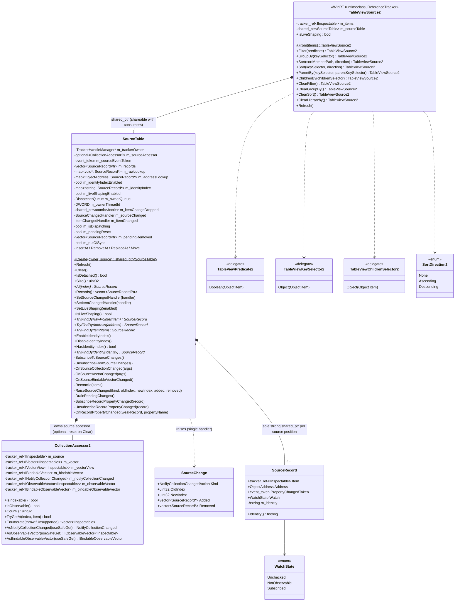

# TableView shaping redesign — TableViewSource2

**Status:** In progress. This doc grows section by section as each part of the design is agreed.
It covers only what exists in `controls/dev/TableViewSource2` today. Everything is declared; nothing
is implemented, and every verb still throws `hresult_not_implemented`.

**Related:**

- [TableView-Data-Pipeline-Current-Structure.md](TableView-Data-Pipeline-Current-Structure.md)
  describes the current (v1) pipeline this replaces.
- [TableView-Row-Identity-Reuse-Spec.md](TableView-Row-Identity-Reuse-Spec.md) is the source of the
  `SourceRecord` design.
- [Shaping-Architecture-Redesign-Original.md](Shaping-Architecture-Redesign-Original.md) is the
  original interface draft (`ShapeSpec`, `ShapePlan`, coordinator, fast paths). Kept unchanged as a
  reference; this doc records what is actually adopted.

## Directory layout

`controls/dev/TableViewSource2` is the domain root. Each layer below the runtime class lives in its
own subdirectory. Includes are relative to the root (the `.vcxitems` adds `$(MSBuildThisFileDirectory)`
to the include path), e.g. `#include "Source/SourceRecord.h"`; files inside a layer include siblings
by bare name.

```text
controls/dev/TableViewSource2/
  TableViewSource2.idl / .h / .cpp / .vcxitems   public runtime class (verbs, Refresh, IsLiveShaping)
  Source/                                        source layer: input collection + record table
    CollectionAccessor2.h
    SourceRecord.h                               SourceRecord, SourceTable, SourceChange
```

Future layers (shape spec, engine, projection, coordinator) each get their own subdirectory when
they are added.

## Why redesign

The v1 pipeline (`TableViewSource` → `ShapedItemsSource` → adapters) has two structural costs:

1. **It re-reads the source on almost every change.** Each filter, group and hierarchy change, and
   every collection change outside two narrow single-item paths, calls `Refresh()`. That enumerates
   the whole source again (`Materialize`). Frameworks that keep a cached full set (AG Grid,
   DevExtreme, WPF `EnumerableCollectionView`, DynamicData) reshape from that cache instead.
2. **Row identity is computed over and over.** The same object's address and identity string are
   derived several times per rebuild, by several components, and each component keeps its own
   copy.

The redesign keeps one record per source row, kept current by change notifications. That record
table serves as both the shared identity store and the cached full set that shaping runs over.

## Components so far

| # | Component | Files | State |
|---|---|---|---|
| 1 | Public verb API | `TableViewSource2.idl` | Declared |
| 2 | `TableViewSource2` runtime class | `TableViewSource2.h/.cpp` | Verbs are stubs; `Refresh` and `IsLiveShaping` are declared |
| 3 | Source collection resolution: `CollectionAccessor2` | `Source/CollectionAccessor2.h` | Declared, not implemented |
| 4 | Source tracking: `SourceRecord`, `SourceTable`, `SourceChange` | `Source/SourceRecord.h` | Declared, not implemented |
| 5 | Shape spec | — | **Next to design** |
| 6 | Shaping engine | — | Not started |
| 7 | Projection output (rows view and row metadata) | — | Not started |
| 8 | Coordinator (incremental vs rebuild, owner notifications) | — | Not started |

## Class diagram



## 1. Public verb API

`TableViewSource2.idl` declares its own types, so v2 does not depend on v1's IDL:

| Type | Shape | Use |
|---|---|---|
| `TableViewPredicate2` | `Boolean(Object item)` | `Filter` |
| `TableViewKeySelector2` | `Object(Object item)` | `GroupBy`, `Sort`, `ParentBy` |
| `TableViewChildrenSelector2` | `Object(Object item)` returning a child collection, or `null` for a leaf | `ChildrenBy` |
| `SortDirection2` | `None`, `Ascending`, `Descending` | `Sort` |

Verbs are fluent: each returns the same `TableViewSource2` so calls can be chained.

| Verb | Meaning |
|---|---|
| `From(items)` | Wraps any collection `TableViewSource.From` accepts. Throws `E_INVALIDARG` when `items` is null. |
| `Filter(predicate)` | Keeps only the items the predicate accepts. |
| `GroupBy(keySelector)` | Groups by key. There is one `GroupBy`; v1's overload taking a group identity selector was removed. |
| `Sort(sortMemberPath, direction)` | Sorts by property path. Projected as `SortByPath`. |
| `Sort(keySelector, direction)` | Sorts by key selector. This is the default overload. |
| `ParentBy(keySelector, parentKeySelector)` | Hierarchy over a flat source. Each item has a unique key and its parent's key (`null` for a root). |
| `ChildrenBy(childrenSelector)` | Hierarchy over a nested source. Each item returns its child collection. |
| `ClearFilter` / `ClearGroupBy` / `ClearSort` | Remove the matching verb. |
| `ClearHierarchy` | Removes the hierarchy declared by `ParentBy` or `ChildrenBy`. |
| `Refresh()` | Re-reads the source and rebuilds. It is for sources that do not raise change notifications. |
| `IsLiveShaping` | A get/set property, `false` by default. When true, an item's `PropertyChanged` re-applies the active verbs to that item. When false, property edits leave rows in place until the next collection change, verb or `Refresh`. |

## 2. `TableViewSource2` runtime class

- **Not activatable.** It is created only through `From(items)`.
- **A `ReferenceTracker`, like v1.** `final_release` runs on the owning UI thread, and `tracker_ref`
  members let the garbage collector walk references to app objects.
- **Members:**
  - `m_items` is the app collection, held as a `tracker_ref`.
  - `m_sourceTable` is a `shared_ptr<SourceTable>`. Consumers (the row metadata provider and
    adapters) may share it past this object's lifetime. `~TableViewSource2()` calls
    `m_sourceTable->Clear()`, which detaches the table (see *Reference tracking and teardown*), so a
    lingering table is empty and holds no `tracker_ref` bound to the dead owner.
  - No live-shaping flag. `IsLiveShaping` get/set forward to `m_sourceTable->IsLiveShaping()` /
    `SetLiveShaping()`, so `SourceTable::m_liveShapingEnabled` is the single source of truth.
    Implementation note: until `m_sourceTable` exists (no source bound), the getter returns
    `false` and the setter has nothing to apply; Phase 1.4 constructs the table in `From(items)` so
    this window does not occur in practice.
- **`Refresh()`** re-reads the source and rebuilds. It is for sources that do not raise change
  notifications, which the record table cannot otherwise detect.
- **Not included:** `DeferRefresh` (batching verbs into one rebuild) was considered and removed for
  now.

## 3. Source collection resolution: `CollectionAccessor2`

`CollectionAccessor2` (`Source/CollectionAccessor2.h`) is the v2 copy of `ShapingHelpers::CollectionAccessor`.
It probes an `IInspectable` source once at construction for both read (`IVector<IInspectable>` >
`IVectorView<IInspectable>` > `IBindableVector`) and change-notification (`INotifyCollectionChanged`,
`IObservableVector<IInspectable>`, `IBindableObservableVector`) interfaces so all indexed reads,
enumerations, and subscriptions agree by construction. Unlike v1's `CollectionAccessor`, every
interface member is stored in a `tracker_ref` bound to the owning `TableViewSource2`
(`ITrackerHandleManager const*`), matching `InspectingDataSource` so .NET GC can trace cycles through
the collection.

## 4. Source tracking: `SourceRecord` and `SourceTable`

### `SourceRecord`

There is one record per source position. It holds only values that depend on the object itself
and that live exactly as long as the item stays in the source.

| Member | Purpose |
|---|---|
| `Item` | A `tracker_ref<IInspectable>` bound to the owning `TableViewSource2` (matching `Vector<IInspectable>`). Keeps the item alive while in the table while letting the .NET GC collect cycles when an item references its owner. `get_abi(Item.get())` is the raw-pointer lookup key. `Item.get()` is used only on live paths; teardown paths use `Item.safe_get()` (see *Reference tracking and teardown*). |
| `Address` (`ObjectAddress` = `uintptr_t`) | The canonical `IUnknown` pointer: the object's physical identity. It costs one QI, at creation. |
| `Identity()` | The logical identity string (`"0x…"` today). It is formatted on first use and cached; this accessor is the only way to read it. |
| `PropertyChangedToken`, `Watch` | Live-shaping subscription state, revoked in `~SourceRecord()`. `NotObservable` records that an item has no `INotifyPropertyChanged`, so it is not probed again. |

Records are not copyable. `SourceTable` holds the sole strong `shared_ptr<SourceRecord>` (`SourceRecordPtr`)
for each record so that `PropertyChanged` callbacks can capture `weak_ptr<SourceRecord>`
(`SourceRecordWeakPtr`) and call `.lock()` before use (returning `nullptr` once removed, with no
`Retired` flag needed). Callbacks raised off the UI thread are marshalled to the owning
`DispatcherQueue` before any weak pointer is locked (see *Threading* below). Downstream stages hold non-owning `SourceRecord*`
pointers and purge them synchronously from the `SourceChanged` handler before `SourceRecord` is destroyed—ensuring
`Item` stays alive until after all consumers drop the record, preventing COM address reuse (ABA).

### `SourceTable`

`SourceTable` owns the `CollectionAccessor2` and the source-change `event_token` for the input source,
maintaining the source records, addresses, identities, and lookups automatically. It also owns the
per-item `INotifyPropertyChanged` subscriptions used by live shaping, so it is the single place
where any external event (collection or item) enters the pipeline. Output projection lives outside
`SourceTable`.

```text
m_sourceAccessor   resolved read + change-notification interfaces for the bound source
Records()          one record per source position, in source order (shared_ptr)
raw lookup         get_abi(item) -> SourceRecord*   always on; pipeline map-back, no QI
address lookup     Address       -> SourceRecord*   always on; duplicate check + COM identity lookup
identity index     Identity      -> SourceRecord*   shaped only; selection, focus, expansion
```

**Public lifecycle & internal synchronization:**

| Operation | Visibility | Behaviour |
|---|---|---|
| `Create(owner, source)` | Public (static) | The only way to build a table. `make_shared<SourceTable>(PrivateToken{}, owner)`, then private `AttachSource(source)`: resolves `CollectionAccessor2(owner, source)`, subscribes to change notifications (storing `m_sourceEventToken`), and performs the initial `Refresh()`. `owner` is the enclosing `TableViewSource2`'s `ITrackerHandleManager const*`. The constructor takes a private `PrivateToken`, so it is reachable by `make_shared` but not by callers; there is no default constructor. |
| `Refresh()` | Public | Re-enumerates `m_sourceAccessor` and reconciles against existing records (initial load, `Reset`, or explicit `Refresh()` for non-observable sources). No-op when detached. |
| `Clear()` | Public | Teardown, called by `~TableViewSource2()` on the UI thread while the owner is alive. Nulls both handlers (raises nothing), unsubscribes from the source via `safe_get`, clears the lookups wholesale, destroys every record, resets `m_sourceAccessor`, and nulls `m_trackerOwner`. Idempotent. Afterwards the table is detached. |
| `IsDetached()` | Public | True after `Clear()`. Every public entry point and event lambda returns early when detached. |
| `SetSourceChangedHandler` | Public | Single handler (the coordinator) for normalized, record-level `SourceChange` notifications. See *Source change notification* below. |
| `SetItemChangedHandler` | Public | Single handler (the coordinator) for per-record `PropertyChanged` notifications (`(SourceRecord*, hstring const& propertyName)`). See *Item property change notification* below. |
| `SetLiveShaping` / `IsLiveShaping` | Public | Enables or disables per-record `INotifyPropertyChanged` subscriptions across the table, irrespective of whether any shaping verbs are currently active. |
| `Reconcile` / `InsertAt` / `RemoveAt` / `ReplaceAt` / `Move` | Private | Driven internally by `Refresh()` and `OnSourceCollectionChanged` / `OnSourceVectorChanged` / `OnSourceBindableVectorChanged`. Each ends in `RaiseSourceChanged`. |
| `ValidateItems` / `ValidateIncoming` | Private | Reject null and duplicate items before any mutation. See *Null and duplicate items* below. |
| `RaiseSourceChanged` / `DrainPendingChanges` | Private | Raise (or queue while dispatching) the change, then destroy the removed records; deliver queued changes after the outermost dispatch returns. |
| `SubscribeRecordPropertyChanged` / `UnsubscribeRecordPropertyChanged` / `OnRecordPropertyChanged` | Private | Manage each record's `PropertyChangedToken` and `WatchState`, and forward `PropertyChanged` to `m_itemChanged`. |

**Source change notification:**

`SourceTable` is the only subscriber to the source. Downstream stages never subscribe to the
source themselves: a second subscription could see a change before the table has applied it, so
the table and the rows would disagree. Instead the table reports each change in terms of records.

```cpp
// Add, Remove, Replace, Move, Reset
using SourceChangeKind = winrt::Microsoft::UI::Xaml::Interop::NotifyCollectionChangedAction;

struct SourceChange
{
    SourceChangeKind Kind;
    uint32_t OldIndex;                                // Remove, Replace, Move
    uint32_t NewIndex;                                // Add, Replace, Move
    std::vector<SourceRecord*> const& Added;          // Add, Replace (one); Reset (all new)
    std::vector<SourceRecord const*> const& Removed;  // Remove, Replace (one); Reset (all gone)
};
```

The change kind reuses `NotifyCollectionChangedAction`. Its five values match exactly, so the
table adds no enum of its own. `NotifyCollectionChangedEventArgs` itself is not reused:

- It carries raw items, not `SourceRecord*`, so every consumer would look each item up again.
- Its `Reset` carries no items, but this `Reset` carries what left and what arrived.
- It cannot guarantee that removed records stay readable until the handler returns.
- It is a WinRT runtime class, so every change would cost an activation and two vectors. `SourceChange` is a stack struct.
- It would suggest the source's event is passed through. It isn't: `IVectorChangedEventArgs` (which has no Move) and multi-item, re-entrant or out-of-sync notifications are all converted to this one shape.

| Rule | Detail |
|---|---|
| Ordering | Update `m_records` and the lookups → raise `SourceChanged` → destroy removed records. The handler sees the updated table; removed records' `Item` and `Identity()` stay readable so they can be found among the visible rows. |
| Single, synchronous handler | Raised on the UI thread. Only the coordinator subscribes, and it fans out to engine, projection, and owner (selection, focus, sort-rank cleanup) in a fixed order. A C++ callback, not a WinRT event. |
| `Reset` | Carries what left and what arrived, not moves. Consumers reshape from `Records()` without re-reading the source. `Refresh()` raises `Reset`. |
| Multi-item notifications | Split into single-item changes, or reported as one `Reset`. Downstream only handles the simple cases. |
| Re-entrancy | App code run inside the handler (filter predicate, comparer) may change the source again. The table applies the edit immediately but defers its notification; deferred changes are coalesced into one `Reset` (`m_pendingReset`, `m_pendingRemoved`) and delivered after the outermost dispatch returns. |

**Item property change notification (live shaping):**

`SourceTable` also owns per-record `INotifyPropertyChanged` subscriptions. Subscriptions depend only
on `IsLiveShaping`, **never on which shaping verbs are active**:

| Rule | Detail |
|---|---|
| Verb-independent subscription | `SetLiveShaping(true)` subscribes every record in `m_records`, and `CreateRecord` subscribes newly added records while `m_liveShapingEnabled` is true. Adding or clearing verbs (`Filter`, `Sort`, `GroupBy`, `ParentBy`, `ChildrenBy`) never walks records to subscribe or unsubscribe. |
| `WatchState` caching | First probe sets `WatchState::Subscribed` (storing `PropertyChangedToken`) or `WatchState::NotObservable`. `SetLiveShaping(false)` revokes tokens and resets `Subscribed` → `Unchecked`, but preserves `NotObservable` so re-enabling does not re-QI non-observable items. |
| Automatic teardown | Removing a record (or `Clear()`) destroys the `SourceRecord`, whose destructor revokes `PropertyChangedToken` through `Item.safe_get()` (skipped if the item was already collected) before its `tracker_ref` handle is deleted. |
| Callback contract | Each subscription lambda captures `weak_from_this()` (`weak_ptr<SourceTable>`), `SourceRecordWeakPtr` (`weak_ptr<SourceRecord>`), `m_ownerQueue`, `m_ownerThreadId` and `m_itemChangeDropped`. On the owning thread it locks the table and returns if it has expired; `OnRecordPropertyChanged` then locks the record (dropping stale notifications for removed records) and invokes `m_itemChanged(record, propertyName)`. Off the owning thread it marshals first (see *Threading*). Downstream (the coordinator) decides whether the changed property affects any active verb. |
| Table lifetime | `SourceTable` derives from `enable_shared_from_this` and is always owned by `shared_ptr` (`Create()`). Items belong to the app and can outlive the table; a notification already in flight when `~SourceRecord()` revokes, or a revoke that fails on a torn-down event source, would otherwise call into a freed table. The source-change lambdas (`CollectionChanged` / `VectorChanged`) use the same `weak_from_this()` guard, mirroring v1 `ShapedItemsSource`. Because `weak_from_this()` is empty in the constructor, all subscriptions start in `AttachSource()` / `SetLiveShaping()`, never in the constructor. Weak pointers are locked only on the owning UI thread: a lock on a worker thread could become the last strong reference and run `~SourceTable()` (and its UI-affine revokes) there — v1 `TrackFlatItemPropertyChanged` has the same rule. |
| Empty property name | Per the `INotifyPropertyChanged` convention, an empty or null `PropertyName` means "all properties changed". It is forwarded unchanged; the coordinator treats it as a change to every dependency of the active verbs. |
| Null record | `ItemChanged(nullptr, L"")` means "unknown items changed": an off-thread change was dropped (see *Threading*). The coordinator re-evaluates every record against the active verbs. |
| Reuse keeps subscriptions | `Reconcile` reuses records by raw pointer or address, so a `Reset` or `Refresh()` does not drop and re-create subscriptions for items that are still in the source. |
| Cost trade-off | With `IsLiveShaping` true and no verbs active, every observable item is still subscribed and every `PropertyChanged` is forwarded. This is deliberate: verb changes never walk the table to (un)subscribe, and the coordinator drops events cheaply when no verb reads the property. Apps that do not need live shaping leave `IsLiveShaping` false (the default) and pay nothing. |

**Reference tracking and teardown:**

`CollectionAccessor2` and every `SourceRecord::Item` hold their references through `tracker_ref`
bound to `m_trackerOwner` (the owning `TableViewSource2`). The source subscription is a raw
`event_token`, not `winrt::event_revoker`, which would hold an untracked strong reference.

| Rule | Detail |
|---|---|
| Cost | Each record costs one `NewTrackerHandle` + `SetTrackerValue` on creation and one `DeleteTrackerHandle` on removal, the same as `Vector<IInspectable>`. A load or `Reset` of *n* items pays *n* of each. |
| Single source token | `SubscribeToSourceChanges` binds exactly one interface (`INotifyCollectionChanged` > `IObservableVector` > `IBindableObservableVector`). `UnsubscribeFromSourceChanges` re-derives it with the same precedence; no kind is stored. |
| No `tracker_ref` outlives the owner | `~tracker_ref` dereferences its owner even when empty. `Clear()` destroys every record, resets `m_sourceAccessor` (a `std::optional` for this reason), and nulls `m_trackerOwner` while the owner is alive. |
| Detached table | After `Clear()` the table is empty and owner-free, so it is safe to outlive `TableViewSource2` (consumer `shared_ptr`s, or a posted off-thread lambda that has the table locked). Every entry point and event lambda checks `IsDetached()` and returns. `~SourceTable()` asserts it was detached and never touches `m_trackerOwner`. |
| GC-collected targets | `tracker_ref` holds no reference count; the owner's tracker handle does. When the GC collects a cycle (item ↔ VM ↔ `TableViewSource2`), items and the collection may already be collected when `final_release` → `~TableViewSource2()` → `Clear()` runs, and `tracker_ref::get()` would return a dangling pointer. So teardown never calls `get()`: handlers are nulled first (no consumer reads `Item` or `Identity()`), lookups are cleared wholesale (`RemoveFromLookups`, which reads `Item.get()`, is for incremental paths only), `~SourceRecord()` revokes via `Item.safe_get()`, and `UnsubscribeFromSourceChanges` uses the accessor's `AsXxx(true)`. Revoke failures are swallowed (`SafeRevoke`). |
| Address reuse | The owner's tracker handle keeps each item alive until the record is destroyed, so a COM address cannot be reused while its record is in the table. The only exception is GC collection of the whole cycle, where nothing remains to observe the reused address. |

**Threading** (same contract as v1 `ShapedItemsSource`):

| Rule | Detail |
|---|---|
| Owning thread | `Create()` must run on the UI thread. It captures `DispatcherQueue::GetForCurrentThread()` into `m_ownerQueue` and `GetCurrentThreadId()` into `m_ownerThreadId`. All table state and both handlers belong to that thread. |
| Source collection changes | Must arrive on the owning thread, the contract every XAML collection consumer imposes. Not marshalled: marshalling would let `m_records` drift from the live collection between the event and its delivery. |
| Item change on the owning thread | Handled inline: lock table → `OnRecordPropertyChanged` → lock record → `m_itemChanged`. |
| Item change off-thread, queue available | `m_ownerQueue.TryEnqueue` posts a lambda holding only the two weak pointers and the property name; they are locked on the owning thread. Order is preserved per raising thread only; a record removed before the post runs fails its lock and the change is dropped (correct, since it left the table). |
| Item change off-thread, cannot marshal | If `TryEnqueue` fails, or there is no queue and the thread differs, the change is dropped and `m_itemChangeDropped` (a `shared_ptr<atomic<bool>>`, so the lambda never locks the table off-thread) is set. |
| Recovery from a dropped change | The next `OnRecordPropertyChanged` on the owning thread does `m_itemChangeDropped->exchange(false)`; if it was set, it first raises `ItemChanged(nullptr, L"")` so the coordinator re-evaluates every record, then delivers the current change. `Refresh()` and `SetLiveShaping(false)` clear the flag, since both already resynchronize or stop tracking. |
| Coalescing | Not done in `SourceTable`. Repeated changes are coalesced per dispatcher turn by the coordinator (Phase 5). |

**Null and duplicate items:**

Rejected in **all modes**, shaped or not. Every lookup key therefore maps to at most one record,
and enabling the first verb needs no validation pass.

| Rule | Detail |
|---|---|
| Behaviour change from v1 | v1 allows null items and the same object on several rows while unshaped (`RebuildUnshapedRows`), and throws only once a verb is active (`ValidateRowIdentities`). v2 throws on attach / change regardless of verbs. Apps binding `[a, a, b]` or lists containing `null` must use distinct objects per row. |
| Validate before mutate | `ValidateItems` (whole materialization, scratch raw-pointer + address sets) and `ValidateIncoming` (one item against `m_rawLookup`, then `m_addressLookup`, ignoring the position being replaced) touch no table state. A rejected change leaves `m_records`, the lookups and subscriptions as they were, and raises no `SourceChanged`. |
| Error | `hresult_invalid_argument`, reusing v1 messages: "The same item object appears in the source more than once. Rows are identified by object identity, so two rows backed by one object cannot be told apart. Use a distinct object per row." / "A row could not be given a stable identity: null item". |
| `Create()` / `Refresh()` | Validated upfront; the throw reaches the caller of `From(items)` or `Refresh()`. |
| Incremental change (`InsertAt` / `ReplaceAt`) | The throw propagates out of the `CollectionChanged` / `VectorChanged` handler, i.e. into the app's `Add()` / `Insert()` / indexer. `ReplaceAt` with the same object at the same index is allowed. |
| Out-of-sync recovery | After a rejected incremental change the source has already diverged from `m_records`. `m_outOfSync` is set and every later notification is handled as a `Reset` (re-enumerate + `ValidateItems`) instead of a positional delta. The first one that validates raises a single `Reset` and clears the flag; `Refresh()` does the same. Positional deltas are never applied on top of a diverged table. |
| `Move` / `RemoveAt` | Cannot introduce null or duplicates; not validated. |

**Lookups:**

| Lookup | Notes |
|---|---|
| `TryFindByRawPointer` | Always on (`m_rawLookup`). Exact `get_abi(item)` hit, no QI. |
| `TryFindByAddress` | Always on (`m_addressLookup`). Canonical `IUnknown` address hit; also backs upfront duplicate-object detection in all modes. |
| `TryFindByItem` | Always O(1): checks `m_rawLookup` first, falling back to one QI + `m_addressLookup` when an item is reached through a different interface pointer. |
| `EnableIdentityIndex` / `DisableIdentityIndex` / `HasIdentityIndex` | Builds `m_identityIndex` in O(n) with no QI when the first shaping verb turns on; drops it when the last verb turns off so unshaped tables keep `Identity()` string formatting lazy. |
| `TryFindByIdentity` | Logical identity lookup (`m_identityIndex`). |

### Rules and differences from the identity spec

| Spec | Here | Why |
|---|---|---|
| D9: types in `TabularShaping` | In `TableViewSource2` | v1 stays untouched. The types can move down a layer when the hierarchy or rank code needs to hold records. |
| D5/D6: `addressSet` for duplicates only | `m_addressLookup` (`ObjectAddress` → `SourceRecord*`) always on | Serves duplicate-object detection, `Reconcile` pass 3, and O(1) `TryFindByItem` fallback in one map; only `m_identityIndex` is toggled on/off with shaping. |
| v1: null / duplicate items allowed while unshaped | Rejected in all modes | Keeps every lookup one-to-one (no multimap, no per-key chains or counters) and removes the mode-dependent validation pass when the first verb turns on. Accepted breaking change. |
| D7/D9: projection stored inside `SourceRecordTable` | Split out of `SourceTable` | `SourceTable` strictly manages input source records, addresses, identities, and lookups; output projection belongs to the downstream stage. |
| D10/D21: co-owned `shared_ptr` + `Retired` flag | Sole strong `shared_ptr` in `SourceTable`, no `Retired` flag | Downstream stages hold `SourceRecord*` and purge synchronously before destruction; `weak_ptr::lock()` alone rejects late async callbacks. |
| Original draft §5.2: `ItemPropertyObserver` owned by the coordinator, subscribing only items read by live-enabled steps | Item subscriptions owned by `SourceTable`, gated only by `IsLiveShaping` | Tokens live on the record and are revoked by `~SourceRecord()`, so subscription lifetime matches record lifetime with no separate tracker. Property filtering by dependency moves to the coordinator's `ItemChanged` handler. |
| v1 `ShapedItemsSource` & `CollectionAccessor`: plain `IInspectable` references to source and items | `tracker_ref` bound to `TableViewSource2` (`ITrackerHandleManager`) for both `CollectionAccessor2` and `SourceRecord::Item`, plus raw `event_token` instead of `winrt::event_revoker` | Matches `InspectingDataSource` and `Vector<IInspectable>`: lets the .NET GC collect cycles when the collection or row items hold back-references to the page/VM/source. `~TableViewSource2()` calls `m_sourceTable->Clear()` so tracker handles are deleted while the owner is still alive. |
| `ObjectAddress` type | Alias for `uintptr_t` | This branch has no `ObjectAddress` type. |

## 5. Next: shape spec

The shape spec is the stored set of verbs currently in force. The engine, the projection and the
coordinator all read it. Questions to settle:

- **Sort axes:** how several sorts are represented, and whether sort by path and sort by key
  selector reduce to one form.
- **Sort and group ordering:** v1 decides whether a sort orders the groups or the rows within them
  by declaration order relative to `GroupBy`. Keep that, or make it explicit?
- **Filter:** one predicate, or several combined?
- **Hierarchy:** `ParentBy` and `ChildrenBy` look mutually exclusive. If both are called, does the
  second replace the first, or throw?
- **Diffing:** whether the spec is a comparable value, so the engine can pick the cheapest update.
  v1 always treats a re-declared verb as changed.
- **Mutability:** whether each verb replaces the whole spec, or edits it in place.

## 6. Implementation plan

Each phase is designed (headers first) and agreed before its `.cpp` implementation is wired up.

### Phase 1 — Public API & source tracking (headers done, `.cpp` pending)
- [x] **1.1 Public IDL & runtimeclass shell** (`TableViewSource2.idl`, `TableViewSource2.h/.cpp`):
      verbs (`Filter`, `GroupBy`, `Sort`, `ParentBy`, `ChildrenBy`, `Clear*`), `Refresh()`, `IsLiveShaping`.
- [x] **1.2 Source collection resolution** (`Source/CollectionAccessor2.h`):
      single-pass resolution of read (`IVector` / `IVectorView` / `IBindableVector`) and notification
      (`INotifyCollectionChanged` / `IObservableVector` / `IBindableObservableVector`) interfaces.
- [x] **1.3 Source record & table** (`Source/SourceRecord.h`):
      `SourceRecord` (item, canonical `Address`, lazy `Identity()`, live-shaping watch state) and
      `SourceTable` (owns `CollectionAccessor2` + the source `event_token`, maintains `m_records`, `m_rawLookup`,
      `m_addressLookup`, shaped-only `m_identityIndex`, verb-independent per-record `INotifyPropertyChanged`
      subscriptions via `SetLiveShaping`, and the `SourceChanged` + `ItemChanged` callbacks).
- [ ] **1.4 Implement Phase 1 `.cpp` files**:
  - `CollectionAccessor2.cpp`: port `Count`, `TryGetAt`, `Enumerate`, `GetAtUnchecked`.
  - `SourceRecord.cpp`: `SourceTable::Create` / `AttachSource`, canonical `IUnknown` QI, lazy hex
    `Identity()`, `~SourceRecord()` token revoke,
    upfront null/duplicate validation (`ValidateItems`, `ValidateIncoming`, `m_outOfSync` recovery), 3-pass `Reconcile`
    (position → raw pointer → address), incremental `InsertAt`/`RemoveAt`/`ReplaceAt`/`Move`,
    `RaiseSourceChanged` ordering and re-entrant queueing, source change subscriptions, and
    `SetLiveShaping` / per-record `INotifyPropertyChanged` subscription + `ItemChanged` forwarding,
    off-thread marshalling to `m_ownerQueue` and dropped-change recovery, and `Clear()` detach
    (optional accessor reset, `m_trackerOwner` nulled, `IsDetached()` guards) with `safe_get`-only
    teardown in `~SourceRecord()` and `UnsubscribeFromSourceChanges`.
  - `TableViewSource2.cpp`: add `Refresh()` and `IsLiveShaping` implementations forwarding to
    `m_sourceTable`, construct `m_sourceTable` via `SourceTable::Create(this, items)` in `TableViewSource2(items)`, and call
    `m_sourceTable->Clear()` in `~TableViewSource2()`.


### Phase 2 — Shape spec (`Spec/ShapeSpec.h/.cpp`)
- [ ] Define how active verbs (`Filter`, `Sort` list, `GroupBy`, `ParentBy` vs `ChildrenBy`) are stored.
- [ ] Define spec diffing (`ShapeDelta`) so the coordinator knows whether a verb change is a no-op,
      flat re-sort, filter/group reshape from `m_sourceTable` (no source re-read), or hierarchy rebuild.
- [ ] Wire `TableViewSource2` verb methods to update `ShapeSpec`.

### Phase 3 — Projection output & row metadata (`Projection/Projection.h/.cpp`, `RowMetadataProvider`)
- [ ] Define the projected row store (`std::vector<SourceRecord*>` + `Identity` → projected index for
      flat views; group/hierarchy adapters for grouped/tree views) separated from `SourceTable`.
- [ ] Expose the WinRT `IObservableVector<IInspectable>` view consumed by `ItemsRepeater`.
- [ ] Wire `RowMetadataProvider` to read row identities and indices from the projection and shared
      `std::shared_ptr<SourceTable>` without recomputing `Identity()`.

### Phase 4 — Shaping engine (`Engine/ShapingEngine.h/.cpp`)
- [ ] Run filter, sort, group, and hierarchy (`ParentBy` and `ChildrenBy`) over `SourceTable::Records()`
      without re-enumerating the underlying collection.
- [ ] Map shaped output back to `SourceRecord*` in O(1) via `SourceTable::TryFindByRawPointer`.

### Phase 5 — Coordinator (`Coordinator/ShapingCoordinator.h/.cpp`)

The coordinator reacts to live-shaping events but does not own subscriptions; those live in
`SourceTable` (Phase 1).

- [ ] Handle `SourceTable::SourceChanged` (the coordinator is its only subscriber): incremental
      projection splices (when eligible) or cached reshapes over `SourceTable::Records()` on `Reset`.
- [ ] Handle `SourceTable::ItemChanged` (`(SourceRecord*, propertyName)`): filter by active
      `ShapeSpec` property dependencies, coalesce per dispatcher turn, and re-evaluate affected
      records (every record for `ItemChanged(nullptr, L"")`) without managing `INotifyPropertyChanged` subscriptions in the coordinator.
- [ ] Fan out `SourceChanged` to `TableView` owner callbacks (selection/focus/rank purge of removed
      records, projection rebuild notifications).

### Phase 6 — `TableView` integration & validation
- [ ] Switch `TableView` to accept `TableViewSource2` alongside `TableViewSource`.
- [ ] Build and run API + interaction test suites (`TableViewSource_APITests`, `TableView_Sorting_APITests`,
      `TableView_LiveShaping_APITests`, `TableView_HierarchicalRows_APITests`).

## Open items

- `Refresh` and `IsLiveShaping` are declared in the IDL and the header, with no `.cpp` stubs yet (Phase 1.4).
- `m_sourceTable` is never created yet (the constructor does not allocate it).
- `Source/SourceRecord.h` and `Source/CollectionAccessor2.h` have no `.cpp` files yet (Phase 1.4).
- **Re-entrant `ItemChanged` (parked).** A `PropertyChanged` raised while `SourceChanged` or
  `ItemChanged` is dispatching (for example, a setter called from a comparer) would reach the
  coordinator mid-reshape. Leading candidate: route it through the same `m_isDispatching` gate,
  queue `(SourceRecordWeakPtr, propertyName)` in `m_pendingItemChanges`, and drain after pending
  source changes; plus a `DeferNotifications()` RAII scope the coordinator wraps verb-driven
  reshapes in. Alternatives: collapse to `ItemChanged(nullptr, L"")`, or a coordinator-side guard.
