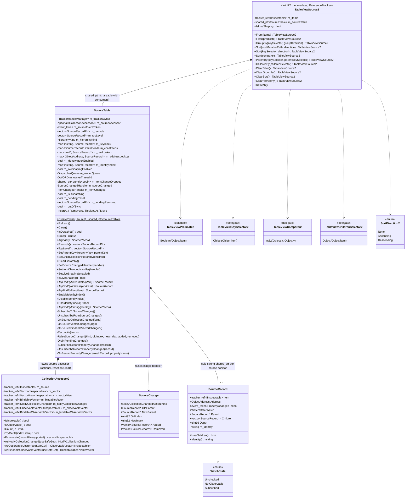

# TableView shaping redesign — TableViewSource2

**Status:** In progress. This doc grows section by section as each part of the design is agreed.
It covers only what exists in `controls/dev/TableViewSource2` today. Everything is declared; nothing
is implemented, and every verb still throws `hresult_not_implemented`.

**Related:**

- [TableView-Data-Pipeline-Current-Structure.md](TableView-Data-Pipeline-Current-Structure.md)
  describes the current (v1) pipeline this replaces.
- [TableView-Row-Identity-Reuse-Spec.md](TableView-Row-Identity-Reuse-Spec.md) is the source of the
  `SourceRecord` design.
- [Shaping-Architecture-Redesign-Original.md](Shaping-Architecture-Redesign-Original.md) is the
  original interface draft (`ShapeSpec`, `ShapePlan`, coordinator, fast paths). Kept unchanged as a
  reference; this doc records what is actually adopted.

## Directory layout

`controls/dev/TableViewSource2` is the domain root. Each layer below the runtime class lives in its
own subdirectory. Includes are relative to the root (the `.vcxitems` adds `$(MSBuildThisFileDirectory)`
to the include path), e.g. `#include "Source/SourceTable.h"`; files inside a layer include siblings
by bare name.

```text
controls/dev/TableViewSource2/
  TableViewSource2.idl / .h / .cpp / .vcxitems   public runtime class (verbs, Refresh, IsLiveShaping)
  Source/                                        source layer: input collection + record table
    CollectionAccessor2.h
    SourceRecord.h                               SourceRecord, SourceChange
    SourceTable.h                                SourceTable (records + source tree), HierarchyKind
  Spec/                                          shape spec: verbs in force (data) + delegate registry + path evaluator
    ShapeSpec.h                                  ShapeSpec, FilterSpec, SortSpec, GroupSpec, DelegateRef, ShapeDelta
    PathEvaluator.h                              PathEvaluator (cached SortMemberPathResolver per sort path)
    ShapeDelegates.h                             ShapeDelegates (tracker_ref'd app delegates)
  Engine/                                        shaping engine (only node types so far)
    ShapedTree.h                                 ShapedRef, GroupNode
```

Future layers (visible list, coordinator) each get their own subdirectory when they
are added.

## Why redesign

The v1 pipeline (`TableViewSource` → `ShapedItemsSource` → adapters) has two structural costs:

1. **It re-reads the source on almost every change.** Each filter, group and hierarchy change, and
   every collection change outside two narrow single-item paths, calls `Refresh()`. That enumerates
   the whole source again (`Materialize`). Frameworks that keep a cached full set (AG Grid,
   DevExtreme, WPF `EnumerableCollectionView`, DynamicData) reshape from that cache instead.
2. **Row identity is computed over and over.** The same object's address and identity string are
   derived several times per rebuild, by several components, and each component keeps its own
   copy.

The redesign keeps one record per source row, kept current by change notifications. That record
table serves as both the shared identity store and the cached full set that shaping runs over.

## Components so far

| # | Component | Files | State |
|---|---|---|---|
| 1 | Public verb API | `TableViewSource2.idl` | Declared |
| 2 | `TableViewSource2` runtime class | `TableViewSource2.h/.cpp` | Verbs are stubs; `Refresh` and `IsLiveShaping` are declared |
| 3 | Source collection resolution: `CollectionAccessor2` | `Source/CollectionAccessor2.h` | Declared, not implemented |
| 4 | Source tracking and source tree: `SourceRecord`, `SourceTable`, `SourceChange` | `Source/SourceRecord.h`, `Source/SourceTable.h` | Declared, not implemented |
| 5 | Shape spec: `ShapeSpec`, `ShapeDelegates`, `PathEvaluator` | `Spec/ShapeSpec.h`, `Spec/ShapeDelegates.h`, `Spec/PathEvaluator.h` | Declared, not implemented; ownership and application open |
| 6 | Shaping engine: shaped tree node types `ShapedRef`, `GroupNode` | `Engine/ShapedTree.h` | Node types declared; engine not started |
| 7 | Projection output (rows view and row metadata) | — | Not started |
| 8 | Coordinator (incremental vs rebuild, owner notifications) | — | Not started |

## Class diagram



## 1. Public verb API

`TableViewSource2.idl` declares its own types, so v2 does not depend on v1's IDL:

| Type | Shape | Use |
|---|---|---|
| `TableViewPredicate2` | `Boolean(Object item)` | `Filter` |
| `TableViewKeySelector2` | `Object(Object item)` | `GroupBy`, `Sort`, `ParentBy` |
| `TableViewComparer2` | `Int32(Object x, Object y)`: negative when `x` sorts first, zero when equal, positive when after | `Sort` |
| `TableViewChildrenSelector2` | `Object(Object item)` returning a child collection, or `null` for a leaf | `ChildrenBy` |
| `SortDirection2` | `None`, `Ascending`, `Descending` | `Sort`, `GroupBy` |

Verbs are fluent: each returns the same `TableViewSource2` so calls can be chained.

| Verb | Meaning |
|---|---|
| `From(items)` | Wraps any collection `TableViewSource.From` accepts. Throws `E_INVALIDARG` when `items` is null. |
| `Filter(predicate)` | Keeps only the items the predicate accepts. A second call replaces the first, as in v1. |
| `GroupBy(keySelector, groupDirection)` | Groups by key. `groupDirection` orders the groups by key (`None` = order of first appearance in the filtered source). `Sort` orders only the rows inside each group, never the groups. There is one `GroupBy`; v1's overload taking a group identity selector was removed. |
| `Sort(sortMemberPath, direction)` | Sorts by property path. Projected as `SortByPath`. |
| `Sort(keySelector, direction)` | Sorts by key selector. This is the default overload. |
| `Sort(comparer)` | Sorts by comparing whole items (like WPF's `CustomSort`). The comparer defines the full order of its level, so there is no direction. Projected as `SortWithComparer`. |
| `ParentBy(keySelector, parentKeySelector)` | Hierarchy over a flat source. Each item has a unique key and its parent's key (`null` for a root). |
| `ChildrenBy(childrenSelector)` | Hierarchy over a nested source. Each item returns its child collection. |
| `ClearFilter` / `ClearGroupBy` / `ClearSort` | Remove the matching verb. |
| `ClearHierarchy` | Removes the hierarchy declared by `ParentBy` or `ChildrenBy`. |
| `Refresh()` | Re-reads the source and rebuilds. It is for sources that do not raise change notifications. |
| `IsLiveShaping` | A get/set property, `false` by default. When true, an item's `PropertyChanged` re-applies the active verbs to that item. When false, property edits leave rows in place until the next collection change, verb or `Refresh`. |

Each `Sort` call appends a lower-priority level after the existing ones (`Sort(a).Sort(b)` sorts
by `a`, then `b`), unless it matches an existing level, in which case it replaces that level in
place. A path matches by string; a key selector or comparer matches only when the same delegate
object is passed again. `SortDirection2::None` removes the matching level. `ClearSort` removes
every level. Unlike v1, group order no longer depends on
whether `Sort` was declared before or after `GroupBy`.

## 2. `TableViewSource2` runtime class

- **Not activatable.** It is created only through `From(items)`.
- **A `ReferenceTracker`, like v1.** `final_release` runs on the owning UI thread, and `tracker_ref`
  members let the garbage collector walk references to app objects.
- **Members:**
  - `m_items` is the app collection, held as a `tracker_ref`.
  - `m_sourceTable` is a `shared_ptr<SourceTable>`. Consumers (the row metadata provider and
    adapters) may share it past this object's lifetime. `~TableViewSource2()` calls
    `m_sourceTable->Clear()`, which detaches the table (see *Reference tracking and teardown*), so a
    lingering table is empty and holds no `tracker_ref` bound to the dead owner.
  - No live-shaping flag. `IsLiveShaping` get/set forward to `m_sourceTable->IsLiveShaping()` /
    `SetLiveShaping()`, so `SourceTable::m_liveShapingEnabled` is the single source of truth.
    Implementation note: until `m_sourceTable` exists (no source bound), the getter returns
    `false` and the setter has nothing to apply; Phase 1.4 constructs the table in `From(items)` so
    this window does not occur in practice.
- **`Refresh()`** re-reads the source and rebuilds. It is for sources that do not raise change
  notifications, which the record table cannot otherwise detect.
- **Not included:** `DeferRefresh` (batching verbs into one rebuild) was considered and removed for
  now.

## 3. Source collection resolution: `CollectionAccessor2`

`CollectionAccessor2` (`Source/CollectionAccessor2.h`) is the v2 copy of `ShapingHelpers::CollectionAccessor`.
It probes an `IInspectable` source once at construction for both read (`IVector<IInspectable>` >
`IVectorView<IInspectable>` > `IBindableVector`) and change-notification (`INotifyCollectionChanged`,
`IObservableVector<IInspectable>`, `IBindableObservableVector`) interfaces so all indexed reads,
enumerations, and subscriptions agree by construction. Unlike v1's `CollectionAccessor`, every
interface member is stored in a `tracker_ref` bound to the owning `TableViewSource2`
(`ITrackerHandleManager const*`), matching `InspectingDataSource` so .NET GC can trace cycles through
the collection.

## 4. Source tracking: `SourceRecord` and `SourceTable`

### `SourceRecord`

There is one record per source position. It holds only values that depend on the object itself
and that live exactly as long as the item stays in the source.

| Member | Purpose |
|---|---|
| `Item` | A `tracker_ref<IInspectable>` bound to the owning `TableViewSource2` (matching `Vector<IInspectable>`). Keeps the item alive while in the table while letting the .NET GC collect cycles when an item references its owner. `get_abi(Item.get())` is the raw-pointer lookup key. `Item.get()` is used only on live paths; teardown paths use `Item.safe_get()` (see *Reference tracking and teardown*). |
| `Address` (`ObjectAddress` = `uintptr_t`) | The canonical `IUnknown` pointer: the object's physical identity. It costs one QI, at creation. |
| `Identity()` | The logical identity string (`"0x…"` today). It is formatted on first use and cached; this accessor is the only way to read it. |
| `PropertyChangedToken`, `Watch` | Live-shaping subscription state, revoked in `~SourceRecord()`. `NotObservable` records that an item has no `INotifyPropertyChanged`, so it is not probed again. |
| `Parent`, `Children`, `Depth`, `HasChildren()` | Source-tree links, written only by `SourceTable`. Non-owning; flat sources leave every record top-level (`Parent == nullptr`) with no children. See *Hierarchy: the source tree in `SourceTable`*. |

Records are not copyable. `SourceTable` holds the sole strong `shared_ptr<SourceRecord>` (`SourceRecordPtr`)
for each record so that `PropertyChanged` callbacks can capture `weak_ptr<SourceRecord>`
(`SourceRecordWeakPtr`) and call `.lock()` before use (returning `nullptr` once removed, with no
`Retired` flag needed). Callbacks raised off the UI thread are marshalled to the owning
`DispatcherQueue` before any weak pointer is locked (see *Threading* below). Downstream stages hold non-owning `SourceRecord*`
pointers and purge them synchronously from the `SourceChanged` handler before `SourceRecord` is destroyed—ensuring
`Item` stays alive until after all consumers drop the record, preventing COM address reuse (ABA).

### `SourceTable`

`SourceTable` owns the `CollectionAccessor2` and the source-change `event_token` for the input source,
maintaining the source records, addresses, identities, and lookups automatically. It also owns the
per-item `INotifyPropertyChanged` subscriptions used by live shaping, so it is the single place
where any external event (collection or item) enters the pipeline. Output projection lives outside
`SourceTable`.

```text
m_sourceAccessor   resolved read + change-notification interfaces for the bound source
Records()          root-collection records, one per source position, in source order (shared_ptr)
TopLevel()         top-level records of the source tree, in source order (flat: same as Records())
raw lookup         get_abi(item) -> SourceRecord*   always on; pipeline map-back, no QI
address lookup     Address       -> SourceRecord*   always on; duplicate check + COM identity lookup
identity index     Identity      -> SourceRecord*   shaped only; selection, focus, expansion
```

**Public lifecycle & internal synchronization:**

| Operation | Visibility | Behaviour |
|---|---|---|
| `Create(owner, source)` | Public (static) | The only way to build a table. `make_shared<SourceTable>(PrivateToken{}, owner)`, then private `AttachSource(source)`: resolves `CollectionAccessor2(owner, source)`, subscribes to change notifications (storing `m_sourceEventToken`), and performs the initial `Refresh()`. `owner` is the enclosing `TableViewSource2`'s `ITrackerHandleManager const*`. The constructor takes a private `PrivateToken`, so it is reachable by `make_shared` but not by callers; there is no default constructor. |
| `Refresh()` | Public | Re-enumerates `m_sourceAccessor` and reconciles against existing records (initial load, `Reset`, or explicit `Refresh()` for non-observable sources). No-op when detached. |
| `Clear()` | Public | Teardown, called by `~TableViewSource2()` on the UI thread while the owner is alive. Nulls both handlers (raises nothing), unsubscribes from the source and every child collection via `safe_get`, clears the lookups and key index wholesale, destroys the child feeds and their records, then every root record, resets `m_sourceAccessor`, and nulls `m_trackerOwner`. Idempotent. Afterwards the table is detached. |
| `TopLevel()` / `SetParentKeyHierarchy` / `SetChildCollectionHierarchy` / `ClearHierarchy` | Public | Source tree. See *Hierarchy: the source tree in `SourceTable`*. |
| `IsDetached()` | Public | True after `Clear()`. Every public entry point and event lambda returns early when detached. |
| `SetSourceChangedHandler` | Public | Single handler (the coordinator) for normalized, record-level `SourceChange` notifications. See *Source change notification* below. |
| `SetItemChangedHandler` | Public | Single handler (the coordinator) for per-record `PropertyChanged` notifications (`(SourceRecord*, hstring const& propertyName)`). See *Item property change notification* below. |
| `SetLiveShaping` / `IsLiveShaping` | Public | Enables or disables per-record `INotifyPropertyChanged` subscriptions across the table, irrespective of whether any shaping verbs are currently active. |
| `Reconcile` / `InsertAt` / `RemoveAt` / `ReplaceAt` / `Move` | Private | Driven internally by `Refresh()` and `OnSourceCollectionChanged` / `OnSourceVectorChanged` / `OnSourceBindableVectorChanged`. Each ends in `RaiseSourceChanged`. |
| `ValidateItems` / `ValidateIncoming` | Private | Reject null and duplicate items before any mutation. See *Null and duplicate items* below. |
| `RaiseSourceChanged` / `DrainPendingChanges` | Private | Raise (or queue while dispatching) the change, then destroy the removed records; deliver queued changes after the outermost dispatch returns. |
| `SubscribeRecordPropertyChanged` / `UnsubscribeRecordPropertyChanged` / `OnRecordPropertyChanged` | Private | Manage each record's `PropertyChangedToken` and `WatchState`, and forward `PropertyChanged` to `m_itemChanged`. |

**Source change notification:**

`SourceTable` is the only subscriber to the source. Downstream stages never subscribe to the
source themselves: a second subscription could see a change before the table has applied it, so
the table and the rows would disagree. Instead the table reports each change in terms of records.

```cpp
// Add, Remove, Replace, Move, Reset
using SourceChangeKind = winrt::Microsoft::UI::Xaml::Interop::NotifyCollectionChangedAction;

struct SourceChange
{
    SourceChangeKind Kind;
    SourceRecord* OldParent;                          // Remove, Replace, Move; nullptr = top level
    SourceRecord* NewParent;                          // Add, Replace, Move; nullptr = top level
    uint32_t OldIndex;                                // Remove, Replace, Move; within OldParent's children
    uint32_t NewIndex;                                // Add, Replace, Move; within NewParent's children
    std::vector<SourceRecord*> const& Added;          // Add, Replace (subtree, pre-order); Reset (all new)
    std::vector<SourceRecord const*> const& Removed;  // Remove, Replace (subtree, pre-order); Reset (all gone)
};
```

Flat sources always report null parents, so the indices are source positions. See *Hierarchy: the
source tree in `SourceTable`* for hierarchical sources.

The change kind reuses `NotifyCollectionChangedAction`. Its five values match exactly, so the
table adds no enum of its own. `NotifyCollectionChangedEventArgs` itself is not reused:

- It carries raw items, not `SourceRecord*`, so every consumer would look each item up again.
- Its `Reset` carries no items, but this `Reset` carries what left and what arrived.
- It cannot guarantee that removed records stay readable until the handler returns.
- It is a WinRT runtime class, so every change would cost an activation and two vectors. `SourceChange` is a stack struct.
- It would suggest the source's event is passed through. It isn't: `IVectorChangedEventArgs` (which has no Move) and multi-item, re-entrant or out-of-sync notifications are all converted to this one shape.

| Rule | Detail |
|---|---|
| Ordering | Update `m_records` and the lookups → raise `SourceChanged` → destroy removed records. The handler sees the updated table; removed records' `Item` and `Identity()` stay readable so they can be found among the visible rows. |
| Single, synchronous handler | Raised on the UI thread. Only the coordinator subscribes, and it fans out to engine, projection, and owner (selection, focus, sort-rank cleanup) in a fixed order. A C++ callback, not a WinRT event. |
| `Reset` | Carries what left and what arrived, not moves. Consumers reshape from `Records()` without re-reading the source. `Refresh()` raises `Reset`. |
| Multi-item notifications | Split into single-item changes, or reported as one `Reset`. Downstream only handles the simple cases. |
| Re-entrancy | App code run inside the handler (filter predicate, comparer) may change the source again. The table applies the edit immediately but defers its notification; deferred changes are coalesced into one `Reset` (`m_pendingReset`, `m_pendingRemoved`) and delivered after the outermost dispatch returns. |

**Item property change notification (live shaping):**

`SourceTable` also owns per-record `INotifyPropertyChanged` subscriptions. Subscriptions depend only
on `IsLiveShaping`, **never on which shaping verbs are active**:

| Rule | Detail |
|---|---|
| Verb-independent subscription | `SetLiveShaping(true)` subscribes every record in `m_records`, and `CreateRecord` subscribes newly added records while `m_liveShapingEnabled` is true. Adding or clearing verbs (`Filter`, `Sort`, `GroupBy`, `ParentBy`, `ChildrenBy`) never walks records to subscribe or unsubscribe. |
| `WatchState` caching | First probe sets `WatchState::Subscribed` (storing `PropertyChangedToken`) or `WatchState::NotObservable`. `SetLiveShaping(false)` revokes tokens and resets `Subscribed` → `Unchecked`, but preserves `NotObservable` so re-enabling does not re-QI non-observable items. |
| Automatic teardown | Removing a record (or `Clear()`) destroys the `SourceRecord`, whose destructor revokes `PropertyChangedToken` through `Item.safe_get()` (skipped if the item was already collected) before its `tracker_ref` handle is deleted. |
| Callback contract | Each subscription lambda captures `weak_from_this()` (`weak_ptr<SourceTable>`), `SourceRecordWeakPtr` (`weak_ptr<SourceRecord>`), `m_ownerQueue`, `m_ownerThreadId` and `m_itemChangeDropped`. On the owning thread it locks the table and returns if it has expired; `OnRecordPropertyChanged` then locks the record (dropping stale notifications for removed records) and invokes `m_itemChanged(record, propertyName)`. Off the owning thread it marshals first (see *Threading*). Downstream (the coordinator) decides whether the changed property affects any active verb. |
| Table lifetime | `SourceTable` derives from `enable_shared_from_this` and is always owned by `shared_ptr` (`Create()`). Items belong to the app and can outlive the table; a notification already in flight when `~SourceRecord()` revokes, or a revoke that fails on a torn-down event source, would otherwise call into a freed table. The source-change lambdas (`CollectionChanged` / `VectorChanged`) use the same `weak_from_this()` guard, mirroring v1 `ShapedItemsSource`. Because `weak_from_this()` is empty in the constructor, all subscriptions start in `AttachSource()` / `SetLiveShaping()`, never in the constructor. Weak pointers are locked only on the owning UI thread: a lock on a worker thread could become the last strong reference and run `~SourceTable()` (and its UI-affine revokes) there — v1 `TrackFlatItemPropertyChanged` has the same rule. |
| Empty property name | Per the `INotifyPropertyChanged` convention, an empty or null `PropertyName` means "all properties changed". It is forwarded unchanged; the coordinator treats it as a change to every dependency of the active verbs. |
| Null record | `ItemChanged(nullptr, L"")` means "unknown items changed": an off-thread change was dropped (see *Threading*). The coordinator re-evaluates every record against the active verbs. |
| Reuse keeps subscriptions | `Reconcile` reuses records by raw pointer or address, so a `Reset` or `Refresh()` does not drop and re-create subscriptions for items that are still in the source. |
| Cost trade-off | With `IsLiveShaping` true and no verbs active, every observable item is still subscribed and every `PropertyChanged` is forwarded. This is deliberate: verb changes never walk the table to (un)subscribe, and the coordinator drops events cheaply when no verb reads the property. Apps that do not need live shaping leave `IsLiveShaping` false (the default) and pay nothing. |

**Reference tracking and teardown:**

**Rule: every app-supplied object or delegate held natively goes through `tracker_ref`** bound to
the owning `TableViewSource2`. This covers:
- `CollectionAccessor2` (root and child feeds) and every `SourceRecord::Item`;
- the hierarchy selectors (`m_keySelector`, `m_parentKeySelector`, `m_childrenSelector`);
- `ParentBy` object keys (`NodeKeys::KeyObject`);
- `GroupNode::Key`;
- the filter, sort and group delegates, once the shape spec stores them (Phase 2).

Why: a strong native reference to a .NET object (for example a lambda capturing the page or VM)
roots it, so the cycle back through `TableViewSource2` is invisible to the GC and leaks. v1 holds
its selectors strongly inside `std::function` and has this leak. XAML core does the same for event
handlers (`TrackerPtrFamily.h` wraps listener delegates in `TrackerPtr`), and `TableView` already
holds `tracker_ref<TableViewRowTemplateSelector>`. `tracker_ref` accepts any COM type, delegates
included.

Fields that can outlive their owner are `std::optional<tracker_ref<T>>` so they can be reset while
the owner is alive. Delegates are invoked only on live UI-thread paths, never during teardown.

The source subscription is a raw `event_token`, not `winrt::event_revoker`, which would hold an
untracked strong reference.

| Rule | Detail |
|---|---|
| Cost | Each record costs one `NewTrackerHandle` + `SetTrackerValue` on creation and one `DeleteTrackerHandle` on removal, the same as `Vector<IInspectable>`. A load or `Reset` of *n* items pays *n* of each. |
| Single source token | `SubscribeToSourceChanges` binds exactly one interface (`INotifyCollectionChanged` > `IObservableVector` > `IBindableObservableVector`). `UnsubscribeFromSourceChanges` re-derives it with the same precedence; no kind is stored. |
| No `tracker_ref` outlives the owner | `~tracker_ref` dereferences its owner even when empty. `Clear()` destroys every record, resets `m_sourceAccessor`, the selectors and the key index (all `std::optional` for this reason), and nulls `m_trackerOwner` while the owner is alive. |
| Detached table | After `Clear()` the table is empty and owner-free, so it is safe to outlive `TableViewSource2` (consumer `shared_ptr`s, or a posted off-thread lambda that has the table locked). Every entry point and event lambda checks `IsDetached()` and returns. `~SourceTable()` asserts it was detached and never touches `m_trackerOwner`. |
| GC-collected targets | `tracker_ref` holds no reference count; the owner's tracker handle does. When the GC collects a cycle (item ↔ VM ↔ `TableViewSource2`), items and the collection may already be collected when `final_release` → `~TableViewSource2()` → `Clear()` runs, and `tracker_ref::get()` would return a dangling pointer. So teardown never calls `get()`: handlers are nulled first (no consumer reads `Item` or `Identity()`), lookups are cleared wholesale (`RemoveFromLookups`, which reads `Item.get()`, is for incremental paths only), `~SourceRecord()` revokes via `Item.safe_get()`, and `UnsubscribeFromSourceChanges` uses the accessor's `AsXxx(true)`. Revoke failures are swallowed (`SafeRevoke`). |
| Address reuse | The owner's tracker handle keeps each item alive until the record is destroyed, so a COM address cannot be reused while its record is in the table. The only exception is GC collection of the whole cycle, where nothing remains to observe the reused address. |

**Threading** (same contract as v1 `ShapedItemsSource`):

| Rule | Detail |
|---|---|
| Owning thread | `Create()` must run on the UI thread. It captures `DispatcherQueue::GetForCurrentThread()` into `m_ownerQueue` and `GetCurrentThreadId()` into `m_ownerThreadId`. All table state and both handlers belong to that thread. |
| Source collection changes | Must arrive on the owning thread, the contract every XAML collection consumer imposes. Not marshalled: marshalling would let `m_records` drift from the live collection between the event and its delivery. |
| Item change on the owning thread | Handled inline: lock table → `OnRecordPropertyChanged` → lock record → `m_itemChanged`. |
| Item change off-thread, queue available | `m_ownerQueue.TryEnqueue` posts a lambda holding only the two weak pointers and the property name; they are locked on the owning thread. Order is preserved per raising thread only; a record removed before the post runs fails its lock and the change is dropped (correct, since it left the table). |
| Item change off-thread, cannot marshal | If `TryEnqueue` fails, or there is no queue and the thread differs, the change is dropped and `m_itemChangeDropped` (a `shared_ptr<atomic<bool>>`, so the lambda never locks the table off-thread) is set. |
| Recovery from a dropped change | The next `OnRecordPropertyChanged` on the owning thread does `m_itemChangeDropped->exchange(false)`; if it was set, it first raises `ItemChanged(nullptr, L"")` so the coordinator re-evaluates every record, then delivers the current change. `Refresh()` and `SetLiveShaping(false)` clear the flag, since both already resynchronize or stop tracking. |
| Coalescing | Not done in `SourceTable`. Repeated changes are coalesced per dispatcher turn by the coordinator (Phase 5). |

**Null and duplicate items:**

Rejected in **all modes**, shaped or not. Every lookup key therefore maps to at most one record,
and enabling the first verb needs no validation pass.

| Rule | Detail |
|---|---|
| Behaviour change from v1 | v1 allows null items and the same object on several rows while unshaped (`RebuildUnshapedRows`), and throws only once a verb is active (`ValidateRowIdentities`). v2 throws on attach / change regardless of verbs. Apps binding `[a, a, b]` or lists containing `null` must use distinct objects per row. |
| Validate before mutate | `ValidateItems` (whole materialization, scratch raw-pointer + address sets) and `ValidateIncoming` (one item against `m_rawLookup`, then `m_addressLookup`, ignoring the position being replaced) touch no table state. A rejected change leaves `m_records`, the lookups and subscriptions as they were, and raises no `SourceChanged`. |
| Error | `hresult_invalid_argument`, reusing v1 messages: "The same item object appears in the source more than once. Rows are identified by object identity, so two rows backed by one object cannot be told apart. Use a distinct object per row." / "A row could not be given a stable identity: null item". |
| `Create()` / `Refresh()` | Validated upfront; the throw reaches the caller of `From(items)` or `Refresh()`. |
| Incremental change (`InsertAt` / `ReplaceAt`) | The throw propagates out of the `CollectionChanged` / `VectorChanged` handler, i.e. into the app's `Add()` / `Insert()` / indexer. `ReplaceAt` with the same object at the same index is allowed. |
| Out-of-sync recovery | After a rejected incremental change the source has already diverged from `m_records`. `m_outOfSync` is set and every later notification is handled as a `Reset` (re-enumerate + `ValidateItems`) instead of a positional delta. The first one that validates raises a single `Reset` and clears the flag; `Refresh()` does the same. Positional deltas are never applied on top of a diverged table. |
| `Move` / `RemoveAt` | Cannot introduce null or duplicates; not validated. |

**Lookups:**

| Lookup | Notes |
|---|---|
| `TryFindByRawPointer` | Always on (`m_rawLookup`). Exact `get_abi(item)` hit, no QI. |
| `TryFindByAddress` | Always on (`m_addressLookup`). Canonical `IUnknown` address hit; also backs upfront duplicate-object detection in all modes. |
| `TryFindByItem` | Always O(1): checks `m_rawLookup` first, falling back to one QI + `m_addressLookup` when an item is reached through a different interface pointer. |
| `EnableIdentityIndex` / `DisableIdentityIndex` / `HasIdentityIndex` | Builds `m_identityIndex` in O(n) with no QI when the first shaping verb turns on; drops it when the last verb turns off so unshaped tables keep `Identity()` string formatting lazy. |
| `TryFindByIdentity` | Logical identity lookup (`m_identityIndex`). |

### Rules and differences from the identity spec

| Spec | Here | Why |
|---|---|---|
| D9: types in `TabularShaping` | In `TableViewSource2` | v1 stays untouched. The types can move down a layer when the hierarchy or rank code needs to hold records. |
| D5/D6: `addressSet` for duplicates only | `m_addressLookup` (`ObjectAddress` → `SourceRecord*`) always on | Serves duplicate-object detection, `Reconcile` pass 3, and O(1) `TryFindByItem` fallback in one map; only `m_identityIndex` is toggled on/off with shaping. |
| v1: null / duplicate items allowed while unshaped | Rejected in all modes | Keeps every lookup one-to-one (no multimap, no per-key chains or counters) and removes the mode-dependent validation pass when the first verb turns on. Accepted breaking change. |
| D7/D9: projection stored inside `SourceRecordTable` | Split out of `SourceTable` | `SourceTable` strictly manages input source records, addresses, identities, and lookups; output projection belongs to the downstream stage. |
| D10/D21: co-owned `shared_ptr` + `Retired` flag | Sole strong `shared_ptr` in `SourceTable`, no `Retired` flag | Downstream stages hold `SourceRecord*` and purge synchronously before destruction; `weak_ptr::lock()` alone rejects late async callbacks. |
| Original draft §5.2: `ItemPropertyObserver` owned by the coordinator, subscribing only items read by live-enabled steps | Item subscriptions owned by `SourceTable`, gated only by `IsLiveShaping` | Tokens live on the record and are revoked by `~SourceRecord()`, so subscription lifetime matches record lifetime with no separate tracker. Property filtering by dependency moves to the coordinator's `ItemChanged` handler. |
| v1 `ShapedItemsSource` & `CollectionAccessor`: plain `IInspectable` references to source and items | `tracker_ref` bound to `TableViewSource2` (`ITrackerHandleManager`) for both `CollectionAccessor2` and `SourceRecord::Item`, plus raw `event_token` instead of `winrt::event_revoker` | Matches `InspectingDataSource` and `Vector<IInspectable>`: lets the .NET GC collect cycles when the collection or row items hold back-references to the page/VM/source. `~TableViewSource2()` calls `m_sourceTable->Clear()` so tracker handles are deleted while the owner is still alive. |
| `ObjectAddress` type | Alias for `uintptr_t` | This branch has no `ObjectAddress` type. |

### Hierarchy: the source tree in `SourceTable`

With a hierarchy the tree must exist before any other verb runs:

- **Filter** keeps matches plus their ancestors, so it walks parent chains.
- **Sort** orders each sibling set separately.
- **`GroupBy`** buckets the top-level records.

So the tree is part of the source, not of shaping:
`SourceTable (records + source tree) → filter / sort / group over the tree → projection`.
Shaping reads only `TopLevel()` and `SourceRecord::Parent` / `Children` / `Depth`, and does not care
whether `ParentBy` or `ChildrenBy` built the tree.

The tree lives **on `SourceRecord` and in `SourceTable`**; there is no separate tree object. Keeping
it in the table gives one set of lookups, one validation path, one re-entrancy gate and queue, one
`SourceChanged` and one `Clear()`.

**Record fields.** The record carries the *source* tree only; everything shaped lives in the shaped
tree (below).

| Member | Meaning | Who reads it |
|---|---|---|
| `SourceRecord* Parent` | Source parent; `nullptr` for top-level records | Reparent, ancestor walk for filter-with-ancestors |
| `std::vector<SourceRecord*> Children` | Non-owning, source order | Shaped tree reads it directly when no filter or sort is active (no copy) |
| `uint16_t Depth` | Top level = 0; never changed by grouping | Indent = spacer offset + per-level indent × `Depth`; `ShapedDepth()` |
| `HasChildren()` | Derived from `Children` | Expandability of a source parent (`ShapedRef` row, not a group) |

Not on the record (decided by the shaped tree section): expanded state (expansion model keyed by
identity), group membership and group level (`GroupNode`), filtered and sorted children (side table
keyed by record), visible flag (presence in the visible list), shaped depth (`ShapedDepth()` getter).

**`SourceTable` additions** (`Source/SourceTable.h`):

| Member | Purpose |
|---|---|
| `TopLevel()` / `m_topLevel` | Top-level records in source order (non-owning). Flat: mirrors `m_records`. |
| `GetHierarchyKind()` / `HierarchyKind` | `None`, `ParentKey` (`ParentBy`), `ChildCollections` (`ChildrenBy`). |
| `SetParentKeyHierarchy(key, parentKey)` | `ParentBy`. Validates the whole tree and throws before touching any record; then links every record and raises one `Reset`. |
| `SetChildCollectionHierarchy(children)` | `ChildrenBy`. Enumerates every child collection eagerly and recursively, validates the whole tree, then creates child records, subscribes to every observable child collection and raises one `Reset`. |
| `ClearHierarchy()` | Back to flat; resets the selectors; one `Reset`. |
| `SiblingsOf(parent)` (private) | `parent ? parent->Children : m_topLevel`; tree maintenance only. |
| `m_keyIndex`, `m_nodeKeys` (private) | `ParentBy` key index and each record's cached keys. Object keys are held (as `optional<tracker_ref<IInspectable>>`) while the tree is current so their addresses cannot be reused (v1 §3.1). Kept off `SourceRecord` so flat tables pay nothing. |
| `ChildFeed`, `m_childFeeds` (private) | `ChildrenBy`: one feed per record with a non-null child collection. A feed holds a weak `Owner`, an `optional<CollectionAccessor2>`, an `event_token`, the sole strong `SourceRecordPtr`s for that collection in collection order, and an `OutOfSync` flag. |
| Selectors (private) | `m_keySelector`, `m_parentKeySelector`, `m_childrenSelector`; each an `optional<tracker_ref<…>>` (see *Reference tracking and teardown*). |

`Records()` / `Size()` / `At()` stay the root collection (owning, source order). `ChildrenBy` records
are owned by their feed and are not in `Records()`, but they are in the lookups, the identity index,
validation and live shaping. Shaping walks `TopLevel()` and `Children`, never `Records()`.

| Decision | Detail |
|---|---|
| Eager materialization | `ChildrenBy` enumerates every child collection up front, recursively. Filter and sort always cover the whole tree. No load-on-expand. |
| One object, one position | Null and duplicate items are rejected across the whole tree, including child collections. Identity stays the item itself; there is no path-based identity. |
| Last writer wins (assumed) | A new `ParentBy` / `ChildrenBy` replaces the previous tree. |
| Verb change rewrites links | Setting or clearing the hierarchy rewrites `Parent` / `Children` / `Depth` on every record (O(n)) and raises one `Reset`. `Filter`, `Sort` and `GroupBy` never write to records. |
| Ownership per collection | Under `ParentBy` source order differs from tree order, so `m_records` keeps owning in source order and `Parent` / `Children` are non-owning links. Under `ChildrenBy` the child feed owns. |
| Reparent | A `ParentBy` key change moves the record and updates `Depth` for the whole moved subtree. |
| Child collections are source | Their changes are tracked whether or not live shaping is on, through the same normalization, validation, re-entrancy gate and queue as the root collection. A rejected change sets that feed's `OutOfSync`; its next notification rebuilds the subtree as a `Reset` of that subtree. |
| Key and children-property edits | A change to an existing item's key, parent key or children property is seen only through live shaping. `OnRecordPropertyChanged` re-evaluates it (reparent, or swap the feed) and raises the resulting `SourceChange` before forwarding `ItemChanged`. |

**`ParentBy` key rules** follow v1 (`Hierarchical-Data-Rows-Parent-Key-Design.md` §3):

- Value keys compare by value; object keys compare by reference.
- A null or empty parent key, or an orphan (no item has that key), makes a top-level record.
- A null or empty key, a duplicate key, an item that is its own parent, or a cycle throws
  `hresult_invalid_argument` before any mutation. Cycles are found by counting the records
  reachable from the top level.

**`SourceChange` with a tree.** One struct for flat and hierarchical sources. Positions are within the parent's children
(`TopLevel()` when the parent is null), so a flat source reports source positions and a
hierarchical one reports tree positions.

```cpp
struct SourceChange
{
    SourceChangeKind Kind;
    SourceRecord* OldParent;                          // nullptr = top level
    SourceRecord* NewParent;                          // OldParent != NewParent on Move = reparent
    uint32_t OldIndex, NewIndex;                      // within the parent's children
    std::vector<SourceRecord*> const& Added;          // subtree in pre-order; Reset: every record
    std::vector<SourceRecord const*> const& Removed;  // subtree in pre-order; alive for the handler
};
```

**Threading, lifetime and teardown** follow the existing `SourceTable` contracts:

- Child-collection notifications must arrive on the UI thread, like the root collection's.
- Feed lambdas capture `weak_from_this()` plus the owner record's `weak_ptr`, and lock them only on
  the UI thread.
- Feed accessors, the selectors and object keys hold `tracker_ref`s bound to `m_trackerOwner`.
- `Clear()` unsubscribes every feed via `safe_get`, destroys the child feeds and their records
  first, then the root records, then resets `m_sourceAccessor` and nulls `m_trackerOwner`.

**Source root: no sentinel record.** Top-level records have `Parent == nullptr`, and `SourceTable`
keeps `m_topLevel` in source order. Every `SourceRecord` keeps its item invariants (`Address`,
`Identity()`, token, watch), and up-walks stop at `nullptr`.

- `SiblingsOf(parent)` is used only by tree maintenance: insert, remove, reparent, and
  `OldIndex` / `NewIndex` for `SourceChange`. `nullptr` means "top level" in those paths.
- Grouping is unaffected: it buckets `TopLevel()` under the shaped root `GroupNode`. A record's
  group comes from the engine's `m_groupOf` map (top-level record → bottom-level `GroupNode`),
  never from `record->Parent`; a nested record's group is that of its top-level ancestor.
- The shaped root is always an engine-owned `GroupNode`; there is no source root record.
- `ShapedRef` tags the low pointer bit, so `SourceRecord` and `GroupNode` must have `alignof >= 2`
  (`static_assert` next to `ShapedRef`).
- Rejected: a sentinel `SourceRecord` with no item. It removes the one branch in `SiblingsOf`, but
  moves an `IsRoot()` check into every reader (filter-with-ancestors, find-group-of-ancestor, live
  shaping, validation, lookups, `Records()` / `Size()`), and a missed check treats the root as data.
  It breaks the same invariants cited below for rejecting `GroupRecord`.

**Open (hierarchy):**

- One source change can produce several tree changes. Under `ParentBy`, inserting an item can adopt
  existing orphans, each of which becomes a Move from the top level to the new item. Deliver them
  as an ordered batch in one dispatch, or collapse to `Reset` above a threshold?
- **Visible-descendant counts for source parents.** The visible list needs a count of visible
  descendants per node to splice in O(depth). `GroupNode` can hold it; for source parents it must
  live in the side table keyed by record (keeps records free of shaped state) or on the record.
  Undecided.
- **Indent without per-row writes (spacer column).** Applying or removing grouping must not write a
  level to every row. Data rows store only `SourceRecord.Depth`, which never changes with grouping.
  Group-level indent is one shared offset, like Avalonia's `RowGroupSpacerColumn`:
  - `EnsureRowGroupSpacerColumnWidth(groupLevelCount)` sets one width from the cumulative
    `RowGroupSublevelIndents[]`.
  - `EnsureRowGrouping(false)` removes the column.
  - No row is touched in either case.

  Row indent = spacer width (group-level count) + per-level indent × `Depth`. Group headers carry
  their own group level. The work that remains is the O(n) group rebuild, the same as WPF
  `PrepareGroups` and Avalonia. Contrast with AG Grid:
  - Its `resetGrouping` writes `level = 0` and clears the shaped child arrays on every leaf.
  - Its `FlattenStage` calls `setUiLevel` on every visible row on every run.

#### Shaped tree representation (decided: option A, tagged reference)

The shaped tree does not copy the source tree. Only group headers are new nodes; rows are
references to existing `SourceRecord`s.

Declared in `Engine/ShapedTree.h`:

```cpp
// One slot in a shaped child list: a group or a source record (low pointer bit = tag).
struct ShapedRef
{
    static ShapedRef FromRecord(SourceRecord*) noexcept;
    static ShapedRef FromGroup(GroupNode*) noexcept;
    bool IsNull() const noexcept;
    bool IsGroup() const noexcept;
    GroupNode* Group() const noexcept;      // null if this slot holds a record
    SourceRecord* Record() const noexcept;  // null if this slot holds a group
private:
    uintptr_t m_bits;
};
// static_assert: alignof(SourceRecord) >= 2, alignof(GroupNode) >= 2, sizeof(ShapedRef) == pointer

struct GroupNode                       // engine-owned; headers exist only while grouping is active
{
    optional<tracker_ref<IInspectable>> Key;  // empty on the shaped root
    GroupNode* Parent;                 // nullptr only on the shaped root
    uint16_t GroupLevel;               // top-level groups = 0; the header's ShapedDepth()
    std::vector<ShapedRef> Children;   // subgroups, or top-level records after filter and sort
    uint32_t ItemCount;                // bucketed top-level records (descendants not counted)
    uint32_t VisibleDescendantCount;   // maintained by the flattener
    bool IsRoot() const noexcept;      // Parent == nullptr
};
```

- Engine-owned in a container with stable addresses, so `GroupNode*` and `ShapedRef` stay valid
  until the engine drops the group.
- `ItemCount` counts bucketed top-level records only, matching v1 `GroupItemCount`.
- **Bottom level is derived by the engine**, not stored or asked of the node: a group is
  bottom-level when `GroupLevel + 1 == groupLevelCount`; the shaped root is when
  `groupLevelCount == 0`. Inspecting `Children` cannot classify an empty group.
- A `GroupNode` is surfaced to consumers as `TableViewGroupInfo` (Key, ItemCount,
  Level = `GroupLevel`).
- **Record → group map.** While grouping is active the engine keeps
  `std::unordered_map<SourceRecord*, GroupNode*> m_groupOf`: top-level record → its bottom-level
  group.
  - Top-level records only; descendants never need an entry (groups bucket `TopLevel()` only).
  - Filled during bucketing (already one visit per top-level record), so it adds no pass. Dropped
    with the groups when `GroupBy` is cleared.
  - Needed anyway: removing a record, or re-bucketing it after `ItemChanged` changed its group key,
    must find the old group when the item is gone or its old key is no longer computable.
  - A row's owning group is then: header → `GroupNode::Parent`; record → climb `Parent` to the
    top-level record (O(depth)), then `m_groupOf` (O(1)); ungrouped → the shaped root. Used only
    for group-scoped actions (collapse this row's group, sticky header, group selection).

- **The shaped root is always a `GroupNode`.** Without grouping, `_root` (shaped) holds
  `ShapedRef`s to the filtered and sorted top-level records and no other group exists. There is
  no grouped/ungrouped mode: the same walk handles both.
- **Children of a source parent, after filter and sort:**
  - With no filter and no sort, they are read straight from `SourceRecord::Children` (no copy).
  - Otherwise they live in a side table keyed by record (`vector<SourceRecord*>` per parent),
    built only for parents that are expanded or have matches, and dropped when the verbs are
    cleared.
- **Group vs. source node:** `ShapedRef::IsGroup()`.
  - A source parent (`Record()->HasChildren()`) is expandable but is not a group.
  - This avoids AG Grid's mix-up, where `rowNode.group` is also true for tree-data parents and
    user rows need a separate `sourceRowIndex >= 0` check.
- **`SourceRecord` and `SourceTable` are unchanged by grouping.** No record stores its group or
  shaped level. Applying or removing grouping rebuilds `GroupNode`s, which is O(n) bucketing, and
  writes nothing to records.

**Visible list (flattener output).** One list for every case: flat, grouped, hierarchical, and
grouped + hierarchical.

```cpp
struct VisibleRow
{
    ShapedRef Ref;          // data context, identity, children, selection target
    ShapedRef Parent;       // shaped parent: group header or source parent record; null = shaped root
    uint32_t IndexInParent; // position among Parent's shaped children; PositionInSet without a scan
};
```

- **`Parent` is the shaped parent**, whatever its kind: the containing `GroupNode` for headers and
  top-level records, the source parent record for nested records, null for anything directly under
  the shaped root. Set size, parent identity and "go to parent" therefore take one path for every
  row.
- **The owning group is not stored.** It is found through `m_groupOf` (see "Record → group map");
  only group-scoped actions need it.
- **Set size is not stored.** It is the shaped child count of `Parent`, O(1): `Children.size()` of
  the group or shaped root, the side-table entry size, or `Record()->Children.size()` with no filter
  or sort. Storing it would mean rewriting every visible sibling on each insert or remove.
- **`IndexInParent` is stored** because it is not O(1) to derive (it would need a sibling search).
  The cost is accepted: an insert or remove updates the later siblings' entries during the splice.
- Only visible rows have entries; a collapsed node's descendants have none.

**`VisibleRow` vs. `TableViewRowInfo`.** They are not the same thing:
- `VisibleRow` is the stored entry of the visible list: three pointer-sized fields into the shaped
  tree, kept per visible row and internal to the flattener and the visible list.
- `TableViewRowInfo` is the consumer-facing metadata snapshot returned by
  `ITableViewRowMetadataProvider::GetRowInfo(index)`. The v2 provider builds it on demand, in O(1),
  from the `VisibleRow` at that index; it is never stored per row (storing it would duplicate state
  and bring back per-row writes when grouping or expansion changes).

| `TableViewRowInfo` field | Derived from |
|---|---|
| Kind | `Ref.IsGroup()` |
| Level | `ShapedDepth()` |
| IsExpandable | group header, or `Record()->HasChildren()` (shaped children for filtered views) |
| IsExpanded | expansion model, by identity |
| ChildCount | `GroupNode::ItemCount`, or the record's shaped child count |
| ParentIdentity | `Parent.Record()->Identity()` when the shaped parent is a record; empty otherwise |
| PositionInSet | `IndexInParent + 1` |
| SizeOfSet | shaped child count of `Parent` (the shaped root when `Parent` is null) |

Everything else is read through `Ref`:
- Kind comes from the tag.
- `Depth` and expandability come from the record or group.
- Expanded comes from the expansion model, by identity.
- Indent = spacer offset (group-level count) + per-level indent × `Depth`.
- `ShapedDepth()` (getter, never stored) = depth in the shaped tree, 0-based below the shaped root:
  - Group header: `GroupNode::GroupLevel` (top-level groups = 0).
  - Row: `groupLevelCount + record->Depth`. Every row sits under a bottom-level group, so the group
    part is the same for all rows; ungrouped, `groupLevelCount` is 0 and this equals `Depth`.
  - O(1), computed from the flattener's active group-level count. Not stored on `SourceRecord`,
    because it changes when grouping changes and that would bring back per-row writes.
  - Used by the UIA `Level` property (`ShapedDepth() + 1`) and by keyboard navigation to the parent
    or child. Indentation does not need it: it uses spacer width + `Depth`.
- Each node keeps a count of its visible descendants, so a node's position in the visible list is
  found in O(depth), letting changes splice only their range instead of rebuilding.

**Effect on downstream code.** `ShapedRef` and `GroupNode` stay inside the engine and the
flattener. Consumers see only `VisibleRow`s and branch on group vs. row, never on whether
grouping is on:
- Container and template choice, UIA peer: header or row.
- Selection, editing, copy: skip headers.
- Keyboard: walks the same list.

The v1 `IsTableViewSourceGrouped()` branches, and the O(n) scan in
`GetDataRowPositionInSetInternal`, go away.

**Difference from the v1 flat list:**

| | v1 | v2 |
|---|---|---|
| Visible-list types | Five, by `ProjectionKind` (`m_rows`, plus the grouped and hierarchical adapters' `Entries()`) | One `VisibleRow` list |
| Duplicate state | `m_rows` is kept up to date even when grouped or hierarchical, though not displayed | Shaped tree plus visible list only |
| Row metadata | A provider per kind; some values found by scanning | Stored on, or read through, the `VisibleRow` |
| Source change when grouped or hierarchical | Full `Refresh()`: re-read the source, new provider, possibly a new view object | Shaped tree is updated; only the affected range is spliced |
| Object the repeater is bound to | Can be swapped on `Refresh` | Same object for the control's lifetime |

**Alternatives rejected:**
- **Mirror every row with a shaped node.** n extra nodes, rebuilt on every filter or sort, and
  stale after records are recreated by Replace or Refresh. AG Grid is close to this: it stores
  `childrenAfterFilter` and `childrenAfterSort` on every `RowNode`, so its `resetGrouping` must
  clear every leaf.
- **`GroupRecord : SourceRecord` under a separate `_groupRoot`** (AG Grid style).
  - Compile-time safety is lost: selection, editing, live shaping and `SourceChange` could be
    handed a group as an item.
  - `SourceTable` invariants break: groups have no `Address`, `Identity()`,
    `PropertyChangedToken` or `Watch`.
  - Polymorphism adds a vtable pointer to every record.
  - A row → group link needs either rewriting `Parent` (corrupting the source tree) or a
    `ShapedParent` written on every row when grouping changes.
- **Shared `ShapedNodeBase { Kind }` base for `SourceRecord` and `GroupNode`.** Viable, but adds
  1 byte plus padding to every record for no gain over the tag bit.

## 5. Shape spec

The shape spec is the stored set of verbs currently in force. The engine, the projection and the
coordinator all read it. It is split in two (`Spec/`):

- **`ShapeSpec`** (`Spec/ShapeSpec.h`): plain data saying *what* is applied. No COM references, so
  it needs no `tracker_ref`, is copyable and comparable with `==`, and paths stay readable strings.

  ```cpp
  enum class DelegateId : uint32_t { None = 0 };          // plain value; does not keep the delegate alive
  struct DelegateRef { DelegateId Id; uint32_t Version; }; // new Version on every Register call

  struct FilterSpec { DelegateRef Predicate; };
  struct SortSpec   { Kind SortKind /* Path | Key | Comparer */; hstring Path; DelegateRef Delegate;
                      SortDirection2 Direction /* None for Comparer */; bool Matches(SortSpec const&) const; };
  struct GroupSpec  { DelegateRef Key; SortDirection2 Direction; };
  struct ShapeSpec  { vector<FilterSpec> Filters; optional<GroupSpec> Group; vector<SortSpec> Sorts; };

  enum class ShapeDelta { None, Sort, GroupOrder, GroupKey, Filter };   // flags
  ShapeDelta Diff(ShapeSpec const& before, ShapeSpec const& after);  // pure; == means no work
  ```

- **`ShapeDelegates`** (`Spec/ShapeDelegates.h`): the registry holding *how*: the app's
  predicates, key selectors and comparers (`tracker_ref`, optional, destroyed by `Clear()` while
  the owner is alive), deduplicated by `IUnknown` address so the same delegate object always gets
  the same `DelegateId`, and every `Register` call returns a new `Version`. `Retain(specsInUse)`
  releases delegates no spec in use refers to. UI-thread affine.
- **`PathEvaluator`** (`Spec/PathEvaluator.h`): reads the keys of `Path` sort levels. A path is a
  string, not a delegate, so it is kept out of `ShapeDelegates`. Uses v1's `SortMemberPathResolver`
  (a one-time `{Binding}`), so v1 and v2 agree on what a path means; one resolver cached per path,
  and `Retain(specsInUse)` drops resolvers for paths no spec uses. Holds no app objects between
  calls, so no `tracker_ref`. UI-thread affine (drives the binding engine), so path sorts read
  their keys on the UI thread.

| `ShapeDelta` | Engine work |
|---|---|
| `None` | Nothing |
| `Sort` | Re-sort rows inside each group |
| `GroupOrder` | Reorder groups only |
| `GroupKey` | Re-bucket into groups, then re-sort |
| `Filter` | Re-filter from `SourceTable` (no source re-read), then regroup and re-sort |

Compared with the original redesign (`ShapeWork` + `ShapePlan`, Original §4.4): `Sort`,
`GroupOrder`, `GroupKey` and `Filter` match `ReorderSiblings`, `ReorderGroups`, `Regroup` and
`Refilter`. There is no `Rehierarchy` (hierarchy is a `SourceTable` Reset) and no `Full` (no first
shape or `KeyPolicy` in the spec). `ShapeDelta` is flags rather than one "most expensive" value,
so independent changes such as group order plus row sort combine. `ShapePlan`'s key-cache
invalidation flags are added only if the engine caches per-row keys. The per-entry `Version`
follows the original's `StepVersion`.

Decisions and open questions:

- **Sort levels (decided):** each `Sort` call appends a lower-priority level.
- **Repeated sort (decided, same rules as v1):** a `Sort` call that matches an existing level
  replaces it in place (keeping its priority) instead of appending.
  - **Path:** matched by string, so `Sort("Name", Asc)` then `Sort("Name", Desc)` flips the
    direction. v1 does the same with its `"path:"` axis token (`SortAxisTokenForPath`).
  - **Key selector / comparer:** matched by delegate object (`IUnknown` pointer). Passing the same
    object again replaces; a new lambda, even with identical code, is a different object and
    appends. Apps that want to change a key level's direction keep the delegate in a field. The
    `ShapeDelegates` registry dedupes by address, so a level matches on `(kind, path or DelegateId)`.
  - **`None`:** removes the matching level (path or key); with no match it is a no-op. A comparer
    level has no direction, so only `ClearSort` removes it.
  - **Why not always append:** with two different lambdas for the same key, the second level never
    decides anything (the first has already ordered every pair it can), so a direction flip
    would silently do nothing.
  - `TableView` column headers will not depend on delegate identity: like v1's internal
    `SortReplacing` with `"column:<address>"` tokens, they will match by column.
- **Path and key levels stay separate (decided):** a path level stores the property path as a
  string, a key level stores the `TableViewKeySelector2`, and a comparer level stores the
  `TableViewComparer2`. Keeping the path as data lets column headers and saved settings read it.
  Inside the engine, path and key levels both produce a key per row and share one comparison.
- **Sort comparer (decided):** `Sort(comparer)` adds a level that compares whole items with a
  `TableViewComparer2`. It is one level like any other, so it can be mixed with path and key
  levels (`Sort(path).Sort(comparer)` breaks path ties with the comparer). It takes no direction;
  an app wanting the reverse order inverts its comparer. Unlike WPF's `CustomSort`, it does not
  replace the other levels. Key levels keep the engine's default key comparison.
- **Sort and group ordering (decided):** explicit. `GroupBy`'s `groupDirection` orders groups by
  key; the `Sort` levels order only rows within groups. v1's declaration-order rule is dropped.
  - **Logical order:** filter → group → sort within each group, as in TanStack Table, MUI X and
    AG Grid.
  - **Filter first:** groups are built only from passing rows, so a group never appears empty.
  - **Group order:** `Ascending` / `Descending` order groups by key. `None` keeps the order in
    which groups first appear in the filtered source.
  - **Row sort never moves groups:** changing `Sort` reorders rows inside groups but never group
    positions (AG Grid's `groupMaintainOrder` behaviour). WPF and Avalonia differ: they sort
    before grouping, so with no group sort the groups follow their first row in the sorted
    list, and they swap when the sort changes. We don't adopt that.
  - **Engine freedom:** the engine may physically sort before bucketing for efficiency, as long
    as the result matches this logical order.
- **Filter (decided):** the spec holds a list of predicates combined with AND, evaluated in order
  and stopping at the first rejection; a throwing predicate rejects the item. This matches v1's
  engine (`ShapingPipeline::m_filters`, `PassesFilter`). The public API keeps v1's behaviour: a
  `Filter` call replaces the existing filter, and `ClearFilter` removes it, so today the list
  holds at most one entry. The list leaves room for per-column filters later (v1's engine keys
  them by an axis token that no public verb exposes).
- **Hierarchy:** `ParentBy` and `ChildrenBy` are mutually exclusive. Assumed: the last call replaces
  the earlier one (see *Hierarchy: the source tree in `SourceTable`*). The tree itself lives in
  `SourceTable` and on `SourceRecord`, not in the spec. **Decided:** the selectors stay in
  `SourceTable` too, so a hierarchy change never produces a `ShapeDelta`; `SourceTable` raises a
  `Reset` `SourceChange` and the coordinator rebuilds from it.
- **Re-declaration (decided, same as v1):** calling a verb again with the same delegate object
  (filter, key selector, comparer or group key), even with the same direction, counts as a change
  to that verb. A delegate can read app state that has moved since (for example, a filter
  comparing against a `_minAge` field), and the delegate cannot reveal that. v1 does the same
  (`ShapingPipeline::SetFilter` re-mints the description id on every declaration). Recorded in
  the spec itself: every `DelegateRef` carries a `Version` that `Register` bumps on each call
  (like the original redesign's `StepVersion`), so `Diff` stays a pure comparison of two specs and
  nothing is lost when intermediate specs are dropped.
  - Only that verb's step re-runs: re-declaring `Filter` re-filters from `SourceTable`; it does
    not re-read the source like `Refresh()`.
  - Re-declaring a path sort with the same direction is a no-op: a path reads only the item's own
    property, which live shaping already tracks.
- **Diffing:** whether the spec is a comparable value, so the engine can pick the cheapest update.
  **Decided:** yes. Because re-declarations bump a `Version`, `==` means no work.
- **Spec ownership, mutability and application (open; decide with the engine, after surveying
  other frameworks).** A future `DeferRefresh` batches several verbs into one reshape, so the
  verb-time spec and the applied spec must be separate. Options considered:
  - **Committed + pending (transaction):** a pending copy exists only inside a batch; verbs edit
    it in place; at the end the engine applies it and, only on success, it becomes the committed
    spec (frozen `shared_ptr<const ShapeSpec>` read by the engine and all readers). On failure the
    pending copy is discarded.
  - **Copy per verb:** each verb produces a new immutable spec. Same semantics; gains a frozen
    snapshot per verb, costs a copy per verb. Combining both (edit pending in place, freeze at
    commit) gets the snapshot without per-verb copies.
  - **Desired in the source, applied in the engine:** verbs edit the source's desired spec and bump
    a version; the engine pulls the latest version when ready, dropping intermediate ones (each
    spec is a full state, not a delta). Failure of the latest cannot fall back to an
    intermediate, which the app never asked for; on failure the desired spec would reset to the
    applied one.
  - Points that hold for every option:
    - Readers (`IsGrouped`, sort indicators, row metadata, live shaping) and source changes
      arriving during a batch use only the applied spec.
    - Re-declarations are carried by `DelegateRef::Version` inside the spec, so no side state
      travels with the pending/desired spec.
    - `DelegateId` is a plain value; the registry drops unused delegates at commit, so a delegate
      the applied spec still uses is never released early.
    - Nested `DeferRefresh` uses a depth counter (as WPF's `CollectionView`): all levels edit one
      pending spec, only the outermost end commits, levels have no separate rollback, and
      disposing a handle twice is a no-op.
    - With coalesced or deferred application, the verb has already returned, so errors have no
      caller. Candidate rule: validate inputs at the verb call (throw synchronously), and make
      application itself non-failing by handling delegate errors per item (a throwing predicate
      excludes the item as in v1, a throwing key selector gives `null`, a throwing comparer means
      "equal"). Only fatal errors remain.
    - A verb called from inside a delegate during apply either throws, or edits the
      pending/desired spec and triggers one more apply afterwards.
    - Hierarchy verbs act on `SourceTable`, not the spec, so they are not batched by
      `DeferRefresh` unless `SourceTable` gets its own deferral.
- **Path evaluation: revisit `PathEvaluator` and `SortMemberPathResolver` (open).** The current
  declaration reuses v1's resolver (a hidden `ContentControl` with a `OneTime {Binding}`, one
  per path) so v1 and v2 agree on what a path means. Questions to settle:
  - Keep the binding-based resolver, or use a cheaper evaluator (for example reflection through
    `ICustomPropertyProvider`, or a cached property getter) and accept differences from cell
    bindings?
  - The binding engine ties path evaluation to the UI thread; does that fit the engine's threading
    model, or must path keys be extracted on the UI thread before off-thread work?
  - Cost: each read is a `DataContext` write plus a binding evaluation, so keys must be read once
    per record per level into a key cache (engine phase), not per comparison.
  - Errors: the resolver swallows exceptions and returns `null`; confirm against the engine's error
    rule.
  - Live shaping: a dotted path changes when a nested object raises `PropertyChanged`, which the
    row item does not report. Re-read every path key on `ItemChanged`, or match the first segment
    against the property name?
  - Ownership: should `PathEvaluator` be shared with v1 / the column-header sort path, and who
    calls `Retain` (tied to the spec-ownership question above)?

## 6. Implementation plan

Each phase is designed (headers first) and agreed before its `.cpp` implementation is wired up.

### Phase 1 — Public API & source tracking (headers done, `.cpp` pending)
- [x] **1.1 Public IDL & runtimeclass shell** (`TableViewSource2.idl`, `TableViewSource2.h/.cpp`):
      verbs (`Filter`, `GroupBy`, `Sort`, `ParentBy`, `ChildrenBy`, `Clear*`), `Refresh()`, `IsLiveShaping`.
- [x] **1.2 Source collection resolution** (`Source/CollectionAccessor2.h`):
      single-pass resolution of read (`IVector` / `IVectorView` / `IBindableVector`) and notification
      (`INotifyCollectionChanged` / `IObservableVector` / `IBindableObservableVector`) interfaces.
- [x] **1.3 Source record & table** (`Source/SourceRecord.h`, `Source/SourceTable.h`):
      `SourceRecord` (item, canonical `Address`, lazy `Identity()`, live-shaping watch state) and
      `SourceTable` (owns `CollectionAccessor2` + the source `event_token`, maintains `m_records`, `m_rawLookup`,
      `m_addressLookup`, shaped-only `m_identityIndex`, verb-independent per-record `INotifyPropertyChanged`
      subscriptions via `SetLiveShaping`, and the `SourceChanged` + `ItemChanged` callbacks).
- [ ] **1.4 Implement Phase 1 `.cpp` files**:
  - `CollectionAccessor2.cpp`: port `Count`, `TryGetAt`, `Enumerate`, `GetAtUnchecked`.
  - `SourceRecord.cpp`: canonical `IUnknown` QI, lazy hex `Identity()`, `~SourceRecord()` token revoke.
  - `SourceTable.cpp`: `SourceTable::Create` / `AttachSource`,
    upfront null/duplicate validation (`ValidateItems`, `ValidateIncoming`, `m_outOfSync` recovery), 3-pass `Reconcile`
    (position → raw pointer → address), incremental `InsertAt`/`RemoveAt`/`ReplaceAt`/`Move`,
    `RaiseSourceChanged` ordering and re-entrant queueing, source change subscriptions, and
    `SetLiveShaping` / per-record `INotifyPropertyChanged` subscription + `ItemChanged` forwarding,
    off-thread marshalling to `m_ownerQueue` and dropped-change recovery, and `Clear()` detach
    (optional accessor reset, `m_trackerOwner` nulled, `IsDetached()` guards) with `safe_get`-only
    teardown in `UnsubscribeFromSourceChanges`.
  - `TableViewSource2.cpp`: add `Refresh()` and `IsLiveShaping` implementations forwarding to
    `m_sourceTable`, construct `m_sourceTable` via `SourceTable::Create(this, items)` in `TableViewSource2(items)`, and call
    `m_sourceTable->Clear()` in `~TableViewSource2()`.

- [ ] **1.5 Source tree** (`Source/SourceRecord.h`, `Source/SourceTable.h`): declared on `SourceRecord` (`Parent`,
      `Children`, `Depth`, `HasChildren()`) and `SourceTable` (`TopLevel()`,
      `SetParentKeyHierarchy`, `SetChildCollectionHierarchy`, `ClearHierarchy`, `ChildFeed`s,
      key index, `SiblingsOf`). Implement, then wire `TableViewSource2` (`ParentBy`, `ChildrenBy`,
      `ClearHierarchy`).

### Phase 2 — Shape spec (`Spec/ShapeSpec.h/.cpp`, `Spec/ShapeDelegates.h/.cpp`, `Spec/PathEvaluator.h/.cpp`)
- [x] Declare how active verbs (`Filter` list, `Sort` levels, `GroupBy`) are stored (`ShapeSpec`,
      `FilterSpec`, `SortSpec`, `GroupSpec`, `DelegateRef`). Hierarchy selectors stay in `SourceTable`.
- [x] Declare spec diffing (`ShapeDelta`, `Diff`) so the coordinator knows whether
      a verb change is a no-op, flat re-sort, or filter/group reshape from `m_sourceTable` (no source
      re-read). A delegate re-declaration always marks its verb changed; hierarchy changes arrive as a
      `SourceTable` Reset.
- [x] Declare the delegate registry (`ShapeDelegates`) and the path evaluator (`PathEvaluator`).
- [ ] Implement `SortSpec::Matches`, `Diff`, `ShapeDelegates` and `PathEvaluator`.
- [ ] Revisit path evaluation (`PathEvaluator`, `SortMemberPathResolver`; open, see §5).
- [ ] Decide spec ownership and application (open, see §5), then add the members to
      `TableViewSource2` or the coordinator.
- [ ] Wire `TableViewSource2` verb methods to update `ShapeSpec`.

### Phase 3 — Projection output & row metadata (`Projection/Projection.h/.cpp`, `RowMetadataProvider`)
- [ ] Define the projected row store (`std::vector<SourceRecord*>` + `Identity` → projected index for
      flat views; group/hierarchy adapters for grouped/tree views) separated from `SourceTable`.
- [ ] Expose the WinRT `IObservableVector<IInspectable>` view consumed by `ItemsRepeater`.
- [ ] Wire `RowMetadataProvider` to read row identities and indices from the projection and shared
      `std::shared_ptr<SourceTable>` without recomputing `Identity()`.

### Phase 4 — Shaping engine (`Engine/ShapingEngine.h/.cpp`)
- [ ] Shaped tree node types `ShapedRef`, `GroupNode` (`Engine/ShapedTree.h`): declared, no
      implementation.
- [ ] Run filter, sort, group, and hierarchy over `SourceTable::TopLevel()` and
      `SourceRecord::Children` without re-enumerating the underlying collection.
- [ ] Map shaped output back to `SourceRecord*` in O(1) via `SourceTable::TryFindByRawPointer`.

### Phase 5 — Coordinator (`Coordinator/ShapingCoordinator.h/.cpp`)

The coordinator reacts to live-shaping events but does not own subscriptions; those live in
`SourceTable` (Phase 1).

- [ ] Handle `SourceTable::SourceChanged` (the coordinator is its only subscriber): incremental
      projection splices (when eligible) or cached reshapes over `SourceTable::Records()` on `Reset`.
- [ ] Handle `SourceTable::ItemChanged` (`(SourceRecord*, propertyName)`): filter by active
      `ShapeSpec` property dependencies, coalesce per dispatcher turn, and re-evaluate affected
      records (every record for `ItemChanged(nullptr, L"")`) without managing `INotifyPropertyChanged` subscriptions in the coordinator.
- [ ] Fan out `SourceChanged` to `TableView` owner callbacks (selection/focus/rank purge of removed
      records, projection rebuild notifications).

### Phase 6 — `TableView` integration & validation
- [ ] Switch `TableView` to accept `TableViewSource2` alongside `TableViewSource`.
- [ ] Build and run API + interaction test suites (`TableViewSource_APITests`, `TableView_Sorting_APITests`,
      `TableView_LiveShaping_APITests`, `TableView_HierarchicalRows_APITests`).

## Open items

- `Refresh` and `IsLiveShaping` are declared in the IDL and the header, with no `.cpp` stubs yet (Phase 1.4).
- `m_sourceTable` is never created yet (the constructor does not allocate it).
- `Source/SourceRecord.h`, `Source/SourceTable.h` and `Source/CollectionAccessor2.h` have no `.cpp` files yet (Phase 1.4).
- The source-tree members of `SourceTable` are declared only (Phase 1.5).
- `Engine/ShapedTree.h` (`ShapedRef`, `GroupNode`) is declared only (Phase 4).
- `Spec/ShapeSpec.h`, `Spec/ShapeDelegates.h` and `Spec/PathEvaluator.h` are declared only
  (Phase 2); nothing owns a `ShapeSpec`, `ShapeDelegates` or `PathEvaluator` yet.
- **Split hierarchy out of `SourceTable` (later).** `SourceTable` mixes always-on code with code
  used only by one feature (ParentBy, ChildrenBy, live shaping, identity index), which hurts
  readability and single responsibility. Proposed: a `SourceHierarchy` strategy owned by
  `SourceTable` (`std::unique_ptr`, null = flat) with `ParentKeyHierarchy` and
  `ChildCollectionsHierarchy` implementations; hooks `Prepare`/`Commit` (validate, then build),
  `CollectIncoming`, `OnInserted`/`OnRemoving`/`OnMoved`, `Reevaluate`, `Release`/`Clear`.
  Not a `HierarchicalSourceTable` subclass: hierarchy is set and cleared on a live table, and
  lookups, live shaping and removal all need hierarchy hooks. Callback models considered: a thin
  `ISourceHierarchyHost` (`CreateRecord`, `ReleaseRecord`, `RaiseSourceChanged`) plus extracted
  `SourceLookups` (with object validation) and `SourceTree` (top level and links) passed by
  reference; or strategies as `friend`s holding `SourceTable&`. Live shaping and its threading
  state could move to an `ItemWatcher` the same way. Undecided; done after the file split
  (`SourceRecord.h` / `SourceTable.h`).
- **Re-entrant `ItemChanged` (parked).** A `PropertyChanged` raised while `SourceChanged` or
  `ItemChanged` is dispatching (for example, a setter called from a comparer) would reach the
  coordinator mid-reshape. Leading candidate: route it through the same `m_isDispatching` gate,
  queue `(SourceRecordWeakPtr, propertyName)` in `m_pendingItemChanges`, and drain after pending
  source changes; plus a `DeferNotifications()` RAII scope the coordinator wraps verb-driven
  reshapes in. Alternatives: collapse to `ItemChanged(nullptr, L"")`, or a coordinator-side guard.
