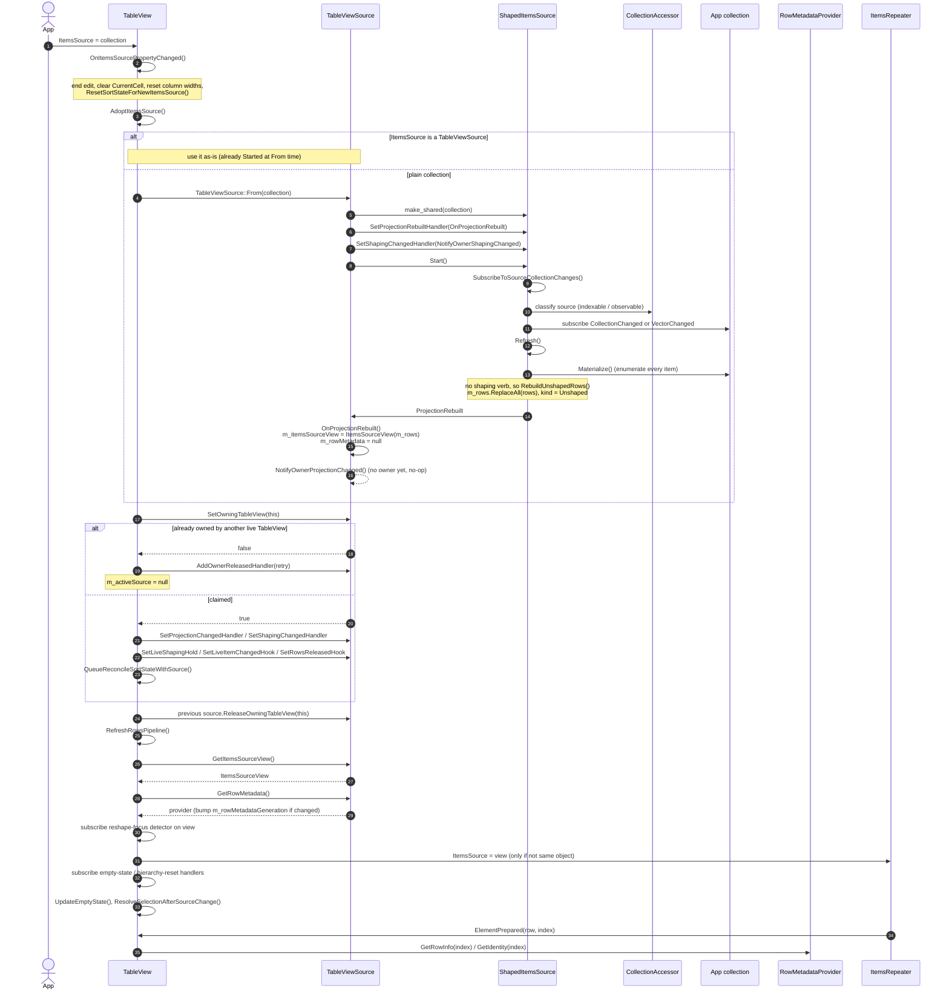
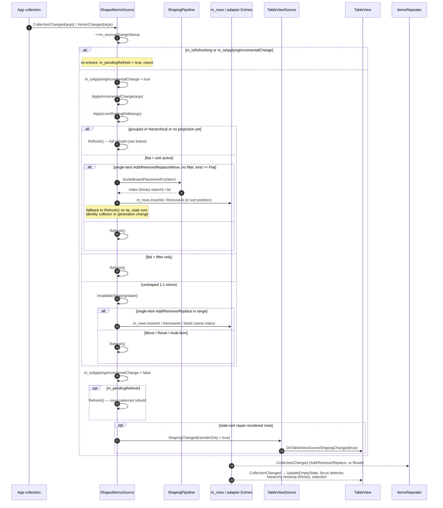
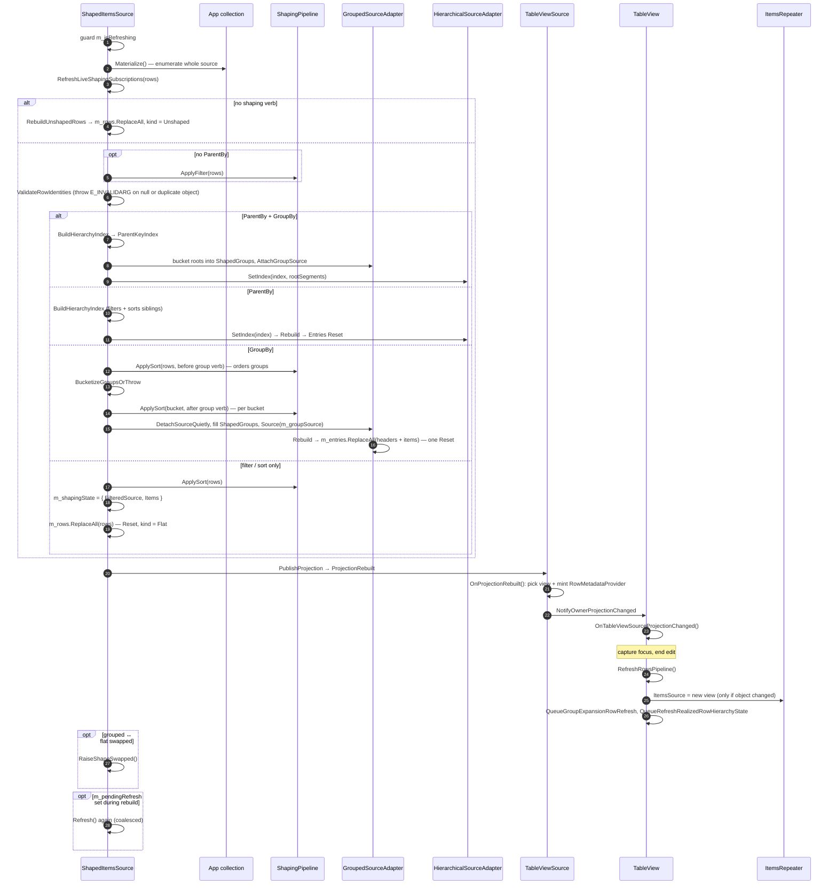
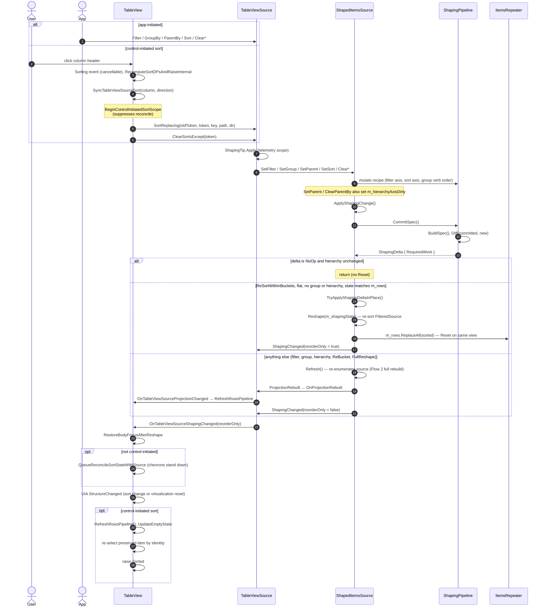
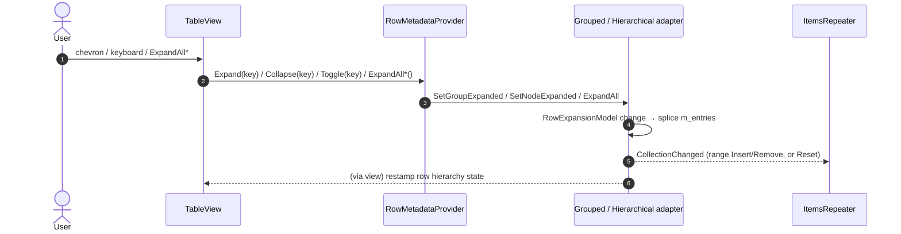

# TableView data pipeline — current structure

This note describes how data currently gets from an app's collection to TableView rows. It covers
the class structure and three runtime flows:

1. The source is set (`TableView.ItemsSource` assigned).
2. The source raises a change notification.
3. The shaping changes (filter, sort, group, hierarchy).

It describes the code as it is, not a proposed design. For hierarchy details, see
[Hierarchical-Data-Rows-Parent-Key-Design.md](Hierarchical-Data-Rows-Parent-Key-Design.md). For the public API, see
[TableView-spec.md](../../api-specs/TableView/TableView-spec.md). For the grouping and sort
ownership rules, see [TableView-dev-spec.md](TableView-dev-spec.md).

## Layering

The pipeline is split into layers. Each layer may depend only on the layers below it.

| Layer | Component | Folder | Responsibility |
|---|---|---|---|
| 4 — control | `TableView` | `controls/dev/TableView` | Owns the active source, drives `PART_RowsRepeater`, selection, focus, editing, UIA. |
| 4 — control face | `TableViewSource` | `controls/dev/TableView` | Public fluent verbs. Turns the engine's projection into an `ItemsSourceView` and a row-metadata provider. Notifies the owning `TableView`. |
| 4 — row semantics | `RowMetadataProvider` | `controls/dev/TableView` | Describes each projected row: kind, level, identity, expansion, group membership. |
| 3 — adapters | `GroupedSourceAdapter`, `HierarchicalSourceAdapter` | `controls/dev/GroupedSourceAdapter`, `controls/dev/HierarchicalSourceAdapter` | Turn groups or a tree index into one flat, observable row list (`Entries()`), and apply expand and collapse. |
| 2 — live projection | `ShapedItemsSource` | `controls/dev/ShapedItemsSource` | Subscribes to the source, materializes it, applies the recipe, keeps the projection current under change, picks the incremental or full-rebuild path. |
| 2 — recipe | `ShapingPipeline` | `controls/dev/TabularShaping` | The ordered list of verbs currently in force, as filter and sort axes plus the group verb's position. Builds and diffs specs. |
| 1 — values and helpers | `ShapingSpec`, `ShapingDelta`, `ShapingState`, `Reshape`, `CollectionAccessor`, `ParentKeyIndex`, `RowExpansionModel`, `StableSortByKeys`, `BucketizeToGroups` | `controls/dev/TabularShaping` | Pure, stateless shaping plus value types. |

`TableViewSource2` (`controls/dev/TableViewSource2`) is a stub with the same verb surface. It is not
connected to this pipeline yet.

## Class diagram

```mermaid
classDiagram
    direction TB

    class TableView {
        <<layer 4 control>>
        -tracker_ref~TableViewSource~ m_activeSource
        -ItemsSourceView m_rowsItemsSourceView
        -TableViewRowMetadataProvider m_tableViewSourceRowMetadata
        -uint64 m_rowMetadataGeneration
        -TableViewSourceSortBinding m_tableViewSourceSort
        -tracker_ref~ItemsRepeater~ m_rowsRepeater
        +ItemsSource : Object
        -OnItemsSourcePropertyChanged()
        -AdoptItemsSource(reclaim)
        -RefreshRowsPipeline()
        -OnTableViewSourceProjectionChanged()
        -OnTableViewSourceShapingChanged(reorderOnly)
        -SyncTableViewSourceSort(column, direction)
        -ReconcileSortStateWithSource()
    }

    class ItemsRepeater {
        <<XAML>>
        +ItemsSource : Object
        +ItemsSourceView : ItemsSourceView
        ElementPrepared / ElementClearing
    }

    class TableViewSource {
        <<layer 4 WinRT, ReferenceTracker>>
        -shared_ptr~ShapedItemsSource~ m_engine
        -tracker_ref~ItemsSourceView~ m_itemsSourceView
        -TableViewRowMetadataProvider m_rowMetadata
        -weak_ref m_owningTableView
        -function m_projectionChanged
        -function m_shapingChanged
        +From(items)$ TableViewSource
        +Filter(predicate)
        +GroupBy(keySelector, identitySelector)
        +ParentBy(keySelector, parentKeySelector)
        +Sort(keySelector or path, direction)
        +SortReplacing(prevToken, token, key, path, direction)
        +ClearFilter() / ClearGroupBy() / ClearParentBy()
        +ClearSort() / ClearSort(token) / ClearSortsExcept(token)
        +IsLiveShaping : bool
        +GetItemsSourceView() ItemsSourceView
        +GetRowMetadata() TableViewRowMetadataProvider
        +SetOwningTableView(owner) bool
        +ReleaseOwningTableView(owner)
        -OnProjectionRebuilt()
        -NotifyOwnerProjectionChanged()
        -NotifyOwnerShapingChanged(reorderOnly)
    }

    class ITableViewRowMetadataProvider {
        <<interface>>
        +GetRowInfo(index) TableViewRowInfo
        +GetIdentity(index) hstring
        +TryGetIndexForIdentity(identity, index) bool
        +Expand(key) / Collapse(key) / Toggle(key)
        +ExpandAllGroups() / CollapseAllGroups()
        +ExpandAllRows() / CollapseAllRows()
        +IsHierarchicalSource() bool
        +TryGetGroupMembership(rows, index, pos, size) bool
    }

    class RowMetadataProvider {
        <<layer 4>>
        -SourceKind m_sourceKind
        -ItemsSourceView m_flatRows
        -GroupedSourceAdapterPtr m_groupedAdapter
        -HierarchicalSourceAdapterPtr m_hierarchicalAdapter
        -map m_identityToIndex
        +CreateForFlatRows(rows, keySelector)$
        +CreateForGroupedRows(adapter, keySelector)$
        +CreateForHierarchicalRows(adapter, keySelector)$
        +CreateForGroupedHierarchicalRows(grouped, hierarchical, keySelector)$
    }

    class TableViewRowInfo {
        <<struct>>
        Kind : Data or GroupHeader
        Level : int
        IsExpandable : bool
        IsExpanded : bool
        ChildCount : int
        ParentIdentity : hstring
        PositionInSet / SizeOfSet
    }

    class ShapedItemsSource {
        <<layer 2 live projection>>
        -IInspectable m_source
        -CollectionAccessor m_sourceAccessor
        -CollectionChanged_revoker m_sourceCollectionChangedRevoker
        -VectorChanged_revoker m_sourceVectorChangedRevoker
        -VectorChanged_revoker m_sourceBindableVectorChangedRevoker
        -ShapingPipeline m_pipeline
        -ShapingState m_shapingState
        -ProjectionKind m_kind
        -IObservableVector m_rows
        -IObservableVector m_groupSource
        -map m_groupCache
        -KeySelector m_groupSelector
        -KeySelector m_keySelector
        -KeySelector m_parentKeySelector
        -shared_ptr~GroupedSourceAdapter~ m_groupedAdapter
        -shared_ptr~HierarchicalSourceAdapter~ m_hierarchicalAdapter
        -shared_ptr~LiveShapingTracker~ m_liveShaping
        -flat identity set + index map
        -bool m_isRefreshing / m_isApplyingIncrementalChange / m_pendingRefresh
        +Start()
        +SetFilter() / SetSort() / SetGroup() / SetParent()
        +ClearFilter() / ClearSorts() / ClearGroup() / ClearParentBy()
        +Refresh()
        +Kind() ProjectionKind
        +Rows() IObservableVector
        +GroupedAdapter() / HierarchicalAdapter()
        +SetLiveShaping(bool)
        -SubscribeToSourceCollectionChanges()
        -UnsubscribeFromSourceCollectionChanges()
        -OnSourceCollectionChanged(args)
        -OnSourceCollectionChanged()
        -OnSourceVectorChanged(args)
        -ApplyIncrementalChange(args)
        -TryApplyIncrementalSortedChange(args) bool
        -ApplyShapingChange()
        -TryApplyShapingDeltaInPlace(delta) bool
        -RebuildFlat / RebuildGrouped / RebuildHierarchical
        -RebuildGroupedHierarchical / RebuildUnshapedRows
        -PublishProjection()
    }

    class ProjectionKind {
        <<enum>>
        None
        Unshaped
        Flat
        Grouped
        Hierarchical
        GroupedHierarchical
    }

    class ShapingPipeline {
        <<layer 2 recipe>>
        -vector~FilterAxis~ m_filters
        -vector~SortAxis~ m_sorts
        -int m_groupOrder
        -ShapingSpec m_committedSpec
        +SetFilter(token, predicate)
        +SetSort(prevToken, token, key, identity, path, direction)
        +MarkGroupVerb(key) int
        +ApplyFilter(rows)
        +ApplySort(rows, afterOrder, beforeOrder)
        +SortedInsertPlacementFor(item, count, getRow)
        +BuildSpec() ShapingSpec
        +CommitSpec() ShapingDelta
    }

    class ShapingSpec {
        <<layer 1 value>>
        Filters : FilterDescription[]
        Groups : GroupDescription[]
        Sorts : SortDescription[]
        +Diff(next) ShapingDelta
    }

    class ShapingDelta {
        <<layer 1 value>>
        FilterChanged / GroupingChanged / SortChanged
        RequiredWork : None, ReSortWithinBuckets, ReBucket, FullReshape
    }

    class ShapingState {
        <<layer 1 value>>
        FilteredSource : items in source order
        Items : shaped output
        Buckets : KeyedBucket[]
        HasProjection : bool
    }

    class CollectionAccessor {
        <<layer 1>>
        +IsIndexable() bool
        +IsObservable() bool
        +Count() / TryGetAt() / Enumerate()
        +AsNotifyCollectionChanged()
        +AsObservableVector()
        +AsBindableObservableVector()
    }

    class LiveShapingTracker {
        <<layer 2>>
        per-item INotifyPropertyChanged subscriptions
    }

    class ShapedGroup {
        <<ICollectionViewGroup>>
        +Group() key
        +GroupItems() IObservableVector
        +GroupKey() identity
    }

    class GroupedSourceAdapter {
        <<layer 3>>
        -IInspectable m_source
        -IObservableVector m_entries
        -ItemsSourceView m_entriesView
        -RowExpansionModel m_expansion
        +Source(groups)
        +DetachSourceQuietly()
        +Entries() ItemsSourceView
        +SetGroupExpanded(group, bool)
        +ExpandAll() / CollapseAll()
        -Rebuild()
    }

    class GroupedEntry {
        <<group header row>>
    }

    class HierarchicalSourceAdapter {
        <<layer 3>>
        -shared_ptr~ParentKeyIndex~ m_index
        -IObservableVector m_entries
        -ItemsSourceView m_entriesView
        -vector~NodeRow~ m_descriptors
        -RowExpansionModel m_expansion
        +SetIndex(index, rootSegments)
        +ClearIndex()
        +Entries() ItemsSourceView
        +SetNodeExpanded(key, bool)
        +ExpandAll() / CollapseAll() / ExpandSubtree(key)
        +TryGetNodeRow(index) NodeRow
        -Rebuild()
    }

    class ParentKeyIndex {
        <<layer 1, immutable>>
        validated parent-child structure
        filtered and sorted sibling lists
    }

    class RowExpansionModel {
        <<layer 1>>
        expansion intent per key
    }

    TableView "1" *-- "0..1" TableViewSource : m_activeSource (strong)
    TableViewSource ..> TableView : weak owner + handlers
    TableView --> ItemsRepeater : sets ItemsSource
    TableView --> ITableViewRowMetadataProvider : caches
    ItemsRepeater --> TableViewSource : reads ItemsSourceView

    TableViewSource "1" *-- "1" ShapedItemsSource : m_engine
    TableViewSource --> RowMetadataProvider : mints on every rebuild
    RowMetadataProvider ..|> ITableViewRowMetadataProvider
    ITableViewRowMetadataProvider ..> TableViewRowInfo : returns

    ShapedItemsSource *-- ShapingPipeline
    ShapedItemsSource *-- ShapingState
    ShapedItemsSource *-- CollectionAccessor
    ShapedItemsSource *-- LiveShapingTracker
    ShapedItemsSource --> ProjectionKind
    ShapedItemsSource "1" *-- "0..*" ShapedGroup : m_groupCache
    ShapedItemsSource "1" *-- "0..1" GroupedSourceAdapter
    ShapedItemsSource "1" *-- "0..1" HierarchicalSourceAdapter
    ShapedItemsSource ..> ParentKeyIndex : builds

    ShapingPipeline ..> ShapingSpec : builds and commits
    ShapingSpec ..> ShapingDelta : Diff()

    GroupedSourceAdapter --> ShapedGroup : observes m_groupSource
    GroupedSourceAdapter *-- RowExpansionModel
    GroupedSourceAdapter ..> GroupedEntry : creates header rows
    HierarchicalSourceAdapter --> ParentKeyIndex : projects
    HierarchicalSourceAdapter *-- RowExpansionModel

    RowMetadataProvider --> GroupedSourceAdapter
    RowMetadataProvider --> HierarchicalSourceAdapter
```

### What the repeater is bound to, per projection kind

`TableViewSource::OnProjectionRebuilt` maps the engine's `ProjectionKind` to the view the repeater
consumes and the metadata provider the control reads.

| `ProjectionKind` | `ItemsSourceView` handed to the repeater | Row metadata provider |
|---|---|---|
| `None` | `null` | `null` |
| `Unshaped` (no verbs) | `ItemsSourceView{ m_rows }`, a 1:1 mirror of the source | `null`, because there is no shaped identity |
| `Flat` (filter and/or sort) | `ItemsSourceView{ m_rows }` | `CreateForFlatRows` |
| `Grouped` | `GroupedSourceAdapter::Entries()` (header rows interleaved with items) | `CreateForGroupedRows` |
| `Hierarchical` | `HierarchicalSourceAdapter::Entries()` (visible nodes) | `CreateForHierarchicalRows` |
| `GroupedHierarchical` | `GroupedSourceAdapter::Entries()` (group buckets contain roots and their expanded subtrees) | `CreateForGroupedHierarchicalRows` |

Under `Grouped`, `Hierarchical` and `GroupedHierarchical`, `m_rows` is still kept up to date as
the flat shaped data, without header rows and ignoring expansion. It is not what the repeater
displays.

### Ownership and lifetime notes

- **One pipeline.** `TableView` always goes through a `TableViewSource`. A plain collection is
  wrapped with `TableViewSource::From(items)` in `AdoptItemsSource`.
- **Single owner.** `SetOwningTableView` refuses a second live `TableView`. The refused table
  registers an owner-released waiter and retries when the first owner releases the source.
- **Calls go up through handlers.** `TableViewSource` does not reference `TableView` by name. The
  owner installs handlers for projection changed, shaping changed, live-shaping hold,
  live-item-changed and rows released, and the source holds only a weak pointer to the owner.
  `ShapedItemsSource` reports to `TableViewSource` the same way.
- **UI-thread affinity.** `TableViewSource` is a `ReferenceTracker`, so teardown is marshaled to
  the UI thread. `ShapedItemsSource` requires source notifications to arrive on the UI thread. The
  only marshaling it does is for off-thread `PropertyChanged` under live shaping.

## Flow 1 — the source is set

The flow starts when `TableView.ItemsSource` is assigned. On `OnApplyTemplate`, a repeater
`Loaded`, or `ReclaimItemsSource`, only `RefreshRowsPipeline` runs.

Key points:

- **The source is enumerated once, at `Start()`.** `Materialize` calls
  `EnumerateInspectableItems(source)` and copies every item into `m_rows`. Every later full rebuild
  enumerates the source again.
- **The first projection is observed like any other.** The handlers are installed before `Start()`.
- **A plain collection has no shaped identity.** It produces an `Unshaped` projection with a null
  metadata provider. Shaped identity and row metadata appear once a verb is applied.
- **The repeater is guarded.** It is reassigned only when the view object actually changes,
  because reassigning tears down every realized container.

## Flow 2 — the source raises a change notification

The engine subscribes to whichever notification interface `CollectionAccessor` resolves first:
`INotifyCollectionChanged`, then `IObservableVector<IInspectable>`, then
`IBindableObservableVector`. A non-observable source is never re-read on its own. Silent edits stay
invisible until the next verb or `Refresh`.

### Full rebuild (`Refresh`) path

Every fallback above ends here, and so does every non-in-place shaping change.

Key points:

- **Incremental paths are narrow.** In-place splices happen only for:
  - single-item changes on an unshaped mirror (same index);
  - single-item changes on a sorted flat projection without a filter (binary-search placement).

  Everything else re-enumerates the whole source. That includes every change under a filter,
  grouping or hierarchy, every `Move`, `Reset` and multi-item change, and every `VectorChanged`
  while any verb is active.
- **Re-entrancy is coalesced.** A notification that arrives during `Refresh` or during an
  incremental apply sets `m_pendingRefresh`. Exactly one rebuild runs after the outer operation
  unwinds.
- **Live shaping is a separate trigger.** With `IsLiveShaping` on, `LiveShapingTracker` watches each
  item's `PropertyChanged`. A change to a sort key, group key, filter result or parent edge marks
  the projection dirty and posts one `RestoreLiveShaping` to the dispatcher. That calls `Refresh()`
  and then raises `ShapingChanged(false)`. While a cell editor is open the restore is held, and
  `ResumeHeldLiveShaping` releases it.
- **Sort-key tracking applies without live shaping.** With a sort active and live shaping off,
  `PropertyChanged` on a sort-key property only marks the row dirty. The row is repaired on the
  next collection change (`TryReshapeStaleSortedFlatProjection`).

## Flow 3 — shaping changes

A shaping change can come from the app calling a fluent verb on `TableViewSource`, or from the
control: a column header click goes through `SyncTableViewSourceSort`, and expand and collapse
go through the metadata provider.

### Expand and collapse

Expand and collapse are not shaping verbs. They do not go through `ShapedItemsSource`.

Key points:

- **Two exits.** `ApplyShapingChange` ends in one of two ways:
  - The in-place re-sort keeps the same `ItemsSourceView`. The repeater sees a `Reset` and the
    source is not re-enumerated.
  - `Refresh()` re-enumerates the source, rebuilds, and mints a new metadata provider, and may swap
    the view object.
- **Only a flat, ungrouped, sort-only change is in place.** A grouped re-sort, a filter change, any
  group change and any hierarchy change all take the `Refresh()` path.
- **The diff is conservative.** Every declaration mints a fresh description id. Re-declaring the
  same verb therefore reads as a change, never as a no-op. Only a `Clear*` with nothing to clear is
  a no-op.
- **Who owns the sort.** The control owns one tokenized axis (`m_tableViewSourceSort`). If the app
  declares or clears a sort directly, `ReconcileSortStateWithSource` drops the control's axis and
  clears every column's `SortDirection`, so the last writer wins.
- **The hierarchy axis is outside the spec diff.** `m_hierarchyAxisDirty` makes a `ParentBy` or
  `ClearParentBy` call force a rebuild.

## Where the source is enumerated (summary)

| Trigger | Re-enumerates source? | Notes |
|---|---|---|
| `ItemsSource` set or `From(items)` | Yes, once | `Start()` → `Refresh()` |
| Single-item change, unshaped | No | Index splice |
| Single-item change, sorted flat, no filter | No | Binary-search splice |
| Any other collection change | Yes | `Refresh()` |
| Live-shaping `PropertyChanged` | Yes | Posted `RestoreLiveShaping` → `Refresh()` |
| Sort-only change, flat, ungrouped | No | Re-sort of retained `FilteredSource` |
| Filter / group / hierarchy change, grouped re-sort | Yes | `Refresh()` |
| Expand / collapse | No | Adapter splice |
| Silent edit to a non-observable source | No | Not detected |

## Source files

| Component | Files |
|---|---|
| Control | `controls/dev/TableView/TableView.{h,cpp}`, `TableView_Sort.cpp`, `TableView_Grouping.cpp` |
| Control face | `controls/dev/TableView/TableViewSource.{idl,h,cpp}` |
| Row semantics | `controls/dev/TableView/RowMetadataProvider.{h,cpp}`, `TableViewRowInfo.h` |
| Live projection | `controls/dev/ShapedItemsSource/ShapedItemsSource.{h,cpp}`, `ShapedGroup.h`, `LiveShapingTracker.h`, `RowIdentity.h` |
| Adapters | `controls/dev/GroupedSourceAdapter/*`, `controls/dev/HierarchicalSourceAdapter/*` |
| Recipe and layer 1 | `controls/dev/TabularShaping/ShapingPipeline.*`, `ShapingDescriptions.*`, `ShapingHelpers.*`, `ParentKeyIndex.*`, `RowExpansionModel.*` |
